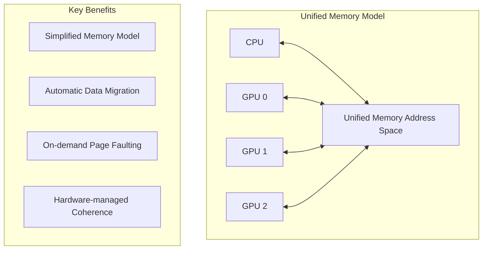
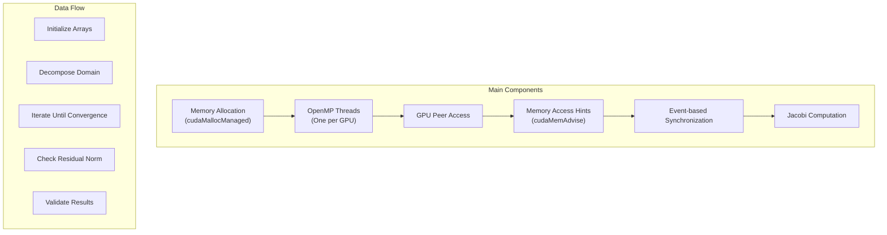
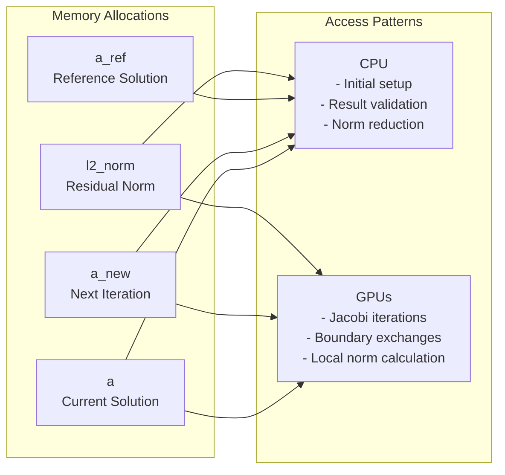
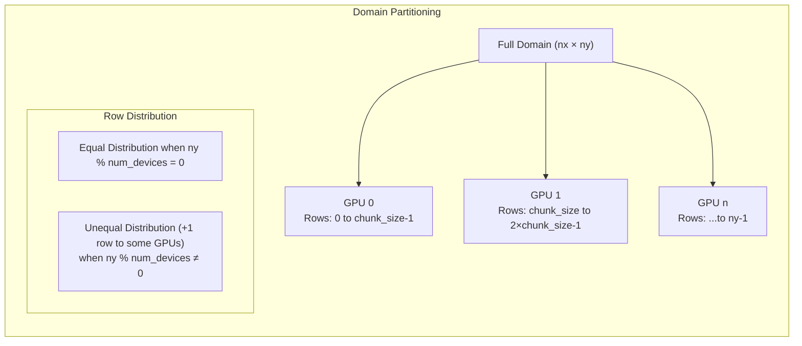
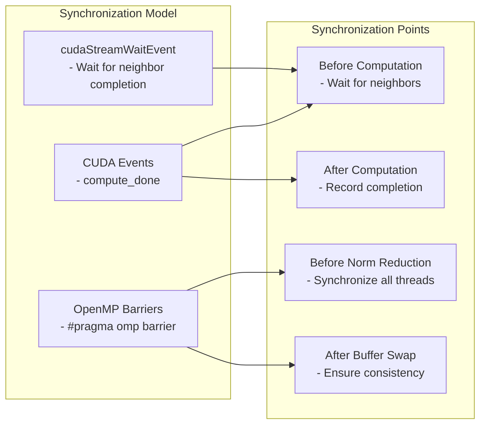

<!-- source: DeepWiki mcp.deepwiki.com · repo NVIDIA/multi-gpu-programming-models · extra page Unified Memory · fetched 2026-10-26 -->

# Unified Memory

<details>
<summary>Relevant source files</summary>

The following files were used as context for generating this wiki page:

- [multi_threaded_um/Makefile](multi_threaded_um/Makefile)
- [multi_threaded_um/jacobi.cu](multi_threaded_um/jacobi.cu)

</details>


This page documents the Unified Memory implementation of the Jacobi solver in the multi-GPU programming models repository. This implementation leverages CUDA's Unified Memory feature to simplify memory management across multiple GPUs while maintaining high performance. For other inter-GPU communication approaches, see [Direct GPU-to-GPU Communication](#3.2).

## Introduction to Unified Memory

Unified Memory is a CUDA programming model that provides a single, coherent memory space accessible by both CPU and GPU. Memory is automatically migrated between host and device as needed, eliminating the need for explicit memory transfers.



Sources: [multi_threaded_um/jacobi.cu:178-179]()

## Implementation Architecture

The multi-threaded Unified Memory implementation builds on the OpenMP threading model, but replaces explicit memory management with Unified Memory allocations. Each GPU operates on its portion of the domain, with the CPU coordinating the overall computation.



Sources: [multi_threaded_um/jacobi.cu:176-179](), [multi_threaded_um/jacobi.cu:202-372]()

## Memory Management

The implementation uses `cudaMallocManaged` for all primary data structures. This creates memory allocations that are accessible by all GPUs and the CPU without explicit transfers.

### Key Allocations



Sources: [multi_threaded_um/jacobi.cu:166-179](), [multi_threaded_um/jacobi.cu:270-274]()

## Memory Access Optimization

The implementation includes optional memory access hints to optimize data locality and reduce page faults:

### Memory Advice Hints (Optional)

When compiled with `UM_HINTS` defined, the implementation uses `cudaMemAdvise` to provide hints to the CUDA runtime about memory access patterns:

1. **Preferred Location**: Each GPU's primary computation region is set to prefer that GPU's memory
2. **Accessed By**: Boundary regions are marked as accessed by neighboring GPUs

These hints help reduce page faults and migration overhead during execution.

Sources: [multi_threaded_um/jacobi.cu:250-263]()

## Domain Decomposition

The 2D domain is partitioned horizontally into strips, with each GPU assigned a contiguous set of rows:



The implementation uses a balanced load distribution algorithm that handles cases where the number of rows doesn't divide evenly by the number of GPUs. This is handled in lines 211-223 of jacobi.cu.

Sources: [multi_threaded_um/jacobi.cu:210-235]()

## Peer Access Configuration

The implementation enables peer access between GPUs where hardware supports it:

1. Each GPU enables access to its "top" neighbor (previous GPU or the last GPU if it's GPU 0)
2. Each GPU enables access to its "bottom" neighbor (next GPU or GPU 0 if it's the last GPU)

This creates a ring topology where each GPU can directly access its neighbors' memory.

Sources: [multi_threaded_um/jacobi.cu:237-248]()

## Synchronization Mechanism

The implementation uses CUDA events and OpenMP barriers for synchronization:



The implementation uses two sets of events (`compute_done[0]` and `compute_done[1]`) that alternate between iterations to ensure proper ordering of operations.

Sources: [multi_threaded_um/jacobi.cu:276-277](), [multi_threaded_um/jacobi.cu:295-296](), [multi_threaded_um/jacobi.cu:302-303]()

## Computation Kernel

The `jacobi_kernel` implements the core computation:

1. Each thread computes a single point in the 2D grid
2. The stencil computation uses values from neighboring points (north, south, east, west)
3. Optionally calculates the local contribution to the global L2 norm
4. Uses block reduction (with CUB when available) to efficiently compute local sums

Sources: [multi_threaded_um/jacobi.cu:98-135](), [multi_threaded_um/jacobi.cu:299-300]()

## Boundary Handling

The implementation includes special handling for boundary conditions:

1. **Dirichlet boundaries**: Fixed values on left and right edges (initialized once at the beginning)
2. **Periodic boundaries**: Top and bottom rows are treated as connected

For periodic boundaries, the implementation includes logic to wrap around the domain (lines 115-120 in the kernel).

Sources: [multi_threaded_um/jacobi.cu:86-95](), [multi_threaded_um/jacobi.cu:115-120]()

## Convergence Checking

The L2 norm of the residual is computed periodically to check for convergence:

1. Each GPU computes its local contribution to the norm
2. Results are atomically added to a shared variable
3. The master thread takes the square root to get the final norm
4. The solver terminates when the norm falls below tolerance or maximum iterations are reached

Sources: [multi_threaded_um/jacobi.cu:305-323]()

## Compilation and Execution

The implementation is compiled with OpenMP support and optional CUB for optimized reductions:

```bash
nvcc -Xcompiler -fopenmp -DHAVE_CUB jacobi.cu -o jacobi
```

Additional compilation flags include:
- `-DUM_HINTS` to enable memory access hints
- `-DUSE_NVTX` to enable NVIDIA Tools Extension profiling markers

Sources: [multi_threaded_um/Makefile:16-18]()

## Advantages and Limitations

### Advantages
- Simplified memory management without explicit transfers
- Automatic handling of data coherence
- Reduced code complexity compared to explicit P2P implementations

### Limitations
- Potential performance overhead from page faults and data migrations
- Limited control over when data movement occurs
- Performance depends on hardware support for unified memory

## Performance Considerations

For best performance with Unified Memory:
1. Use memory advice hints when possible
2. Enable peer access between GPUs
3. Structure access patterns to minimize page faults
4. Consider using prefetching for predictable access patterns

---

