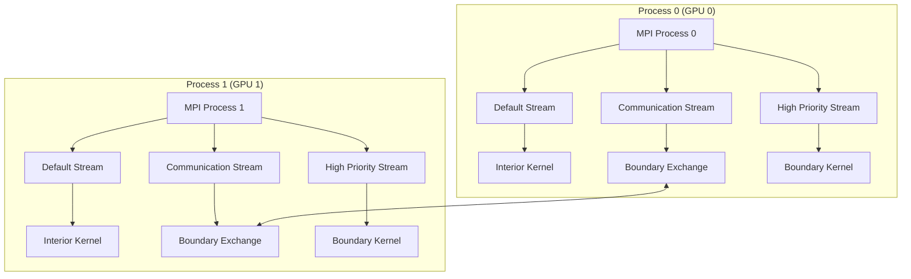
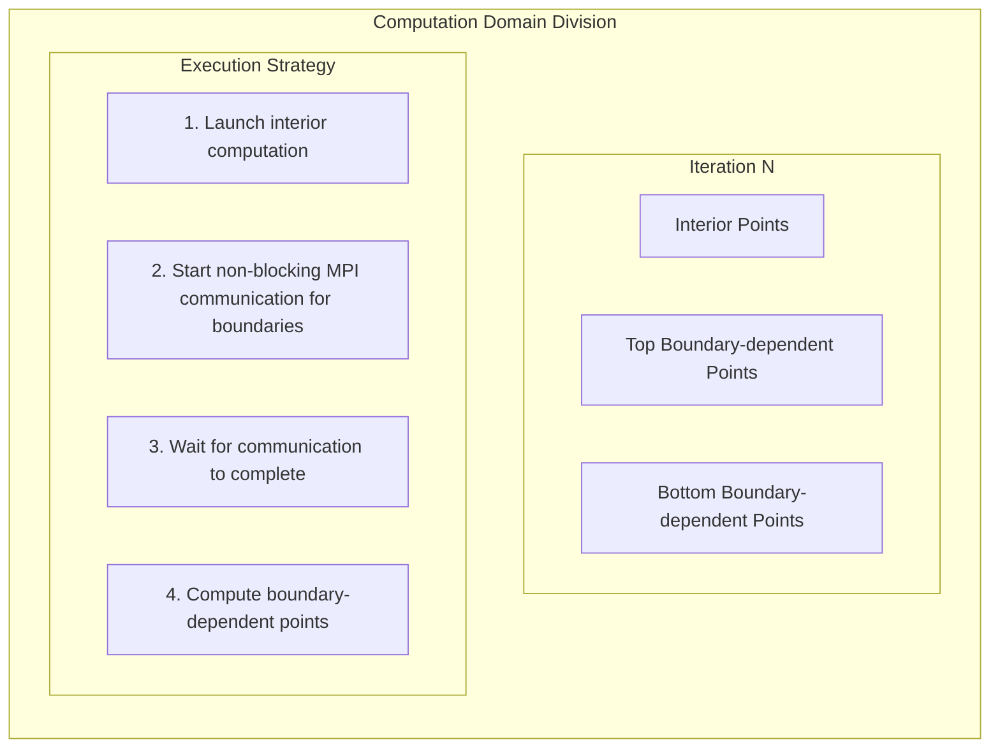
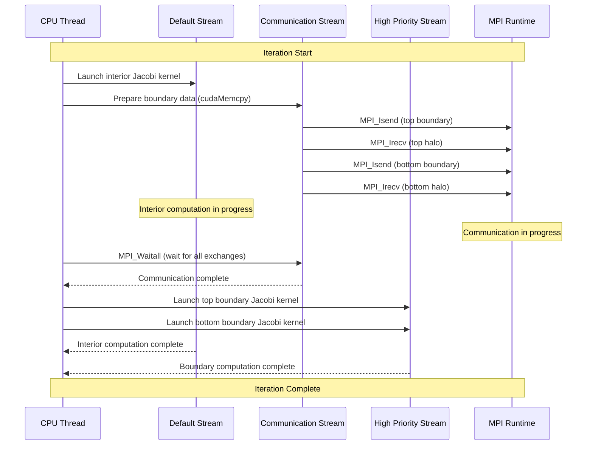

<!-- source: DeepWiki mcp.deepwiki.com · repo NVIDIA/multi-gpu-programming-models · extra page MPI with Computation-Communication Overlap · fetched 2026-10-26 -->

# MPI with Computation-Communication Overlap

<details>
<summary>Relevant source files</summary>

The following files were used as context for generating this wiki page:

- [mpi/jacobi_kernels.cu](mpi/jacobi_kernels.cu)
- [mpi_overlap/Makefile](mpi_overlap/Makefile)
- [multi_threaded_copy_overlap/Makefile](multi_threaded_copy_overlap/Makefile)

</details>


This page details the optimized MPI implementation that overlaps computation and communication to hide communication latency in multi-GPU Jacobi solvers. For information about the basic MPI implementation without overlap, see [MPI Implementation](#3.3.1).

## Purpose

The MPI with computation-communication overlap implementation demonstrates how to:

1. Use non-blocking MPI communication to exchange boundary data between GPUs
2. Employ multiple CUDA streams to parallelize interior computation and boundary exchanges
3. Hide communication latency by performing useful computation while data transfers are in progress

This approach significantly improves performance compared to the basic MPI implementation, especially when the communication overhead is substantial relative to computation time.

Sources: [mpi_overlap/Makefile:1-5]()

## Concept of Computation-Communication Overlap

In traditional MPI implementations, computation and communication occur sequentially:
1. Compute on all data
2. Exchange boundaries with neighbors (communication)
3. Wait for communication to complete
4. Start next iteration

This creates idle GPU time during communication phases. The overlap pattern modifies this sequence to:
1. Start non-blocking boundary exchange with neighbors
2. Compute on interior points (not dependent on boundary data)
3. Wait for communication to complete
4. Compute on boundary-dependent points
5. Start next iteration

```mermaid
gantt
    title Traditional vs Overlapped Execution
    dateFormat s
    axisFormat %S
    
    section Traditional
    Computation      :a1, 0, 2s
    Communication    :a2, after a1, 1s
    Wait             :a3, after a2, 0.2s
    Next Computation :a4, after a3, 2s
    
    section Overlapped
    Start Communication :b1, 0, 0.1s
    Interior Computation :b2, after b1, 1.5s
    Wait Communication  :b3, after b2, 0.2s
    Boundary Computation :b4, after b3, 0.5s
    Next Iteration      :b5, after b4, 0.1s
```



Sources: [mpi/jacobi_kernels.cu:105-116]()

## Implementation Architecture

The MPI with overlap implementation divides the domain into interior and boundary regions and processes them separately to enable overlapping. The implementation uses multiple CUDA streams to achieve this parallelism.



Sources: [mpi_overlap/Makefile:24-30]()

## Key Components

### Multiple CUDA Streams

The implementation uses three CUDA streams per MPI process:

1. **Default Stream**: Handles the main computation on interior points
2. **Communication Stream**: Manages data exchange with other MPI processes
3. **High-Priority Stream**: Processes boundary-dependent computations once communication completes

The high-priority stream ensures that boundary computations occur as soon as possible once boundary data is available.

Sources: [mpi_overlap/Makefile:24-27](), [mpi/jacobi_kernels.cu:106-115]()

### Domain Decomposition for Overlap

The computational domain is partitioned to facilitate the overlap pattern:



The Jacobi kernel is launched with different parameters to process different regions:

1. **Interior kernel**: Processes all points except those dependent on boundaries from neighboring GPUs
2. **Boundary kernels**: Process points that depend on halo data received from neighbors

Sources: [mpi/jacobi_kernels.cu:74-104]()

### Non-blocking MPI Communication

The implementation uses non-blocking MPI communication functions:

1. `MPI_Isend`: Start asynchronous send operations without waiting for completion
2. `MPI_Irecv`: Start asynchronous receive operations without waiting for completion
3. `MPI_Waitall`: Wait for all communications to complete when necessary

These non-blocking operations allow the code to continue execution (compute on interior points) while data transfers are in progress.

Sources: [mpi_overlap/Makefile:24-30]()

## Implementation Workflow

The main execution flow follows these steps:



Sources: [mpi/jacobi_kernels.cu:105-116]()

## Performance Considerations

### When Overlap is Most Beneficial

The computation-communication overlap pattern provides the most benefit when:

1. Communication time is significant relative to computation time
2. There is enough interior computation to hide communication latency
3. The problem can be effectively split into interior and boundary regions

### Stream Priority Importance

Setting different priorities for the streams ensures that once communication completes, boundary computations are scheduled immediately:

```
cudaStreamCreateWithPriority(&boundary_stream, cudaStreamNonBlocking, highest_priority);
```

This prevents boundary computations from being delayed behind potentially lengthy interior calculations.

Sources: [mpi_overlap/Makefile:24-30]()

## Implementation Details

### Memory Layout and Boundary Exchange

Each MPI process manages a rectangular subdomain of the overall Jacobi grid. To enable efficient overlap:

1. Memory for boundary exchanges is allocated separately to enable independent handling
2. Explicit CUDA memory operations copy boundary data to/from host buffers for MPI exchange
3. Boundary data is exchanged with neighboring MPI processes using non-blocking operations

### Jacobi Kernel Launch Parameters

The implementation launches the Jacobi kernel with specific parameters to process different regions:

```
// Interior points computation (launched on default stream)
launch_jacobi_kernel(a_new, a, l2_norm, iy_start + 1, iy_end - 1, nx, calculate_norm, stream_default);

// Top boundary computation (launched on high-priority stream)
launch_jacobi_kernel(a_new, a, l2_norm, iy_start, iy_start + 1, nx, calculate_norm, stream_high_priority);

// Bottom boundary computation (launched on high-priority stream)
launch_jacobi_kernel(a_new, a, l2_norm, iy_end - 1, iy_end, nx, calculate_norm, stream_high_priority);
```

The kernel function itself is implemented in [mpi/jacobi_kernels.cu:74-104]() and designed to handle different regions of the grid based on start and end indices.

Sources: [mpi/jacobi_kernels.cu:105-116]()

## Comparison with Basic MPI Implementation

The primary differences between the basic MPI implementation and the MPI with overlap are:

| Feature | Basic MPI | MPI with Overlap |
|---------|-----------|------------------|
| CUDA Streams | Single stream | Multiple streams with priorities |
| Communication | Blocking operations | Non-blocking operations |
| Computation Pattern | Process entire domain at once | Split into interior and boundary regions |
| Execution Model | Sequential (compute→communicate→wait) | Overlapped (communicate→compute interior→wait→compute boundaries) |
| Performance | Limited by communication overhead | Communication overhead partially hidden |

Sources: [mpi_overlap/Makefile:1-46](), [mpi/jacobi_kernels.cu:74-116]()

## Compilation and Execution

The implementation is compiled using:

```
mpicxx $(MPICXX_FLAGS) jacobi.cpp jacobi_kernels.o $(LD_FLAGS) -o jacobi
```

And executed with:

```
mpirun -np $(NP) ./jacobi
```

Where `NP` specifies the number of MPI processes to use (typically matching the number of available GPUs).

Sources: [mpi_overlap/Makefile:28-42]()

## Summary

The MPI with computation-communication overlap implementation demonstrates an advanced technique for optimizing multi-GPU applications. By carefully structuring the computation and using non-blocking communication with multiple CUDA streams, the implementation effectively hides communication latency and achieves better performance than the basic MPI approach. This pattern is particularly valuable for large-scale problems where communication overhead would otherwise limit scalability.

---

