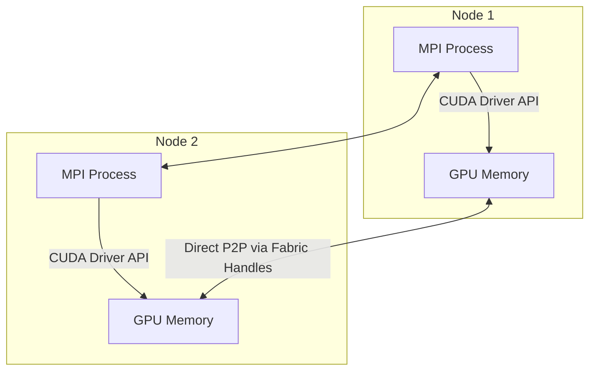
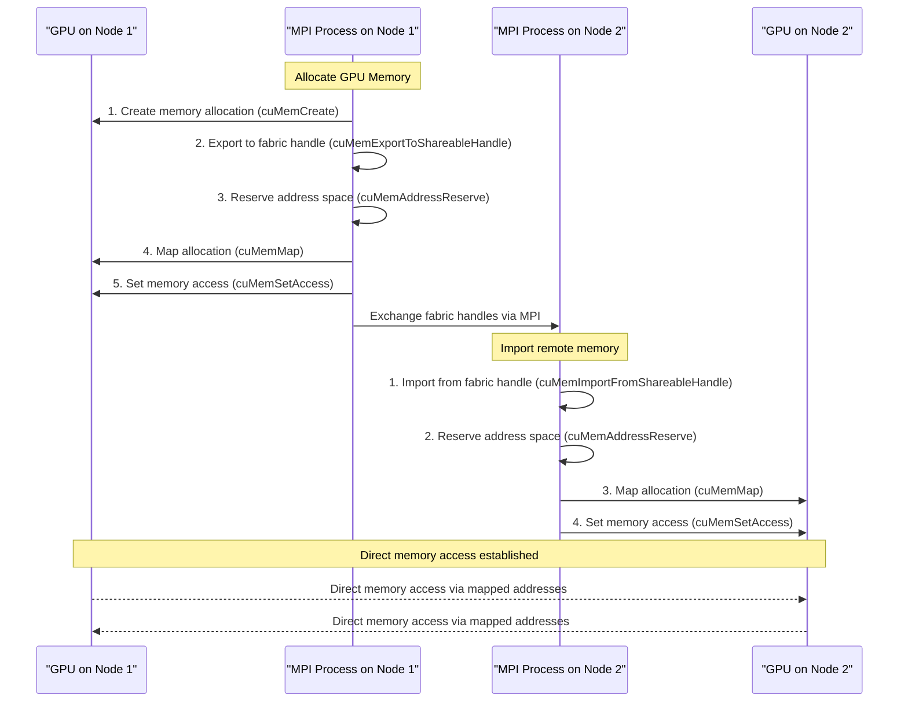
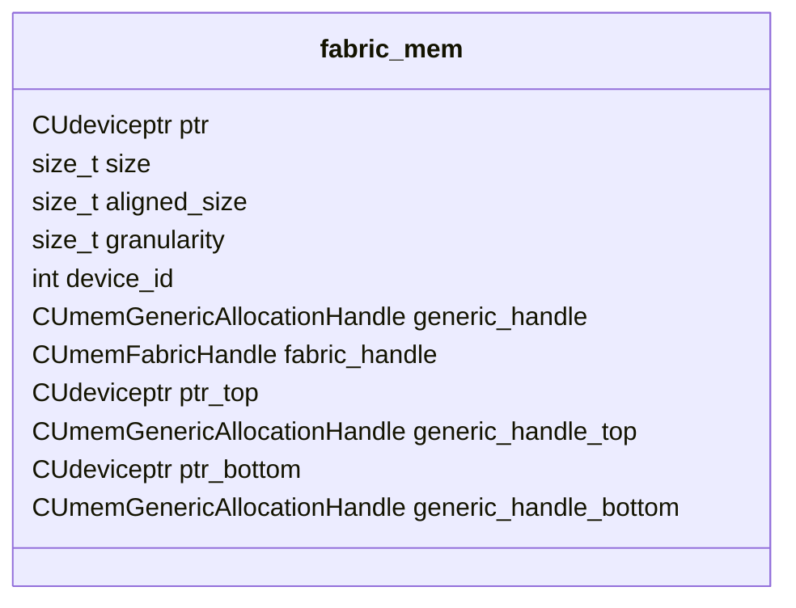
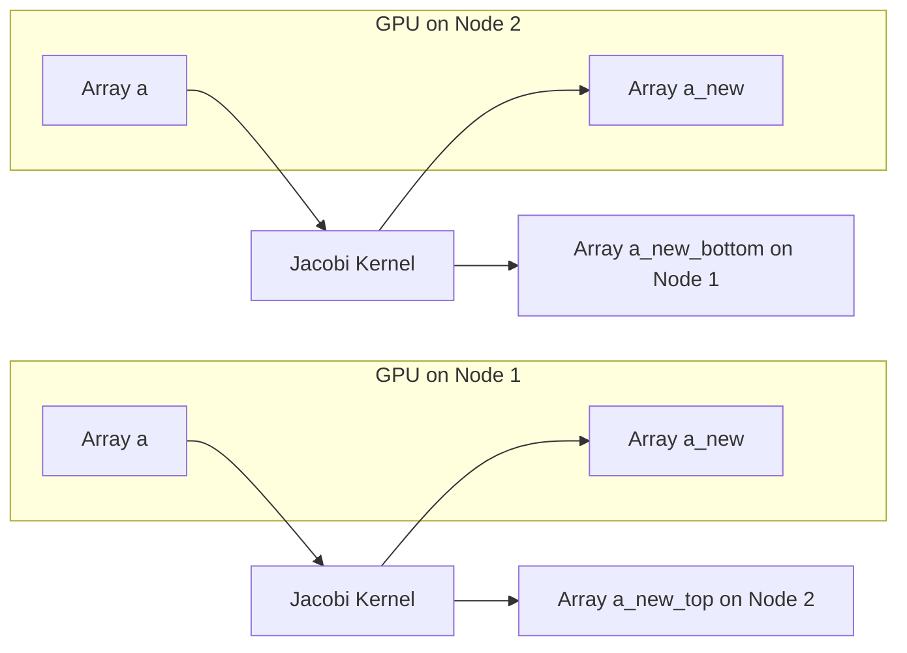
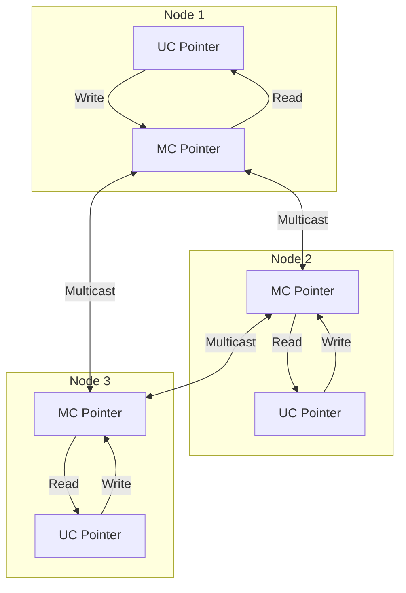
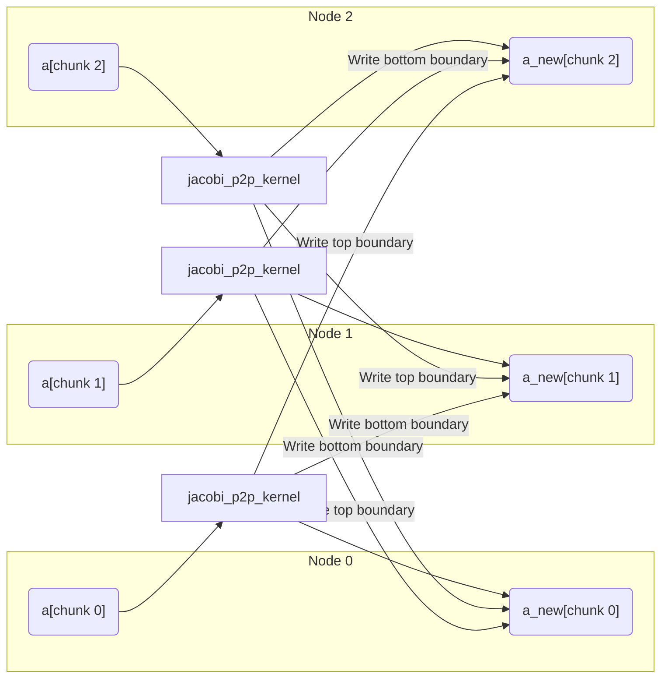
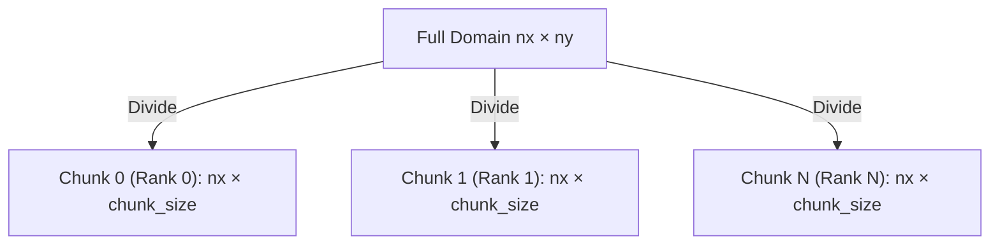

<!-- source: DeepWiki mcp.deepwiki.com · repo NVIDIA/multi-gpu-programming-models · extra page Multi-Node P2P · fetched 2026-10-26 -->

# Multi-Node P2P

Relevant source files

The following files were used as context for generating this wiki page:

- [multi_node_p2p/Makefile](multi_node_p2p/Makefile)
- [multi_node_p2p/jacobi.cpp](multi_node_p2p/jacobi.cpp)
- [multi_node_p2p/jacobi_kernels.cu](multi_node_p2p/jacobi_kernels.cu)

This page documents the Multi-Node P2P (Peer-to-Peer) implementation of the Jacobi solver, which enables direct GPU-to-GPU communication across multiple compute nodes. Unlike single-node multi-GPU implementations which use GPUDirect P2P within a node (see [Multi-Threaded P2P](#3.2.1)), this implementation leverages CUDA Driver APIs with fabric memory handles to establish direct memory access between GPUs across different physical machines.

## Architecture Overview

The Multi-Node P2P implementation combines MPI for process coordination with CUDA Driver APIs for direct GPU memory access across physical nodes. This approach eliminates the need for staging data through host memory when communicating across node boundaries.

Sources: [multi_node_p2p/jacobi.cpp:290-325]()

## Fabric Memory System

The key innovation in this implementation is the use of CUDA fabric memory handles to enable direct GPU memory access across nodes.

Sources: [multi_node_p2p/jacobi.cpp:182-287](), [multi_node_p2p/jacobi.cpp:382-453]()

## Key Components

### 1. Fabric Memory Allocation and Sharing

The implementation uses a `fabric_mem` struct to encapsulate the details of allocatable and shareable GPU memory:

The memory allocation process follows these steps:
1. Create a CUDA memory allocation (cuMemCreate)
2. Export the allocation to a shareable fabric handle (cuMemExportToShareableHandle)
3. Reserve an address range (cuMemAddressReserve)
4. Map the allocation into the address range (cuMemMap)
5. Set access permissions (cuMemSetAccess)

Sources: [multi_node_p2p/jacobi.cpp:182-194](), [multi_node_p2p/jacobi.cpp:213-252]()

### 2. Peer Memory Mapping

To enable direct access to peer GPUs' memory, the implementation:
1. Reserves local address ranges for the remote memory
2. Maps the remote memory into those address ranges
3. Sets appropriate access permissions

This process allows the local GPU to directly read from and write to the remote GPU's memory.

Sources: [multi_node_p2p/jacobi.cpp:260-287]()

### 3. MPI Process Coordination

MPI serves several crucial roles in this implementation:
- Identifying process ranks and distributing work
- Exchanging fabric memory handles between nodes
- Coordinating algorithm phases across nodes
- Optionally reducing norm values for convergence checks

Sources: [multi_node_p2p/jacobi.cpp:290-332](), [multi_node_p2p/jacobi.cpp:416-425]()

### 4. Optimized P2P Jacobi Kernel

The Jacobi kernel is specifically designed to directly write halo data to peer GPU memory:

The `jacobi_p2p_kernel` performs three key operations:
1. Computes new values for the local domain
2. Directly writes boundary data to the mapped memory of neighboring GPUs
3. Calculates partial L2 norm for convergence checks when needed

Sources: [multi_node_p2p/jacobi_kernels.cu:126-183]()

## Multicast Reduction Optimization

An optional optimization uses CUDA Multicast Objects for efficient cross-node reductions of the L2 norm:

This optimization uses:
1. A paired unicast (UC) and multicast (MC) pointer structure
2. A specialized kernel for all-reduce operations using multicast
3. Atomic operations on the GPU to coordinate barrier synchronization

When enabled, this eliminates the need for MPI_Allreduce operations for convergence checking.

Sources: [multi_node_p2p/jacobi.cpp:467-543](), [multi_node_p2p/jacobi_kernels.cu:185-233]()

## Halo Exchange Implementation

The Multi-Node P2P implementation uses a direct halo exchange pattern where each GPU kernel writes its boundary data directly to the memory of its neighbors:

Key aspects:
1. Each process sets up peer memory mappings to its top and bottom neighbors
2. The kernel directly writes boundary data to these mapped regions
3. A cyclic boundary pattern ensures all processes have neighbors

Sources: [multi_node_p2p/jacobi_kernels.cu:142-153](), [multi_node_p2p/jacobi.cpp:416-453]()

## Implementation Details

### Data Distribution

The implementation divides the computational domain into roughly equal chunks across all available MPI ranks:

Each chunk includes additional halo regions for the boundary data, which are updated through direct memory access to neighboring GPUs.

Sources: [multi_node_p2p/jacobi.cpp:364-401]()

### Algorithm Flow

The main iteration loop follows this pattern:

1. Optionally reset the L2 norm accumulator
2. Launch the `jacobi_p2p_kernel` to compute new values and directly update neighbor halos
3. If norm checking is enabled, either:
   - Use the multicast reduction to compute the global norm, or
   - Use MPI_Allreduce to compute the global norm
4. Swap pointers for the next iteration
5. Check for convergence or maximum iterations

Sources: [multi_node_p2p/jacobi.cpp:561-601]()

### Hardware Requirements

The implementation requires specific GPU capabilities:

1. Support for fabric handle export/import (CU_DEVICE_ATTRIBUTE_HANDLE_TYPE_FABRIC_SUPPORTED)
2. For the multicast optimization, support for multicast objects (CU_DEVICE_ATTRIBUTE_MULTICAST_SUPPORTED)

These features are available on NVIDIA GPUs supporting the necessary driver extensions.

Sources: [multi_node_p2p/jacobi.cpp:322-356]()

## Key Advantages

The Multi-Node P2P implementation offers several advantages compared to traditional MPI-based approaches:

1. **Reduced Communication Overhead**: Direct GPU-to-GPU communication eliminates host memory staging
2. **Simplified Programming Model**: The application can treat remote GPU memory similar to local GPU memory
3. **Overlap of Computation and Communication**: Direct memory writes can be overlapped with computation
4. **Optional Multicast Optimization**: Efficient cross-node reductions without MPI involvement

These advantages make this implementation particularly well-suited for large-scale multi-node GPU clusters with high-speed interconnects.

Sources: [multi_node_p2p/jacobi.cpp:561-601](), [multi_node_p2p/jacobi_kernels.cu:126-168]()

---

