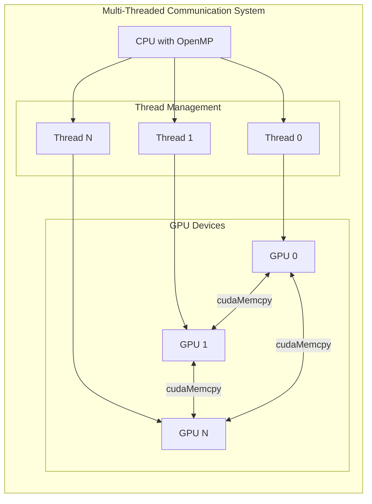
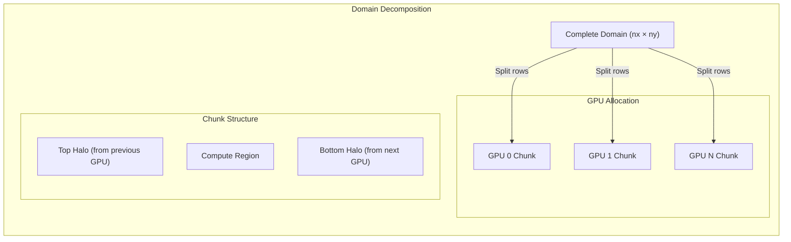
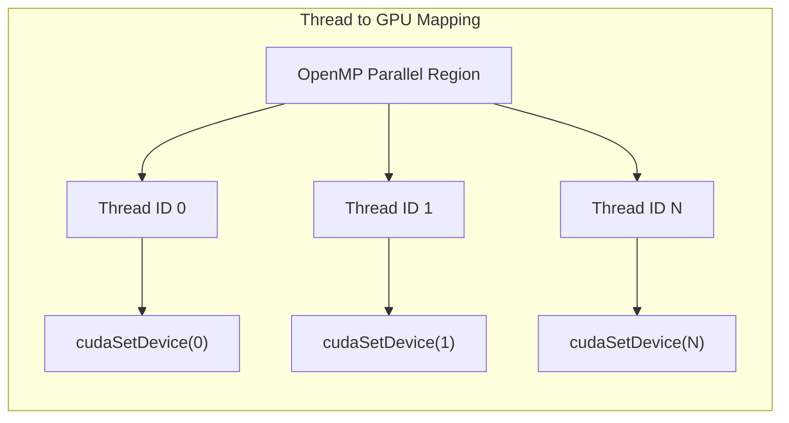
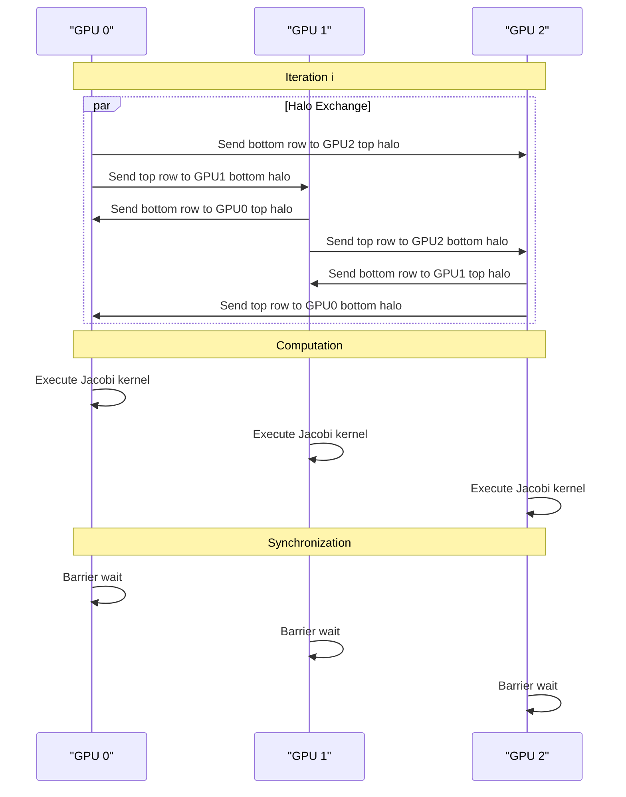
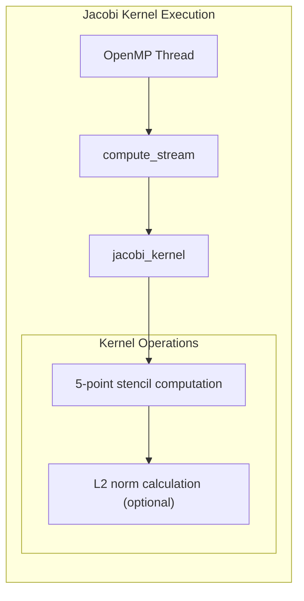

<!-- source: DeepWiki mcp.deepwiki.com · repo NVIDIA/multi-gpu-programming-models · extra page Multi-Threaded Copy · fetched 2026-10-26 -->

# Multi-Threaded Copy

<details>
<summary>Relevant source files</summary>

The following files were used as context for generating this wiki page:

- [multi_threaded_copy/Makefile](multi_threaded_copy/Makefile)
- [multi_threaded_copy/jacobi.cu](multi_threaded_copy/jacobi.cu)

</details>


## Purpose and Scope

This document describes the multi-threaded copy approach for multi-GPU Jacobi iteration, which uses OpenMP to parallelize host-based memory transfers between GPUs. This implementation improves upon the [Single-Threaded Copy](#3.1.1) model by leveraging multiple CPU threads to manage GPU communication in parallel, with each CPU thread controlling a dedicated GPU.

Sources: [multi_threaded_copy/jacobi.cu:1-548]()

## System Overview

The multi-threaded copy implementation employs OpenMP to create multiple CPU threads, each managing communication for a single GPU. Rather than using more advanced techniques like GPUDirect P2P (see [Multi-Threaded P2P](#3.2.1)) or NCCL (see [NCCL Implementation](#3.4.1)), this approach relies on standard `cudaMemcpy` operations but parallelizes them across multiple CPU threads.



Sources: [multi_threaded_copy/jacobi.cu:34-35](), [multi_threaded_copy/jacobi.cu:174-426]()

## Domain Decomposition

The 2D domain is decomposed along the y-dimension (rows), distributing work across multiple GPUs. Each GPU is responsible for computing a chunk of rows from the complete domain. The algorithm carefully handles load balancing by optimizing the distribution of rows when the total number of rows is not evenly divisible by the number of GPUs.



Sources: [multi_threaded_copy/jacobi.cu:197-233]()

## Implementation Details

### Thread and Device Management

Each OpenMP thread manages one GPU device:



The number of OpenMP threads is set to match the number of available CUDA devices, with each thread exclusively controlling one GPU:

```c
#pragma omp parallel num_threads(num_devices) shared(l2_norm)
{
    int dev_id = omp_get_thread_num();
    CUDA_RT_CALL(cudaSetDevice(dev_id));
    // Thread-specific code
}
```

Sources: [multi_threaded_copy/jacobi.cu:174-189]()

### Communication Pattern

The implementation uses CUDA streams to manage computation and communication, with separate streams for different operations:

1. `compute_stream`: For Jacobi kernel execution
2. `push_top_stream`: For sending data to the previous GPU
3. `push_bottom_stream`: For sending data to the next GPU

Data exchange happens in a circular pattern with each GPU communicating with its adjacent neighbors:



Sources: [multi_threaded_copy/jacobi.cu:237-246](), [multi_threaded_copy/jacobi.cu:311-339]()

### Memory Management

Each GPU allocates memory for:
- Input array `a`
- Output array `a_new`
- L2 norm calculation

The memory layout includes space for both the computational domain and halo regions:

```
|-------------------------------------------|
| Top halo (from previous GPU)              |
|-------------------------------------------|
| Computational domain                      |
| (rows iy_start to iy_end-1)               |
|-------------------------------------------|
| Bottom halo (from next GPU)               |
|-------------------------------------------|
```

Sources: [multi_threaded_copy/jacobi.cu:213-217]()

### Synchronization Strategy

The implementation uses both OpenMP synchronization and CUDA synchronization mechanisms:

1. **OpenMP Barriers**: Synchronize all CPU threads at critical points
   - Before starting the main loop
   - After halo exchanges
   - During norm calculation

2. **CUDA Events**: Coordinate operations between different CUDA streams
   - `compute_done`: Signals completion of the Jacobi kernel
   - `push_top_done`: Signals completion of data transfer to the previous GPU
   - `push_bottom_done`: Signals completion of data transfer to the next GPU

3. **Stream Synchronization**: Ensures proper ordering of operations
   - Wait for halo data to arrive before computing
   - Wait for computation to complete before exchanging halos

Sources: [multi_threaded_copy/jacobi.cu:240-246](), [multi_threaded_copy/jacobi.cu:311-342]()

## Computation Kernel

The Jacobi iteration is performed by the `jacobi_kernel` CUDA kernel:



The kernel implements a 5-point stencil computation:
- Each interior point is updated as the average of its four neighbors
- Optionally calculates the L2 norm for convergence checking

Sources: [multi_threaded_copy/jacobi.cu:98-128](), [multi_threaded_copy/jacobi.cu:314-316]()

## Performance Considerations

### Communication Overhead

The multi-threaded copy implementation improves on the single-threaded version by parallelizing data transfers, but still has limitations:

1. Each `cudaMemcpy` operation requires data to pass through host memory
2. Multiple synchronization points are needed to ensure data coherence
3. OpenMP barriers can lead to thread idle time

Sources: [multi_threaded_copy/jacobi.cu:328-339]()

### Memory Transfer Optimization

To optimize memory transfers, the implementation:

1. Uses separate CUDA streams for computation and communication
2. Employs CUDA events to synchronize between streams
3. Performs periodic (not per-iteration) norm checks to reduce synchronization overhead

Sources: [multi_threaded_copy/jacobi.cu:309-316]()

## Compilation and Execution

The implementation is compiled with the following key flags:

- `-Xcompiler -fopenmp`: Enables OpenMP support
- `-DHAVE_CUB`: Optionally enables CUB library for optimized reductions
- `-DUSE_NVTX`: Enables NVIDIA Tools Extension for profiling

Sources: [multi_threaded_copy/Makefile:16-18]()

## Comparison with Related Approaches

| Feature | Multi-Threaded Copy | Single-Threaded Copy | Multi-Threaded P2P |
|---------|---------------------|----------------------|-------------------|
| Communication Method | Host-based `cudaMemcpy` | Host-based `cudaMemcpy` | GPUDirect P2P |
| Thread Management | One thread per GPU | Single thread for all GPUs | One thread per GPU |
| Parallelism | Parallel transfers | Sequential transfers | Parallel direct transfers |
| Memory Path | GPU → Host → GPU | GPU → Host → GPU | GPU → GPU (direct) |
| Scalability | Limited by host bandwidth | Limited by host bandwidth and serialization | Limited by PCIe topology |

Sources: [multi_threaded_copy/jacobi.cu:304-339]()

The multi-threaded copy approach represents an intermediate step between the basic single-threaded implementation and more advanced direct communication models. It offers better performance than the single-threaded version through parallelization but doesn't achieve the full potential of direct GPU-to-GPU communication methods like P2P or NVLink.

---

