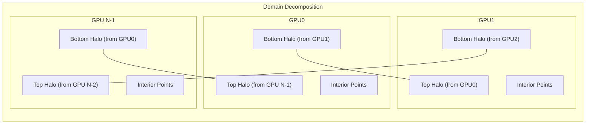
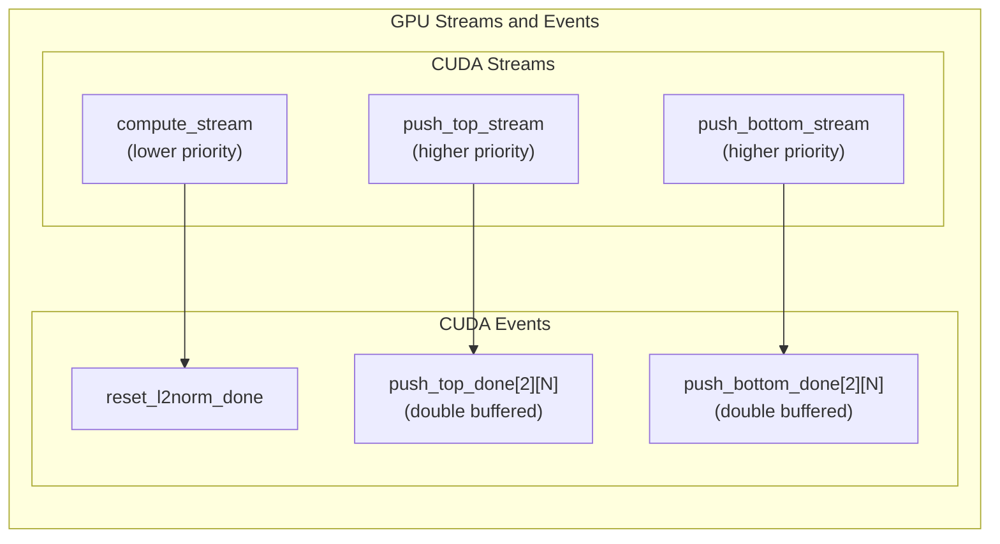
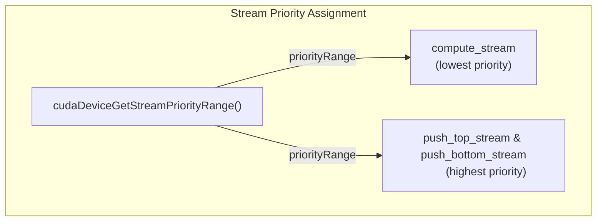
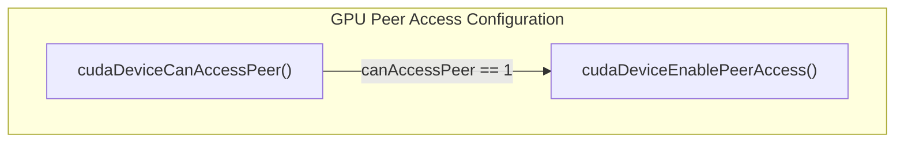
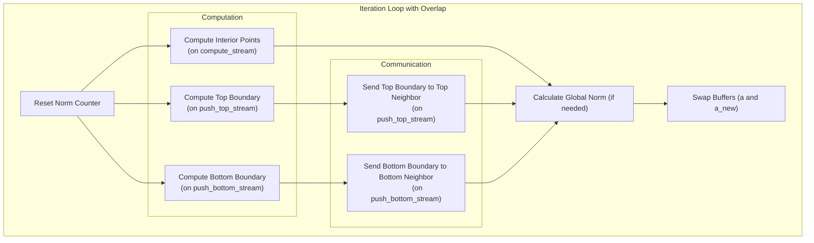
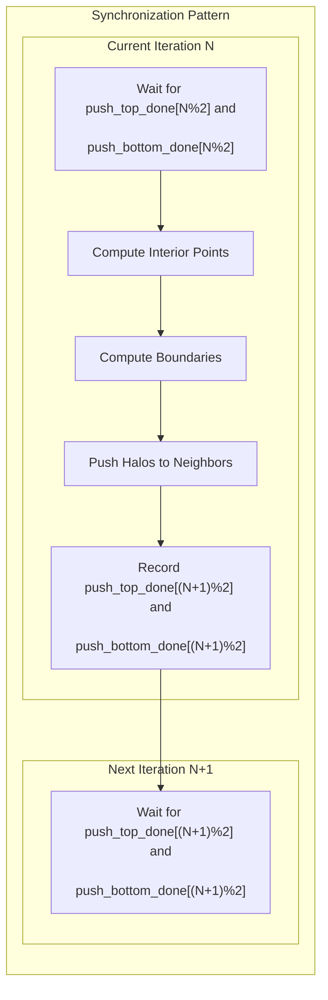
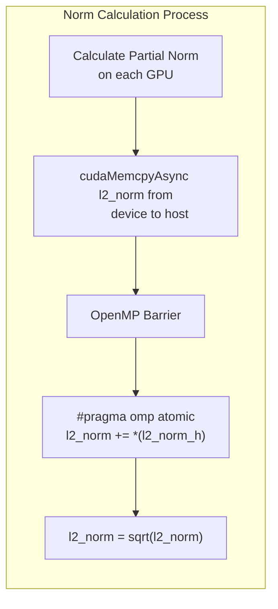

<!-- source: DeepWiki mcp.deepwiki.com · repo NVIDIA/multi-gpu-programming-models · extra page Multi-Threaded Copy with Overlap · fetched 2026-10-26 -->

# Multi-Threaded Copy with Overlap

<details>
<summary>Relevant source files</summary>

The following files were used as context for generating this wiki page:

- [multi_threaded_copy_overlap/jacobi.cu](multi_threaded_copy_overlap/jacobi.cu)

</details>


## Purpose and Scope

This document describes the Multi-Threaded Copy with Overlap implementation of the Jacobi solver. This implementation extends the [Multi-Threaded Copy](#3.1.2) approach by adding computation-communication overlap to improve performance. While the basic multi-threaded copy implementation uses sequential communication and computation, this version uses multiple CUDA streams to overlap these operations, hiding communication latency behind useful computation.

Sources: [multi_threaded_copy_overlap/jacobi.cu:1-5]()

## Overview

The Multi-Threaded Copy with Overlap implementation uses a combination of:

1. OpenMP for thread-level parallelism (one thread per GPU)
2. CUDA streams for managing overlapped operations
3. CUDA events for fine-grained synchronization
4. Asynchronous memory transfers between GPUs
5. Stream priorities to ensure proper ordering of operations

This approach allows halo exchanges to occur simultaneously with computation, reducing the overall execution time by hiding data transfer latency.

Sources: [multi_threaded_copy_overlap/jacobi.cu:173-186](), [multi_threaded_copy_overlap/jacobi.cu:237-254]()

## Execution Model

### Domain Decomposition and Thread Assignment

The implementation divides the computational domain among available GPUs, with each OpenMP thread managing one GPU. The domain is split along the y-dimension, with each GPU responsible for a chunk of rows.



Sources: [multi_threaded_copy_overlap/jacobi.cu:194-229]()

### Stream and Event Organization

The implementation uses three CUDA streams per GPU to manage different operations with appropriate priorities:



Sources: [multi_threaded_copy_overlap/jacobi.cu:237-254](), [multi_threaded_copy_overlap/jacobi.cu:167-169]()

## Implementation Details

### Stream Priority Management

The implementation uses CUDA stream priorities to ensure that communication operations (halo exchanges) have higher priority than computation operations. This helps minimize the latency of data transfers between GPUs.



Sources: [multi_threaded_copy_overlap/jacobi.cu:237-246]()

### Peer Access Configuration

To allow direct memory transfers between GPUs, the implementation enables peer access between adjacent GPUs:



Sources: [multi_threaded_copy_overlap/jacobi.cu:259-272]()

### Main Iteration Loop

The main iteration loop implements the overlapped computation and communication pattern:



Sources: [multi_threaded_copy_overlap/jacobi.cu:312-386]()

## Key Algorithm Components

### Synchronization Pattern

A key aspect of this implementation is the careful synchronization between computation and communication operations to ensure correctness while maximizing overlap:

1. Each iteration waits for halo exchanges from the previous iteration to complete
2. Boundary computations wait for the relevant neighboring halo transfers
3. Communication operations are started as soon as the relevant data is ready

This is implemented using CUDA events and stream wait operations:



Sources: [multi_threaded_copy_overlap/jacobi.cu:321-323](), [multi_threaded_copy_overlap/jacobi.cu:332-343](), [multi_threaded_copy_overlap/jacobi.cu:347-356]()

### Double-Buffered Event Management

The implementation uses a double-buffering technique for CUDA events to allow overlapping iterations:

```
push_top_done[0][dev_id]    // Events for even iterations
push_bottom_done[0][dev_id] // Events for even iterations
push_top_done[1][dev_id]    // Events for odd iterations
push_bottom_done[1][dev_id] // Events for odd iterations
```

This allows the current iteration to record events that will be waited on in the next iteration without conflicts.

Sources: [multi_threaded_copy_overlap/jacobi.cu:167-168](), [multi_threaded_copy_overlap/jacobi.cu:248-253]()

## Norm Calculation

The implementation calculates the L2 norm periodically (either every `nccheck` iterations or every 100 iterations when printing progress):

1. Each GPU computes a partial L2 norm for its portion of the domain
2. These partial norms are gathered using OpenMP atomic operations
3. The global L2 norm is computed as the square root of the sum



Sources: [multi_threaded_copy_overlap/jacobi.cu:358-380]()

## Performance Considerations

### Communication-Computation Overlap Benefits

The primary advantage of this implementation over the basic multi-threaded copy approach is the overlap of computation and communication. This reduces the effective time spent on communication by hiding it behind computation, particularly beneficial when:

1. The communication time is significant but less than computation time
2. GPUs have sufficient resources to perform computation and communication simultaneously
3. The problem size is large enough to benefit from parallelism

### Stream Priority Optimization

Using different priorities for computation and communication streams helps ensure that communication operations are scheduled promptly, minimizing the latency between when data is ready to be transferred and when the transfer actually begins.

Sources: [multi_threaded_copy_overlap/jacobi.cu:237-246]()

## Differences from Multi-Threaded Copy (without Overlap)

The key differences from the basic [Multi-Threaded Copy](#3.1.2) implementation are:

1. **Multiple CUDA Streams**: Uses separate streams for computation and communication
2. **CUDA Events**: Uses events for fine-grained synchronization between operations
3. **Stream Priorities**: Assigns higher priority to communication streams
4. **Asynchronous Memory Operations**: Uses `cudaMemcpyAsync` for all data transfers
5. **Double-buffered Events**: Uses alternating sets of events for odd and even iterations

These differences enable the overlapping of computation and communication, which can significantly improve performance for large problem sizes.

Sources: [multi_threaded_copy_overlap/jacobi.cu:167-169](), [multi_threaded_copy_overlap/jacobi.cu:237-254](), [multi_threaded_copy_overlap/jacobi.cu:347-356]()

---

