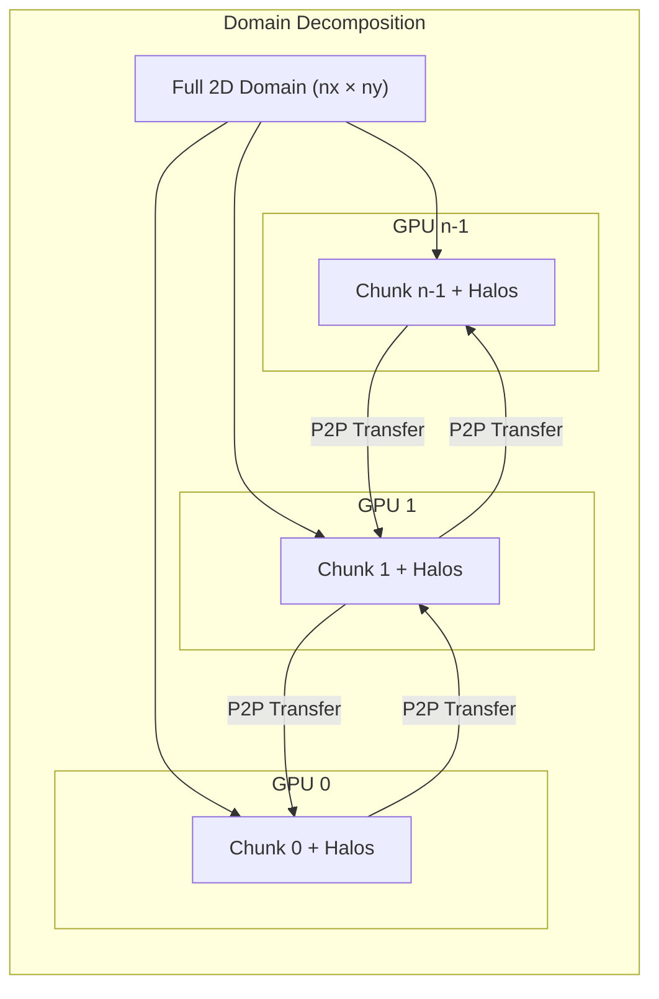
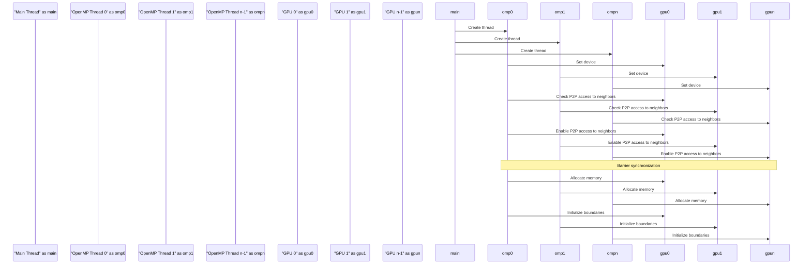
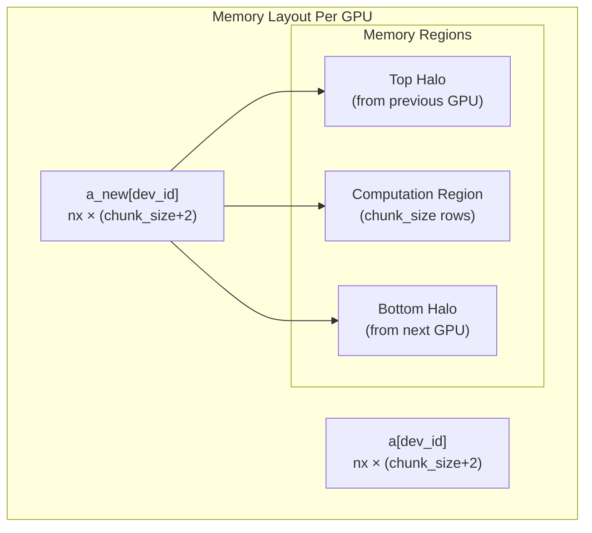
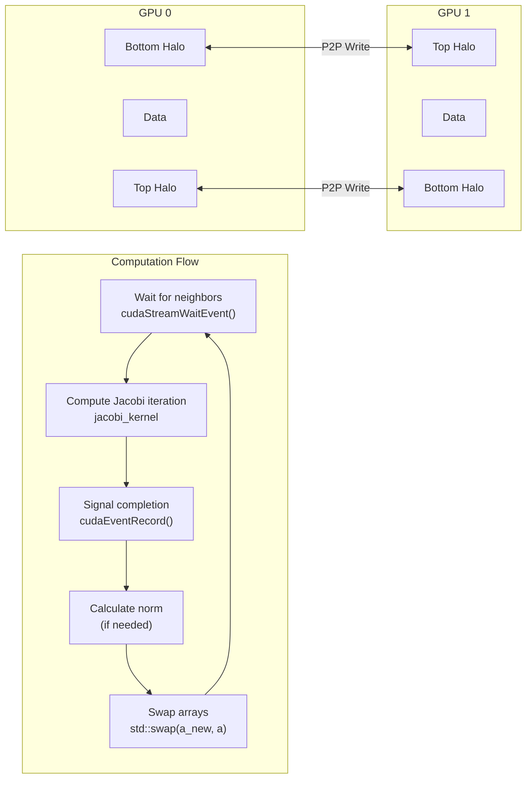
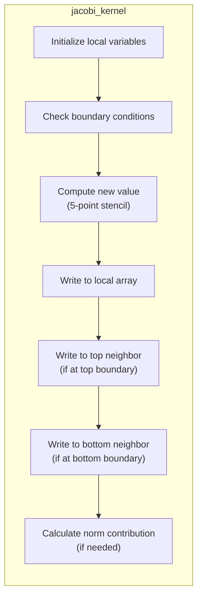
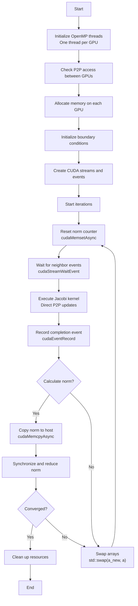

<!-- source: DeepWiki mcp.deepwiki.com · repo NVIDIA/multi-gpu-programming-models · extra page Multi-Threaded P2P · fetched 2026-10-26 -->

# Multi-Threaded P2P

Relevant source files

The following files were used as context for generating this wiki page:

- [multi_threaded_p2p/Makefile](multi_threaded_p2p/Makefile)
- [multi_threaded_p2p/jacobi.cu](multi_threaded_p2p/jacobi.cu)

## Purpose and Scope

This page documents the Multi-Threaded P2P implementation of the Jacobi solver in the multi-GPU programming models repository. This implementation uses CUDA's peer-to-peer (P2P) memory access capabilities to allow direct GPU-to-GPU data transfers without going through host memory. This approach eliminates the host memory bottleneck seen in previous implementations.

For information about the basic multi-threaded implementation using host memory, see [Multi-Threaded Copy](#3.1.2). For the optimized P2P version with deferred norm calculation, see [Multi-Threaded P2P Optimized](#3.2.2).

Sources: [multi_threaded_p2p/jacobi.cu:1-551]()

## Technical Overview

The Multi-Threaded P2P implementation divides the 2D Jacobi domain across multiple GPUs using OpenMP to manage one CPU thread per GPU device. The key optimization is the use of CUDA's GPUDirect P2P technology, which enables direct memory transfers between GPUs over the PCIe bus (or NVLink if available).

### Key Features

- Peer-to-peer direct memory access between GPUs
- OpenMP for multi-threading (one thread per GPU)
- Domain decomposition with direct halo exchange
- Multiple CUDA streams for managing computation and communication
- CUDA events for synchronization between devices

Sources: [multi_threaded_p2p/jacobi.cu:185-427]()

## Domain Decomposition

The 2D domain is partitioned horizontally into slices, with each GPU processing a chunk of rows. The chunking algorithm ensures optimal load balancing by distributing rows as evenly as possible.

Domain calculation is performed using a load-balancing algorithm:
- Calculate base chunk size: `chunk_size_low = (ny - 2) / num_devices`
- Some GPUs may get one additional row: `chunk_size_high = chunk_size_low + 1`
- Determine how many GPUs get the smaller chunk: `num_ranks_low`
- Assign appropriate chunk size to each GPU based on its ID

Sources: [multi_threaded_p2p/jacobi.cu:209-224](), [multi_threaded_p2p/jacobi.cu:264-276]()

## P2P Memory Access Setup

Before computation begins, the implementation checks and enables P2P access between GPUs. This is a critical step that determines whether direct GPU-to-GPU communication is possible.

The code checks for P2P support between each GPU and its neighbors:
- Each GPU needs access to its top and bottom neighbors
- If P2P access is not available, the implementation reports an error
- P2P access is enabled using `cudaDeviceEnablePeerAccess()`

Sources: [multi_threaded_p2p/jacobi.cu:225-253]()

## Memory Management and Data Structures

The implementation uses several key data structures for computation and communication:

1. `a` - Current iteration data array on each GPU
2. `a_new` - Next iteration data array (shared via P2P)
3. `l2_norm_d` - Device memory for norm calculation
4. `compute_done` - CUDA events for signaling completion

The arrays are allocated with space for the actual computational domain plus halo regions for boundary exchange:

Sources: [multi_threaded_p2p/jacobi.cu:258-262](), [multi_threaded_p2p/jacobi.cu:170-171]()

## Computation and Communication Pattern

The implementation uses a specific pattern for computation and communication:

1. Each GPU waits for compute completion from neighboring GPUs
2. The Jacobi kernel updates the interior points and writes to halo regions via P2P
3. CUDA events signal completion of computation to other GPUs
4. Norm calculation is performed when needed
5. Arrays are swapped for the next iteration

The key innovation in this implementation is that GPUs directly write to the halo regions of their neighbors through P2P memory access, eliminating the need for explicit copy operations through host memory.

Sources: [multi_threaded_p2p/jacobi.cu:323-363](), [multi_threaded_p2p/jacobi.cu:98-139]()

## Jacobi Kernel Implementation

The Jacobi kernel performs the main computation and handles the direct P2P memory updates:

Key aspects of the kernel:
- Calculates new values using the 5-point stencil pattern
- Directly writes to neighboring GPU memory for halo regions
- Optionally calculates the norm contribution
- Uses CUB library for efficient block reduction (if available)

Sources: [multi_threaded_p2p/jacobi.cu:98-139]()

## Synchronization Mechanisms

The implementation uses several synchronization mechanisms to coordinate work:

1. **CUDA Events**: Used to signal completion of computation to neighboring GPUs
   - `compute_done` events are recorded after kernel execution
   - Neighboring GPUs wait on these events before starting computation

2. **OpenMP Barriers**: Used to synchronize CPU threads at critical points
   - Before checking global convergence
   - Before accessing shared data structures

3. **Stream Synchronization**: Used to ensure memory operations are complete
   - `cudaStreamSynchronize()` called when waiting for norm calculation

Sources: [multi_threaded_p2p/jacobi.cu:328-341](), [multi_threaded_p2p/jacobi.cu:344-354]()

## Full Execution Flow

The complete execution flow combines all these elements:

Sources: [multi_threaded_p2p/jacobi.cu:185-427]()

## Build and Execution

The implementation is built using NVCC with OpenMP support and can be compiled with optional CUB library support for optimized reductions.

Relevant build flags:
- `-fopenmp`: Enable OpenMP support
- `-DHAVE_CUB`: Enable CUB library optimizations
- `-DUSE_NVTX`: Enable NVIDIA Tools Extension for profiling

Sources: [multi_threaded_p2p/Makefile:1-34]()

## Performance Considerations

The Multi-Threaded P2P implementation offers several performance advantages:

1. **Eliminates Host Memory Bottleneck**: By enabling direct GPU-to-GPU transfers, it avoids the costly round-trip through host memory seen in host-based implementations.

2. **Reduces PCIe Traffic**: Data transfers occur directly between GPUs over the PCIe bus (or NVLink if available).

3. **Overlap Potential**: The use of separate CUDA streams provides potential for overlapping computation and communication.

The implementation reports performance metrics including:
- Single-GPU baseline runtime
- Multi-GPU runtime
- Speedup relative to single-GPU
- Parallel efficiency

Sources: [multi_threaded_p2p/jacobi.cu:376-406]()

## Limitations

There are a few limitations to be aware of:

1. **P2P Compatibility**: Not all GPU combinations support P2P access. The code checks this but will fail if P2P is not supported.

2. **NUMA Considerations**: On multi-socket systems, GPUs on different CPU sockets may have reduced P2P performance.

3. **No Computation-Communication Overlap**: Unlike the [Multi-Threaded P2P Optimized](#3.2.2) version, this implementation doesn't actively overlap computation and communication.

Sources: [multi_threaded_p2p/jacobi.cu:227-250]()

## Summary

The Multi-Threaded P2P implementation represents a significant performance improvement over host-based communication methods by enabling direct GPU-to-GPU memory transfers. It uses OpenMP for CPU thread management and CUDA's peer-to-peer memory access capabilities to efficiently distribute and solve the Jacobi problem across multiple GPUs.

This approach eliminates the host memory bottleneck and reduces PCIe traffic, resulting in better scalability as the number of GPUs increases. However, it requires hardware support for P2P access between the GPUs used in the computation.

---

