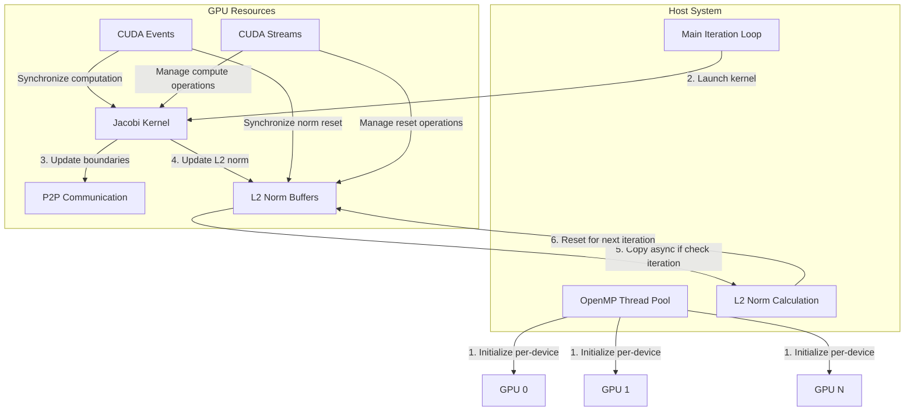
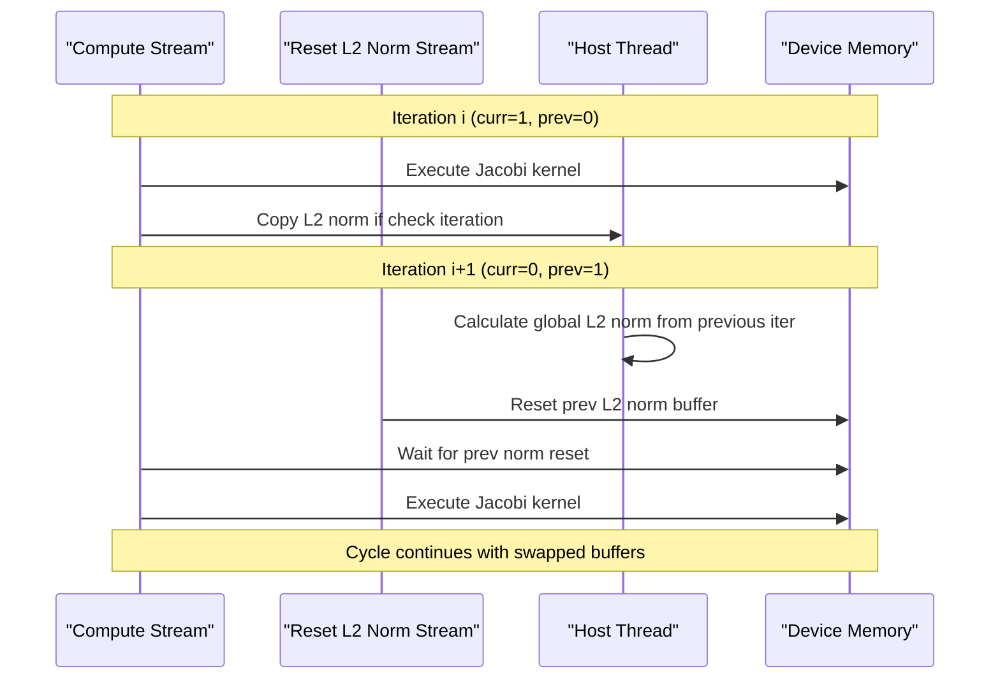
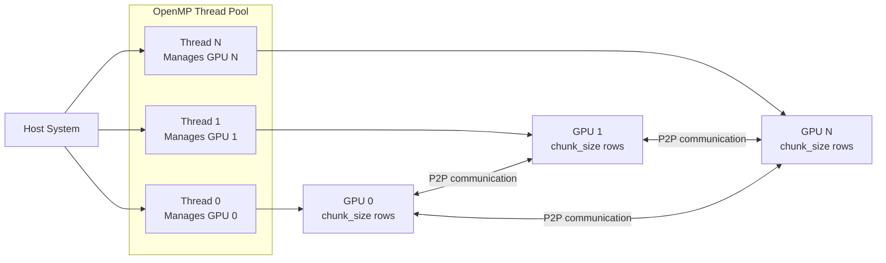
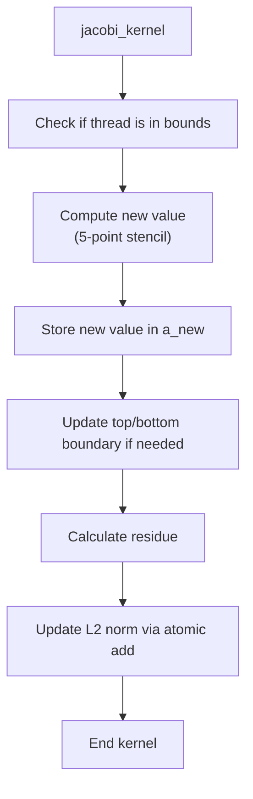

<!-- source: DeepWiki mcp.deepwiki.com · repo NVIDIA/multi-gpu-programming-models · extra page Multi-Threaded P2P Optimized · fetched 2026-10-26 -->

# Multi-Threaded P2P Optimized

<details>
<summary>Relevant source files</summary>

The following files were used as context for generating this wiki page:

- [multi_threaded_p2p_opt/Makefile](multi_threaded_p2p_opt/Makefile)
- [multi_threaded_p2p_opt/jacobi.cu](multi_threaded_p2p_opt/jacobi.cu)

</details>


## Overview

The Multi-Threaded P2P Optimized implementation is an enhanced version of the [Multi-Threaded P2P](#3.2.1) approach for the Jacobi solver. It maintains the direct GPU-to-GPU data transfer capabilities of the base P2P implementation but introduces optimizations to the L2 norm calculation process, improving overall performance by delaying norm calculation and reducing synchronization overhead.

This implementation represents an intermediate step in the evolution of multi-GPU programming models, focusing on optimizing the communication and synchronization aspects of the direct P2P approach.

Sources: [multi_threaded_p2p_opt/jacobi.cu:1-610]()

## Architecture Overview



Sources: [multi_threaded_p2p_opt/jacobi.cu:156-160](), [multi_threaded_p2p_opt/jacobi.cu:179-184](), [multi_threaded_p2p_opt/jacobi.cu:287-289](), [multi_threaded_p2p_opt/jacobi.cu:290-297]()

## Key Optimizations

The Multi-Threaded P2P Optimized implementation introduces several key optimizations over the basic P2P approach:

1. **Delayed L2 Norm Calculation**: Instead of computing the L2 norm on every iteration, this implementation only performs the calculation on specific check iterations, reducing computational overhead.

2. **Asynchronous Norm Calculation**: L2 norm data is transferred asynchronously from device to host, allowing computation to continue without waiting for norm calculation to complete.

3. **Dual-Buffer Approach**: Two sets of L2 norm buffers are used in an alternating fashion to overlap norm calculation with computation.

4. **Efficient Event Synchronization**: CUDA events are used to precisely manage dependencies between computation and norm calculation streams.



Sources: [multi_threaded_p2p_opt/jacobi.cu:339-403](), [multi_threaded_p2p_opt/jacobi.cu:360-397]()

## Implementation Details

### Thread Management

The implementation uses OpenMP to create one thread per GPU device. Each thread manages a portion of the computational domain and handles the communication with neighboring GPUs.



Sources: [multi_threaded_p2p_opt/jacobi.cu:192-467](), [multi_threaded_p2p_opt/jacobi.cu:229-233]()

### Domain Decomposition and P2P Communication

The computational domain is divided into chunks, with each GPU handling a portion of the total rows:

1. The domain is split into `num_devices` chunks, with each chunk having either `chunk_size_low` or `chunk_size_high` rows to ensure balanced workload.
2. Each GPU is responsible for computing its assigned chunk.
3. For boundary exchanges, each GPU communicates directly with its top and bottom neighbors using GPUDirect P2P.
4. P2P capability is verified before execution and enabled between each pair of communicating GPUs.

Sources: [multi_threaded_p2p_opt/jacobi.cu:214-233](), [multi_threaded_p2p_opt/jacobi.cu:229-257]()

### L2 Norm Calculation Optimization

The L2 norm calculation optimization is a key feature of this implementation:

1. Two sets of L2 norm buffers are maintained (using the `l2_norm_buf` structure).
2. At each iteration, the code alternates between these buffers (prev and curr).
3. The L2 norm is calculated only on specific check iterations (controlled by `nccheck` parameter).
4. When calculated, the norm is transferred asynchronously from device to host.
5. The calculation of the actual norm value is delayed to the next iteration, allowing computation to continue without waiting.

```c
struct l2_norm_buf {
    cudaEvent_t copy_done;
    real* d;     // Device buffer
    real* h;     // Host buffer
};
```

Sources: [multi_threaded_p2p_opt/jacobi.cu:156-160](), [multi_threaded_p2p_opt/jacobi.cu:299-306](), [multi_threaded_p2p_opt/jacobi.cu:360-397]()

### CUDA Events and Streams Management

The implementation uses multiple CUDA streams and events to manage concurrency and dependencies:

1. **Compute Stream**: Used for executing the Jacobi kernel and L2 norm computation.
2. **Reset L2 Norm Stream**: Used for resetting the L2 norm buffers.
3. **Compute Done Events**: Signal the completion of the Jacobi kernel computation.
4. **Reset L2 Norm Done Events**: Signal the completion of L2 norm buffer reset.
5. **Copy Done Events**: Signal the completion of device-to-host L2 norm data transfer.

Sources: [multi_threaded_p2p_opt/jacobi.cu:179-184](), [multi_threaded_p2p_opt/jacobi.cu:287-289](), [multi_threaded_p2p_opt/jacobi.cu:290-297](), [multi_threaded_p2p_opt/jacobi.cu:299-306]()

## Jacobi Kernel Implementation

The Jacobi kernel is implemented to compute the next iteration values and update the L2 norm:



The kernel uses a 2D block configuration and implements a 5-point stencil computation for the Jacobi iteration. It also handles boundary updates for neighboring GPUs and contributes to the L2 norm calculation.

Sources: [multi_threaded_p2p_opt/jacobi.cu:98-132](), [multi_threaded_p2p_opt/jacobi.cu:353-358]()

## Iteration Loop and Synchronization

The main iteration loop includes several synchronized steps:

1. Wait for completion of boundary data from neighboring GPUs.
2. Wait for L2 norm buffer reset completion.
3. Launch the Jacobi kernel to compute the next iteration.
4. If it's a check iteration, copy L2 norm data asynchronously to host.
5. Process the L2 norm from the previous iteration.
6. Reset the L2 norm buffer for the next iteration.
7. Swap the solution arrays and continue to the next iteration.

Sources: [multi_threaded_p2p_opt/jacobi.cu:339-403]()

## Comparison with Other Implementations

The Multi-Threaded P2P Optimized implementation offers several advantages compared to other approaches:

| Implementation | Communication Method | Norm Calculation | Synchronization | Advantages |
|----------------|----------------------|------------------|-----------------|------------|
| Multi-Threaded P2P | Direct P2P | Immediate | Explicit barriers | Simple implementation |
| **Multi-Threaded P2P Optimized** | Direct P2P | Delayed, asynchronous | Event-based | Reduced synchronization overhead |
| Multi-Threaded Copy | Host-staged transfers | Immediate | Explicit barriers | No P2P requirement |
| MPI | Message passing | Implementation-dependent | MPI barriers | Greater scalability |

Sources: [multi_threaded_p2p_opt/jacobi.cu:339-403](), [multi_threaded_p2p_opt/jacobi.cu:360-397]()

## Building and Running

The implementation can be built using CUDA compiler with OpenMP support:

```bash
make -C multi_threaded_p2p_opt
```

Running the implementation:

```bash
./multi_threaded_p2p_opt/jacobi [options]
```

Common options include:
- `-niter <n>`: Maximum number of iterations
- `-nx <n>`, `-ny <n>`: Grid dimensions
- `-nccheck <n>`: Check L2 norm every n iterations
- `-csv`: Output results in CSV format

Sources: [multi_threaded_p2p_opt/Makefile:1-34](), [multi_threaded_p2p_opt/jacobi.cu:162-154]()

## Performance Considerations

The Multi-Threaded P2P Optimized implementation provides improved performance over the basic P2P implementation, primarily due to:

1. Reduced synchronization overhead from the delayed norm calculation
2. Better overlap of computation and communication
3. Efficient use of CUDA streams and events to manage dependencies

However, it still requires P2P support between GPUs and may not scale well beyond a single node. For multi-node deployments, consider using the [Multi-Node P2P](#3.2.4) or [MPI-Based Communication](#3.3) implementations.

Sources: [multi_threaded_p2p_opt/jacobi.cu:339-403](), [multi_threaded_p2p_opt/jacobi.cu:429-446]()

---

