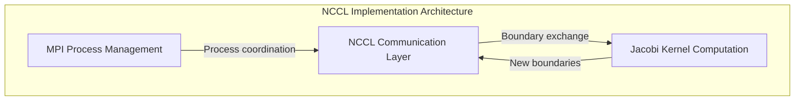
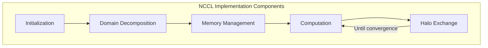
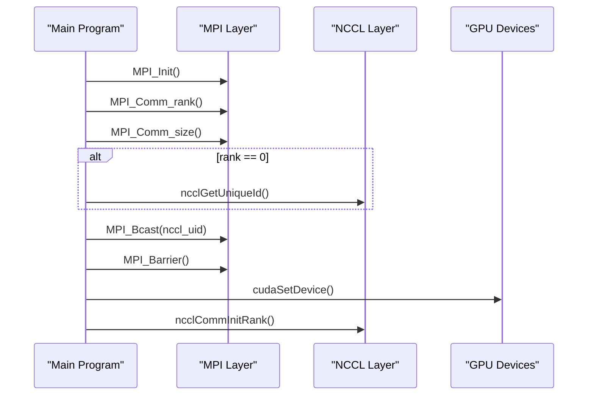
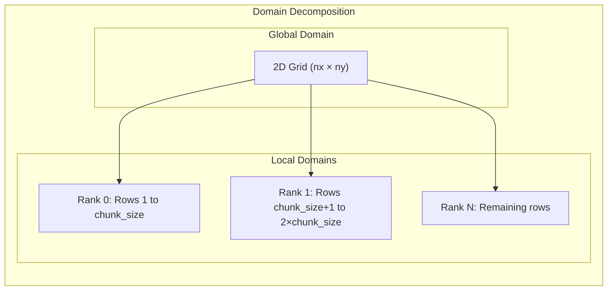
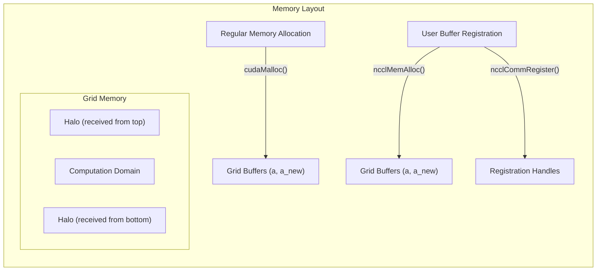
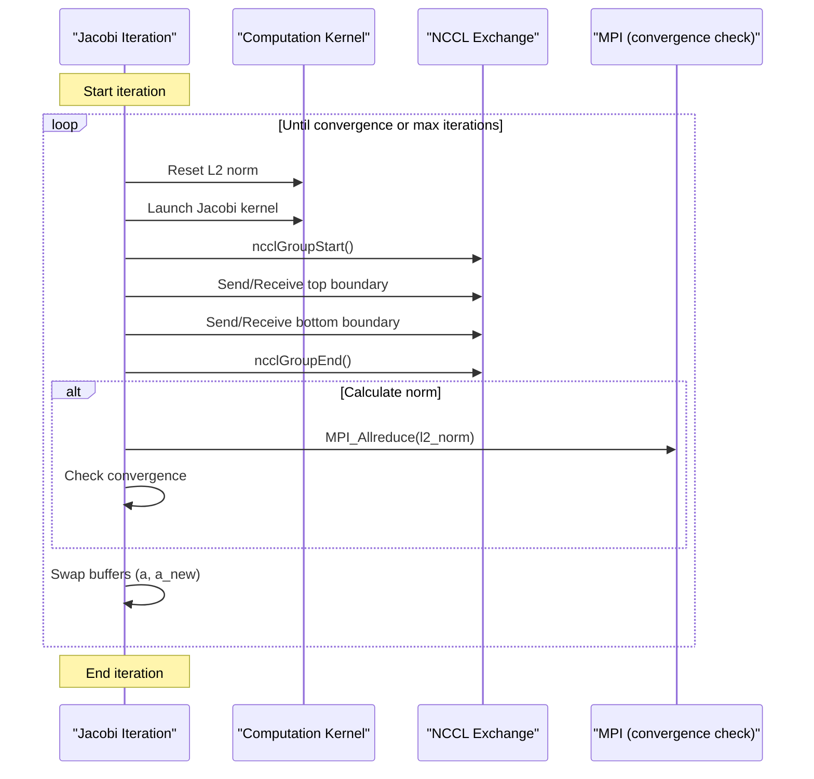
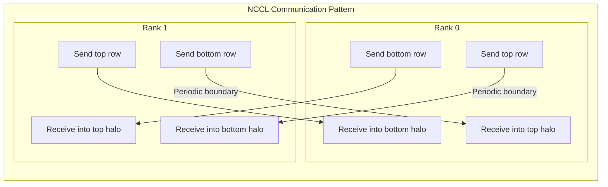
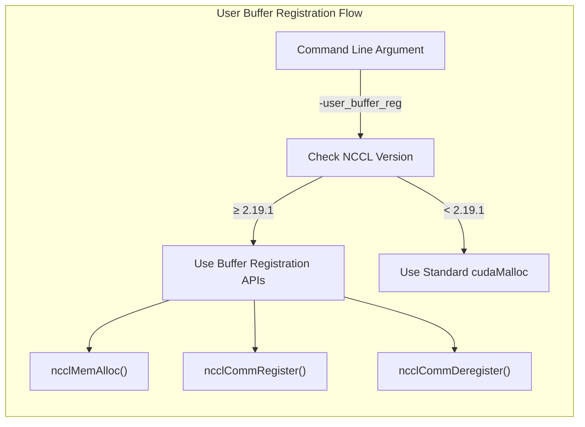
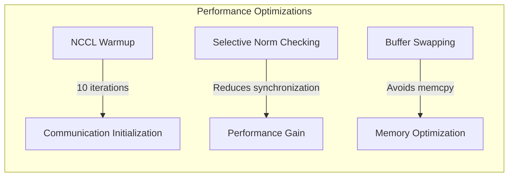
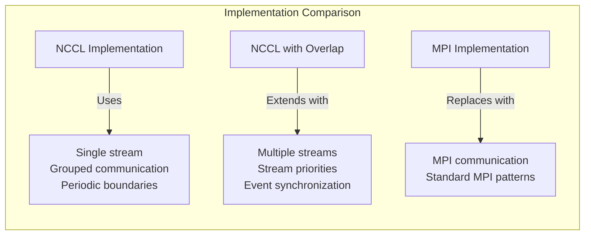

<!-- source: DeepWiki mcp.deepwiki.com · repo NVIDIA/multi-gpu-programming-models · extra page NCCL Implementation · fetched 2026-10-26 -->

# NCCL Implementation

<details>
<summary>Relevant source files</summary>

The following files were used as context for generating this wiki page:

- [bench.sh](bench.sh)
- [nccl/Makefile](nccl/Makefile)
- [nccl/jacobi.cpp](nccl/jacobi.cpp)
- [nccl/jacobi_kernels.cu](nccl/jacobi_kernels.cu)
- [nccl_overlap/Makefile](nccl_overlap/Makefile)
- [nccl_overlap/jacobi.cpp](nccl_overlap/jacobi.cpp)

</details>


This page documents the NVIDIA Collective Communications Library (NCCL) implementation of the Jacobi solver in the multi-GPU programming models repository. This implementation showcases how to use NCCL for efficient GPU-to-GPU communication in a distributed stencil-based computation. For implementations with computation-communication overlap, see [NCCL with Overlap](#3.4.2), and for implementations using CUDA Graphs, see [NCCL with CUDA Graphs](#3.4.3).

## Overview

The NCCL implementation leverages NCCL's point-to-point communication primitives to exchange halo regions between neighboring GPUs during Jacobi iteration. It combines MPI for process management with NCCL for GPU communication, providing a high-performance solution for multi-GPU computation.



Sources: [nccl/jacobi.cpp:34-56](), [nccl/jacobi.cpp:99-112]()

## Implementation Components

The NCCL implementation consists of several key components that work together to solve the Jacobi iteration problem across multiple GPUs:



Sources: [nccl/jacobi.cpp:161-226](), [nccl/jacobi.cpp:332-371]()

### Initialization and Setup

The implementation begins with MPI and NCCL initialization, establishing the communication framework for multi-GPU execution.



Sources: [nccl/jacobi.cpp:162-176](), [nccl/jacobi.cpp:190-225]()

Key steps in the initialization process:

1. **MPI initialization**: Sets up the distributed environment
   ```cpp
   MPI_CALL(MPI_Init(&argc, &argv));
   MPI_CALL(MPI_Comm_rank(MPI_COMM_WORLD, &rank));
   MPI_CALL(MPI_Comm_size(MPI_COMM_WORLD, &size));
   ```

2. **NCCL unique ID generation and distribution**: A core requirement for establishing NCCL communication
   ```cpp
   ncclUniqueId nccl_uid;
   if (rank == 0) NCCL_CALL(ncclGetUniqueId(&nccl_uid));
   MPI_CALL(MPI_Bcast(&nccl_uid, sizeof(ncclUniqueId), MPI_BYTE, 0, MPI_COMM_WORLD));
   ```

3. **GPU device selection**: Each MPI rank selects its corresponding GPU
   ```cpp
   if (1 == num_devices) {
       CUDA_RT_CALL(cudaSetDevice(0));
   } else {
       CUDA_RT_CALL(cudaSetDevice(local_rank));
   }
   ```

4. **NCCL communicator initialization**: Establishes the NCCL communication context
   ```cpp
   NCCL_CALL(ncclCommInitRank(&nccl_comm, size, nccl_uid, rank));
   ```

5. **Version compatibility check**: Ensures NCCL 2.8+ is available
   ```cpp
   int nccl_version = 0;
   NCCL_CALL(ncclGetVersion(&nccl_version));
   if (nccl_version < 2800) {
       // Error handling
   }
   ```

Sources: [nccl/jacobi.cpp:162-225]()

### Domain Decomposition

The 2D domain is divided among available GPUs, with each GPU handling a horizontal strip of the domain.



Sources: [nccl/jacobi.cpp:233-247](), [nccl/jacobi.cpp:274-284]()

Domain decomposition highlights:

1. **Chunk size calculation**: Each rank gets an equal or nearly equal portion of the domain
   ```cpp
   int chunk_size;
   int chunk_size_low = (ny - 2) / size;
   int chunk_size_high = chunk_size_low + 1;
   int num_ranks_low = size * chunk_size_low + size - (ny - 2);
   if (rank < num_ranks_low)
       chunk_size = chunk_size_low;
   else
       chunk_size = chunk_size_high;
   ```

2. **Global index calculation**: Maps local indices to global domain positions
   ```cpp
   int iy_start_global;
   if (rank < num_ranks_low) {
       iy_start_global = rank * chunk_size_low + 1;
   } else {
       iy_start_global = num_ranks_low * chunk_size_low + (rank - num_ranks_low) * chunk_size_high + 1;
   }
   int iy_end_global = iy_start_global + chunk_size - 1;
   ```

3. **Local work boundaries**: Defines the actual computation range for each rank
   ```cpp
   int iy_start = 1;
   int iy_end = iy_start + chunk_size;
   ```

Sources: [nccl/jacobi.cpp:233-284]()

### Memory Management

The implementation allocates memory for the computation grid and handles halo regions for boundary exchanges, with optional support for NCCL's user buffer registration feature.



Sources: [nccl/jacobi.cpp:251-268]()

Key memory management features:

1. **Conditional user buffer registration**: Uses NCCL's memory management if available and requested
   ```cpp
   #if NCCL_UB_SUPPORT
   if (user_buffer_reg) {
       NCCL_CALL(ncclMemAlloc((void**) &a, nx * (chunk_size + 2) * sizeof(real)));
       NCCL_CALL(ncclMemAlloc((void**) &a_new, nx * (chunk_size + 2) * sizeof(real)));
       NCCL_CALL(ncclCommRegister(nccl_comm, a, nx * (chunk_size + 2) * sizeof(real), &a_reg_handle));
       NCCL_CALL(ncclCommRegister(nccl_comm, a_new, nx * (chunk_size + 2) * sizeof(real), &a_new_reg_handle));
   }
   else
   #endif //NCCL_UB_SUPPORT
   {
       CUDA_RT_CALL(cudaMalloc(&a, nx * (chunk_size + 2) * sizeof(real)));
       CUDA_RT_CALL(cudaMalloc(&a_new, nx * (chunk_size + 2) * sizeof(real)));
   }
   ```

2. **Memory layout**: Includes space for halo regions (ghost cells)
   - The array has `chunk_size + 2` rows
   - Position 0 stores the top halo from the neighbor above
   - Positions 1 to chunk_size store the actual domain data
   - Position chunk_size+1 stores the bottom halo from the neighbor below

3. **Boundary initialization**: Sets up Dirichlet boundary conditions on left and right borders
   ```cpp
   launch_initialize_boundaries(a, a_new, PI, iy_start_global - 1, nx, (chunk_size + 2), ny);
   ```

Sources: [nccl/jacobi.cpp:251-288]()

### Computation and Communication

The core of the implementation alternates between computation and communication phases until convergence criteria are met.



Sources: [nccl/jacobi.cpp:332-371]()

Key aspects of the computation and communication flow:

1. **Main iteration loop**: Continues until convergence or maximum iterations
   ```cpp
   while (l2_norm > tol && iter < iter_max) {
       // Reset norm
       CUDA_RT_CALL(cudaMemsetAsync(l2_norm_d, 0, sizeof(real), compute_stream));
       
       // Determine if norm calculation is needed
       calculate_norm = (iter % nccheck) == 0 || (!csv && (iter % 100) == 0);
       
       // Launch Jacobi kernel
       launch_jacobi_kernel(a_new, a, l2_norm_d, iy_start, iy_end, nx, calculate_norm, compute_stream);
       
       // Boundary exchange with NCCL
       NCCL_CALL(ncclGroupStart());
       // ... send/receive operations
       NCCL_CALL(ncclGroupEnd());
       
       // Check convergence if needed
       if (calculate_norm) {
           // ... norm calculation and checking
       }
       
       // Swap buffers for next iteration
       std::swap(a_new, a);
       iter++;
   }
   ```

2. **Jacobi kernel launch**: Performs the stencil computation on each domain
   ```cpp
   launch_jacobi_kernel(a_new, a, l2_norm_d, iy_start, iy_end, nx, calculate_norm, compute_stream);
   ```

3. **NCCL halo exchange**: Implements periodic boundary conditions
   ```cpp
   const int top = rank > 0 ? rank - 1 : (size - 1);
   const int bottom = (rank + 1) % size;
   
   NCCL_CALL(ncclGroupStart());
   NCCL_CALL(ncclRecv(a_new,                     nx, NCCL_REAL_TYPE, top,    nccl_comm, compute_stream));
   NCCL_CALL(ncclSend(a_new + (iy_end - 1) * nx, nx, NCCL_REAL_TYPE, bottom, nccl_comm, compute_stream));
   NCCL_CALL(ncclRecv(a_new + (iy_end * nx),     nx, NCCL_REAL_TYPE, bottom, nccl_comm, compute_stream));
   NCCL_CALL(ncclSend(a_new + iy_start * nx,     nx, NCCL_REAL_TYPE, top,    nccl_comm, compute_stream));
   NCCL_CALL(ncclGroupEnd());
   ```

Sources: [nccl/jacobi.cpp:332-371](), [nccl/jacobi_kernels.cu:106-116]()

## NCCL Communication Pattern

The NCCL implementation uses a specific communication pattern for exchanging halo regions between GPUs:



Sources: [nccl/jacobi.cpp:346-357](), [nccl/jacobi.cpp:300-312]()

Key characteristics of the NCCL communication pattern:

1. **Grouping operations**: Using NCCL's grouping mechanism to optimize communication
   ```cpp
   NCCL_CALL(ncclGroupStart());
   // All send/receive operations
   NCCL_CALL(ncclGroupEnd());
   ```

2. **Periodic boundary implementation**: 
   - Top rank (`rank == 0`) communicates with bottom rank (`rank == size-1`)
   - Establishes wrap-around communication for periodic boundaries
   ```cpp
   const int top = rank > 0 ? rank - 1 : (size - 1);
   const int bottom = (rank + 1) % size;
   ```

3. **Communication pairing**: Each rank performs two sends and two receives
   - Send top row to rank above, receive from rank above into top halo
   - Send bottom row to rank below, receive from rank below into bottom halo

4. **Memory addressing**: Precise pointer arithmetic for accessing rows
   ```cpp
   NCCL_CALL(ncclRecv(a_new,                     nx, NCCL_REAL_TYPE, top,    nccl_comm, compute_stream));
   NCCL_CALL(ncclSend(a_new + (iy_end - 1) * nx, nx, NCCL_REAL_TYPE, bottom, nccl_comm, compute_stream));
   ```

Sources: [nccl/jacobi.cpp:346-357]()

## Advanced Features

The NCCL implementation includes several advanced features for performance optimization:

### User Buffer Registration



Sources: [nccl/jacobi.cpp:182-188](), [nccl/jacobi.cpp:251-268](), [nccl/jacobi.cpp:417-429]()

User buffer registration enables NCCL to optimize memory handling:

1. **Feature detection**: Checks NCCL version before enabling the feature
   ```cpp
   #define NCCL_VERSION_UB NCCL_VERSION(2,19,1)
   #define NCCL_UB_SUPPORT NCCL_VERSION_CODE >= NCCL_VERSION_UB
   
   bool user_buffer_reg = get_arg(argv, argv + argc, "-user_buffer_reg");
   #if NCCL_UB_SUPPORT == 0
   if (user_buffer_reg) {
       fprintf(stderr,"WARNING: Ignoring -user_buffer_reg, required NCCL APIs are provided by NCCL 2.19.1 or later.\n");
       user_buffer_reg = false;
   }
   #endif
   ```

2. **API usage**: Uses `ncclMemAlloc` and `ncclCommRegister` when available
   ```cpp
   #if NCCL_UB_SUPPORT
   if (user_buffer_reg) {
       NCCL_CALL(ncclMemAlloc((void**) &a, nx * (chunk_size + 2) * sizeof(real)));
       NCCL_CALL(ncclCommRegister(nccl_comm, a, nx * (chunk_size + 2) * sizeof(real), &a_reg_handle));
   }
   #endif
   ```

3. **Proper cleanup**: Deregisters and frees memory at program end
   ```cpp
   #if NCCL_UB_SUPPORT
   if (user_buffer_reg) {
       NCCL_CALL(ncclCommDeregister(nccl_comm, a_new_reg_handle));
       NCCL_CALL(ncclCommDeregister(nccl_comm, a_reg_handle));
       NCCL_CALL(ncclMemFree(a_new));
       NCCL_CALL(ncclMemFree(a));
   }
   #endif
   ```

Sources: [nccl/jacobi.cpp:114-116](), [nccl/jacobi.cpp:182-188](), [nccl/jacobi.cpp:251-268](), [nccl/jacobi.cpp:417-429]()

### Warmup and Performance Optimizations



Sources: [nccl/jacobi.cpp:300-313](), [nccl/jacobi.cpp:335-336](), [nccl/jacobi.cpp:369]()

Notable performance optimization techniques:

1. **NCCL warmup**: Performs initial iterations to prime the communication system
   ```cpp
   PUSH_RANGE("NCCL_Warmup", 5)
   for (int i = 0; i < 10; ++i) {
       const int top = rank > 0 ? rank - 1 : (size - 1);
       const int bottom = (rank + 1) % size;
       NCCL_CALL(ncclGroupStart());
       // Communication pattern
       NCCL_CALL(ncclGroupEnd());
       CUDA_RT_CALL(cudaStreamSynchronize(compute_stream));
       std::swap(a_new, a);
   }
   POP_RANGE
   ```

2. **Selective norm calculation**: Only computes the convergence norm periodically
   ```cpp
   calculate_norm = (iter % nccheck) == 0 || (!csv && (iter % 100) == 0);
   ```

3. **Buffer swapping**: Uses pointer swapping instead of memory copying
   ```cpp
   std::swap(a_new, a);
   ```

4. **Stream management**: Uses a dedicated stream for computation
   ```cpp
   cudaStream_t compute_stream;
   CUDA_RT_CALL(cudaStreamCreate(&compute_stream));
   ```

Sources: [nccl/jacobi.cpp:290-313](), [nccl/jacobi.cpp:335-369]()

## Comparison with Other Implementations

The NCCL implementation provides several advantages compared to other multi-GPU approaches:

| Implementation | Communication Mechanism | Key Characteristics | Relative Performance |
|----------------|-------------------------|---------------------|----------------------|
| NCCL | NCCL point-to-point | Single compute stream, synchronous communication | Baseline |
| NCCL with Overlap | NCCL point-to-point | Multiple streams, prioritized communication, overlapped computation | Better than baseline |
| NCCL with CUDA Graphs | NCCL + CUDA Graphs | Reduced kernel launch overhead, captured iteration pattern | Better for long-running applications |
| MPI | MPI Send/Recv | Standard MPI approach, compatible with many systems | Generally lower than NCCL |

Sources: [nccl/jacobi.cpp:161-438](), [nccl_overlap/jacobi.cpp:161-461]()



Sources: [nccl/jacobi.cpp:290-294](), [nccl_overlap/jacobi.cpp:290-302]()

Key differences from other implementations:

1. **Compared to NCCL with Overlap**:
   - Basic NCCL uses a single compute stream
   - No stream priorities or fine-grained event synchronization
   - Computation fully synchronizes with communication

2. **Compared to MPI-based approach**:
   - Uses NCCL's optimized GPU-aware communication
   - Lower latency for GPU-to-GPU transfers
   - Native support for CUDA device pointers

Sources: [nccl/jacobi.cpp:290-371](), [nccl_overlap/jacobi.cpp:290-377]()

## Conclusion

The NCCL implementation provides an efficient way to distribute the Jacobi solver across multiple GPUs using NCCL's communication primitives. Key advantages include:

1. High-performance GPU-to-GPU communication using NCCL
2. Support for advanced features like user buffer registration
3. Simple and effective domain decomposition
4. Well-defined halo exchange pattern

This implementation forms the foundation for more advanced versions that add computation-communication overlap or CUDA Graphs integration.

Sources: [nccl/jacobi.cpp:1-549]()

---

