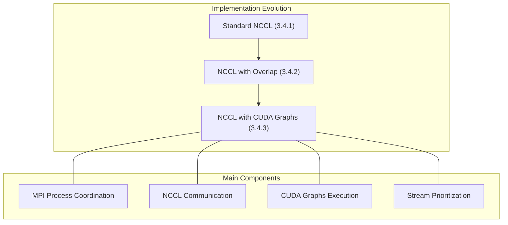
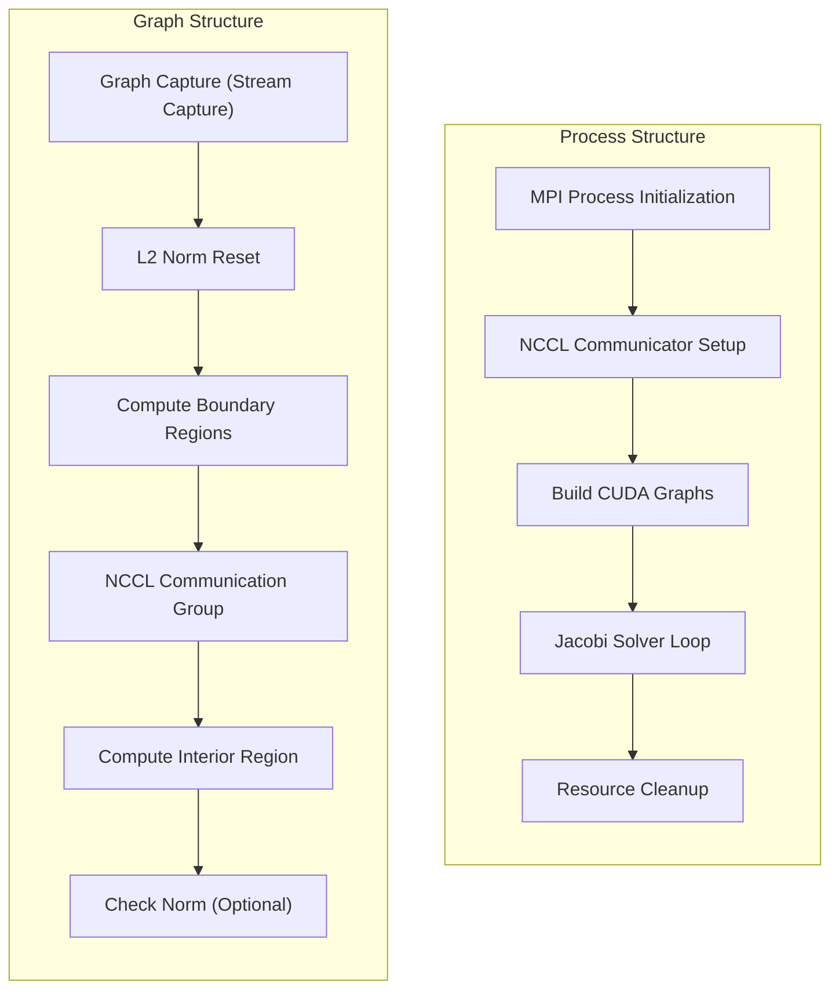
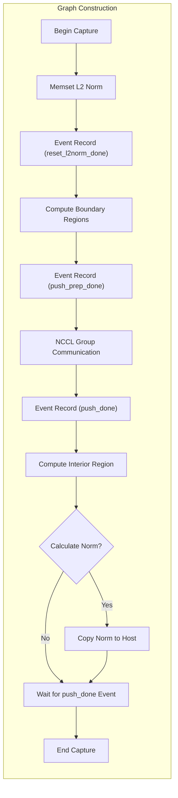
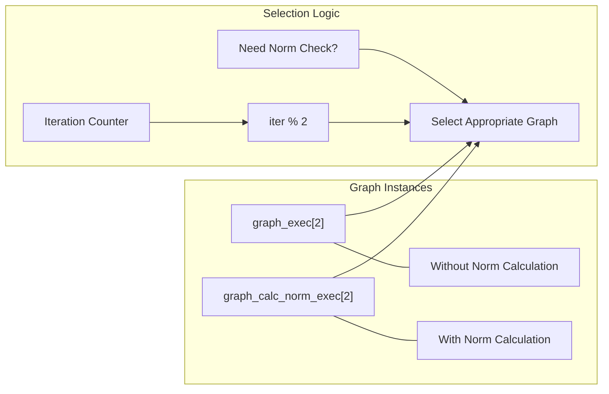
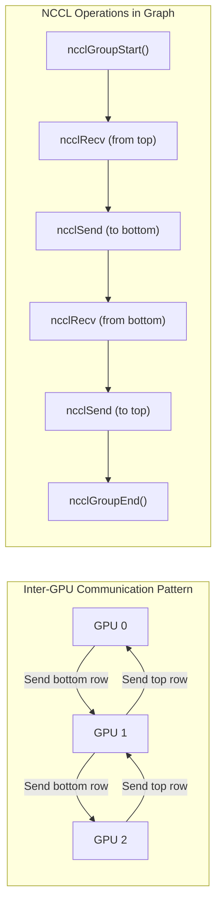
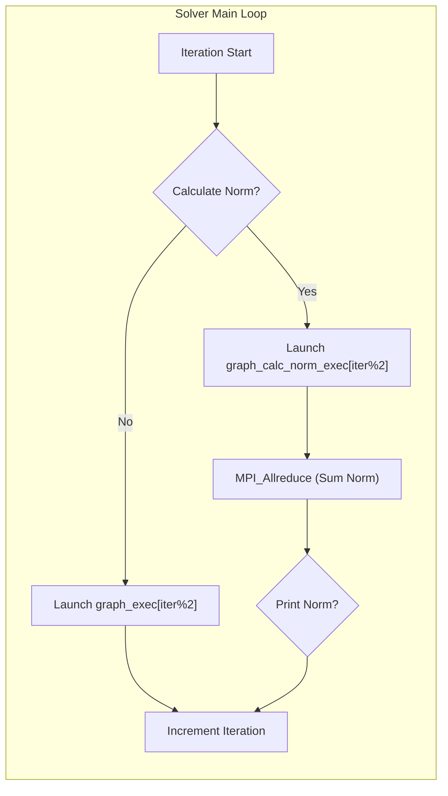
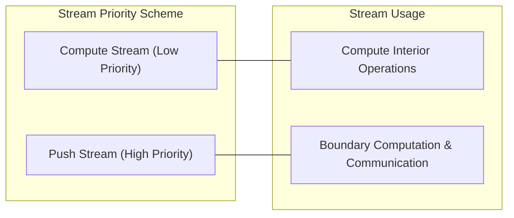
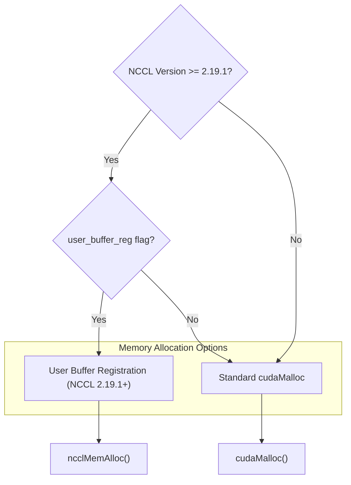
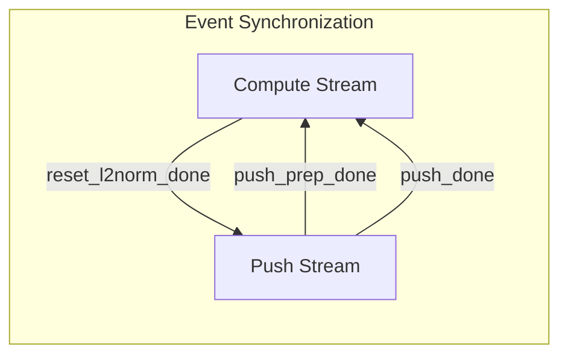

<!-- source: DeepWiki mcp.deepwiki.com · repo NVIDIA/multi-gpu-programming-models · extra page NCCL with CUDA Graphs · fetched 2026-10-26 -->

# NCCL with CUDA Graphs

<details>
<summary>Relevant source files</summary>

The following files were used as context for generating this wiki page:

- [nccl_graphs/Makefile](nccl_graphs/Makefile)
- [nccl_graphs/jacobi.cpp](nccl_graphs/jacobi.cpp)
- [nccl_graphs/jacobi_kernels.cu](nccl_graphs/jacobi_kernels.cu)

</details>


## Purpose and Scope

This document covers the implementation of the Jacobi relaxation solver that combines NVIDIA Collective Communication Library (NCCL) with CUDA Graphs. This implementation represents an advanced optimization approach that builds upon the standard NCCL implementation ([NCCL Implementation](#3.4.1)) and NCCL with computation-communication overlap ([NCCL with Overlap](#3.4.2)) by adding CUDA Graphs to reduce kernel launch overhead and further optimize performance.

Sources: [nccl_graphs/jacobi.cpp:1-26](), [nccl_graphs/jacobi.cpp:160-169]()

## Technical Overview

The NCCL with CUDA Graphs implementation uses CUDA Graphs to capture and replay sequences of GPU operations, including both computation kernels and NCCL communication operations. This approach reduces CPU overhead, minimizes kernel launch latency, and enables more efficient execution by allowing the GPU to schedule work more optimally.



Sources: [nccl_graphs/jacobi.cpp:291-303](), [nccl_graphs/jacobi.cpp:326-407]()

## Implementation Architecture

The NCCL with CUDA Graphs implementation combines several technologies:

1. **MPI**: Used for process coordination and global synchronization
2. **NCCL**: Provides optimized communication primitives for GPU-to-GPU data exchange
3. **CUDA Graphs**: Captures sequences of CUDA operations for efficient replay
4. **Stream Prioritization**: Ensures critical operations are scheduled first



Sources: [nccl_graphs/jacobi.cpp:160-226](), [nccl_graphs/jacobi.cpp:326-394]()

## CUDA Graph Construction

The implementation captures four distinct CUDA Graphs to handle the different execution paths in the Jacobi solver:

1. Two graphs for iterations without norm calculation (for both buffer states)
2. Two graphs for iterations with norm calculation (for both buffer states)

This approach allows for efficient execution regardless of which buffer is being updated (`a` or `a_new`) and whether norm calculation is required for the current iteration.



Sources: [nccl_graphs/jacobi.cpp:326-394]()

### Graph Variant Management

The implementation manages different graph variants using an array structure:



Sources: [nccl_graphs/jacobi.cpp:326-388](), [nccl_graphs/jacobi.cpp:430-442]()

## Communication Pattern

The NCCL with CUDA Graphs implementation uses a neighborhood communication pattern where each GPU communicates with its neighbors (top and bottom ranks) using `ncclSend` and `ncclRecv` operations grouped with `ncclGroupStart` and `ncclGroupEnd`.



Sources: [nccl_graphs/jacobi.cpp:351-360]()

## Graph Execution and Performance Benefits

The main solver loop executes the appropriate CUDA graph based on whether norm calculation is needed. This approach provides several performance benefits:

1. **Reduced CPU Overhead**: Launching a CUDA graph is much more efficient than launching individual operations
2. **Optimized GPU Scheduling**: The GPU can better manage dependencies within the graph
3. **Minimized Kernel Launch Latency**: Kernel launches within the graph have minimal overhead
4. **Stream Priority Preservation**: The graph maintains stream priority relationships



Sources: [nccl_graphs/jacobi.cpp:428-444]()

## Implementation Details

### Stream Prioritization

The implementation uses stream prioritization to ensure that communication operations take precedence over computation:



Sources: [nccl_graphs/jacobi.cpp:291-303]()

### User Buffer Registration Support

The implementation includes support for NCCL's user buffer registration feature for versions that support it (NCCL 2.19.1 or later):



Sources: [nccl_graphs/jacobi.cpp:258-276](), [nccl_graphs/jacobi.cpp:499-511]()

## GPU Synchronization with Events

The implementation uses CUDA events to synchronize operations between streams:

- `reset_l2norm_done`: Signals completion of L2 norm reset
- `push_prep_done`: Signals completion of boundary region computation
- `push_done`: Signals completion of NCCL communication



Sources: [nccl_graphs/jacobi.cpp:300-305](), [nccl_graphs/jacobi.cpp:341-372]()

## Performance Considerations

The NCCL with CUDA Graphs implementation offers several performance advantages:

1. **Lower CPU Overhead**: By capturing and replaying entire sequences of GPU work
2. **Improved GPU Utilization**: Better scheduling of dependent operations
3. **Reduced Kernel Launch Latency**: Minimized driver overhead for launches within the graph
4. **Preserved Optimization Techniques**: Retains benefits from stream prioritization and computation-communication overlap

When compared to other implementations, this approach is particularly beneficial for problems requiring many iterations, as the upfront cost of graph creation is amortized across multiple executions.

Sources: [nccl_graphs/jacobi.cpp:428-447](), [nccl_graphs/jacobi.cpp:326-394]()

## Compilation and Execution

The NCCL with CUDA Graphs implementation can be built and run using the provided Makefile:

```bash
make
mpirun -np <number_of_gpus> ./jacobi [options]
```

Key command-line options include:
- `-niter <iterations>`: Maximum number of iterations (default: 1000)
- `-nccheck <frequency>`: Frequency of convergence checks (default: 1)
- `-nx <size>`, `-ny <size>`: Problem dimensions (default: 16384)
- `-user_buffer_reg`: Enable NCCL user buffer registration (requires NCCL 2.19.1+)

For profiling, the implementation includes NVTX ranges and supports CUDA profiling tools:

```bash
make profile NP=<number_of_gpus>
```

Sources: [nccl_graphs/Makefile:1-44](), [nccl_graphs/jacobi.cpp:160-183]()

---

