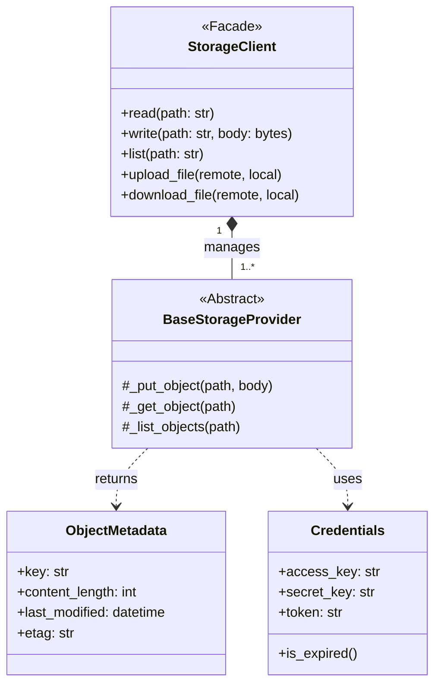

<!-- source: DeepWiki mcp.deepwiki.com · repo NVIDIA/multi-storage-client · page 1 Overview · fetched 2026-10-26 -->

# Overview

<details>
<summary>Relevant source files</summary>

The following files were used as context for generating this wiki page:

- [.github/pull_request_template.md](.github/pull_request_template.md)
- [.github/workflows/slack.yml](.github/workflows/slack.yml)
- [.release_notes/.unreleased.md](.release_notes/.unreleased.md)
- [.release_notes/1.0.0.md](.release_notes/1.0.0.md)
- [CONTRIBUTING.md](CONTRIBUTING.md)
- [README.md](README.md)
- [multi-storage-client/pyproject.toml](multi-storage-client/pyproject.toml)
- [multi-storage-client/src/multistorageclient/providers/base.py](multi-storage-client/src/multistorageclient/providers/base.py)
- [multi-storage-client/src/multistorageclient/types.py](multi-storage-client/src/multistorageclient/types.py)
- [multi-storage-client/tests/test_multistorageclient/unit/providers/test_base_storage_provider.py](multi-storage-client/tests/test_multistorageclient/unit/providers/test_base_storage_provider.py)
- [pyproject.toml](pyproject.toml)
- [uv.lock](uv.lock)

</details>


The multi-storage-client (MSC) is a unified, high-performance Python client library for interacting with various object and file stores. It provides a consistent interface for accessing multiple storage backends including cloud providers (AWS S3, Azure Blob Storage, Google Cloud Storage, Oracle Cloud), POSIX file systems, and NVIDIA AIStore.

Sources: [README.md:1-6](), [multi-storage-client/pyproject.toml:8-10]()

## Purpose and Key Features

Multi-storage-client serves as an abstraction layer, enabling seamless interaction with diverse storage systems through a unified API. It provides:

- **Unified Interface**: A consistent API for operations across different storage backends.
- **Pluggable Architecture**: Support for multiple storage providers, credential systems, and metadata backends.
- **Performance Optimization**: Client-side caching, streaming capabilities, and Rust-accelerated transfers.
- **Observability**: Integrated metrics and tracing through OpenTelemetry.
- **Ecosystem Integration**: Compatibility with key Python data ecosystems (fsspec, PyTorch, Zarr, XArray, Ray).
- **Filesystem Access**: A FUSE-based daemon (MSFS) for POSIX-level access to cloud backends.

Sources: [multi-storage-client/pyproject.toml:28-42](), [multi-storage-client/pyproject.toml:48-126](), [README.md:45-47]()

## Monorepo Structure

The repository is organized as a monorepo containing the following components:

| Component | Path | Description |
|-----------|------|-------------|
| **Python Client** | `multi-storage-client` | The core Python library and Rust performance backend. |
| **Documentation** | `multi-storage-client-docs` | Sphinx-based documentation source. |
| **Scripts** | `multi-storage-client-scripts` | Internal tools for CI/CD, API compatibility, and releases. |
| **Web Explorer** | `multi-storage-explorer` | A React-based web UI for browsing storage backends. |
| **FUSE Filesystem** | `multi-storage-file-system` | A Go implementation of the MSFS daemon. |

Sources: [README.md:24-66](), [uv.lock:18-23]()

## System Architecture

The following diagram maps high-level system components to their respective code entities and shows the data flow from user interfaces to storage backends.

```mermaid
graph TD
    subgraph "User Interface Layer"
        [DirectAPI] --> |"StorageClient"| MSC["multistorageclient.client.StorageClient"]
        [Shortcuts] --> |"shortcuts.py"| MSC
        [PathAPI] --> |"MultiStoragePath"| MSC
        [CLI] --> |"msc command"| MSC
    end
    
    subgraph "Core Abstraction Layer"
        MSC --> |"delegates to"| SP["multistorageclient.types.StorageProvider"]
        MSC --> |"manages"| CM["multistorageclient.cache.manager.CacheManager"]
        MSC --> |"telemetry"| OTEL["opentelemetry-api"]
    end
    
    subgraph "Provider Implementations"
        SP --> S3["S3StorageProvider"]
        SP --> AZ["AzureBlobStorageProvider"]
        SP --> GCS["GoogleStorageProvider"]
        SP --> POS["PosixFileStorageProvider"]
        SP --> AIS["AIStoreStorageProvider"]
    end
    
    subgraph "Performance & Backend"
        MSC --> |"run_coroutine_sync"| RUST["multistorageclient_rust"]
        MSFS["MSFS Daemon (Go)"] -.-> |"FUSE"| POS
    end
```

Sources: [multi-storage-client/src/multistorageclient/providers/base.py:170-205](), [multi-storage-client/pyproject.toml:145-151](), [multi-storage-client/src/multistorageclient/providers/base.py:34-35]()

## Core Components and Relationships

The library follows a "Core + Extras" architecture. The core logic handles path resolution, caching, and telemetry, while specific storage backends and integrations are loaded as optional dependencies.



Sources: [multi-storage-client/src/multistorageclient/providers/base.py:170-205](), [multi-storage-client/src/multistorageclient/types.py:80-120](), [multi-storage-client/src/multistorageclient/types.py:120-146]()

## Storage Providers

The multi-storage-client supports multiple storage backends. Most cloud providers require specific optional dependencies:

| Provider | Description | Dependency Group |
|----------|-------------|---------------------|
| **S3** | AWS S3 and S3-compatible storage | `boto3` |
| **Azure** | Microsoft Azure Blob Storage | `azure-storage-blob` |
| **GCS** | Google Cloud Storage | `google-cloud-storage` |
| **OCI** | Oracle Cloud Infrastructure | `oci` |
| **POSIX** | Local filesystem access | (Core) |
| **AIStore** | NVIDIA AIStore | `aistore` |

Sources: [multi-storage-client/pyproject.toml:79-102]()

## Performance and Observability

- **Rust Backend**: High-performance async I/O is handled by `multistorageclient_rust` using PyO3 bindings. Python calls are bridged via `run_coroutine_sync`.
- **Parallel Listing**: The `_PrefixExpander` in the base provider uses a `ThreadPoolExecutor` to expand directory prefixes in parallel, improving listing performance for deep hierarchies.
- **Telemetry**: MSC uses OpenTelemetry to track operations (`read`, `write`, `copy`, `list`). It collects attributes such as `multistorageclient.provider` and `multistorageclient.operation`.

Sources: [multi-storage-client/src/multistorageclient/providers/base.py:34-35](), [multi-storage-client/src/multistorageclient/providers/base.py:88-154](), [multi-storage-client/src/multistorageclient/providers/base.py:180-205]()

## Stable API (MSC 1.0)

Starting with version 1.0.0, the project follows strict semantic versioning. Key changes in the stable release include:
- Standardized `symlink_handling` using the `SymlinkHandling` enum (`FOLLOW`, `SKIP`, `PRESERVE`).
- Unified `list(path=...)` interface.
- Stable cache eviction policies (FIFO, LRU, MRU).

Sources: [.release_notes/1.0.0.md:1-12](), [multi-storage-client/src/multistorageclient/types.py:43-66]()

---

