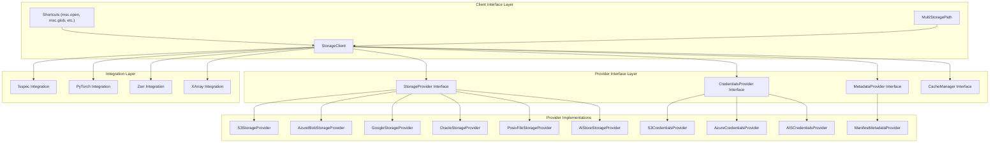
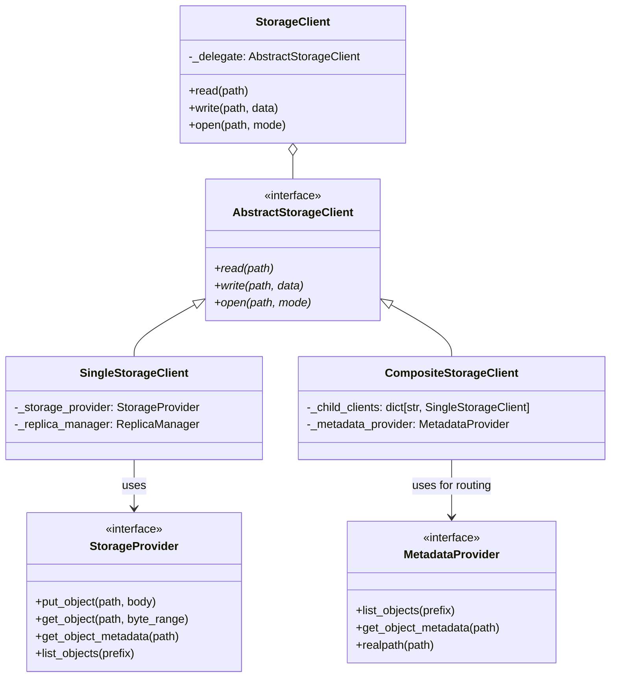
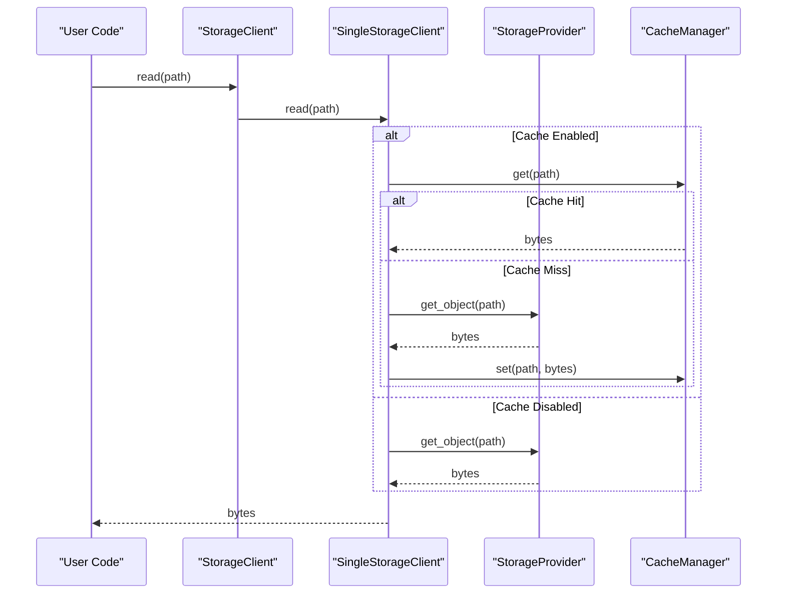
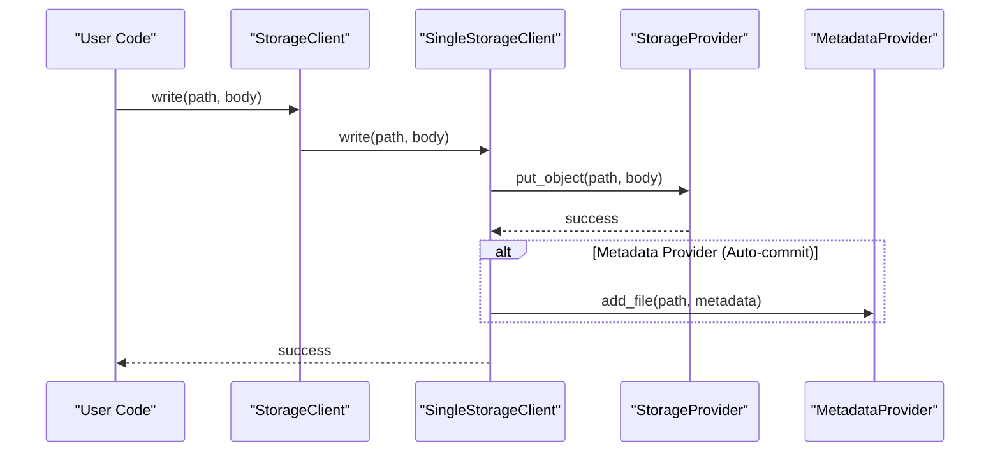

<!-- source: DeepWiki mcp.deepwiki.com · repo NVIDIA/multi-storage-client · page 2 Architecture · fetched 2026-10-26 -->

# Architecture

Relevant source files

The following files were used as context for generating this wiki page:

- [multi-storage-client/src/multistorageclient/client/client.py](multi-storage-client/src/multistorageclient/client/client.py)
- [multi-storage-client/src/multistorageclient/client/composite.py](multi-storage-client/src/multistorageclient/client/composite.py)
- [multi-storage-client/src/multistorageclient/client/single.py](multi-storage-client/src/multistorageclient/client/single.py)
- [multi-storage-client/src/multistorageclient/client/types.py](multi-storage-client/src/multistorageclient/client/types.py)
- [multi-storage-client/src/multistorageclient/providers/base.py](multi-storage-client/src/multistorageclient/providers/base.py)
- [multi-storage-client/src/multistorageclient/types.py](multi-storage-client/src/multistorageclient/types.py)
- [multi-storage-client/tests/test_multistorageclient/unit/providers/test_base_storage_provider.py](multi-storage-client/tests/test_multistorageclient/unit/providers/test_base_storage_provider.py)

This document outlines the architecture of the Multi-Storage Client (MSC), describing its core components and their interactions. It provides a high-level understanding of how MSC abstracts various storage backends behind a unified interface. For specific implementation details of individual components, see the related wiki pages on [Core Components](#2.1) and [Storage Provider Implementations](#2.3).

## System Overview

The Multi-Storage Client provides a unified, high-performance Python interface for interacting with various object and file storage systems. It abstracts the underlying storage providers, allowing users to work with different storage systems using a consistent API, regardless of whether the data is in S3, Azure Blob Storage, Google Cloud Storage, Oracle Cloud, a local POSIX file system, or AIStore.

Sources: [src/multistorageclient/client/client.py:42-49](), [src/multistorageclient/types.py:153-283](), [src/multistorageclient/types.py:120-145](), [src/multistorageclient/types.py:286-381]()

## Core Architecture Principles

The Multi-Storage Client architecture is built around these key principles:

1. **Abstraction**: Provides a unified API that abstracts away the differences between various storage backends.
2. **Modularity**: Uses well-defined interfaces that allow for easy extension with new storage providers via a plugin system.
3. **Consistency**: Maintains consistent behavior across different storage providers (e.g., error translation and path normalization).
4. **Performance**: Incorporates caching and optimized data transfer mechanisms, including a Rust-based performance backend for cloud providers. [src/multistorageclient/client/single.py:175-180]()
5. **Observability**: Includes built-in instrumentation for monitoring and tracing using OpenTelemetry. [src/multistorageclient/providers/base.py:31-35]()

## Component Model

The architecture follows a delegated facade pattern. The `StorageClient` acts as a facade, delegating operations to either a `SingleStorageClient` or a `CompositeStorageClient`.

Sources: [src/multistorageclient/client/client.py:42-51](), [src/multistorageclient/client/types.py:42-58](), [src/multistorageclient/client/single.py:56-67](), [src/multistorageclient/client/composite.py:42-52](), [src/multistorageclient/types.py:186-283]()

## Data Flow

### Read Data Flow
Read operations are routed based on the client type. In a `CompositeStorageClient`, the `MetadataProvider` resolves the logical path to a physical path and a specific backend profile. [src/multistorageclient/client/composite.py:173-178]()

Sources: [src/multistorageclient/client/single.py:165-167](), [src/multistorageclient/client/composite.py:167-178]()

### Write Data Flow
Write operations are typically supported only by `SingleStorageClient`. `CompositeStorageClient` is read-only for most operations to maintain consistency across backends. [src/multistorageclient/client/composite.py:42-50]()

Sources: [src/multistorageclient/client/single.py:98-114](), [src/multistorageclient/client/single.py:228-235]()

## Provider Architecture

All storage providers inherit from `BaseStorageProvider`, which provides common logic for path normalization, telemetry, and parallel listing. [src/multistorageclient/providers/base.py:170-205]()

- **Path Normalization**: The `base_path` is automatically prepended to all paths before calling internal implementation methods like `_get_object`. [src/multistorageclient/providers/base.py:171-177]()
- **Parallel Listing**: Uses a `_PrefixExpander` and a heap-based consumer to parallelize directory traversal. [src/multistorageclient/providers/base.py:88-106]()
- **Telemetry**: Automatically emits metrics for operation latency, data size, and errors. [src/multistorageclient/providers/base.py:180-205]()

Sources: [src/multistorageclient/providers/base.py:170-205](), [src/multistorageclient/providers/base.py:88-106](), [tests/test_multistorageclient/unit/providers/test_base_storage_provider.py:31-78]()

## File Handling

MSC provides file-like objects for both POSIX and cloud backends:
- **`PosixFile`**: Wraps standard Python file objects for local filesystem access, supporting atomic writes via temporary files. [src/multistorageclient/file.py:532-550]()
- **`ObjectFile`**: Manages remote object streams, integrating with the `CacheManager` for local caching and the `StorageProvider` for multipart uploads. [src/multistorageclient/file.py:166-200]()

Sources: [src/multistorageclient/file.py:166-200](), [src/multistorageclient/file.py:532-550]()

## Summary

The Multi-Storage Client architecture provides a flexible, delegated framework for accessing various storage backends through a unified interface. Key architectural features include:
- **Delegation**: Facade pattern for single vs. composite backend routing.
- **Replica Management**: Automatic failover and priority-based read routing. [src/multistorageclient/client/single.py:118-138]()
- **Metadata Routing**: Logical-to-physical path resolution for multi-backend datasets. [src/multistorageclient/client/composite.py:173-178]()
- **Performance**: Rust-accelerated IO and parallelized provider operations. [src/multistorageclient/providers/base.py:34-35]()

For more details, see:
- [Core Components](#2.1)
- [Configuration System](#2.2)
- [Caching System](#2.5)
- [Rust Backend](#2.7)

---

