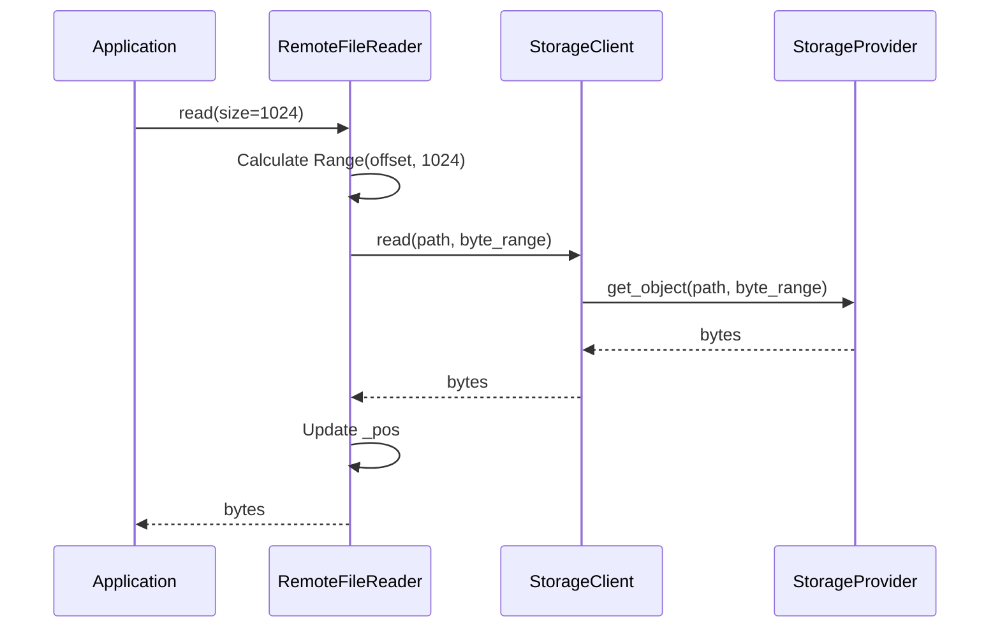
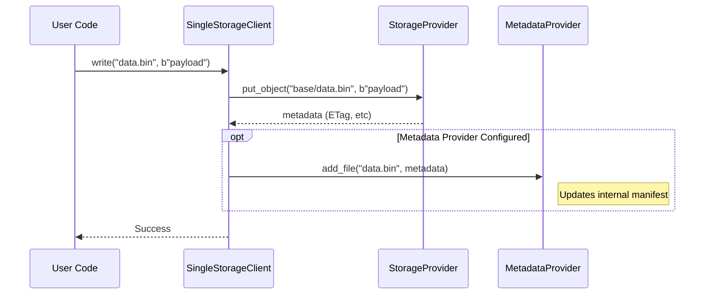

<!-- source: DeepWiki mcp.deepwiki.com · repo NVIDIA/multi-storage-client · page 2.1 Core Components · fetched 2026-10-26 -->

# Core Components

<details>
<summary>Relevant source files</summary>

The following files were used as context for generating this wiki page:

- [multi-storage-client-docs/src/user_guide/explorer.rst](multi-storage-client-docs/src/user_guide/explorer.rst)
- [multi-storage-client-docs/src/user_guide/rust.rst](multi-storage-client-docs/src/user_guide/rust.rst)
- [multi-storage-client/src/multistorageclient/client/client.py](multi-storage-client/src/multistorageclient/client/client.py)
- [multi-storage-client/src/multistorageclient/client/composite.py](multi-storage-client/src/multistorageclient/client/composite.py)
- [multi-storage-client/src/multistorageclient/client/single.py](multi-storage-client/src/multistorageclient/client/single.py)
- [multi-storage-client/src/multistorageclient/client/types.py](multi-storage-client/src/multistorageclient/client/types.py)
- [multi-storage-client/src/multistorageclient/file.py](multi-storage-client/src/multistorageclient/file.py)
- [multi-storage-client/src/multistorageclient/providers/base.py](multi-storage-client/src/multistorageclient/providers/base.py)
- [multi-storage-client/src/multistorageclient/types.py](multi-storage-client/src/multistorageclient/types.py)
- [multi-storage-client/src/multistorageclient/utils.py](multi-storage-client/src/multistorageclient/utils.py)
- [multi-storage-client/tests/test_multistorageclient/unit/client/test_client.py](multi-storage-client/tests/test_multistorageclient/unit/client/test_client.py)
- [multi-storage-client/tests/test_multistorageclient/unit/providers/test_base_storage_provider.py](multi-storage-client/tests/test_multistorageclient/unit/providers/test_base_storage_provider.py)
- [multi-storage-client/tests/test_multistorageclient/unit/test_file.py](multi-storage-client/tests/test_multistorageclient/unit/test_file.py)
- [multi-storage-client/tests/test_multistorageclient/unit/test_utils.py](multi-storage-client/tests/test_multistorageclient/unit/test_utils.py)

</details>


This page documents the core architectural components of the Multi-Storage Client library. It provides detailed information about the primary interfaces and classes that form the foundation of the system.

For configuration details, see [Configuration System](2.2). For specific storage provider implementations, see [Storage Provider Implementations](2.3).

## Overview of Core Components

The Multi-Storage Client architecture is built around several key interfaces that work together to provide a unified storage experience across different backends. The system uses a facade pattern where `StorageClient` delegates to specific implementations based on the configuration.

### System Class Diagram

```mermaid
classDiagram
    class "StorageClient" {
        +read(path)
        +write(path, data)
        +copy(src, dest)
        +delete(path)
        +list(prefix)
        +glob(pattern)
        +open(path, mode)
        +upload_file/download_file()
        +sync_from(source_client)
    }
    
    class "AbstractStorageClient" {
        <<abstract>>
        #_config: StorageClientConfig
        #_storage_provider: StorageProvider
        #_metadata_provider: MetadataProvider
        +read()*
        +open()*
        +list_objects()*
    }

    class "StorageProvider" {
        <<interface>>
        +put_object(path, body)
        +get_object(path)
        +copy_object(src, dest)
        +delete_object(path)
        +list_objects(prefix)
        +get_object_metadata(path)
    }
    
    class "CredentialsProvider" {
        <<interface>>
        +get_credentials()
        +refresh_credentials()
    }
    
    class "MetadataProvider" {
        <<interface>>
        +list_objects(prefix)
        +get_object_metadata(path)
        +realpath(path)
        +commit_updates()
    }
    
    "StorageClient" *-- "AbstractStorageClient" : delegates to
    "AbstractStorageClient" <|-- "SingleStorageClient"
    "AbstractStorageClient" <|-- "CompositeStorageClient"
    "AbstractStorageClient" --> "StorageProvider" : uses
    "AbstractStorageClient" --> "CredentialsProvider" : configures
    "AbstractStorageClient" --> "MetadataProvider" : optional
```
Sources: [src/multistorageclient/client/types.py:42-57](), [src/multistorageclient/client/client.py:42-51](), [src/multistorageclient/types.py:19-25]()

## StorageClient Facade

The `StorageClient` class in [src/multistorageclient/client/client.py:42-49]() acts as a unified facade. It inspects the provided `StorageClientConfig` and automatically instantiates the appropriate internal delegate.

- **`SingleStorageClient`**: Used for single-backend configurations. Supports full read and write operations [src/multistorageclient/client/single.py:56-61]().
- **`CompositeStorageClient`**: Used for multi-backend configurations (e.g., when `storage_provider_profiles` is set). This implementation is **read-only** and routes requests to child `SingleStorageClient` instances based on metadata [src/multistorageclient/client/composite.py:42-50]().

Sources: [src/multistorageclient/client/client.py:53-60](), [src/multistorageclient/client/single.py:79-84](), [src/multistorageclient/client/composite.py:61-68]()

### Composite Routing and Provider Bundles
The `CompositeStorageClient` relies on a `MetadataProvider` to make routing decisions. It uses `realpath(path)` to obtain a `ResolvedPath`, which contains the `profile` name of the backend where the data physically resides [src/multistorageclient/client/composite.py:173-178]().

When using `ProviderBundleV2`, child configurations are pre-built and passed into the composite client via `config.child_configs` [src/multistorageclient/client/composite.py:83-86]().

Sources: [src/multistorageclient/client/composite.py:80-98](), [src/multistorageclient/client/composite.py:145-165]()

## StorageProvider Interface

The `StorageProvider` interface (defined in `multistorageclient.types`) is the contract for backend-specific logic. Most providers inherit from `BaseStorageProvider`.

### BaseStorageProvider
`BaseStorageProvider` [src/multistorageclient/providers/base.py:170-204]() handles:
1.  **Path Translation**: Automatically prepends `base_path` to all relative logical paths before calling internal methods [src/multistorageclient/providers/base.py:171-177]().
2.  **Telemetry**: Automatically collects metrics for `READ`, `WRITE`, `COPY`, and `DELETE` operations using OpenTelemetry [src/multistorageclient/providers/base.py:180-204]().
3.  **Parallel Listing**: Implements a `_PrefixExpander` using a `ThreadPoolExecutor` to accelerate directory traversal for providers that support it [src/multistorageclient/providers/base.py:88-154]().

### ObjectMetadata
All listing and info operations return `ObjectMetadata` [src/multistorageclient/types.py:120-145]().

| Field | Description |
| :--- | :--- |
| `key` | Logical relative path |
| `content_length` | Size in bytes |
| `last_modified` | `datetime` object (UTC) |
| `etag` | Entity tag for versioning |
| `symlink_target` | Populated if the object represents a symbolic link [src/multistorageclient/types.py:142-145]() |

Sources: [src/multistorageclient/providers/base.py:170-204](), [src/multistorageclient/types.py:120-146]()

## CredentialsProvider and MetadataProvider

### CredentialsProvider
Provides a `Credentials` object containing `access_key`, `secret_key`, and an optional `token` [src/multistorageclient/types.py:81-95](). It includes an `is_expired()` helper to facilitate proactive refreshing [src/multistorageclient/types.py:97-106]().

### MetadataProvider
Decouples logical paths from physical locations.
- **`realpath(path)`**: The most critical function for composite clients; it returns a `ResolvedPath` mapping a logical string to a `(physical_path, profile)` pair [src/multistorageclient/client/composite.py:173-177]().
- **Auto-Commit**: `SingleStorageClient` can manage a background `_committer_thread` to periodically call `commit_metadata()` if `autocommit_config` is enabled [src/multistorageclient/client/single.py:98-114]().

Sources: [src/multistorageclient/types.py:81-118](), [src/multistorageclient/client/single.py:140-154]()

## File Abstractions

MSC provides file-like objects that implement the standard `IO[bytes]` interface.

### ObjectFile vs PosixFile
- **`PosixFile`**: Returned when the backend is a local filesystem. Supports atomic writes by writing to a temporary file and renaming on `close()` [src/multistorageclient/file.py:532-540]().
- **`ObjectFile`**: Returned for cloud backends.
    - **Read**: Uses `RemoteFileReader` for range-based streaming [src/multistorageclient/file.py:43-49]().
    - **Write**: Buffers to a local temporary file and uploads the entire result to the provider upon `close()` [src/multistorageclient/file.py:184-194]().

### RemoteFileReader Data Flow
For large files, `RemoteFileReader` performs range requests to avoid OOM (Out Of Memory) issues.


Sources: [src/multistorageclient/file.py:93-118](), [src/multistorageclient/file.py:43-62]()

## Component Interactions: Write Operation

The following diagram shows the interaction when writing to a single backend.


Sources: [src/multistorageclient/client/single.py:246-270](), [src/multistorageclient/client/single.py:159-163]()

---

