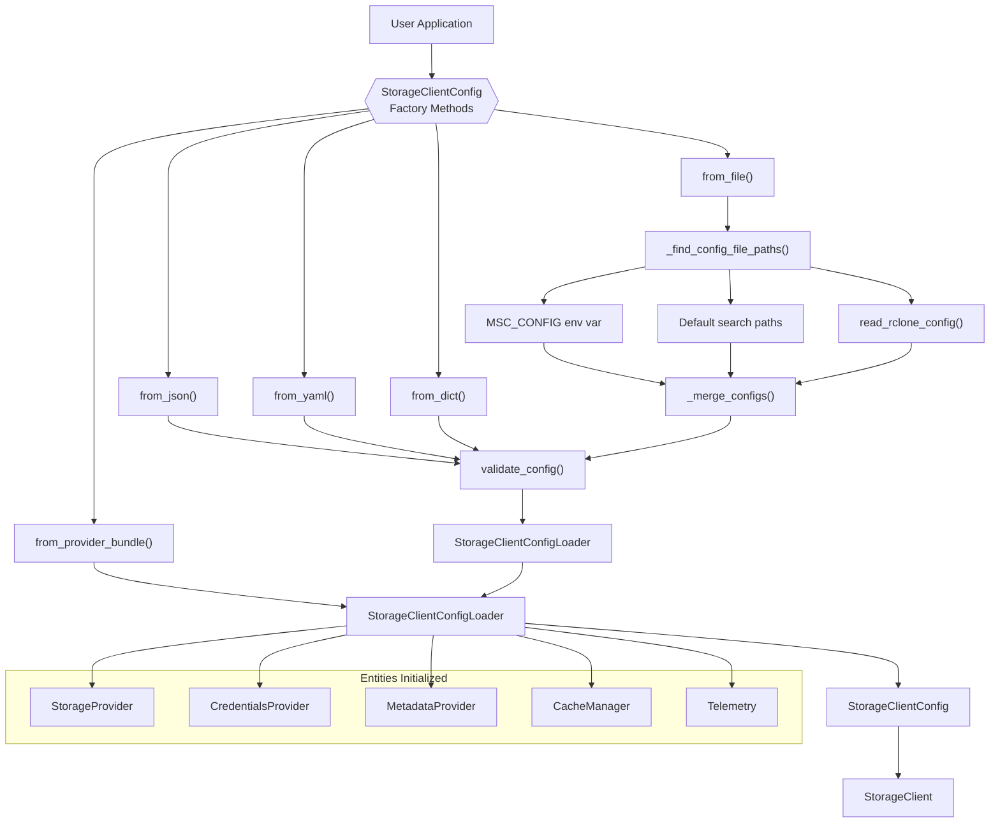
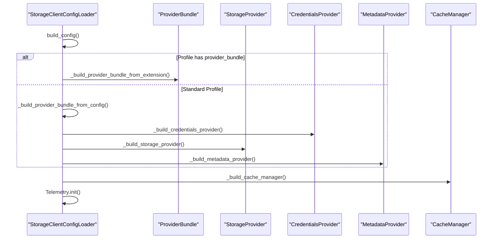

<!-- source: DeepWiki mcp.deepwiki.com · repo NVIDIA/multi-storage-client · page 2.2 Configuration System · fetched 2026-10-26 -->

# Configuration System

<details>
<summary>Relevant source files</summary>

The following files were used as context for generating this wiki page:

- [multi-storage-client-docs/src/references/configuration.rst](multi-storage-client-docs/src/references/configuration.rst)
- [multi-storage-client-docs/src/user_guide/cache.rst](multi-storage-client-docs/src/user_guide/cache.rst)
- [multi-storage-client/.msc/config.yaml](multi-storage-client/.msc/config.yaml)
- [multi-storage-client/src/multistorageclient/caching/README.md](multi-storage-client/src/multistorageclient/caching/README.md)
- [multi-storage-client/src/multistorageclient/config.py](multi-storage-client/src/multistorageclient/config.py)
- [multi-storage-client/src/multistorageclient/schema.py](multi-storage-client/src/multistorageclient/schema.py)
- [multi-storage-client/tests/test_multistorageclient/unit/mcp/test_mcp_integration.py](multi-storage-client/tests/test_multistorageclient/unit/mcp/test_mcp_integration.py)
- [multi-storage-client/tests/test_multistorageclient/unit/test_config.py](multi-storage-client/tests/test_multistorageclient/unit/test_config.py)
- [multi-storage-client/tests/test_multistorageclient/unit/test_replica_manager.py](multi-storage-client/tests/test_multistorageclient/unit/test_replica_manager.py)
- [multi-storage-client/tests/test_multistorageclient/unit/test_schema.py](multi-storage-client/tests/test_multistorageclient/unit/test_schema.py)

</details>


The Configuration System in multi-storage-client provides a flexible and powerful way to configure and initialize storage clients. It supports multiple configuration formats, environment variable expansion, profile-based configurations, include directives, and schema validation to ensure correctness.

## Configuration Overview

The multi-storage-client configuration system revolves around the `StorageClientConfig` class, which is responsible for loading configuration from various sources and initializing the components needed by the `StorageClient`. The configuration system supports JSON, YAML, and dictionary-based configurations, with optional environment variable expansion and modular configuration management via includes.

### Code-to-System Mapping
The following diagram shows how configuration methods in `StorageClientConfig` relate to the internal loading and validation logic.



Sources: [src/multistorageclient/config.py:429-549](), [src/multistorageclient/config.py:105-428](), [src/multistorageclient/schema.py:33-33]()

## Configuration Methods

The `StorageClientConfig` class provides several static methods to create configurations from different sources:

1.  **`from_file()`**: Loads configuration from file(s), looking in common locations or specified by the `MSC_CONFIG` environment variable. It handles merging multiple files if `include` directives are present. [src/multistorageclient/config.py:462-511]()
2.  **`from_json()`**: Creates configuration from a JSON string. [src/multistorageclient/config.py:521-527]()
3.  **`from_yaml()`**: Creates configuration from a YAML string. [src/multistorageclient/config.py:513-519]()
4.  **`from_dict()`**: Creates configuration from a Python dictionary. [src/multistorageclient/config.py:447-460]()
5.  **`from_provider_bundle()`**: Creates configuration from a pre-built `ProviderBundle` instance. [src/multistorageclient/config.py:529-549]()

### File Search Order
When using `StorageClientConfig.from_file()`, the `_find_config_file_paths()` function searches for configuration files in the following order:
1.  Path specified in the `MSC_CONFIG` environment variable. [src/multistorageclient/config.py:487-490]()
2.  Standard configuration paths (e.g., `/etc/msc_config.yaml`, `~/.config/msc/config.yaml`). [src/multistorageclient/config.py:60-69]()
3.  rclone configuration file via `read_rclone_config()`. [src/multistorageclient/config.py:506-508]()

If no configuration file is found, a reserved POSIX profile named `__filesystem__` is used as a fallback. [src/multistorageclient/config.py:81-82]()

## Modular Configuration (Includes)

MSC supports splitting configuration across multiple files using the `include` keyword. This enables modular management of shared settings like OpenTelemetry or Cache.

*   **Merge Rules**:
    *   **Profiles**: Combined from all files. Identical profile definitions are allowed (idempotent), but conflicting definitions for the same profile name raise a `ValueError`. [src/multistorageclient/config.py:124-181]()
    *   **OpenTelemetry**: Attributes are concatenated. Readers and exporters must be identical across files or defined in only one. [src/multistorageclient/config.py:184-233]()
    *   **Path Mapping**: Entries are merged; conflicts raise an error. [src/multistorageclient/config.py:236-258]()
    *   **Cache / POSIX**: Must be identical across all files or defined in only one. [src/multistorageclient/config.py:261-277]()

Sources: [multi-storage-client-docs/src/references/configuration.rst:60-134](), [src/multistorageclient/config.py:109-281]()

## Configuration Schema and Validation

The configuration is validated using `jsonschema` against `CONFIG_SCHEMA`. [src/multistorageclient/schema.py:19-216]()

### Key Schema Sections
| Section | Description |
| :--- | :--- |
| `profiles` | Dictionary of profile definitions. Profile names must not start with `_` except for `__filesystem__`. [src/multistorageclient/schema.py:101-171]() |
| `cache` | Global cache settings including `size`, `location`, `eviction_policy`, and `check_source_version`. [src/multistorageclient/schema.py:54-98]() |
| `opentelemetry` | Metrics and tracing configuration. [src/multistorageclient/schema.py:32-52]() |
| `path_mapping` | Maps non-MSC URLs (e.g., `s3://`) to MSC profiles. [src/multistorageclient/schema.py:174-178]() |
| `posix` | FUSE mount settings for MSFS. [src/multistorageclient/schema.py:181-205]() |

Sources: [src/multistorageclient/schema.py:21-216](), [multi-storage-client-docs/src/references/configuration.rst:13-59]()

## Component Initialization

The `StorageClientConfigLoader` class manages the instantiation of the storage stack based on the selected profile.



Sources: [src/multistorageclient/config.py:365-425]()

### Storage Provider Mapping
Storage providers are initialized using `STORAGE_PROVIDER_MAPPING`. [src/multistorageclient/config.py:84-95]()
*   `s3` -> `S3StorageProvider`
*   `file` -> `PosixFileStorageProvider`
*   `gcs` -> `GoogleStorageProvider`
*   `azure` -> `AzureBlobStorageProvider`
*   `ais` -> `AIStoreStorageProvider`

### Credentials Provider Mapping
Credentials providers use `CREDENTIALS_PROVIDER_MAPPING`. [src/multistorageclient/config.py:97-106]()
*   `S3Credentials` -> `StaticS3CredentialsProvider`
*   `DefaultAzureCredentials` -> `DefaultAzureCredentialsProvider`

## Path Mapping

The `path_mapping` system allows the client to resolve standard cloud URLs (like `s3://bucket/`) to specific MSC profiles. This is critical for transparently intercepting calls in libraries that don't natively use `msc://` protocols.

*   **Schema**: Keys are URL prefixes (must end in `/`), and values are MSC profile URLs (e.g., `msc://my-s3-profile/`). [src/multistorageclient/schema.py:174-178]()
*   **Expansion**: Environment variables are expanded in mapping values. [src/multistorageclient/config.py:440]()

Sources: [multi-storage-client-docs/src/references/configuration.rst:31-34](), [src/multistorageclient/config.py:438-442]()

## Cache Configuration

The cache system is configured globally but can be enabled/disabled per profile using `caching_enabled`. [src/multistorageclient/schema.py:148-148]()

*   **`check_source_version`**: Replaces the legacy `use_etag`. If `true`, MSC validates the remote object version before serving from cache. [multi-storage-client-docs/src/user_guide/cache.rst:37-44]()
*   **`cache_line_size`**: Defines chunk sizes for partial file caching (default 64MB). [multi-storage-client-docs/src/user_guide/cache.rst:56-57]()
*   **Eviction Policies**: Supports `lru`, `mru`, `fifo`, `random`, and `no_eviction`. [src/multistorageclient/schema.py:72-86]()

Sources: [src/multistorageclient/cache.py:29-30](), [multi-storage-client-docs/src/user_guide/cache.rst:28-72]()

## Environment Variable Expansion

MSC uses `expand_env_vars()` to resolve `${VAR}` syntax within configuration strings. This allows sensitive credentials or dynamic paths to be injected at runtime. [src/multistorageclient/utils.py:52-52]()

Example:
```yaml
storage_provider:
  type: s3
  options:
    base_path: ${MY_BUCKET_NAME}
```

Sources: [src/multistorageclient/config.py:52](), [multi-storage-client-docs/src/references/configuration.rst:151-151]()

---

