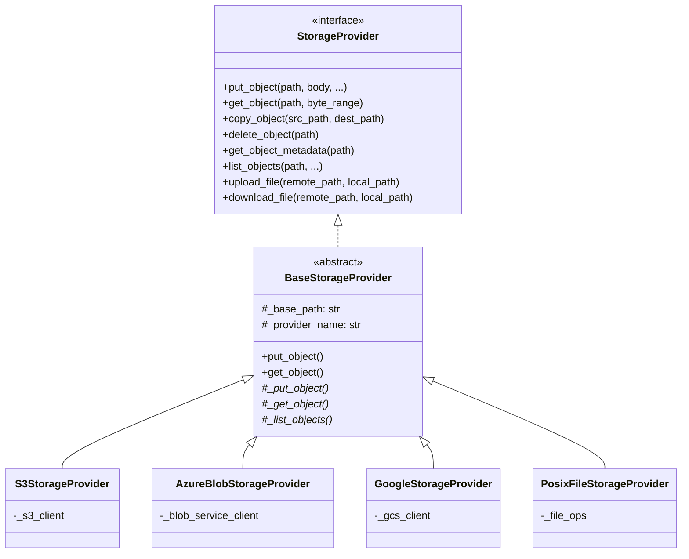
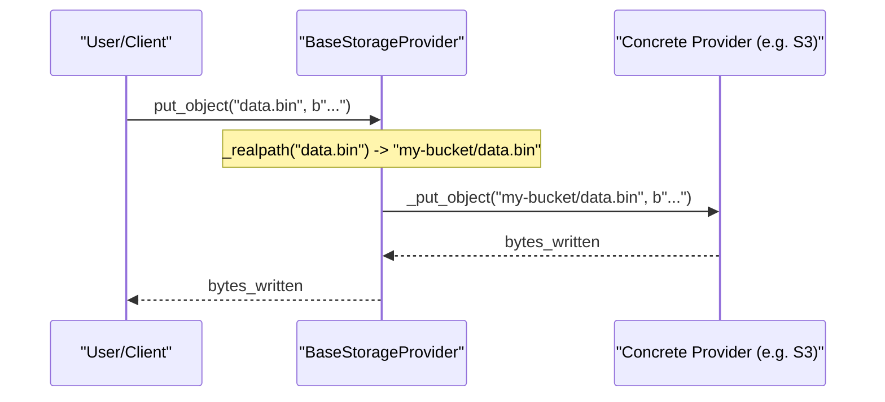

<!-- source: DeepWiki mcp.deepwiki.com · repo NVIDIA/multi-storage-client · page 2.3 Storage Provider Implementations · fetched 2026-10-26 -->

# Storage Provider Implementations

Relevant source files

The following files were used as context for generating this wiki page:

- [multi-storage-client/src/multistorageclient/providers/__init__.py](multi-storage-client/src/multistorageclient/providers/__init__.py)
- [multi-storage-client/src/multistorageclient/providers/base.py](multi-storage-client/src/multistorageclient/providers/base.py)
- [multi-storage-client/src/multistorageclient/providers/file_credentials.py](multi-storage-client/src/multistorageclient/providers/file_credentials.py)
- [multi-storage-client/src/multistorageclient/types.py](multi-storage-client/src/multistorageclient/types.py)
- [multi-storage-client/tests/test_multistorageclient/e2e/test_file_credentials.py](multi-storage-client/tests/test_multistorageclient/e2e/test_file_credentials.py)
- [multi-storage-client/tests/test_multistorageclient/unit/providers/test_base_storage_provider.py](multi-storage-client/tests/test_multistorageclient/unit/providers/test_base_storage_provider.py)
- [multi-storage-client/tests/test_multistorageclient/unit/providers/test_file_credentials_provider.py](multi-storage-client/tests/test_multistorageclient/unit/providers/test_file_credentials_provider.py)
- [multi-storage-client/tests/test_multistorageclient/unit/test_credentials_provider.py](multi-storage-client/tests/test_multistorageclient/unit/test_credentials_provider.py)

## Introduction

This page documents the storage provider implementations in the `multi-storage-client` library. Storage providers are the core components responsible for interfacing with different storage backends such as S3, Azure Blob Storage, Google Cloud Storage, Oracle Cloud Storage, POSIX file systems, and AIStore. These providers implement a common interface while abstracting away the specific details of each storage system.

The provider architecture is designed to be extensible, allowing new backends to be added by implementing the `StorageProvider` abstract base class [src/multistorageclient/types.py:207-356]().

For information about the core architecture and interfaces, see [Core Components](#2.1). For details about configuring storage providers, see [Configuration System](#2.2).

Sources: [src/multistorageclient/providers/base.py:170-205](), [src/multistorageclient/types.py:207-356]()

## Provider Architecture

The `multi-storage-client` uses a consistent inheritance model for all storage providers. The `BaseStorageProvider` [src/multistorageclient/providers/base.py:170]() implements common logic like path translation, telemetry, and parallel listing, while concrete subclasses handle the specific API calls.

### Code Entity Mapping: Provider Hierarchy

Sources: [src/multistorageclient/types.py:207-356](), [src/multistorageclient/providers/base.py:170-205](), [src/multistorageclient/providers/__init__.py:31-61]()

## Provider Registration and Loading

Providers are lazily loaded to minimize dependency overhead. The `multistorageclient.providers` module uses `__getattr__` to import specific provider classes only when requested [src/multistorageclient/providers/__init__.py:29-115](). If a provider's dependencies (e.g., `boto3`, `azure-storage-blob`) are missing, the client provides a helpful error message indicating which `pip install` extra is required [src/multistorageclient/providers/__init__.py:70-111]().

### Credentials Integration

Each provider works in tandem with a `CredentialsProvider` [src/multistorageclient/types.py:192-204](). For example, the `AzureBlobStorageProvider` can use a `DefaultAzureCredentialsProvider` [tests/test_multistorageclient/unit/test_credentials_provider.py:28-55](), and the `GoogleStorageProvider` supports `GoogleIdentityPoolCredentialsProvider` [tests/test_multistorageclient/unit/test_credentials_provider.py:82-109](). A generic `FileBasedCredentialsProvider` is also available for reading AWS-style JSON credential files [src/multistorageclient/providers/file_credentials.py:27-53]().

Sources: [src/multistorageclient/providers/__init__.py:29-115](), [src/multistorageclient/providers/file_credentials.py:27-53](), [tests/test_multistorageclient/unit/test_credentials_provider.py:28-109]()

## BaseStorageProvider Logic

The `BaseStorageProvider` class handles path normalization by automatically prepending a `base_path` to all logical paths provided by the user [src/multistorageclient/providers/base.py:171-177]().

### Path Resolution Sequence

### Parallel Listing

`BaseStorageProvider` implements a sophisticated parallel listing mechanism using a `_PrefixExpander` and a heap-based consumer [src/multistorageclient/providers/base.py:74-154](). This allows the client to fetch multiple directory prefixes concurrently, significantly speeding up `list_objects` and `glob` operations on deep directory structures.

Sources: [src/multistorageclient/providers/base.py:74-154](), [src/multistorageclient/providers/base.py:170-205](), [tests/test_multistorageclient/unit/providers/test_base_storage_provider.py:103-132]()

## Major Provider Groups

Detailed documentation for each provider implementation is found in the following child pages:

### [AWS S3 Provider](#2.3.1)
Covers the `S3StorageProvider`, including support for S3-compatible backends like `s8k` and `gcs_s3`. It details multipart upload logic, Rust-accelerated transfers via `multistorageclient_rust`, and presigned URL generation.

### [Azure and Oracle Providers](#2.3.2)
Documents `AzureBlobStorageProvider` and `OracleStorageProvider`. Focuses on Azure-specific authentication (MSAL) and OCI's `UploadManager` integration.

### [Google Cloud Storage Provider](#2.3.3)
Covers the native `GoogleStorageProvider` and the S3-compatible `GoogleS3StorageProvider`. Includes details on Service Account and Identity Pool authentication.

### [POSIX and AIStore Providers](#2.3.4)
Documents `PosixFileStorageProvider` (local filesystem) and `AIStoreStorageProvider`. Details how the POSIX provider handles `SymlinkHandling` [src/multistorageclient/types.py:43-61]() and how AIStore leverages manifest generation.

## Common Features and Limitations

| Feature | Description | Implementation Note |
|:---|:---|:---|
| **Conditional Writes** | `if_match` and `if_none_match` support. | Handled via ETags in cloud providers [src/multistorageclient/types.py:120-146](). |
| **Batch Transfers** | `upload_files` and `download_files`. | Implemented with thread pools in `BaseStorageProvider` [src/multistorageclient/providers/base.py:63-70](). |
| **Symlinks** | Logical symlinks in object storage. | Encoded as objects with `symlink_target` metadata [src/multistorageclient/types.py:181-185](). |
| **Telemetry** | OpenTelemetry integration. | Providers emit `multistorageclient.operation` and `multistorageclient.status` metrics [src/multistorageclient/providers/base.py:180-199](). |

Sources: [src/multistorageclient/providers/base.py:180-205](), [src/multistorageclient/types.py:43-185]()

---

