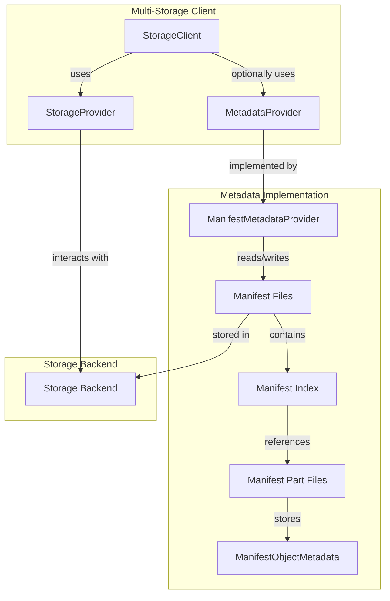
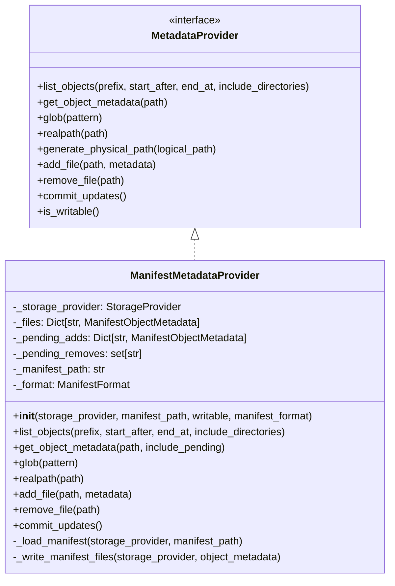
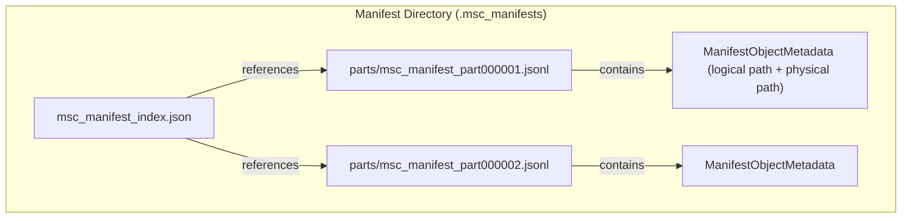
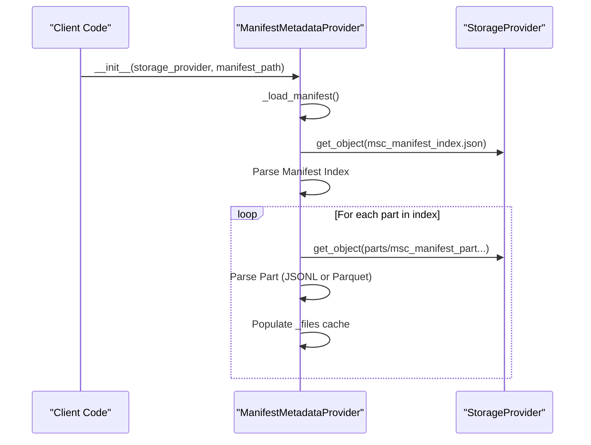

<!-- source: DeepWiki mcp.deepwiki.com · repo NVIDIA/multi-storage-client · page 2.4 Metadata System · fetched 2026-10-26 -->

# Metadata System

Relevant source files

The following files were used as context for generating this wiki page:

- [multi-storage-client-docs/src/references/api.rst](multi-storage-client-docs/src/references/api.rst)
- [multi-storage-client/src/multistorageclient/__init__.py](multi-storage-client/src/multistorageclient/__init__.py)
- [multi-storage-client/src/multistorageclient/client/__init__.py](multi-storage-client/src/multistorageclient/client/__init__.py)
- [multi-storage-client/src/multistorageclient/generators/manifest_metadata.py](multi-storage-client/src/multistorageclient/generators/manifest_metadata.py)
- [multi-storage-client/src/multistorageclient/providers/manifest_formats.py](multi-storage-client/src/multistorageclient/providers/manifest_formats.py)
- [multi-storage-client/src/multistorageclient/providers/manifest_metadata.py](multi-storage-client/src/multistorageclient/providers/manifest_metadata.py)
- [multi-storage-client/src/multistorageclient/providers/manifest_object_metadata.py](multi-storage-client/src/multistorageclient/providers/manifest_object_metadata.py)
- [multi-storage-client/tests/test_multistorageclient/unit/providers/test_manifest_metadata.py](multi-storage-client/tests/test_multistorageclient/unit/providers/test_manifest_metadata.py)
- [multi-storage-client/tests/test_multistorageclient/unit/providers/test_metadata_rewrite.py](multi-storage-client/tests/test_multistorageclient/unit/providers/test_metadata_rewrite.py)
- [multi-storage-client/tests/test_multistorageclient/unit/utils/mocks.py](multi-storage-client/tests/test_multistorageclient/unit/utils/mocks.py)

The Metadata System in `multi-storage-client` provides a way to track and manage object metadata separately from the actual objects stored in various storage providers. This separation allows for efficient querying and manipulation of metadata without needing to interact with the objects themselves. The primary implementation is the `ManifestMetadataProvider`, which stores metadata in manifest files within the storage system.

## Overview

The Metadata System serves as an optional component in the architecture, providing enhanced capabilities for tracking, querying, and managing object metadata. It allows for logical-to-physical path mapping and atomic metadata updates.

Sources: [src/multistorageclient/providers/manifest_metadata.py:111-141](), [src/multistorageclient/providers/manifest_object_metadata.py:23-35]()

## MetadataProvider Interface

The `MetadataProvider` interface defines the contract for metadata providers. Any implementation can be used to provide metadata services to the `StorageClient`.

Sources: [src/multistorageclient/providers/manifest_metadata.py:111-150](), [tests/test_multistorageclient/unit/utils/mocks.py:62-132]()

## Manifest Formats and Structure

The manifest system organizes metadata using a structured file format. It supports multiple serialization formats via the `ManifestFormat` enum and corresponding handlers.

### Supported Formats
- **JSONL**: Default format. Each line is a JSON object representing one file's metadata. [src/multistorageclient/providers/manifest_formats.py:50-74]()
- **Parquet**: Binary columnar format for high-performance metadata reading, requiring `pyarrow`. [src/multistorageclient/providers/manifest_formats.py:77-134]()

### File Hierarchy
The manifest is stored within a `.msc_manifests` directory by default. [src/multistorageclient/providers/manifest_metadata.py:42]()

Sources: [src/multistorageclient/providers/manifest_metadata.py:42-46](), [src/multistorageclient/providers/manifest_metadata.py:79-108](), [src/multistorageclient/providers/manifest_formats.py:25-28]()

## Physical vs. Logical Path Resolution

The system supports **Metadata Rewriting**, where a logical path (user-facing) maps to a different physical path (actual storage location). This is enabled by `ManifestObjectMetadata`.

- **Logical Path**: The key used by the user in the `StorageClient`.
- **Physical Path**: The actual key on the backend (e.g., a UUID or hashed path).
- **realpath()**: Resolves a logical path to a `ResolvedPath` containing the physical location. [src/multistorageclient/providers/manifest_metadata.py:381-397]()
- **generate_physical_path()**: Creates a new physical path for a logical path, supporting features like safe overwrites. [src/multistorageclient/providers/manifest_metadata.py:399-411]()

Sources: [src/multistorageclient/providers/manifest_object_metadata.py:23-35](), [tests/test_multistorageclient/unit/providers/test_metadata_rewrite.py:29-94]()

## Core Functionality

### Loading Manifests
During initialization, `ManifestMetadataProvider` performs a recursive search for the manifest index. [src/multistorageclient/providers/manifest_metadata.py:151-183]()

Sources: [src/multistorageclient/providers/manifest_metadata.py:151-233](), [src/multistorageclient/providers/manifest_formats.py:137-148]()

### Transactional Updates
Metadata changes are not persisted immediately. They are held in `_pending_adds` and `_pending_removes` until a commit is triggered. [src/multistorageclient/providers/manifest_metadata.py:413-461]()

1. **add_file(path, metadata)**: Queues metadata for a new or updated file. [src/multistorageclient/providers/manifest_metadata.py:413-424]()
2. **remove_file(path)**: Queues a file for deletion from the manifest. [src/multistorageclient/providers/manifest_metadata.py:426-435]()
3. **commit_updates()**: Writes new manifest parts and a new index file to the storage provider. [src/multistorageclient/providers/manifest_metadata.py:441-461]()

Sources: [src/multistorageclient/providers/manifest_metadata.py:413-461](), [tests/test_multistorageclient/unit/providers/test_manifest_metadata.py:102-104]()

## Manifest Generator Utility

The `ManifestMetadataGenerator` is a utility for bootstrapping a manifest from an existing storage backend.

- **Listing**: It performs a full list of the `data_storage_client`. [src/multistorageclient/generators/manifest_metadata.py:108-110]()
- **Partitioning**: Supports `partition_keys` to parallelize the listing operation using a `ThreadPoolExecutor`. [src/multistorageclient/generators/manifest_metadata.py:90-106]()
- **Exclusion**: Automatically excludes the `.msc_manifests` directory from the generated manifest to avoid recursion. [src/multistorageclient/generators/manifest_metadata.py:100-101]()

Sources: [src/multistorageclient/generators/manifest_metadata.py:28-113]()

## Performance and Consistency

- **Fast Queries**: Once loaded, `list_objects`, `glob`, and `get_object_metadata` are served from an in-memory dictionary. [src/multistorageclient/providers/manifest_metadata.py:286-350]()
- **Atomicity**: The `commit_updates` process ensures that metadata updates are visible as a single atomic change once the index file is updated. [src/multistorageclient/providers/manifest_metadata.py:441-461]()
- **Soft Delete**: Supports a `should_use_soft_delete` mode where files are marked as deleted in metadata without immediately removing physical objects. [tests/test_multistorageclient/unit/providers/test_metadata_rewrite.py:130-132]()

Sources: [src/multistorageclient/providers/manifest_metadata.py:286-350](), [tests/test_multistorageclient/unit/providers/test_metadata_rewrite.py:29-85]()

---

