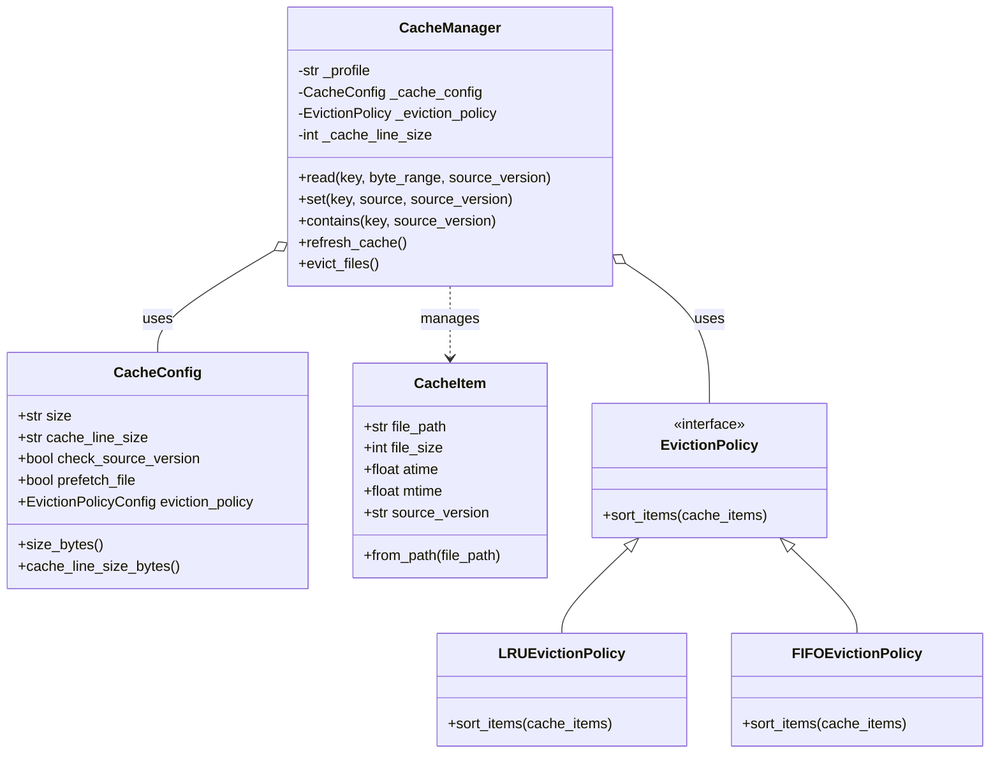
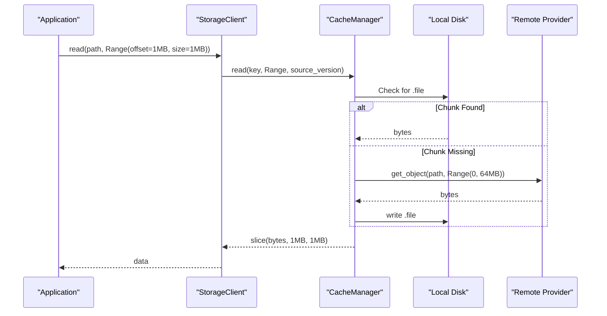

<!-- source: DeepWiki mcp.deepwiki.com · repo NVIDIA/multi-storage-client · page 2.5 Caching System · fetched 2026-10-26 -->

# Caching System

<details>
<summary>Relevant source files</summary>

The following files were used as context for generating this wiki page:

- [multi-storage-client-docs/src/references/configuration.rst](multi-storage-client-docs/src/references/configuration.rst)
- [multi-storage-client-docs/src/user_guide/cache.rst](multi-storage-client-docs/src/user_guide/cache.rst)
- [multi-storage-client/src/multistorageclient/cache.py](multi-storage-client/src/multistorageclient/cache.py)
- [multi-storage-client/src/multistorageclient/config.py](multi-storage-client/src/multistorageclient/config.py)
- [multi-storage-client/src/multistorageclient/providers/ais.py](multi-storage-client/src/multistorageclient/providers/ais.py)
- [multi-storage-client/src/multistorageclient/providers/oci.py](multi-storage-client/src/multistorageclient/providers/oci.py)
- [multi-storage-client/src/multistorageclient/schema.py](multi-storage-client/src/multistorageclient/schema.py)
- [multi-storage-client/tests/test_multistorageclient/unit/test_cache.py](multi-storage-client/tests/test_multistorageclient/unit/test_cache.py)
- [multi-storage-client/tests/test_multistorageclient/unit/test_config.py](multi-storage-client/tests/test_multistorageclient/unit/test_config.py)
- [multi-storage-client/tests/test_multistorageclient/unit/test_partial_file_caching.py](multi-storage-client/tests/test_multistorageclient/unit/test_partial_file_caching.py)
- [multi-storage-client/tests/test_multistorageclient/unit/test_schema.py](multi-storage-client/tests/test_multistorageclient/unit/test_schema.py)

</details>


The multi-storage-client caching system provides local caching capabilities to optimize performance when accessing remote storage objects. It stores frequently accessed data locally to reduce network requests, with configurable size limits and eviction policies. The system supports full-file caching as well as partial file caching using cache lines.

## Architecture Overview

The caching system is managed by the `CacheManager`, which coordinates cache backends, eviction policies, and data integrity checks.

Title: Caching System Architecture


Sources:
- [multi-storage-client/src/multistorageclient/cache.py:43-89]()
- [multi-storage-client/src/multistorageclient/caching/cache_config.py:31-118]()
- [multi-storage-client/src/multistorageclient/caching/cache_item.py:22-65]()
- [multi-storage-client/src/multistorageclient/caching/eviction_policy.py:37-128]()

## CacheManager Lifecycle

The `CacheManager` is initialized per profile when caching is enabled. It handles directory setup, initial cache population, and periodic maintenance.

1.  **Initialization**: Creates the cache directory structure under the configured `location` or a default temp path [multi-storage-client/src/multistorageclient/cache.py:68-74]().
2.  **Population**: Calls `refresh_cache()` on startup to index existing files in the cache directory [multi-storage-client/src/multistorageclient/cache.py:88-89]().
3.  **Operation**: Intercepts read/write requests. It uses `FileLock` to prevent concurrent writes to the same cached object [multi-storage-client/src/multistorageclient/cache.py:48-48]().
4.  **Maintenance**: Periodically triggers `evict_files()` based on the `refresh_interval` [multi-storage-client/src/multistorageclient/cache.py:60-61]().

Sources:
- [multi-storage-client/src/multistorageclient/cache.py:50-89]()
- [multi-storage-client-docs/src/user_guide/cache.rst:18-21]()

## Partial File Caching (Cache Lines)

MSC supports caching specific portions of large files, known as partial file caching. This is controlled by the `cache_line_size` parameter.

-   **Chunking**: Large files are split into chunks (default 64MB) [multi-storage-client/src/multistorageclient/cache.py:40-40]().
-   **Storage**: Chunks are stored as hidden files with a `#chunkN` suffix (e.g., `.data.bin#chunk0`) [multi-storage-client/src/multistorageclient/cache.py:173-174]().
-   **Range Requests**: When a specific byte range is requested via `client.read(..., byte_range=Range(...))`, MSC only downloads the chunks covering that range [multi-storage-client-docs/src/user_guide/cache.rst:56-58]().

Title: Partial Caching Data Flow


Sources:
- [multi-storage-client/src/multistorageclient/cache.py:40-41]()
- [multi-storage-client-docs/src/user_guide/cache.rst:52-58]()
- [multi-storage-client/tests/test_multistorageclient/unit/test_partial_file_caching.py:57-108]()

## Source Version Checking

To ensure data integrity, MSC can validate the remote object's version before serving a cached copy.

-   **Modes**: Controlled by `SourceVersionCheckMode` (`ENABLE`, `DISABLE`, `INHERIT`) [multi-storage-client/src/multistorageclient/types.py:108-112]().
-   **Mechanism**: MSC stores the source version (e.g., S3 ETag) as an extended attribute (`xattr`) on the cached file [multi-storage-client/src/multistorageclient/cache.py:27-27]().
-   **Validation**: If `check_source_version` is true, MSC performs a metadata check (HEAD request) on the remote provider. If the remote version differs from the cached `xattr`, the cache is invalidated [multi-storage-client-docs/src/user_guide/cache.rst:40-44]().

Sources:
- [multi-storage-client/src/multistorageclient/cache.py:168-185]()
- [multi-storage-client-docs/src/user_guide/cache.rst:96-108]()

## Eviction Policies

When the cache exceeds the configured `size`, the `EvictionPolicy` determines which files to remove.

| Policy | Description | Implementation Class |
| :--- | :--- | :--- |
| **LRU** | Least Recently Used (based on `atime`) | `LRUEvictionPolicy` |
| **MRU** | Most Recently Used | `MRUEvictionPolicy` |
| **FIFO** | First In First Out (based on `mtime`) | `FIFOEvictionPolicy` |
| **Random** | Randomly selects files for eviction | `RandomEvictionPolicy` |

Sources:
- [multi-storage-client/src/multistorageclient/schema.py:69-86]()
- [multi-storage-client/src/multistorageclient/caching/eviction_policy.py:37-128]()

## Configuration

Caching is configured in the top-level `cache` section of the YAML configuration.

```yaml
cache:
  size: 500G                 # Max total size (M, G, T suffixes)
  location: /mnt/nvme/cache  # Local path
  check_source_version: true # Enable ETag/version validation
  cache_line_size: 64M       # Chunk size for partial caching
  prefetch_file: false       # Use partial caching for open()
  eviction_policy:
    policy: lru
    refresh_interval: 300    # Seconds between eviction checks
```

Sources:
- [multi-storage-client/src/multistorageclient/schema.py:54-98]()
- [multi-storage-client-docs/src/references/configuration.rst:102-105]()

## Summary of Key Classes

| Class | Role | Source |
| :--- | :--- | :--- |
| `CacheManager` | Primary interface for storage clients to interact with the cache. | [multi-storage-client/src/multistorageclient/cache.py:43]() |
| `CacheConfig` | Parsed and validated cache settings. | [multi-storage-client/src/multistorageclient/caching/cache_config.py:31]() |
| `EvictionPolicyFactory` | Creates policy instances based on configuration strings. | [multi-storage-client/src/multistorageclient/caching/eviction_policy.py:131]() |
| `CacheItem` | Represents a single file or chunk in the cache with metadata. | [multi-storage-client/src/multistorageclient/caching/cache_item.py:22]() |

---

