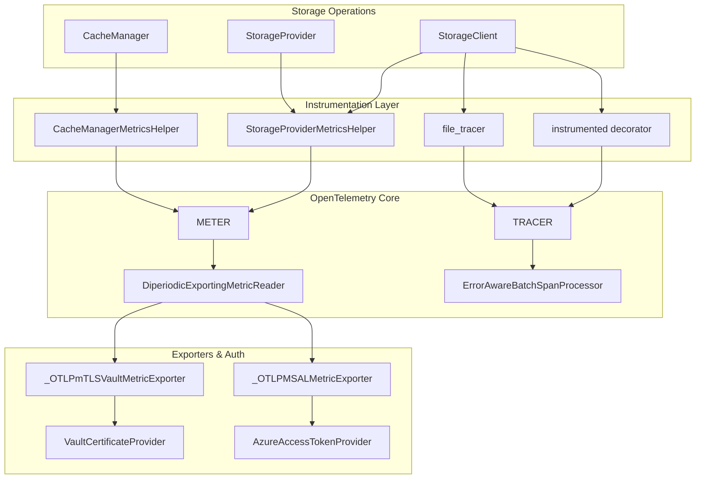
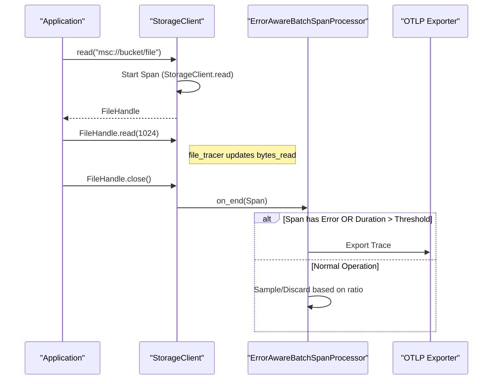

<!-- source: DeepWiki mcp.deepwiki.com · repo NVIDIA/multi-storage-client · page 2.6 Observability · fetched 2026-10-26 -->

# Observability

<details>
<summary>Relevant source files</summary>

The following files were used as context for generating this wiki page:

- [multi-storage-client-scripts/src/multistorageclient_scripts/utils/argparse_extensions/__init__.py](multi-storage-client-scripts/src/multistorageclient_scripts/utils/argparse_extensions/__init__.py)
- [multi-storage-client-scripts/src/multistorageclient_scripts/utils/wait/__init__.py](multi-storage-client-scripts/src/multistorageclient_scripts/utils/wait/__init__.py)
- [multi-storage-client/src/multistorageclient/explorer/api/server.py](multi-storage-client/src/multistorageclient/explorer/api/server.py)
- [multi-storage-client/src/multistorageclient/instrumentation/auth.py](multi-storage-client/src/multistorageclient/instrumentation/auth.py)
- [multi-storage-client/src/multistorageclient/mcp/server.py](multi-storage-client/src/multistorageclient/mcp/server.py)
- [multi-storage-client/src/multistorageclient/signers/cloudfront.py](multi-storage-client/src/multistorageclient/signers/cloudfront.py)
- [multi-storage-client/src/multistorageclient/telemetry/__init__.py](multi-storage-client/src/multistorageclient/telemetry/__init__.py)
- [multi-storage-client/src/multistorageclient/telemetry/metrics/exporters/otlp_msal.py](multi-storage-client/src/multistorageclient/telemetry/metrics/exporters/otlp_msal.py)
- [multi-storage-client/src/multistorageclient/telemetry/metrics/exporters/otlp_mtls_vault.py](multi-storage-client/src/multistorageclient/telemetry/metrics/exporters/otlp_mtls_vault.py)
- [multi-storage-client/src/multistorageclient/telemetry/metrics/readers/diperiodic_exporting.py](multi-storage-client/src/multistorageclient/telemetry/metrics/readers/diperiodic_exporting.py)
- [multi-storage-client/tests/test_multistorageclient/unit/explorer/test_api_endpoints.py](multi-storage-client/tests/test_multistorageclient/unit/explorer/test_api_endpoints.py)
- [multi-storage-client/tests/test_multistorageclient/unit/instrumentation/test_vault_certificate_provider.py](multi-storage-client/tests/test_multistorageclient/unit/instrumentation/test_vault_certificate_provider.py)
- [multi-storage-client/tests/test_multistorageclient/unit/telemetry/metrics/exporters/__init__.py](multi-storage-client/tests/test_multistorageclient/unit/telemetry/metrics/exporters/__init__.py)
- [multi-storage-client/tests/test_multistorageclient/unit/telemetry/metrics/exporters/test_otlp_mtls.py](multi-storage-client/tests/test_multistorageclient/unit/telemetry/metrics/exporters/test_otlp_mtls.py)
- [multi-storage-client/tests/test_multistorageclient/unit/telemetry/metrics/exporters/test_otlp_mtls_vault.py](multi-storage-client/tests/test_multistorageclient/unit/telemetry/metrics/exporters/test_otlp_mtls_vault.py)

</details>


This document describes the observability features in the `multi-storage-client` library, which provides comprehensive instrumentation and monitoring capabilities through OpenTelemetry. The observability system collects metrics (latency, data size, data rate), traces request flows, and exports this telemetry data to configurable backends using OTLP. It includes advanced features like async metrics offloading, MSAL authentication, and mTLS certificate management via HashiCorp Vault.

## Architecture Overview

The observability system is built on OpenTelemetry (OTel) and provides both metrics collection and distributed tracing. It is designed to be optional and high-performance, utilizing background threads for exporting to avoid blocking the main storage I/O path.



Sources: [src/multistorageclient/instrumentation/utils.py:250-330](), [src/multistorageclient/telemetry/metrics/readers/diperiodic_exporting.py:40-65](), [src/multistorageclient/telemetry/metrics/exporters/otlp_msal.py:30-45]()

## Metrics System

The metrics system tracks quantitative data about storage operations. To minimize impact on the application's critical path, the client uses a custom `DiperiodicExportingMetricReader`.

### Async Metrics Offloading

Unlike the standard OTel `PeriodicExportingMetricReader`, which couples collection and exporting, the `DiperiodicExportingMetricReader` runs two separate daemon threads:
1. **Collect Daemon**: Periodically gathers metrics from the SDK into a local buffer [src/multistorageclient/telemetry/metrics/readers/diperiodic_exporting.py:148-151]().
2. **Export Daemon**: Periodically flushes the buffer to the configured OTLP exporter [src/multistorageclient/telemetry/metrics/readers/diperiodic_exporting.py:154-157]().

This separation allows for high-frequency internal collection (e.g., every 1s) while maintaining lower-frequency external exports (e.g., every 60s) to reduce network overhead [src/multistorageclient/telemetry/metrics/readers/diperiodic_exporting.py:28-35]().

### Available Metrics

| Metric Name | Type | Description | Units |
|-------------|------|-------------|-------|
| `storageclient_api_duration` | Histogram | Latency of storage operations | milliseconds |
| `storageclient_object_size` | Histogram | Size of data transferred | megabytes |
| `storageclient_api_duration_p50/p99` | Gauge | Percentile latency via T-Digest | milliseconds |
| `storageclient_cache_manager_count` | Counter | Cache hits/misses/evictions | count |

Sources: [src/multistorageclient/instrumentation/utils.py:40-91](), [src/multistorageclient/instrumentation/utils.py:180-200]()

## Authentication and Exporters

The client supports sophisticated authentication mechanisms for telemetry backends, particularly useful in enterprise environments.

### MSAL Authentication
The `_OTLPMSALMetricExporter` integrates with the Microsoft Authentication Library (MSAL). It uses an `AccessTokenHTTPAdapter` to automatically inject Bearer tokens into OTLP export requests [src/multistorageclient/telemetry/metrics/exporters/otlp_msal.py:38-73](). This is managed by the `AzureAccessTokenProvider` [src/multistorageclient/telemetry/metrics/exporters/otlp_msal.py:92-93]().

### mTLS and Vault Certificate Provider
For secure OTLP communication, the library provides a `VaultCertificateProvider` that fetches mTLS certificates from HashiCorp Vault using AppRole authentication [src/multistorageclient/instrumentation/auth.py:85-104]().

**Key implementation details:**
- **Fingerprinting**: It computes a SHA-256 fingerprint of the configuration to manage multiple certificate sets [src/multistorageclient/instrumentation/auth.py:141-155]().
- **Caching**: Certificates are cached locally in a secure temporary directory (`0o600` permissions) to avoid repeated Vault calls [src/multistorageclient/instrumentation/auth.py:137-140](), [src/multistorageclient/instrumentation/auth.py:180-180]().
- **Expiration Check**: It uses the `cryptography` library to check the `not_valid_after_utc` field of cached certificates and refreshes them automatically if expired [src/multistorageclient/instrumentation/auth.py:182-198]().

Sources: [src/multistorageclient/instrumentation/auth.py:85-198](), [src/multistorageclient/telemetry/metrics/exporters/otlp_mtls_vault.py:58-65]()

## Tracing and Error-Aware Processing

Distributed tracing is implemented using the `ErrorAwareBatchSpanProcessor`. This processor performs "tail sampling" logic: it buffers spans and only flushes the full trace if an error is detected or if an operation exceeds a duration threshold [src/multistorageclient/instrumentation/error_aware_processor.py:22-50]().

### Instrumentation Decorators
- **`@instrumented`**: Automatically wraps class methods in spans, capturing the provider name, operation, and bucket as OTel attributes [src/multistorageclient/instrumentation/utils.py:348-380]().
- **`file_tracer`**: A specialized decorator for file-like objects that tracks `read()` and `write()` calls, recording the total bytes transferred as a span attribute [src/multistorageclient/instrumentation/utils.py:410-465]().



Sources: [src/multistorageclient/instrumentation/utils.py:410-465](), [src/multistorageclient/instrumentation/error_aware_processor.py:60-113]()

## Configuration

Observability is configured via the `observability` block in the MSC profile.

### mTLS Vault Example
```yaml
observability:
  metrics:
    exporter:
      type: "_otlp_mtls_vault"
      auth:
        vault_endpoint: "https://vault.internal"
        approle_id: "${VAULT_ROLE_ID}"
        approle_secret: "${VAULT_SECRET_ID}"
        secret_path: "pki/issue/msc-client"
      options:
        endpoint: "https://otel-collector:4318/v1/metrics"
```

Sources: [src/multistorageclient/telemetry/metrics/exporters/otlp_mtls_vault.py:81-94](), [src/multistorageclient/instrumentation/__init__.py:118-204]()

---

