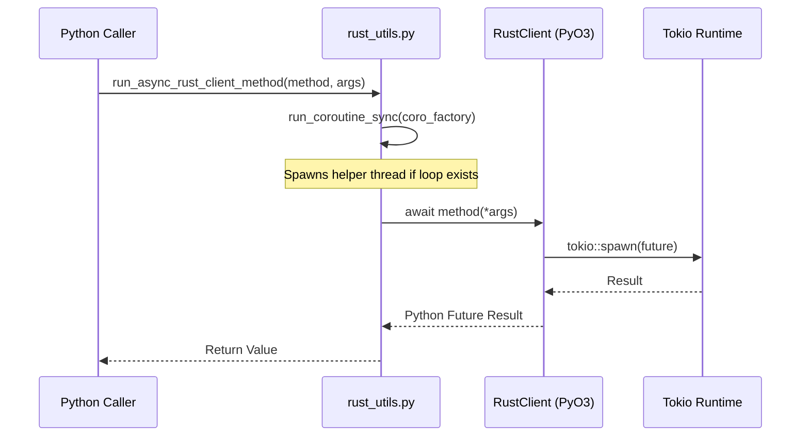
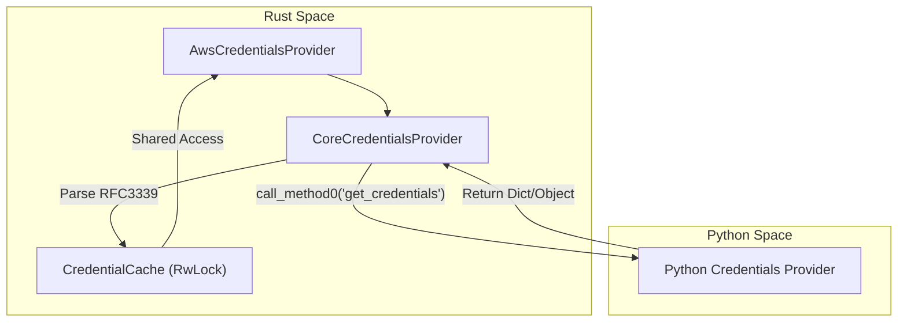

<!-- source: DeepWiki mcp.deepwiki.com · repo NVIDIA/multi-storage-client · page 2.7 Rust Backend · fetched 2026-10-26 -->

# Rust Backend

Relevant source files

The following files were used as context for generating this wiki page:

- [multi-storage-client/rust-toolchain.toml](multi-storage-client/rust-toolchain.toml)
- [multi-storage-client/rust/Cargo.lock](multi-storage-client/rust/Cargo.lock)
- [multi-storage-client/rust/Cargo.toml](multi-storage-client/rust/Cargo.toml)
- [multi-storage-client/rust/src/credentials.rs](multi-storage-client/rust/src/credentials.rs)
- [multi-storage-client/rust/src/lib.rs](multi-storage-client/rust/src/lib.rs)
- [multi-storage-client/rust/src/types.rs](multi-storage-client/rust/src/types.rs)
- [multi-storage-client/src/multistorageclient/rclone.py](multi-storage-client/src/multistorageclient/rclone.py)
- [multi-storage-client/src/multistorageclient/rust_utils.py](multi-storage-client/src/multistorageclient/rust_utils.py)
- [multi-storage-client/src/multistorageclient_rust/__init__.py](multi-storage-client/src/multistorageclient_rust/__init__.py)
- [multi-storage-client/src/multistorageclient_rust/multistorageclient_rust.pyi](multi-storage-client/src/multistorageclient_rust/multistorageclient_rust.pyi)
- [multi-storage-client/tests/test_multistorageclient/unit/test_rust_utils.py](multi-storage-client/tests/test_multistorageclient/unit/test_rust_utils.py)
- [multi-storage-client/tests/test_multistorageclient_rust/unit/test_rustclient.py](multi-storage-client/tests/test_multistorageclient_rust/unit/test_rustclient.py)

The Rust backend, implemented in the `multistorageclient_rust` package, provides a high-performance, asynchronous transfer layer for the Multi-Storage Client. It leverages the Rust `object_store` ecosystem to accelerate S3 and GCS operations, particularly for large-scale multipart uploads and downloads that benefit from Rust's zero-cost abstractions and efficient concurrency model.

## Overview and Build System

The Rust backend is integrated into the Python ecosystem using **PyO3** for bindings and **maturin** as the build system [multi-storage-client/rust/Cargo.toml:12-17](). It is compiled as a `cdylib` and exposed to Python as a native extension [multi-storage-client/rust/Cargo.toml:13-14]().

The core of the backend relies on the following key Rust crates:
*   `object_store`: Provides the underlying asynchronous storage abstractions for S3 and GCS [multi-storage-client/rust/Cargo.toml:23]().
*   `tokio`: Serves as the asynchronous runtime [multi-storage-client/rust/Cargo.toml:20]().
*   `pyo3-async-runtimes`: Manages the lifecycle of the Tokio runtime and handles the conversion between Rust `Futures` and Python `awaitables` [multi-storage-client/rust/Cargo.toml:18]().

### Code Entity Mapping: Build and Initialization
| Component | Code Entity | Description |
| :--- | :--- | :--- |
| **Python Interface** | `RustClient` | The main class exposed to Python [multi-storage-client/rust/src/lib.rs:20](). |
| **Rust Entry Point** | `#[pymodule]` | Defines the `multistorageclient_rust` module [multi-storage-client/rust/src/lib.rs:24](). |
| **Async Bridge** | `future_into_py` | Converts Rust `async` results to Python `Future` objects [multi-storage-client/rust/src/lib.rs:28](). |

Sources: [multi-storage-client/rust/Cargo.toml:1-34](), [multi-storage-client/rust/src/lib.rs:1-165]()

## Architecture and Data Flow

The Rust backend acts as an accelerated sidecar to the primary Python `StorageClient`. When high-throughput operations (like `upload_file` or `download_file`) are requested, the Python layer can delegate the task to the `RustClient`.

### Data Flow: Python to Async Rust
The following diagram illustrates how a synchronous Python call traverses into the asynchronous Rust runtime.

**Diagram: Sync Python to Async Rust Execution**

Sources: [multi-storage-client/src/multistorageclient/rust_utils.py:69-115](), [multi-storage-client/rust/src/lib.rs:28]()

## Implementation Details

### RustClient and ObjectStore
The `RustClient` struct (defined in `lib.rs`) encapsulates an `Arc<dyn ObjectStore>`. It supports both S3 (via `AmazonS3Builder`) and GCS (via `GoogleCloudStorageBuilder`) [multi-storage-client/rust/src/lib.rs:17-18]().

Key performance features include:
*   **Multipart Acceleration**: Functions like `upload_multipart_from_file` and `download_multipart_to_file` split data into chunks (default 32MB) and process them with a configurable concurrency level (default 8) [multi-storage-client/rust/src/lib.rs:168-169]().
*   **Semaphore-based Throttling**: Uses `tokio::sync::Semaphore` to limit concurrent network requests [multi-storage-client/rust/src/lib.rs:40]().
*   **Retry Logic**: Implements a `RustRetryConfig` that controls attempts, backoff multipliers, and timeouts directly within the Rust layer to minimize GIL transitions during retries [multi-storage-client/rust/src/types.rs:69-75]().

### Credential Handling
A critical component is the `AwsCredentialsProvider` and `GcpCredentialsProvider`, which bridge Python-based credential providers to Rust's `object_store` [multi-storage-client/rust/src/credentials.rs:124-129]().

**Diagram: Credential Bridging Logic**

The implementation uses a **two-tier caching strategy**:
1.  **Fast Path**: Attempts to read from a `RwLock<Option<CredentialCache>>` [multi-storage-client/rust/src/credentials.rs:188-189]().
2.  **Slow Path**: If expired or missing, it acquires a `tokio::sync::Mutex` (to prevent thundering herds) and calls back into Python to refresh the credentials [multi-storage-client/rust/src/credentials.rs:72-75]().

Sources: [multi-storage-client/rust/src/credentials.rs:37-75](), [multi-storage-client/rust/src/credentials.rs:177-190](), [multi-storage-client/rust/src/lib.rs:168-174]()

## Error Handling and Translation

The backend defines a comprehensive `StorageError` enum to map Rust errors to Python exceptions [multi-storage-client/rust/src/lib.rs:55-71]().

| Rust Error Variant | Python Exception | Logic / Context |
| :--- | :--- | :--- |
| `HttpError(msg, status)` | `RustClientError` | Includes HTTP status codes (e.g., 404, 403) [multi-storage-client/rust/src/lib.rs:154-156](). |
| `RetryExhaustedError` | `RustRetryableError` | Triggered by connection resets or request timeouts [multi-storage-client/rust/src/lib.rs:151-153](). |
| `ConfigError` | `ValueError` | Invalid bucket or endpoint configuration [multi-storage-client/rust/src/lib.rs:148-150](). |

The function `extract_status_code` maps `object_store::Error` variants (like `NotFound`) to standard u16 status codes for consistent handling in the Python layer [multi-storage-client/rust/src/lib.rs:78-90]().

Sources: [multi-storage-client/rust/src/lib.rs:55-165]()

## Python Bridge: run_coroutine_sync

Since the Python `StorageClient` is primarily synchronous, but the Rust backend is inherently asynchronous (Tokio-based), a bridge is required. The `multistorageclient.rust_utils` module provides `run_coroutine_sync` [multi-storage-client/src/multistorageclient/rust_utils.py:69]().

If a user calls a Rust-accelerated method from a thread that **already has a running event loop** (e.g., inside a FastAPI request or a Jupyter notebook), `run_coroutine_sync` spawns a dedicated background thread to run the coroutine to completion, avoiding `RuntimeError: This event loop is already running` [multi-storage-client/src/multistorageclient/rust_utils.py:82-93]().

Sources: [multi-storage-client/src/multistorageclient/rust_utils.py:69-93](), [multi-storage-client/src/multistorageclient/rust_utils.py:96-115]()

---

