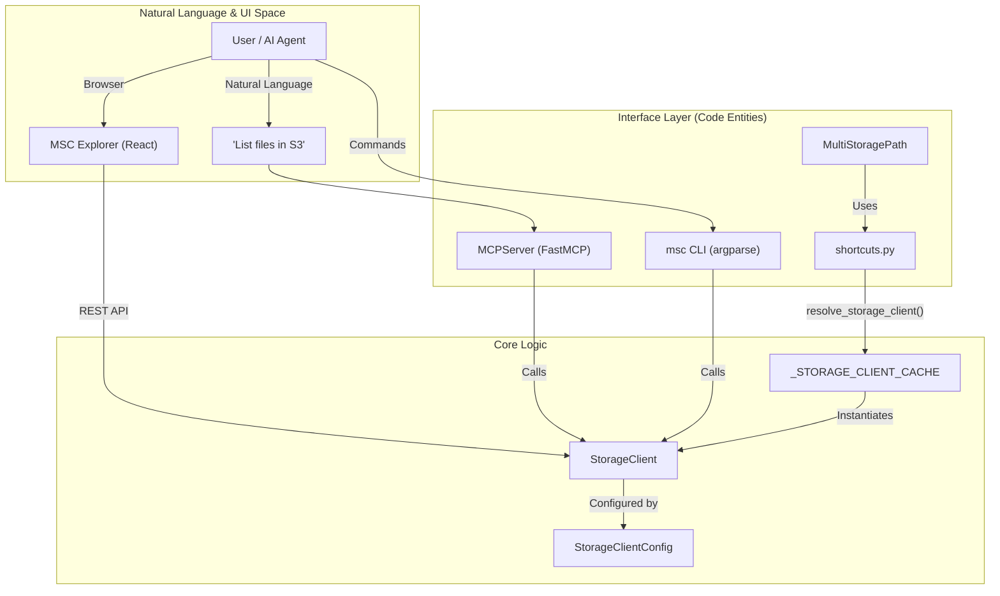
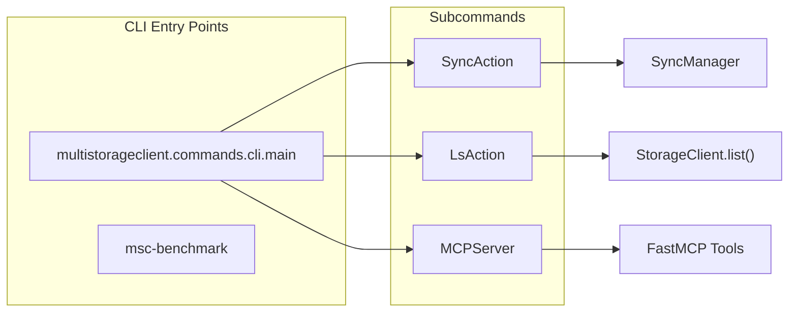

<!-- source: DeepWiki mcp.deepwiki.com · repo NVIDIA/multi-storage-client · page 3 User Interfaces · fetched 2026-10-26 -->

# User Interfaces

Relevant source files

The following files were used as context for generating this wiki page:

- [multi-storage-client-docs/justfile](multi-storage-client-docs/justfile)
- [multi-storage-client-docs/src/index.rst](multi-storage-client-docs/src/index.rst)
- [multi-storage-client-docs/src/references/checksum_support.rst](multi-storage-client-docs/src/references/checksum_support.rst)
- [multi-storage-client-docs/src/user_guide/cli.rst](multi-storage-client-docs/src/user_guide/cli.rst)
- [multi-storage-client-docs/src/user_guide/installation.rst](multi-storage-client-docs/src/user_guide/installation.rst)
- [multi-storage-client-docs/src/user_guide/mcp_server.rst](multi-storage-client-docs/src/user_guide/mcp_server.rst)
- [multi-storage-client/src/multistorageclient/commands/cli/actions/sync.py](multi-storage-client/src/multistorageclient/commands/cli/actions/sync.py)
- [multi-storage-client/src/multistorageclient/shortcuts.py](multi-storage-client/src/multistorageclient/shortcuts.py)
- [multi-storage-client/tests/test_multistorageclient/unit/sync/test_manager.py](multi-storage-client/tests/test_multistorageclient/unit/sync/test_manager.py)
- [multi-storage-client/tests/test_multistorageclient/unit/test_cli.py](multi-storage-client/tests/test_multistorageclient/unit/test_cli.py)
- [multi-storage-client/tests/test_multistorageclient/unit/test_shortcuts.py](multi-storage-client/tests/test_multistorageclient/unit/test_shortcuts.py)

This page provides an overview of the different ways to interact with the `multi-storage-client` library. It describes the available user interfaces, their use cases, and how they relate to each other. For detailed information about specific APIs or tools, see the corresponding child pages.

## Overview of Interface Options

The `multi-storage-client` library offers multiple interfaces to access storage systems, ranging from low-level programmatic APIs to high-level command-line tools and a web-based explorer.

1.  **Storage Client API** - The `StorageClient` class provides the primary, full-featured programmatic API [src/multistorageclient/client.py:44-102]().
2.  **Shortcut Functions** - Convenient global functions like `msc.open()` and `msc.glob()` that handle client resolution automatically [src/multistorageclient/shortcuts.py:245-258]().
3.  **Path-like Interface** - `MultiStoragePath` provides a familiar `pathlib`-like interface for navigating storage [src/multistorageclient/path.py:34-45]().
4.  **CLI and MCP Server** - Command-line tools for manual operations and a Model Context Protocol server for AI agent interactions [multi-storage-client-docs/src/user_guide/cli.rst:5-33]().
5.  **MSC Explorer** - A web-based UI for browsing and previewing files across all configured backends [multi-storage-client-docs/src/index.rst:36-36]().

### Interface Relationship Diagram

The following diagram shows how different interfaces bridge natural language requests and code entities to the underlying `StorageClient` logic.

Sources: [src/multistorageclient/shortcuts.py:32-33](), [src/multistorageclient/path.py:34-45](), [multi-storage-client-docs/src/user_guide/mcp_server.rst:11-23](), [multi-storage-client-docs/src/user_guide/cli.rst:18-33]()

---

## Programmatic Interfaces

### Storage Client API
The `StorageClient` class is the primary interface. It supports standard CRUD operations, complex transfers, and replica management.
*   **For details, see [Storage Client API](#3.1)**

### Shortcut Functions
Located in `shortcuts.py`, these functions allow users to interact with storage using simple URLs (e.g., `msc://profile/path`) without manually managing `StorageClient` instances [src/multistorageclient/shortcuts.py:127-142]().
*   **For details, see [Shortcut Functions](#3.2)**

### Path-like Interface
The `MultiStoragePath` class implements a `pathlib.Path` compatible interface, allowing for intuitive path joins using the `/` operator and standard methods like `.exists()` or `.is_dir()` [src/multistorageclient/path.py:112-135]().
*   **For details, see [Path-like Interface](#3.3)**

---

## System Coordination and Tooling

### Distributed Locking
The `DistributedHint` system provides a mechanism for coordinating concurrent writers across different storage backends using "hint" files as locks [src/multistorageclient/types.py:100-110]().
*   **For details, see [Distributed Locking](#3.4)**

### CLI and MCP Server
The `msc` command-line tool provides subcommands for `ls`, `sync`, `rm`, and `config` [multi-storage-client-docs/src/user_guide/cli.rst:25-33](). Additionally, the `mcp-server` subcommand exposes these capabilities to AI assistants like Cursor or Claude via the Model Context Protocol [multi-storage-client-docs/src/user_guide/mcp_server.rst:53-58]().

Sources: [src/multistorageclient/commands/cli/actions/sync.py:27-34](), [src/multistorageclient/sync/manager.py:26-56](), [multi-storage-client-docs/src/user_guide/mcp_server.rst:164-169]()

*   **For details, see [CLI and MCP Server](#3.5)**

### MSC Explorer
The MSC Explorer is a web-based file manager built with React and FastAPI. It allows users to browse configured storage profiles, preview file contents, and manage data through a graphical interface [multi-storage-client-docs/src/index.rst:36-36]().
*   **For details, see [MSC Explorer](#3.6)**

---

## Summary of Interface Options

| Interface | Target Audience | Primary Use Case |
| :--- | :--- | :--- |
| **StorageClient** | Developers | High-performance, complex application logic. |
| **Shortcuts** | Data Scientists | Rapid prototyping and simple script I/O. |
| **Path-like** | Developers | Porting code that expects `pathlib.Path`. |
| **CLI** | DevOps / Users | Manual data migration and bucket inspection. |
| **MCP Server** | AI Agents | Enabling LLMs to interact with storage. |
| **Explorer** | All Users | Visual browsing and metadata inspection. |

Sources: [src/multistorageclient/shortcuts.py:245-258](), [src/multistorageclient/path.py:34-45](), [multi-storage-client-docs/src/user_guide/cli.rst:5-33](), [multi-storage-client-docs/src/user_guide/mcp_server.rst:11-23]()

---

