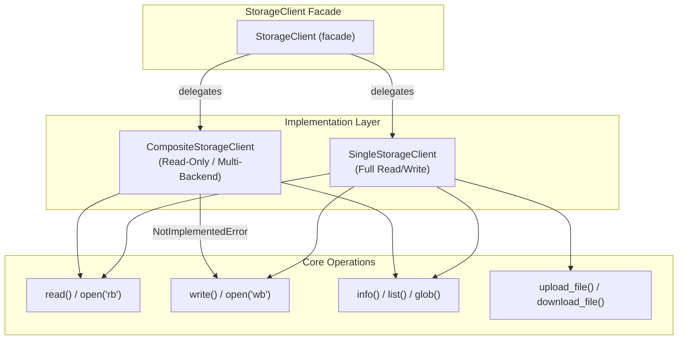
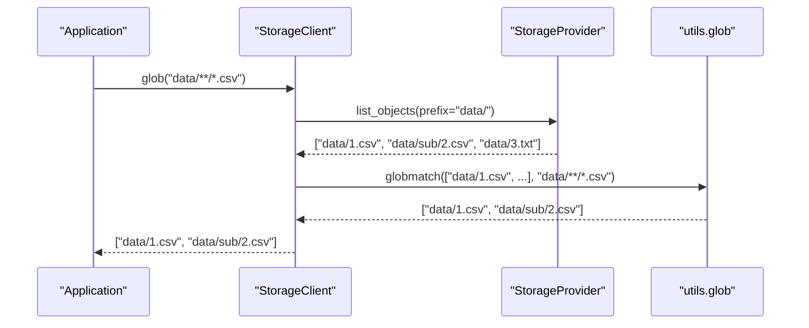

<!-- source: DeepWiki mcp.deepwiki.com · repo NVIDIA/multi-storage-client · page 3.1 Storage Client API · fetched 2026-10-26 -->

# Storage Client API

Relevant source files

The following files were used as context for generating this wiki page:

- [multi-storage-client-docs/src/user_guide/explorer.rst](multi-storage-client-docs/src/user_guide/explorer.rst)
- [multi-storage-client-docs/src/user_guide/rust.rst](multi-storage-client-docs/src/user_guide/rust.rst)
- [multi-storage-client/src/multistorageclient/client/client.py](multi-storage-client/src/multistorageclient/client/client.py)
- [multi-storage-client/src/multistorageclient/client/composite.py](multi-storage-client/src/multistorageclient/client/composite.py)
- [multi-storage-client/src/multistorageclient/client/single.py](multi-storage-client/src/multistorageclient/client/single.py)
- [multi-storage-client/src/multistorageclient/client/types.py](multi-storage-client/src/multistorageclient/client/types.py)
- [multi-storage-client/src/multistorageclient/file.py](multi-storage-client/src/multistorageclient/file.py)
- [multi-storage-client/src/multistorageclient/utils.py](multi-storage-client/src/multistorageclient/utils.py)
- [multi-storage-client/tests/test_multistorageclient/unit/client/test_client.py](multi-storage-client/tests/test_multistorageclient/unit/client/test_client.py)
- [multi-storage-client/tests/test_multistorageclient/unit/test_file.py](multi-storage-client/tests/test_multistorageclient/unit/test_file.py)
- [multi-storage-client/tests/test_multistorageclient/unit/test_utils.py](multi-storage-client/tests/test_multistorageclient/unit/test_utils.py)

The StorageClient API is the primary interface for interacting with files and objects across various storage systems. It provides a unified API to perform operations like reading, writing, listing, and deleting objects regardless of the underlying storage provider (S3, Azure, Google Cloud Storage, etc.).

This page documents the core `StorageClient` facade and its underlying implementations: `SingleStorageClient` and `CompositeStorageClient`.

## Overview

The `StorageClient` class acts as a facade that delegates operations to specific implementations based on the provided configuration. [multi-storage-client/src/multistorageclient/client/client.py:42-49]().

Sources: [multi-storage-client/src/multistorageclient/client/client.py:42-60](), [multi-storage-client/src/multistorageclient/client/composite.py:42-50]()

## Client Implementations

### SingleStorageClient
Used for single-backend configurations. It supports the full range of read and write operations against a specific `StorageProvider`. [multi-storage-client/src/multistorageclient/client/single.py:56-61]().

### CompositeStorageClient
Used for multi-backend configurations where a `MetadataProvider` (like a manifest) routes requests to different physical backends. [multi-storage-client/src/multistorageclient/client/composite.py:42-50]().
- **Read-Only**: Write operations like `write()`, `upload_file()`, `delete()`, or `copy()` raise `NotImplementedError`. [multi-storage-client/src/multistorageclient/client/composite.py:142-158]().
- **Routing**: It uses `realpath()` from the metadata provider to resolve a logical path to a physical path and a specific profile name, then delegates to a child `SingleStorageClient`. [multi-storage-client/src/multistorageclient/client/composite.py:167-178]().

Sources: [multi-storage-client/src/multistorageclient/client/single.py:56-117](), [multi-storage-client/src/multistorageclient/client/composite.py:42-98]()

## Basic Operations

### Reading and Writing
The API provides both high-level byte-oriented methods and file-like object access.

- **`read(path, byte_range=None)`**: Retrieves object content as bytes. Supports `Range` objects for partial reads. [multi-storage-client/src/multistorageclient/client/types.py:107-122]().
- **`write(path, body)`**: Writes bytes to a path. For `SingleStorageClient`, this triggers a `put_object` on the provider. [multi-storage-client/src/multistorageclient/client/single.py:276-291]().

### File-like Objects (`open`)
The `open()` method returns a `PosixFile` for local files or an `ObjectFile` for remote objects. [multi-storage-client/src/multistorageclient/client/types.py:125-161]().

| Feature | `ObjectFile` | `PosixFile` |
| :--- | :--- | :--- |
| **Backend** | S3, GCS, Azure, etc. | Local Filesystem |
| **Read Mode** | Downloads to memory or uses `RemoteFileReader`. | Direct OS `open()`. |
| **Write Mode** | Buffers locally, uploads on `close()`. | Atomic rename on `close()`. |
| **Caching** | Integrates with `CacheManager`. | N/A (Direct access). |

Sources: [multi-storage-client/src/multistorageclient/file.py:184-210](), [multi-storage-client/src/multistorageclient/file.py:532-550]()

## File Transfer and Sync

### Transfer Methods
- **`upload_file(remote_path, local_path)`**: Transfers a file from the local disk to storage. [multi-storage-client/src/multistorageclient/client/single.py:255-264]().
- **`download_file(remote_path, local_path)`**: Transfers an object to the local disk. [multi-storage-client/src/multistorageclient/client/single.py:234-243]().
- **`upload_files` / `download_files`**: Batch versions that use a `ThreadPoolExecutor` for parallel transfers. [multi-storage-client/src/multistorageclient/client/single.py:245-253](), [multi-storage-client/src/multistorageclient/client/single.py:266-274]().

### Sync Engine (`sync_from`)
The `sync_from()` method synchronizes data from a source `StorageClient` to the current client. It uses a `SyncManager` to coordinate the transfer, supporting multi-threaded or multi-process execution. [multi-storage-client/src/multistorageclient/client/single.py:531-576]().

Sources: [multi-storage-client/src/multistorageclient/client/single.py:234-274](), [multi-storage-client/src/multistorageclient/sync.py:35-100]()

## Listing and Globbing

MSC provides powerful listing capabilities that unify object store prefixes and filesystem directories.

- **`list(prefix)`**: Returns an iterator of `ObjectMetadata`. [multi-storage-client/src/multistorageclient/client/single.py:375-397]().
- **`glob(pattern)`**: Supports Unix-style wildcards and recursive `**` matching. [multi-storage-client/src/multistorageclient/client/single.py:408-435]().

Sources: [multi-storage-client/src/multistorageclient/client/single.py:408-435](), [multi-storage-client/src/multistorageclient/utils.py:101-110]()

## Replica Management

`SingleStorageClient` can manage multiple replicas of data. Replicas are sorted by `read_priority`. [multi-storage-client/src/multistorageclient/client/single.py:118-138]().
- If a read operation fails on the primary backend, the `ReplicaManager` can automatically attempt to read from the next available replica.
- Replicas are themselves `StorageClient` instances initialized from secondary profiles.

Sources: [multi-storage-client/src/multistorageclient/client/single.py:118-138](), [multi-storage-client/src/multistorageclient/replica_manager.py:25-50]()

## Autocommit and Metadata

For clients using a `MetadataProvider`, MSC supports an **autocommit** background thread.
- **Background Thread**: Periodically calls `commit_metadata()` at a configured interval. [multi-storage-client/src/multistorageclient/client/single.py:140-149]().
- **Exit Handler**: Uses `atexit` to ensure metadata is committed when the Python process terminates. [multi-storage-client/src/multistorageclient/client/single.py:151-153]().

Sources: [multi-storage-client/src/multistorageclient/client/single.py:98-114](), [multi-storage-client/src/multistorageclient/client/single.py:140-153]()

## Rust Acceleration

If the `rust_client` option is enabled in the configuration, the `StorageProvider` delegates I/O-heavy operations (like `get_object` and `put_object`) to a Rust-based backend. [multi-storage-client-docs/src/user_guide/rust.rst:70-83]().
- **GIL Bypass**: Rust handles parallelism via async I/O, bypassing Python's Global Interpreter Lock. [multi-storage-client-docs/src/user_guide/rust.rst:11-13]().
- **Check**: The client checks `_is_rust_client_enabled()` to determine if it can use single-process multi-threading instead of multi-processing for sync operations. [multi-storage-client/src/multistorageclient/client/composite.py:116-126]().

Sources: [multi-storage-client-docs/src/user_guide/rust.rst:5-44](), [multi-storage-client/src/multistorageclient/client/single.py:175-179]()

---

