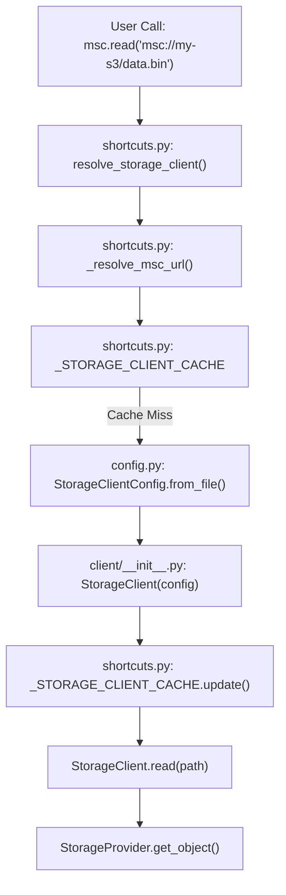
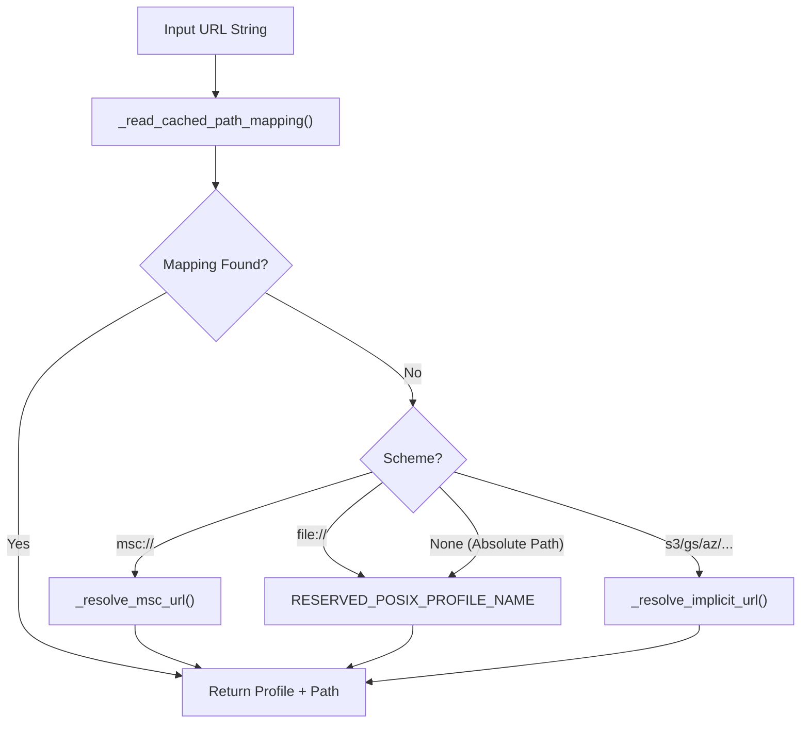
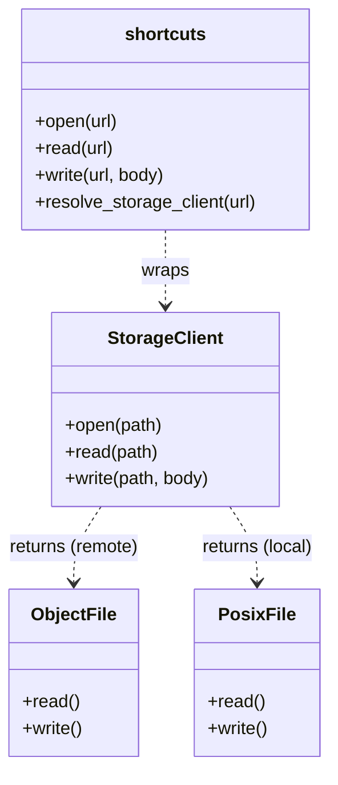

<!-- source: DeepWiki mcp.deepwiki.com · repo NVIDIA/multi-storage-client · page 3.2 Shortcut Functions · fetched 2026-10-26 -->

# Shortcut Functions

Relevant source files

The following files were used as context for generating this wiki page:

- [multi-storage-client-docs/src/user_guide/explorer.rst](multi-storage-client-docs/src/user_guide/explorer.rst)
- [multi-storage-client-docs/src/user_guide/rust.rst](multi-storage-client-docs/src/user_guide/rust.rst)
- [multi-storage-client/src/multistorageclient/file.py](multi-storage-client/src/multistorageclient/file.py)
- [multi-storage-client/src/multistorageclient/shortcuts.py](multi-storage-client/src/multistorageclient/shortcuts.py)
- [multi-storage-client/src/multistorageclient/utils.py](multi-storage-client/src/multistorageclient/utils.py)
- [multi-storage-client/tests/test_multistorageclient/unit/client/test_client.py](multi-storage-client/tests/test_multistorageclient/unit/client/test_client.py)
- [multi-storage-client/tests/test_multistorageclient/unit/test_file.py](multi-storage-client/tests/test_multistorageclient/unit/test_file.py)
- [multi-storage-client/tests/test_multistorageclient/unit/test_shortcuts.py](multi-storage-client/tests/test_multistorageclient/unit/test_shortcuts.py)
- [multi-storage-client/tests/test_multistorageclient/unit/test_utils.py](multi-storage-client/tests/test_multistorageclient/unit/test_utils.py)

The Multi-Storage Client (MSC) provides a set of convenient shortcut functions in `shortcuts.py` that allow users to perform common storage operations without directly instantiating a `StorageClient`. These functions serve as a simplified interface to the underlying storage capabilities, accepting URIs in the form `msc://profile/path` and automatically resolving the appropriate storage client and credentials.

## Overview

The shortcut functions act as a layer of abstraction over the core `StorageClient` facade [src/multistorageclient/client/__init__.py:28-40](). They handle client instantiation, thread-safe caching, and path resolution automatically. The module also includes fork-safety mechanisms to reinitialize state after a process fork [src/multistorageclient/shortcuts.py:41-82]().

### Shortcut Data Flow

The following diagram shows how a shortcut call (e.g., `msc.read()`) flows through the resolution logic to the underlying `StorageClient`.

**Shortcut Resolution to Code Entities**

Sources: [src/multistorageclient/shortcuts.py:32-36](), [src/multistorageclient/shortcuts.py:410-432](), [src/multistorageclient/client/__init__.py:28-40]()

## URI Format and Resolution

The shortcuts resolve strings into a `(StorageClient, path)` tuple. Supported formats include:
- **MSC URIs**: `msc://profile/path` [src/multistorageclient/shortcuts.py:127-142]().
- **POSIX Paths**: Absolute paths (e.g., `/tmp/file`) or `file://` URIs are mapped to the reserved `__filesystem__` profile [src/multistorageclient/shortcuts.py:165-195]().
- **Implicit Profiles**: Protocols like `s3://`, `gs://`, or `az://` can be resolved into implicit profiles if configured [src/multistorageclient/shortcuts.py:202-219]().
- **Path Mapping**: Users can define `path_mapping` in configuration to redirect standard POSIX paths to MSC profiles automatically [src/multistorageclient/shortcuts.py:178-183](), [src/multistorageclient/config.py:734-758]().

### URI Resolution Logic

Sources: [src/multistorageclient/shortcuts.py:127-219](), [src/multistorageclient/config.py:734-758]()

## Client and Path Mapping Caching

To maintain performance, `shortcuts.py` implements two primary caches:
1. **`_STORAGE_CLIENT_CACHE`**: A dictionary mapping profile names to `StorageClient` instances [src/multistorageclient/shortcuts.py:32-33]().
2. **`_PATH_MAPPING_CACHE`**: Caches the `PathMapping` object loaded from the `MSC_CONFIG` environment variable to avoid repeated disk I/O [src/multistorageclient/shortcuts.py:144-162]().

Both caches are protected by `threading.Lock` and are cleared automatically upon a process fork via `os.register_at_fork` [src/multistorageclient/shortcuts.py:81-82]().

## Available Shortcut Functions

The following functions are the primary entry points in `shortcuts.py`. They wrap the `StorageClient` methods but handle URL resolution internally.

| Function | StorageClient Equivalent | Description |
| :--- | :--- | :--- |
| `open(url, ...)` | `client.open(path, ...)` | Opens a file-like `ObjectFile` or `PosixFile` [src/multistorageclient/shortcuts.py:246-267](). |
| `read(url, ...)` | `client.read(path, ...)` | Reads the entire content of a file into memory [src/multistorageclient/shortcuts.py:410-432](). |
| `write(url, body, ...)` | `client.write(path, body, ...)` | Writes bytes/strings to a remote object [src/multistorageclient/shortcuts.py:435-458](). |
| `glob(pattern, ...)` | `client.glob(path_pattern, ...)` | Expands wildcards across storage backends [src/multistorageclient/shortcuts.py:270-302](). |
| `list(url, ...)` | `client.list(path, ...)` | Iterates over `ObjectMetadata` in a prefix [src/multistorageclient/shortcuts.py:381-407](). |
| `sync(src, dst, ...)` | `SyncManager.sync(...)` | High-level directory synchronization [src/multistorageclient/shortcuts.py:355-378](). |
| `upload_file(...)` | `client.upload_file(...)` | Transfers local file to remote [src/multistorageclient/shortcuts.py:305-326](). |
| `download_file(...)` | `client.download_file(...)` | Transfers remote object to local [src/multistorageclient/shortcuts.py:329-352](). |

Sources: [src/multistorageclient/shortcuts.py:246-458]()

## Implementation Details

### Telemetry Integration
Shortcut functions can be configured with a global telemetry provider. The `set_telemetry_provider` function allows users to inject a callable that returns a `Telemetry` instance, which is then passed to every `StorageClient` created by the shortcuts [src/multistorageclient/shortcuts.py:85-108]().

### Fork Safety
The module tracks the process ID (`_PROCESS_ID`). If `_check_and_reinitialize_if_forked()` detects a PID change, it clears the caches and resets the locks to prevent deadlocks or shared socket issues in child processes [src/multistorageclient/shortcuts.py:36-79]().

### Handling Special Characters
The `_build_full_path` helper ensures that query strings (used in some glob patterns) and fragments are preserved during the URL parsing phase [src/multistorageclient/shortcuts.py:109-124]().

**Code Entity Relationship: Shortcuts to Files**

Sources: [src/multistorageclient/shortcuts.py:246-267](), [src/multistorageclient/file.py:184-210](), [src/multistorageclient/file.py:535-545]()

## Integration with `__init__.py`
The top-level `multistorageclient` package exports these shortcuts directly, allowing usage like `import multistorageclient as msc; msc.read(...)`. It also implements a lazy-loading mechanism for "contrib" modules (like `msc.torch` or `msc.numpy`), which internally utilize these shortcuts for storage access [src/multistorageclient/__init__.py:25-72]().

Sources:
- [src/multistorageclient/shortcuts.py:1-458]()
- [src/multistorageclient/client/__init__.py:28-40]()
- [src/multistorageclient/config.py:734-758]()
- [src/multistorageclient/__init__.py:25-72]()
- [src/multistorageclient/file.py:184-545]()

---

