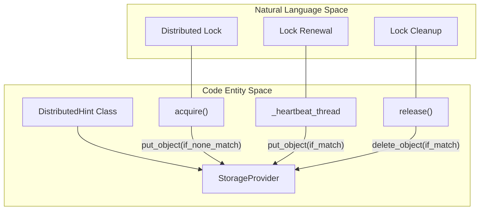
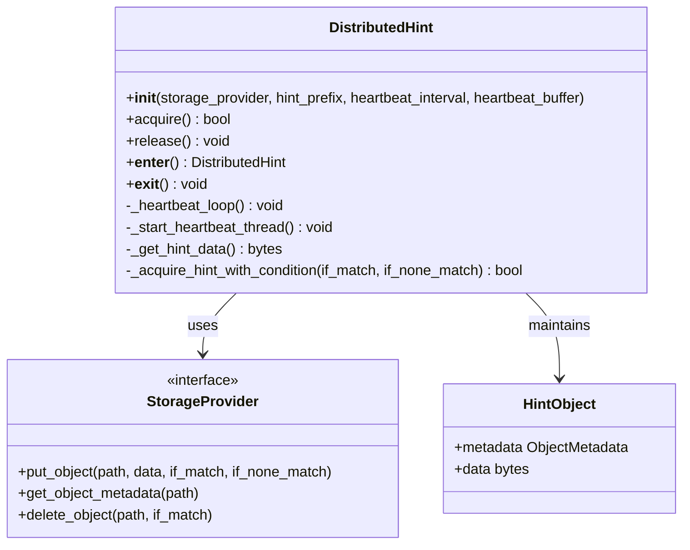
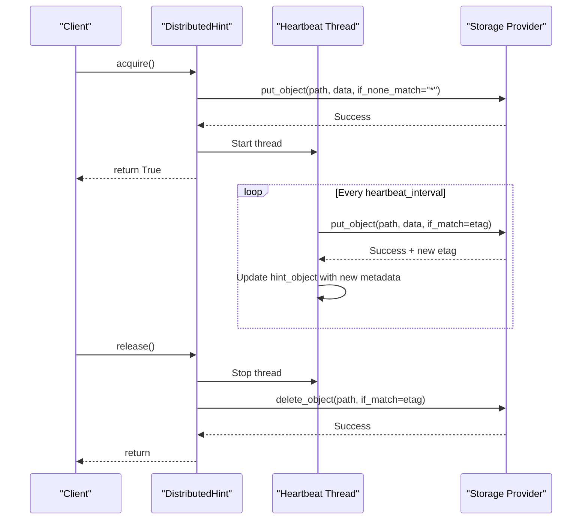
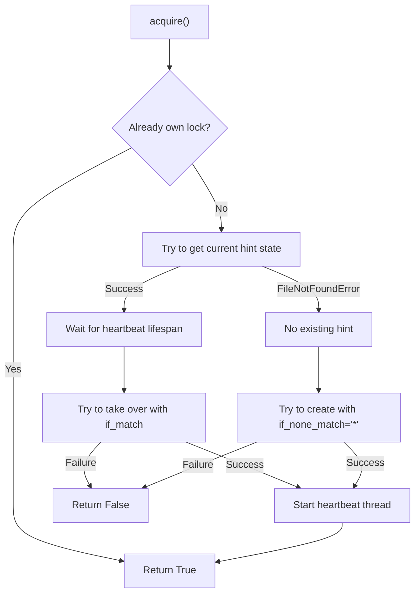
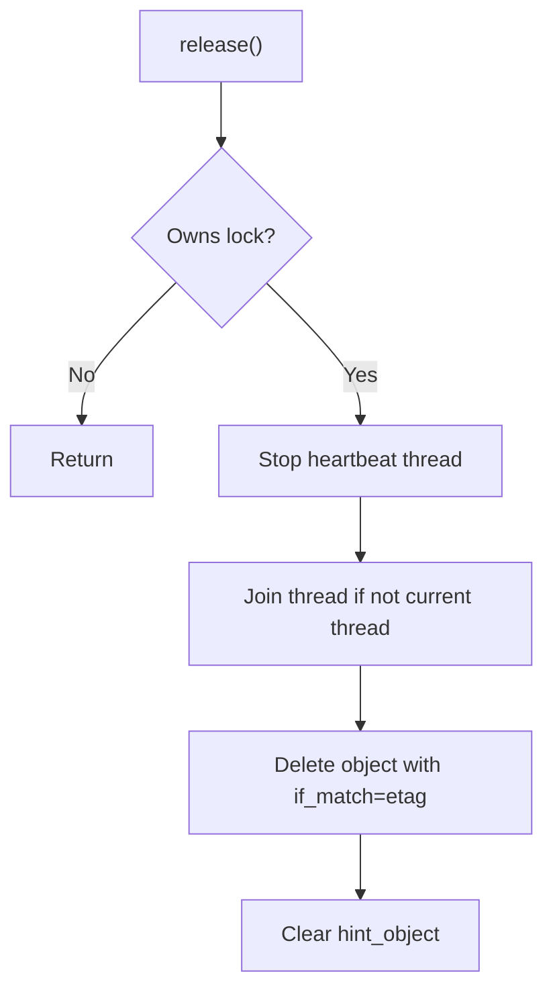
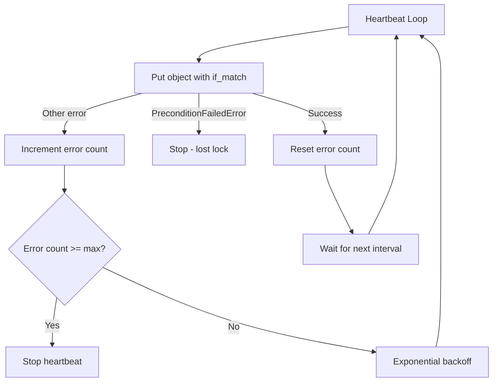

<!-- source: DeepWiki mcp.deepwiki.com · repo NVIDIA/multi-storage-client · page 3.4 Distributed Locking · fetched 2026-10-26 -->

# Distributed Locking

<details>
<summary>Relevant source files</summary>

The following files were used as context for generating this wiki page:

- [multi-storage-client/.msc/config.yaml](multi-storage-client/.msc/config.yaml)
- [multi-storage-client/src/multistorageclient/caching/README.md](multi-storage-client/src/multistorageclient/caching/README.md)
- [multi-storage-client/src/multistorageclient/client/client.py](multi-storage-client/src/multistorageclient/client/client.py)
- [multi-storage-client/src/multistorageclient/client/composite.py](multi-storage-client/src/multistorageclient/client/composite.py)
- [multi-storage-client/src/multistorageclient/client/single.py](multi-storage-client/src/multistorageclient/client/single.py)
- [multi-storage-client/src/multistorageclient/client/types.py](multi-storage-client/src/multistorageclient/client/types.py)
- [multi-storage-client/tests/test_multistorageclient/unit/mcp/test_mcp_integration.py](multi-storage-client/tests/test_multistorageclient/unit/mcp/test_mcp_integration.py)
- [multi-storage-client/tests/test_multistorageclient/unit/test_replica_manager.py](multi-storage-client/tests/test_multistorageclient/unit/test_replica_manager.py)

</details>


This document describes the distributed locking system within the multi-storage-client library. The locking mechanism enables coordination between multiple clients, processes, or threads accessing shared resources in distributed systems. It implements a distributed hint protocol similar to the DynamoDB lock client protocol.

## 1. Overview

The distributed locking system provides a way to coordinate access to shared resources across distributed applications. It's built on top of storage providers to ensure consistent locking without requiring a dedicated locking service.


Sources: [src/multistorageclient/caching/distributed_hint.py:54-63](), [src/multistorageclient/caching/distributed_hint.py:100-136]()

## 2. Implementation Architecture

The distributed locking mechanism is implemented through the `DistributedHint` class, which leverages storage providers to persist lock information. This approach avoids the need for a dedicated locking service by using existing storage infrastructure.


Sources: [src/multistorageclient/caching/distributed_hint.py:40-46](), [src/multistorageclient/caching/distributed_hint.py:54-252]()

## 3. Key Components

### 3.1 DistributedHint Class

The `DistributedHint` class is the main component that implements the distributed locking mechanism.

```
DistributedHint
├── Initialize with storage provider and prefix
├── Acquire and release locks
├── Manage heartbeat thread for lock renewal
└── Support context manager interface
```

The class requires a storage provider to store the lock data and a prefix path where lock information will be stored. It also accepts configurable heartbeat intervals and buffer times to control lock expiration behavior.

Sources: [src/multistorageclient/caching/distributed_hint.py:65-91]()

### 3.2 Heartbeat Mechanism

Locks are maintained through a heartbeat mechanism that periodically refreshes the lock to prevent expiration:


Sources: [src/multistorageclient/caching/distributed_hint.py:100-136](), [src/multistorageclient/caching/distributed_hint.py:137-141]()

## 4. Lock Acquisition Process

### 4.1 Acquiring a Lock

The lock acquisition process involves checking for an existing lock and either creating a new one or taking over an expired lock:


Sources: [src/multistorageclient/caching/distributed_hint.py:178-211]()

### 4.2 Lock Storage Format

Locks are stored as objects in the underlying storage provider with a path constructed from the provided hint prefix. The lock data contains a timestamp that is updated with each heartbeat:

```json
{
  "timestamp": "2023-01-01T12:00:00Z"
}
```

The object's ETag (or equivalent metadata) is used for conditional operations to ensure atomicity.

Sources: [src/multistorageclient/caching/distributed_hint.py:93-98]()

## 5. Lock Release Process

The release process stops the heartbeat thread and deletes the lock object using conditional deletion to ensure only the owner can release the lock:


Sources: [src/multistorageclient/caching/distributed_hint.py:213-230]()

## 6. Error Handling and Resilience

The distributed locking system includes several mechanisms for error handling and resilience:

### 6.1 Heartbeat Error Handling

The heartbeat mechanism includes robust error handling to deal with transient failures:


Sources: [src/multistorageclient/caching/distributed_hint.py:100-136]()

### 6.2 Exponential Backoff

For transient errors, an exponential backoff strategy is used to reduce contention:

```
error_backoff = min(1.0 * (2 ** (consecutive_errors - 1)), 30.0)
```

This increases the delay between retry attempts based on the number of consecutive errors, up to a maximum of 30 seconds.

Sources: [src/multistorageclient/caching/distributed_hint.py:134-135]()

## 7. Thread and Process Safety

The `DistributedHint` class is designed to be thread and process safe, allowing coordination between:
- Multiple threads within the same process
- Multiple processes on the same machine
- Distributed processes across different machines

A transition lock `self._lock` ensures thread safety for operations that modify the hint state.

Sources: [src/multistorageclient/caching/distributed_hint.py:91](), [src/multistorageclient/caching/distributed_hint.py:185](), [src/multistorageclient/caching/distributed_hint.py:215]()

## 8. Usage Examples

### 8.1 Basic Usage

```python
# Create a distributed hint
hint = DistributedHint(
    storage_provider=storage_client._storage_provider,
    hint_prefix="path/to/lock",
    heartbeat_interval=timedelta(seconds=30),
    heartbeat_buffer=timedelta(seconds=10),
)

# Acquire the lock
if hint.acquire():
    try:
        # Perform operations requiring exclusive access
        pass
    finally:
        # Always release the lock
        hint.release()
else:
    # Failed to acquire the lock
    pass
```

### 8.2 Context Manager Usage

The `DistributedHint` class implements the context manager protocol for easier use:

```python
with DistributedHint(
    storage_provider=storage_client._storage_provider,
    hint_prefix="path/to/lock",
) as hint:
    # Perform operations requiring exclusive access
    pass
# Lock is automatically released when exiting the context
```

Sources: [src/multistorageclient/caching/distributed_hint.py:231-247]()

## 9. Configuration Parameters

| Parameter | Default | Description |
|-----------|---------|-------------|
| `storage_provider` | Required | The storage provider to use for storing the hint |
| `hint_prefix` | Required | The prefix to use for the hint object key |
| `heartbeat_interval` | 30 seconds | The interval between heartbeat updates |
| `heartbeat_buffer` | 10 seconds | Buffer time before a hint is considered expired |

The total lifespan of a lock without heartbeat renewal is `heartbeat_interval + heartbeat_buffer`.

Sources: [src/multistorageclient/caching/distributed_hint.py:34-36](), [src/multistorageclient/caching/distributed_hint.py:65-91]()

## 10. Implementation Details

### 10.1 Lock Acquisition Logic

The lock acquisition logic follows these steps:
1. Check if we already own the lock via `self.owns_lock`.
2. Try to get the current lock state via `_storage_provider.get_object_metadata`.
3. If a lock exists, wait for the heartbeat lifespan to see if it's maintained.
4. Try to take over the lock with the matching ETag via `_acquire_hint_with_condition(if_match=etag)`.
5. If no lock exists, try to create a new one with `if_none_match='*'`.
6. Start the heartbeat thread via `_start_heartbeat_thread()` if acquisition was successful.

Sources: [src/multistorageclient/caching/distributed_hint.py:178-211]()

### 10.2 Storage Requirements

The storage provider must support:
1. Conditional operations (`if_match`, `if_none_match`) via `put_object` [src/multistorageclient/types.py:446-447]().
2. Object metadata retrieval via `get_object_metadata` [src/multistorageclient/types.py:417-422]().
3. Atomic operations.

This ensures proper lock coordination between distributed clients.

Sources: [src/multistorageclient/caching/distributed_hint.py:156-161]()

## 11. Known Limitations

1. Relies on the storage provider's consistency guarantees.
2. Network partitions can lead to multiple processes believing they hold the lock.
3. Clock synchronization between nodes is not explicitly handled.

Tests for this functionality have been marked as "Flaky. Needs debugging" in the test suite, indicating potential reliability issues in certain scenarios.

Sources: [tests/test_multistorageclient/e2e/test_distributed_hint.py:231-232](), [tests/test_multistorageclient/e2e/test_distributed_hint.py:246-247]()

---

