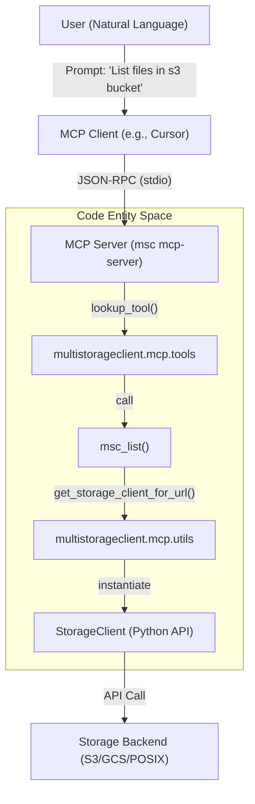
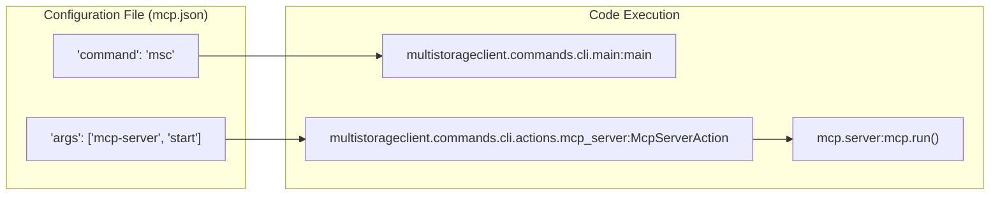

<!-- source: DeepWiki mcp.deepwiki.com · repo NVIDIA/multi-storage-client · page 3.5 CLI and MCP Server · fetched 2026-10-26 -->

# CLI and MCP Server

Relevant source files

The following files were used as context for generating this wiki page:

- [multi-storage-client-docs/justfile](multi-storage-client-docs/justfile)
- [multi-storage-client-docs/src/index.rst](multi-storage-client-docs/src/index.rst)
- [multi-storage-client-docs/src/references/checksum_support.rst](multi-storage-client-docs/src/references/checksum_support.rst)
- [multi-storage-client-docs/src/user_guide/cli.rst](multi-storage-client-docs/src/user_guide/cli.rst)
- [multi-storage-client-docs/src/user_guide/installation.rst](multi-storage-client-docs/src/user_guide/installation.rst)
- [multi-storage-client-docs/src/user_guide/mcp_server.rst](multi-storage-client-docs/src/user_guide/mcp_server.rst)
- [multi-storage-client/src/multistorageclient/commands/cli/actions/__init__.py](multi-storage-client/src/multistorageclient/commands/cli/actions/__init__.py)
- [multi-storage-client/src/multistorageclient/commands/cli/actions/sync.py](multi-storage-client/src/multistorageclient/commands/cli/actions/sync.py)
- [multi-storage-client/src/multistorageclient/commands/cli/main.py](multi-storage-client/src/multistorageclient/commands/cli/main.py)
- [multi-storage-client/src/multistorageclient/commands/msc_benchmark.py](multi-storage-client/src/multistorageclient/commands/msc_benchmark.py)
- [multi-storage-client/src/multistorageclient/mcp/tools.py](multi-storage-client/src/multistorageclient/mcp/tools.py)
- [multi-storage-client/tests/test_multistorageclient/unit/commands/__init__.py](multi-storage-client/tests/test_multistorageclient/unit/commands/__init__.py)
- [multi-storage-client/tests/test_multistorageclient/unit/commands/test_msc_benchmark.py](multi-storage-client/tests/test_multistorageclient/unit/commands/test_msc_benchmark.py)
- [multi-storage-client/tests/test_multistorageclient/unit/mcp/test_mcp.py](multi-storage-client/tests/test_multistorageclient/unit/mcp/test_mcp.py)
- [multi-storage-client/tests/test_multistorageclient/unit/sync/test_manager.py](multi-storage-client/tests/test_multistorageclient/unit/sync/test_manager.py)
- [multi-storage-client/tests/test_multistorageclient/unit/test_cli.py](multi-storage-client/tests/test_multistorageclient/unit/test_cli.py)

The Multi-Storage Client (MSC) provides multiple interfaces for interacting with storage backends outside of the Python SDK. This includes a comprehensive Command-Line Interface (CLI) for manual operations and automation, a dedicated benchmarking tool for performance analysis, and a Model Context Protocol (MCP) server that exposes storage operations to AI agents.

## Command-Line Interface (CLI)

The `msc` command is the primary entry point for command-line interaction [multi-storage-client-docs/src/user_guide/cli.rst:5-7](). It is implemented using a modular action-based architecture where each subcommand corresponds to an `Action` class [multi-storage-client/src/multistorageclient/commands/cli/actions/sync.py:27-31]().

### Subcommands and Usage

| Command | Description | Key Features |
| :--- | :--- | :--- |
| `ls` | List files and directories | Attribute filtering, human-readable sizes, recursive listing [multi-storage-client-docs/src/user_guide/cli.rst:116-125]() |
| `sync` | Synchronize storage locations | Multi-backend sync, Ray integration, dry-run mode, symlink handling [multi-storage-client/src/multistorageclient/commands/cli/actions/sync.py:100-105]() |
| `rm` | Delete objects | Remove files or directories from any supported backend [multi-storage-client-docs/src/user_guide/cli.rst:31-31]() |
| `config` | Manage configuration | Profile and credential management [multi-storage-client-docs/src/user_guide/cli.rst:26-26]() |
| `explorer` | Launch Web UI | Starts the MSC Explorer application [multi-storage-client-docs/src/user_guide/cli.rst:27-27]() |
| `mcp-server` | AI Agent interface | Starts the MCP server for LLM integration [multi-storage-client-docs/src/user_guide/cli.rst:30-30]() |

### The Sync Engine CLI
The `sync` command leverages the `SyncManager` to perform high-performance transfers [multi-storage-client/tests/test_multistorageclient/unit/sync/test_manager.py:26-27](). It supports advanced features such as:
* **Symlink Handling**: Options to `follow`, `skip`, or `preserve` symlinks [multi-storage-client/src/multistorageclient/commands/cli/actions/sync.py:77-87]().
* **Dry-run Mode**: Enumerate changes and output them to JSONL files without modifying the target [multi-storage-client/src/multistorageclient/commands/cli/actions/sync.py:89-92]().
* **Pattern Filtering**: AWS S3-compatible include/exclude glob patterns [multi-storage-client/src/multistorageclient/commands/cli/actions/sync.py:60-70]().

**Sources:** [multi-storage-client-docs/src/user_guide/cli.rst:5-33](), [multi-storage-client/src/multistorageclient/commands/cli/actions/sync.py:27-160](), [multi-storage-client/tests/test_multistorageclient/unit/sync/test_manager.py:130-167]()

---

## MSC Benchmark Tool

`msc-benchmark` is a standalone utility (not an `msc` subcommand) designed to measure throughput and latency across different storage profiles [multi-storage-client-docs/src/user_guide/cli.rst:36-41]().

### Implementation Details
The benchmark tool executes the following lifecycle:
1. **Generation**: Creates test objects of varying sizes (defaulting to 4MB and 64MB) [multi-storage-client-docs/src/user_guide/cli.rst:71-71]().
2. **Execution**: Performs parallel `write` and `read` operations using a configurable number of processes and threads [multi-storage-client-docs/src/user_guide/cli.rst:71-83]().
3. **Measurement**: Reports total throughput and response time percentiles (P50, P90, P99) [multi-storage-client-docs/src/user_guide/cli.rst:39-39]().
4. **Cleanup**: Deletes all generated test objects under the specified `--prefix` [multi-storage-client-docs/src/user_guide/cli.rst:97-99]().

If `--include-file-tests` is specified, the tool also benchmarks local disk I/O by exercising `upload_file` and `download_file` APIs [multi-storage-client-docs/src/user_guide/cli.rst:91-95]().

**Sources:** [multi-storage-client-docs/src/user_guide/cli.rst:36-104]()

---

## Model Context Protocol (MCP) Server

The MSC MCP Server implements the Model Context Protocol, allowing AI assistants (like Cursor or Claude Desktop) to interact with storage backends using natural language [multi-storage-client-docs/src/user_guide/mcp_server:5-11]().

### System Architecture: Natural Language to Storage

The following diagram illustrates how natural language prompts from a user are translated into code entities and storage operations via the MCP Server.

**MCP Tool Resolution Flow**

**Sources:** [multi-storage-client-docs/src/user_guide/mcp_server:65-68](), [multi-storage-client/src/multistorageclient/mcp/tools.py:29-56](), [multi-storage-client/src/multistorageclient/mcp/utils.py:23-23]()

### Exposed Tools
The server uses `FastMCP` to register Python functions as tools available to the LLM [multi-storage-client/tests/test_multistorageclient/unit/mcp/test_mcp.py:36-43]().

| Tool Name | Python Function | Description |
| :--- | :--- | :--- |
| `msc_list` | `msc_list()` | Lists objects under a URL prefix [multi-storage-client/src/multistorageclient/mcp/tools.py:29-37]() |
| `msc_info` | `msc_info()` | Retrieves metadata for a specific object [multi-storage-client/src/multistorageclient/mcp/tools.py:94-103]() |
| `msc_upload_file` | `msc_upload_file()` | Uploads a local file to a remote URL [multi-storage-client/src/multistorageclient/mcp/tools.py:123-134]() |
| `msc_download_file`| `msc_download_file()`| Downloads a remote file to local path [multi-storage-client/src/multistorageclient/mcp/tools.py:166-175]() |
| `msc_sync` | `msc_sync()` | Synchronizes two storage locations [multi-storage-client/tests/test_multistorageclient/unit/mcp/test_mcp.py:53-53]() |

### Data Flow and Communication
The MCP server communicates via **stdio** using JSON-RPC 2.0 [multi-storage-client-docs/src/user_guide/mcp_server:65-68]().
1. **Request**: The AI assistant sends a tool call request via `stdin`.
2. **Execution**: The server identifies the tool in `multistorageclient.mcp.tools`, resolves the appropriate `StorageClient` for the provided URL, and executes the operation [multi-storage-client/src/multistorageclient/mcp/tools.py:56-58]().
3. **Response**: The result is serialized to JSON and returned via `stdout` [multi-storage-client/src/multistorageclient/mcp/tools.py:85-85]().

**Sources:** [multi-storage-client-docs/src/user_guide/mcp_server:65-132](), [multi-storage-client/src/multistorageclient/mcp/tools.py:16-192](), [multi-storage-client/tests/test_multistorageclient/unit/mcp/test_mcp.py:36-63]()

---

## Configuration and Setup

### Agent Tooling Configuration
For AI agents to use MSC effectively, the server must be configured in the agent's environment (e.g., `mcp.json` for Cursor) [multi-storage-client-docs/src/user_guide/mcp_server:75-81]().

**Cursor Configuration Entity Mapping**

**Sources:** [multi-storage-client-docs/src/user_guide/mcp_server:85-95](), [multi-storage-client/src/multistorageclient/commands/cli/main.py:1-20]()

### Installation
The CLI and MCP server are available via specific extras:
* `pip install multi-storage-client` (Base CLI) [multi-storage-client-docs/src/user_guide/installation.rst:23-23]()
* `pip install multi-storage-client[mcp]` (MCP Server) [multi-storage-client-docs/src/user_guide/installation.rst:73-73]()

**Sources:** [multi-storage-client-docs/src/user_guide/installation.rst:1-81]()

---

