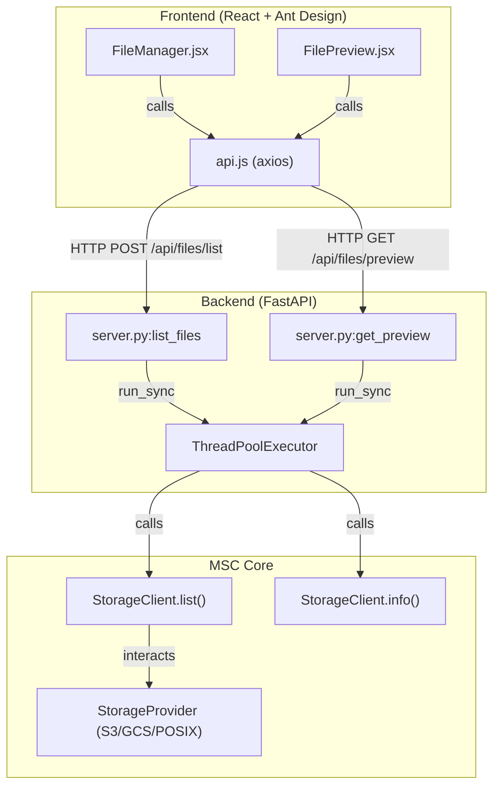
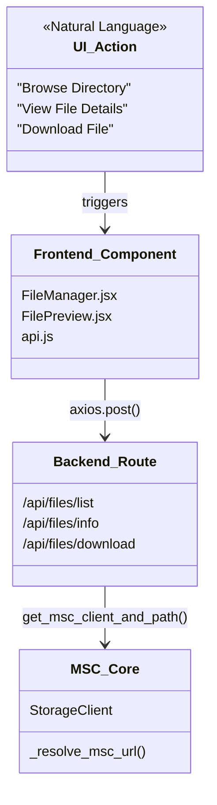

<!-- source: DeepWiki mcp.deepwiki.com · repo NVIDIA/multi-storage-client · page 3.6 MSC Explorer · fetched 2026-10-26 -->

# MSC Explorer

Relevant source files

The following files were used as context for generating this wiki page:

- [multi-storage-client-scripts/src/multistorageclient_scripts/utils/argparse_extensions/__init__.py](multi-storage-client-scripts/src/multistorageclient_scripts/utils/argparse_extensions/__init__.py)
- [multi-storage-client-scripts/src/multistorageclient_scripts/utils/wait/__init__.py](multi-storage-client-scripts/src/multistorageclient_scripts/utils/wait/__init__.py)
- [multi-storage-client/src/multistorageclient/explorer/api/server.py](multi-storage-client/src/multistorageclient/explorer/api/server.py)
- [multi-storage-client/src/multistorageclient/instrumentation/auth.py](multi-storage-client/src/multistorageclient/instrumentation/auth.py)
- [multi-storage-client/src/multistorageclient/mcp/server.py](multi-storage-client/src/multistorageclient/mcp/server.py)
- [multi-storage-client/src/multistorageclient/signers/cloudfront.py](multi-storage-client/src/multistorageclient/signers/cloudfront.py)
- [multi-storage-client/tests/test_multistorageclient/unit/explorer/test_api_endpoints.py](multi-storage-client/tests/test_multistorageclient/unit/explorer/test_api_endpoints.py)
- [multi-storage-explorer/bun.lock](multi-storage-explorer/bun.lock)
- [multi-storage-explorer/justfile](multi-storage-explorer/justfile)
- [multi-storage-explorer/package.json](multi-storage-explorer/package.json)
- [multi-storage-explorer/src/__tests__/components/FileManager.test.jsx](multi-storage-explorer/src/__tests__/components/FileManager.test.jsx)
- [multi-storage-explorer/src/__tests__/components/FilePreview.test.jsx](multi-storage-explorer/src/__tests__/components/FilePreview.test.jsx)
- [multi-storage-explorer/src/components/FileManager.jsx](multi-storage-explorer/src/components/FileManager.jsx)
- [multi-storage-explorer/src/components/FilePreview.jsx](multi-storage-explorer/src/components/FilePreview.jsx)
- [multi-storage-explorer/src/main.jsx](multi-storage-explorer/src/main.jsx)
- [multi-storage-explorer/src/services/api.js](multi-storage-explorer/src/services/api.js)
- [multi-storage-explorer/vitest.config.js](multi-storage-explorer/vitest.config.js)

The **MSC Explorer** is a web-based graphical user interface for the Multi-Storage Client. It provides a user-friendly way to browse files across different storage backends, view metadata, and perform basic file operations without using the CLI or Python API. The system consists of a React-based frontend and a FastAPI-based backend server that interfaces directly with the `StorageClient`.

## System Architecture

The MSC Explorer follows a decoupled architecture where the frontend communicates with the backend via a RESTful API.

### Component Interaction Flow

The following diagram illustrates how a user request flows from the UI to the underlying storage providers.

**Explorer Data Flow**

**Sources:** `[multi-storage-explorer/src/components/FileManager.jsx:30-33]()`, `[multi-storage-client/src/multistorageclient/explorer/api/server.py:49-51]()`, `[multi-storage-client/src/multistorageclient/explorer/api/server.py:186-190]()`.

---

## Backend Server

The backend is implemented using **FastAPI** and is located in `multistorageclient.explorer.api.server`. It serves as a bridge between the web UI and the `StorageClient` logic.

### Key Implementation Details
- **Client Caching**: The server maintains a `_client_cache` [multi-storage-client/src/multistorageclient/explorer/api/server.py:150]() to reuse `StorageClient` instances across requests for the same profile.
- **Thread Management**: Since many MSC operations are blocking/synchronous, the server uses a `ThreadPoolExecutor` and a `run_sync` helper [multi-storage-client/src/multistorageclient/explorer/api/server.py:147-190]() to avoid blocking the FastAPI event loop.
- **CORS Configuration**: The server includes a `get_cors_origins` function [multi-storage-client/src/multistorageclient/explorer/api/server.py:62-88]() that defaults to common development ports (Vite, React) but can be overridden via the `CORS_ORIGINS` environment variable.

### REST API Endpoints

| Endpoint | Method | Model | Description |
| :--- | :--- | :--- | :--- |
| `/api/health` | GET | N/A | Returns status and config state [multi-storage-client/tests/test_multistorageclient/unit/explorer/test_api_endpoints.py:29-40](). |
| `/api/config/profiles` | GET | N/A | Lists available MSC profiles from the loaded config. |
| `/api/files/list` | POST | `ListRequest` | Lists objects and directories for a given `msc://` URL [multi-storage-client/src/multistorageclient/explorer/api/server.py:34-43](). |
| `/api/files/info` | POST | `InfoRequest` | Retrieves detailed metadata for a specific object. |
| `/api/files/preview` | POST | `PreviewRequest` | Fetches the first N bytes of a file (default 1MB) for UI preview [multi-storage-client/tests/test_multistorageclient/unit/explorer/test_api_endpoints.py:158-165](). |

**Sources:** `[multi-storage-client/src/multistorageclient/explorer/api/server.py:49-143]()`, `[multi-storage-client/src/multistorageclient/explorer/api/models.py]()`.

---

## Frontend Components

The frontend is built with **React 19** and **Ant Design (antd) 6**. It utilizes **Vite** as the build tool and **Axios** for API communication.

### FileManager Component
The `FileManager` [multi-storage-explorer/src/components/FileManager.jsx]() is the primary interface.
- **Infinite Scroll**: Uses an `IntersectionObserver` with a `bottomSentinelRef` [multi-storage-explorer/src/components/FileManager.jsx:54-55]() to load more files as the user scrolls, utilizing the `start_after` pagination parameter [multi-storage-explorer/src/components/FileManager.jsx:88-90]().
- **Navigation**: Supports breadcrumb navigation and profile switching. It normalizes paths to ensure compatibility with MSC URL structures [multi-storage-explorer/src/components/FileManager.jsx:101-109]().

### FilePreview Component
The `FilePreview` [multi-storage-explorer/src/components/FilePreview.jsx]() provides a modal interface for object details.
- **Metadata Display**: Shows standard properties (Size, ETag, Content-Type) and custom metadata [multi-storage-explorer/src/components/FilePreview.jsx:154-189]().
- **Formatting**: Includes utilities for human-readable file sizes and localized date formatting [multi-storage-explorer/src/components/FilePreview.jsx:89-124]().

**Sources:** `[multi-storage-explorer/package.json:7-13]()`, `[multi-storage-explorer/src/components/FileManager.jsx:159-192]()`, `[multi-storage-explorer/src/components/FilePreview.jsx:26-31]()`.

---

## Static Asset Bundling

The MSC Explorer is designed to be distributed as part of the `multi-storage-client` Python package.

1. **Building**: The `just bundle` command [multi-storage-explorer/justfile:39-44]() runs `vite build`.
2. **Distribution**: The build process outputs static files to `src/multistorageclient/explorer/static` within the Python source tree.
3. **Serving**: The FastAPI server mounts this directory using `StaticFiles` [multi-storage-client/src/multistorageclient/explorer/api/server.py:29-47]() to serve the UI from the same port as the API in production.

**Sources:** `[multi-storage-explorer/justfile:39-44]()`, `[multi-storage-client/src/multistorageclient/explorer/api/server.py:45-47]()`.

---

## Code Entity Mapping

The following diagram maps high-level UI actions to the specific backend code entities that handle them.

**UI to Code Mapping**

**Sources:** `[multi-storage-explorer/src/components/FileManager.jsx:30-33]()`, `[multi-storage-client/src/multistorageclient/explorer/api/server.py:153-183]()`, `[multi-storage-client/src/multistorageclient/shortcuts.py:32]()`.

---

## Launching the Explorer

The explorer can be launched via the `start-explorer` script.

- **Development Mode**: Run `just start-frontend` in the `multi-storage-explorer` directory to start the Vite dev server with hot-reloading [multi-storage-explorer/justfile:17-19]().
- **Backend Only**: Run `just start-backend` to launch the FastAPI server [multi-storage-explorer/justfile:22-24]().

**Sources:** `[multi-storage-explorer/justfile:16-24]()`.

---

