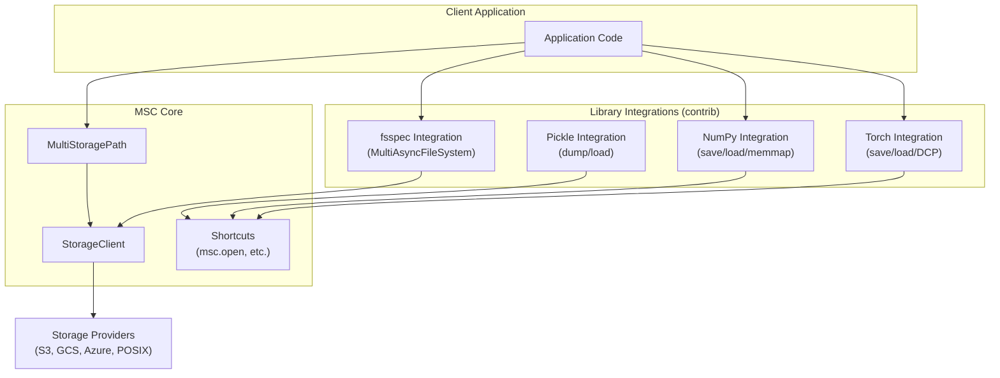
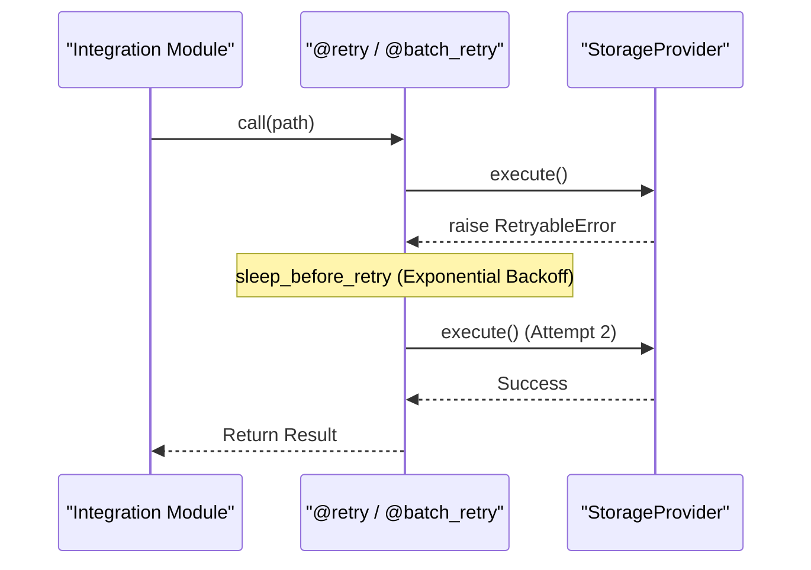

<!-- source: DeepWiki mcp.deepwiki.com · repo NVIDIA/multi-storage-client · page 4 Integrations · fetched 2026-10-26 -->

# Integrations

Relevant source files

The following files were used as context for generating this wiki page:

- [multi-storage-client/src/multistorageclient/contrib/torch/core.py](multi-storage-client/src/multistorageclient/contrib/torch/core.py)
- [multi-storage-client/src/multistorageclient/pathlib.py](multi-storage-client/src/multistorageclient/pathlib.py)
- [multi-storage-client/src/multistorageclient/retry.py](multi-storage-client/src/multistorageclient/retry.py)
- [multi-storage-client/tests/test_multistorageclient/unit/conftest.py](multi-storage-client/tests/test_multistorageclient/unit/conftest.py)
- [multi-storage-client/tests/test_multistorageclient/unit/contrib/test_async_fs.py](multi-storage-client/tests/test_multistorageclient/unit/contrib/test_async_fs.py)
- [multi-storage-client/tests/test_multistorageclient/unit/contrib/test_numpy.py](multi-storage-client/tests/test_multistorageclient/unit/contrib/test_numpy.py)
- [multi-storage-client/tests/test_multistorageclient/unit/contrib/test_pickle.py](multi-storage-client/tests/test_multistorageclient/unit/contrib/test_pickle.py)
- [multi-storage-client/tests/test_multistorageclient/unit/contrib/test_torch.py](multi-storage-client/tests/test_multistorageclient/unit/contrib/test_torch.py)
- [multi-storage-client/tests/test_multistorageclient/unit/test_pathlib.py](multi-storage-client/tests/test_multistorageclient/unit/test_pathlib.py)
- [multi-storage-client/tests/test_multistorageclient/unit/test_retry.py](multi-storage-client/tests/test_multistorageclient/unit/test_retry.py)

This page documents how `multi-storage-client` (MSC) integrates with various data science, machine learning, and general-purpose libraries. These integrations allow you to continue using familiar APIs while leveraging MSC's unified storage interface and performance optimizations across different backends.

## Integration Architecture

MSC integrates with other libraries through adapter modules in the `contrib` namespace. These adapters implement the specific interfaces required by third-party libraries while using the `StorageClient` for the underlying I/O.

Sources: [src/multistorageclient/contrib/torch/core.py:21-23](), [src/multistorageclient/pathlib.py:25-27](), [src/multistorageclient/shortcuts.py:26-27]()

## fsspec Integration

[fsspec Integration](#4.1) — MSC integrates with the `fsspec` ecosystem through the `MultiAsyncFileSystem`. This enables any `fsspec`-compatible library (such as **Dask**, **Pandas**, or **XArray**) to interact with MSC backends transparently using the `msc://` protocol.

The integration is registered as an entry point, allowing users to call `fsspec.filesystem("msc")` [tests/test_multistorageclient/unit/contrib/test_async_fs.py:31-31](). It supports standard filesystem operations including `_pipe_file`, `_cat_file`, `_ls`, and `_info` [tests/test_multistorageclient/unit/contrib/test_async_fs.py:33-56]().

For details, see [fsspec Integration](#4.1).

## Framework Integrations

[Framework Integrations](#4.2) — MSC provides specialized wrappers for common ML and data science frameworks to handle serialization and N-dimensional array I/O.

### PyTorch
The `msc.torch` module adapts `torch.save` and `torch.load` to support `msc://` URIs and `MultiStoragePath` objects [src/multistorageclient/contrib/torch/core.py:27-55](). It also provides `MultiStorageFileSystemReader` and `MultiStorageFileSystemWriter` for PyTorch Distributed Checkpoint (DCP) support [tests/test_multistorageclient/unit/contrib/test_torch.py:103-117]().

### NumPy
The NumPy integration supports `msc.numpy.save`, `msc.numpy.load`, and `msc.numpy.memmap` [tests/test_multistorageclient/unit/contrib/test_numpy.py:33-127](). This allows for memory-mapping large files directly from cloud storage (when used with the MSC cache) or POSIX backends.

### Pickle
The `msc.pickle` module provides `dump` and `load` functions that accept MSC paths, facilitating the serialization of Python objects directly to remote buckets [tests/test_multistorageclient/unit/contrib/test_pickle.py:41-84]().

For details, see [Framework Integrations](#4.2).

## Sync Engine

[Sync Engine](#4.3) — The Sync Engine is a high-performance subsystem designed for bulk data movement between different storage providers (e.g., S3 to POSIX, or POSIX to GCS). 

It utilizes a multi-threaded/multi-process architecture managed by a `SyncManager`. The engine performs efficient merge-sort comparisons to identify differences between source and destination and processes transfers in `OperationBatch` units [tests/test_multistorageclient/unit/test_retry.py:151-155](). It includes robust retry logic via the `@batch_retry` decorator to handle transient network failures during large-scale transfers [src/multistorageclient/retry.py:128-140]().

For details, see [Sync Engine](#4.3).

## Pathlib-like Interface

MSC provides a `MultiStoragePath` class that mimics the standard `pathlib.Path` API but works across all MSC-supported backends [src/multistorageclient/pathlib.py:75-91]().

| Feature | Description | Code Entity |
| :--- | :--- | :--- |
| **Unified Path** | Supports `msc://profile/path` and local paths. | `MultiStoragePath` [src/multistorageclient/pathlib.py:97-109]() |
| **Stat Support** | Returns `StatResult` with size and timestamps. | `StatResult` [src/multistorageclient/pathlib.py:33-40]() |
| **Navigation** | Supports `/` operator and `.parent`. | `__truediv__` [src/multistorageclient/pathlib.py:165-169]() |
| **I/O** | `path.open()`, `path.read_bytes()`, `path.write_text()`. | `open` [src/multistorageclient/pathlib.py:408-410]() |

Sources: [src/multistorageclient/pathlib.py:33-410](), [tests/test_multistorageclient/unit/test_pathlib.py:32-102]()

## Error Handling and Retries

Integrations benefit from a centralized retry mechanism defined in `retry.py`. The `@retry` decorator is used to automatically re-attempt operations that raise a `RetryableError` [src/multistorageclient/retry.py:89-96]().

Sources: [src/multistorageclient/retry.py:39-49](), [tests/test_multistorageclient/unit/test_retry.py:67-92]()

---

