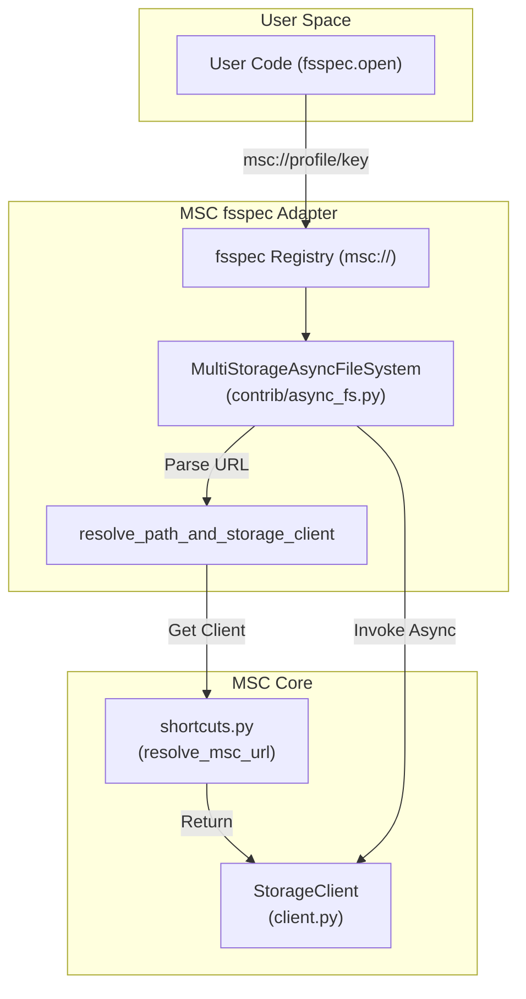
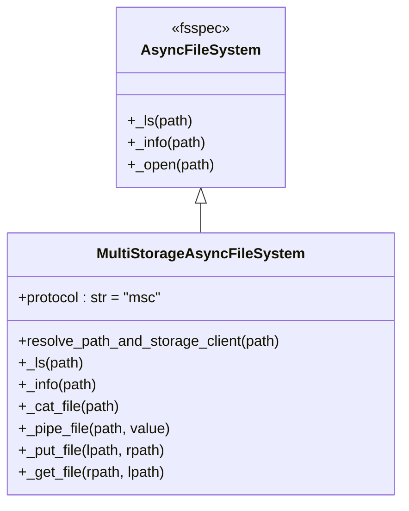
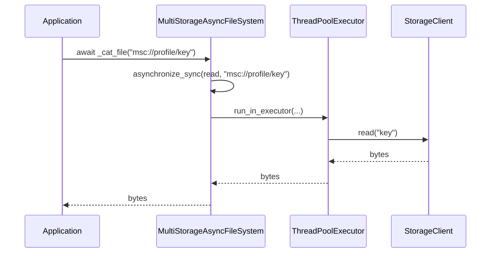

<!-- source: DeepWiki mcp.deepwiki.com · repo NVIDIA/multi-storage-client · page 4.1 fsspec Integration · fetched 2026-10-26 -->

# fsspec Integration

<details>
<summary>Relevant source files</summary>

The following files were used as context for generating this wiki page:

- [multi-storage-client-docs/src/user_guide/libraries.rst](multi-storage-client-docs/src/user_guide/libraries.rst)
- [multi-storage-client-docs/src/user_guide/manifests.rst](multi-storage-client-docs/src/user_guide/manifests.rst)
- [multi-storage-client-docs/src/user_guide/presigned_urls.rst](multi-storage-client-docs/src/user_guide/presigned_urls.rst)
- [multi-storage-client-docs/src/user_guide/quickstart.rst](multi-storage-client-docs/src/user_guide/quickstart.rst)
- [multi-storage-client-docs/src/user_guide/telemetry.rst](multi-storage-client-docs/src/user_guide/telemetry.rst)
- [multi-storage-client/tests/test_multistorageclient/unit/conftest.py](multi-storage-client/tests/test_multistorageclient/unit/conftest.py)
- [multi-storage-client/tests/test_multistorageclient/unit/contrib/test_async_fs.py](multi-storage-client/tests/test_multistorageclient/unit/contrib/test_async_fs.py)
- [multi-storage-client/tests/test_multistorageclient/unit/contrib/test_numpy.py](multi-storage-client/tests/test_multistorageclient/unit/contrib/test_numpy.py)
- [multi-storage-client/tests/test_multistorageclient/unit/contrib/test_pickle.py](multi-storage-client/tests/test_multistorageclient/unit/contrib/test_pickle.py)
- [multi-storage-client/tests/test_multistorageclient/unit/test_presigned_url.py](multi-storage-client/tests/test_multistorageclient/unit/test_presigned_url.py)

</details>


This page documents the fsspec integration in `multi-storage-client`, explaining how the library provides an implementation of the fsspec filesystem interface. This integration enables users to leverage the capabilities of `multi-storage-client` through the familiar fsspec API, making it compatible with numerous data science libraries and frameworks like Zarr, XArray, and Dask.

## Overview

Multi-storage-client provides a custom fsspec filesystem implementation through the `MultiStorageAsyncFileSystem` class (aliased as `MultiAsyncFileSystem`). This implementation registers the `msc://` protocol with fsspec, allowing users to access any storage provider supported by multi-storage-client using fsspec's consistent interface.

### System Flow: Natural Language to Code Entities

The following diagram maps high-level user actions to the specific code entities involved in the fsspec integration.



Sources: [multi-storage-client-docs/src/user_guide/libraries.rst:5-33](), [multi-storage-client/src/multistorageclient/contrib/async_fs.py:33-304]()

## Key Features

- **Protocol Registration**: Registers the `msc://` protocol with fsspec automatically upon installation.
- **Asynchronous Support**: Implements the `AsyncFileSystem` interface, providing `_ls`, `_info`, `_cat_file`, and `_pipe_file`.
- **Unified Access**: Provides access to all storage providers (S3, GCS, Azure, POSIX) through a single `msc://` interface.
- **Transparent Path Resolution**: Automatically resolves `msc://{profile}/{path}` to the appropriate `StorageClient` instance.

## Implementation Details

### Class Structure

`MultiStorageAsyncFileSystem` extends fsspec's `AsyncFileSystem` class. It bridges the asynchronous fsspec API to the synchronous `StorageClient` methods using a thread pool.



Sources: [multi-storage-client/src/multistorageclient/contrib/async_fs.py:33-266]()

### Path Resolution Logic

The method `resolve_path_and_storage_client` is the core utility for translating fsspec paths. It uses `multistorageclient.shortcuts.resolve_msc_url` to obtain a `StorageClient` for the specific profile and the relative object path.

- **Input**: `msc://data-s3-iad/animal-photos/red-panda.png`
- **Output**: `(StorageClient<data-s3-iad>, "animal-photos/red-panda.png")`

Sources: [multi-storage-client/src/multistorageclient/contrib/async_fs.py:49-58](), [multi-storage-client-docs/src/user_guide/quickstart.rst:199-202]()

### Asynchronous Bridging

Since the core `StorageClient` is synchronous, `MultiStorageAsyncFileSystem` wraps calls in `asynchronize_sync`. This helper uses `asyncio.get_event_loop().run_in_executor` to offload blocking I/O to a thread pool, satisfying fsspec's async requirements.



Sources: [multi-storage-client/src/multistorageclient/contrib/async_fs.py:29-72](), [multi-storage-client/src/multistorageclient/contrib/async_fs.py:300-309]()

## Usage Examples

### fsspec Native Usage
The `msc://` protocol is automatically registered, allowing standard fsspec usage:

```python
import fsspec
import multistorageclient as msc

# The msc:// protocol is resolved by MultiStorageAsyncFileSystem
fs = fsspec.filesystem("msc")

# Open a file from a specific profile defined in config.yaml
with fs.open("msc://my-s3-profile/data.bin", "rb") as f:
    data = f.read()
```
Sources: [multi-storage-client-docs/src/user_guide/libraries.rst:15-33]()

### Integration with Higher-Level Libraries
Libraries that support fsspec URLs can use MSC transparently.

| Library | Usage Pattern |
| :--- | :--- |
| **Zarr** | `zarr.open("msc://profile/data.zarr")` |
| **XArray** | `xarray.open_zarr("msc://profile/data.zarr")` |
| **Dask** | `dd.read_parquet("msc://profile/data/*.parquet")` |
| **NumPy** | `msc.numpy.load("msc://profile/array.npy")` |

Sources: [multi-storage-client-docs/src/user_guide/libraries.rst:135-182]()

## Implementation Mapping

The `MultiStorageAsyncFileSystem` maps fsspec operations to `StorageClient` methods as follows:

| fsspec Operation | MSC Implementation | MSC Core Method |
| :--- | :--- | :--- |
| `_ls` | `asynchronize_sync(client.list)` | `StorageClient.list` |
| `_info` | `asynchronize_sync(client.info)` | `StorageClient.info` |
| `_rm_file` | `asynchronize_sync(client.delete)` | `StorageClient.delete` |
| `_cp_file` | `asynchronize_sync(client.copy)` | `StorageClient.copy` |
| `_open` | `asynchronize_sync(client.open)` | `StorageClient.open` |
| `_cat_file` | `asynchronize_sync(client.read)` | `StorageClient.read` |
| `_pipe_file` | `asynchronize_sync(client.write)` | `StorageClient.write` |

Sources: [multi-storage-client/src/multistorageclient/contrib/async_fs.py:74-309]()

## Limitations

- **Cross-Profile Copy**: `_cp_file` requires both source and destination to reside within the same `StorageClient` (same profile). Cross-profile copies are not supported via the fsspec interface and will raise an `AttributeError`.
- **Thread-Based Async**: While the interface is `async`, the underlying execution is synchronous and blocking within a thread pool. Performance is bound by the `MSC_MAX_WORKERS` or thread pool limits.

Sources: [multi-storage-client/src/multistorageclient/contrib/async_fs.py:168-198](), [multi-storage-client/tests/test_multistorageclient/unit/conftest.py:121]()

---

