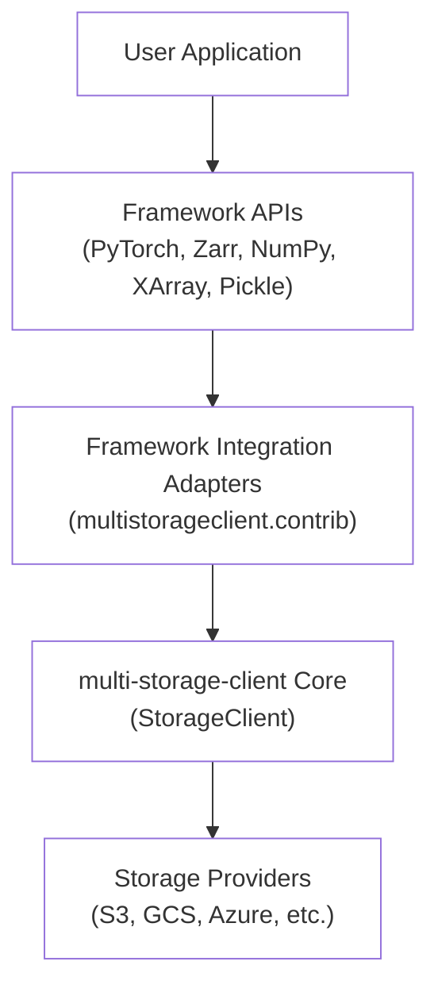
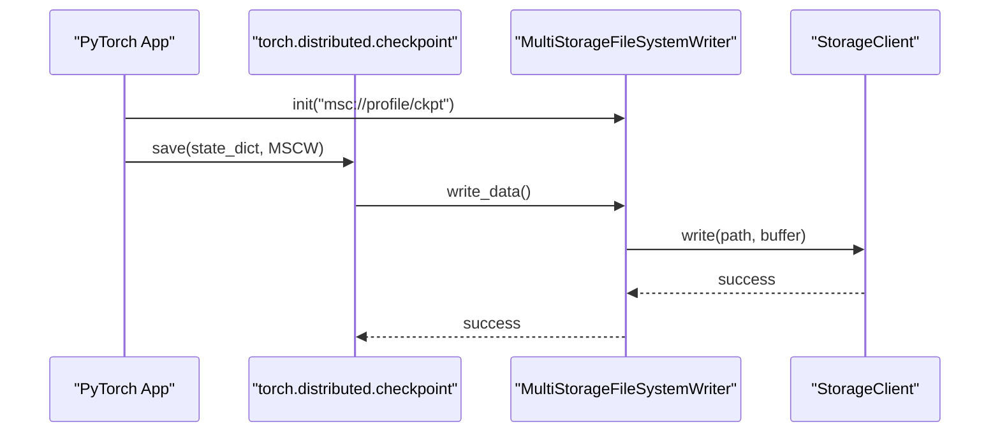
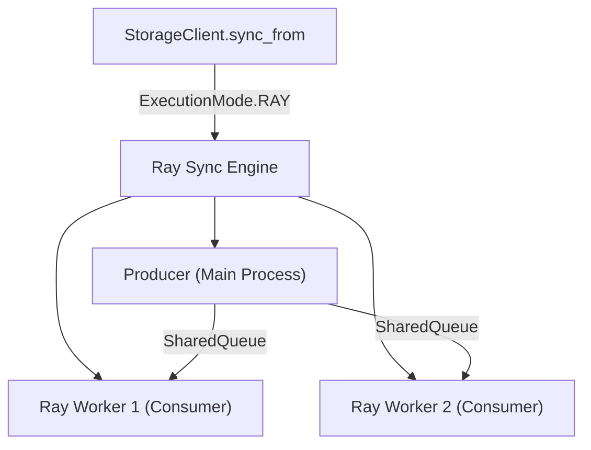

<!-- source: DeepWiki mcp.deepwiki.com · repo NVIDIA/multi-storage-client · page 4.2 Framework Integrations · fetched 2026-10-26 -->

# Framework Integrations

<details>
<summary>Relevant source files</summary>

The following files were used as context for generating this wiki page:

- [.gitignore](.gitignore)
- [multi-storage-client-docs/src/user_guide/libraries.rst](multi-storage-client-docs/src/user_guide/libraries.rst)
- [multi-storage-client-docs/src/user_guide/manifests.rst](multi-storage-client-docs/src/user_guide/manifests.rst)
- [multi-storage-client-docs/src/user_guide/presigned_urls.rst](multi-storage-client-docs/src/user_guide/presigned_urls.rst)
- [multi-storage-client-docs/src/user_guide/quickstart.rst](multi-storage-client-docs/src/user_guide/quickstart.rst)
- [multi-storage-client-docs/src/user_guide/telemetry.rst](multi-storage-client-docs/src/user_guide/telemetry.rst)
- [multi-storage-client/.rayignore](multi-storage-client/.rayignore)
- [multi-storage-client/justfile](multi-storage-client/justfile)
- [multi-storage-client/src/multistorageclient/contrib/pickle.py](multi-storage-client/src/multistorageclient/contrib/pickle.py)
- [multi-storage-client/src/multistorageclient/contrib/torch/core.py](multi-storage-client/src/multistorageclient/contrib/torch/core.py)
- [multi-storage-client/src/multistorageclient/pathlib.py](multi-storage-client/src/multistorageclient/pathlib.py)
- [multi-storage-client/src/multistorageclient/retry.py](multi-storage-client/src/multistorageclient/retry.py)
- [multi-storage-client/tests/test_multistorageclient/unit/contrib/test_ray.py](multi-storage-client/tests/test_multistorageclient/unit/contrib/test_ray.py)
- [multi-storage-client/tests/test_multistorageclient/unit/contrib/test_torch.py](multi-storage-client/tests/test_multistorageclient/unit/contrib/test_torch.py)
- [multi-storage-client/tests/test_multistorageclient/unit/test_pathlib.py](multi-storage-client/tests/test_multistorageclient/unit/test_pathlib.py)
- [multi-storage-client/tests/test_multistorageclient/unit/test_presigned_url.py](multi-storage-client/tests/test_multistorageclient/unit/test_presigned_url.py)
- [multi-storage-client/tests/test_multistorageclient/unit/test_retry.py](multi-storage-client/tests/test_multistorageclient/unit/test_retry.py)

</details>


This page describes how `multi-storage-client` integrates with popular data science and machine learning frameworks. These integrations enable transparent access to remote storage systems without requiring framework-specific storage adaptors or changing your existing code significantly. For information about the fsspec integration specifically, see [fsspec Integration]().

## Overview

Multi-storage-client provides native integrations with several popular frameworks, allowing them to read from and write to supported storage backends using the familiar `msc://` URL scheme. This approach maintains the original framework APIs while extending them to work with remote storage.



Sources: [multi-storage-client/src/multistorageclient/__init__.py:60-65]()

## Lazy-Loading Integration Mechanism

Framework integrations are implemented using a lazy-loading mechanism that imports framework-specific modules only when they're first accessed. This approach minimizes unnecessary dependencies and startup time.

```mermaid
classDiagram
    class "multistorageclient" {
        __getattr__(name)
    }
    
    class "contrib.torch" {
        load()
        save()
        MultiStorageFileSystemWriter
    }
    
    class "contrib.zarr" {
        open_consolidated()
        LazyZarrStore
    }
    
    class "contrib.numpy" {
        load()
        save()
        memmap()
    }
    
    class "contrib.pickle" {
        load()
        dump()
    }
    
    multistorageclient --> "contrib.torch" : loads on demand
    multistorageclient --> "contrib.zarr" : loads on demand
    multistorageclient --> "contrib.numpy" : loads on demand
    multistorageclient --> "contrib.pickle" : loads on demand
```

Each framework integration is accessed as an attribute of the main package (e.g., `msc.torch`, `msc.zarr`), but is only imported when first accessed via `__getattr__` in the package root.

Sources: [multi-storage-client/src/multistorageclient/__init__.py:60-65]()

## PyTorch Integration

The `multistorageclient.torch` module (aliasing `multistorageclient.contrib.torch`) provides adapted versions of PyTorch's `load` and `save` functions. It also supports PyTorch Distributed Checkpoint (DCP) through custom reader and writer classes.

### Distributed Checkpoint (DCP) Support
MSC implements `MultiStorageFileSystemWriter` and `MultiStorageFileSystemReader` to enable saving and loading model checkpoints directly to remote storage using `torch.distributed.checkpoint`.



### Usage Example
```python
import multistorageclient as msc
import torch.distributed.checkpoint as dcp

# Using DCP with MSC
writer = msc.torch.MultiStorageFileSystemWriter("msc://data-s3-iad/checkpoint/1")
dcp.save(state_dict=state_dict, storage_writer=writer)

# Simple load/save
tensor = msc.torch.load("msc://data-s3-iad/tensors/tensor-1.pt")
```

Sources: [multi-storage-client/src/multistorageclient/contrib/torch/core.py:25-44](), [multi-storage-client-docs/src/user_guide/libraries.rst:89-130](), [multi-storage-client/tests/test_multistorageclient/unit/contrib/test_torch.py:103-117]()

## Ray Integration

The Ray integration provides distributed synchronization capabilities. It includes specialized data structures like `SharedQueue` and `SharedEvent` to coordinate work across Ray workers.

### Distributed Sync Execution
When performing a `sync_from` operation, MSC can utilize Ray as an execution backend by setting `execution_mode=ExecutionMode.RAY`. This distributes the transfer tasks across a Ray cluster.



### Usage Example
```python
from multistorageclient.types import ExecutionMode

# Synchronize buckets using Ray workers
target_client.sync_from(
    source_client, 
    "source/", 
    "target/", 
    execution_mode=ExecutionMode.RAY
)
```

Sources: [multi-storage-client/tests/test_multistorageclient/unit/contrib/test_ray.py:59-73](), [multi-storage-client/tests/test_multistorageclient/unit/contrib/test_ray.py:171-201]()

## NumPy and Pickle Integrations

### NumPy
The `multistorageclient.numpy` module allows for loading and saving NumPy arrays directly to storage. It also supports `memmap` for memory-mapped access to large arrays stored remotely.

| Function | Description |
| :--- | :--- |
| `load(url)` | Loads a `.npy` or `.npz` file from an MSC URL. |
| `save(url, array)` | Saves an array to an MSC URL. |
| `memmap(url, ...)` | Creates a memory-map to a file on remote storage. |

Sources: [multi-storage-client-docs/src/user_guide/libraries.rst:60-84]()

### Pickle
The `multistorageclient.contrib.pickle` module provides `dump` and `load` functions that wrap the standard `pickle` library but handle MSC URLs transparently.

```python
import multistorageclient as msc

data = {"key": "value"}
# Serialize object to S3
msc.contrib.pickle.dump(data, "msc://my-profile/objects/data.pkl")

# Deserialize object
loaded_data = msc.contrib.pickle.load("msc://my-profile/objects/data.pkl")
```

Sources: [multi-storage-client/src/multistorageclient/contrib/pickle.py:1-30]()

## Path-like Interface (`MultiStoragePath`)

The `MultiStoragePath` class (aliased as `msc.Path`) provides a `pathlib`-compatible interface for remote storage. It translates standard path operations into `StorageClient` calls.

### Stat Mapping
Remote object metadata is mapped to a `StatResult` object that mimics `os.stat_result`.

| `os.stat_result` field | MSC Mapping |
| :--- | :--- |
| `st_mode` | `S_IFDIR` for directories, `S_IFREG` for files. |
| `st_size` | `ObjectMetadata.content_length`. |
| `st_mtime` | `ObjectMetadata.last_modified` timestamp. |

Sources: [multi-storage-client/src/multistorageclient/pathlib.py:33-72](), [multi-storage-client/src/multistorageclient/pathlib.py:75-105]()

## Zarr and XArray Integrations

Both Zarr and XArray integrations leverage the `fsspec` compatibility layer but provide convenience wrappers.

- **Zarr**: Provides `open_consolidated` to read Zarr groups using `LazyZarrStore`.
- **XArray**: Provides `open_zarr` which utilizes the MSC `fsspec` implementation to load datasets.

Sources: [multi-storage-client-docs/src/user_guide/libraries.rst:132-182]()

---

