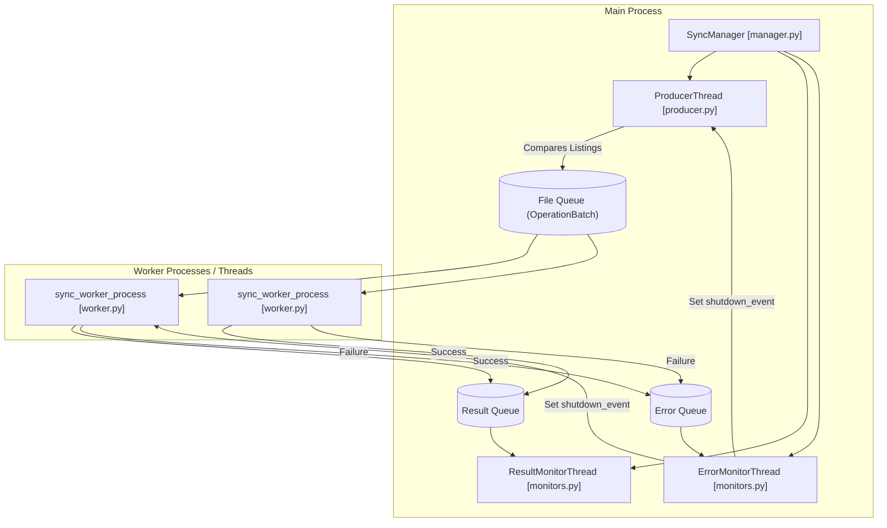
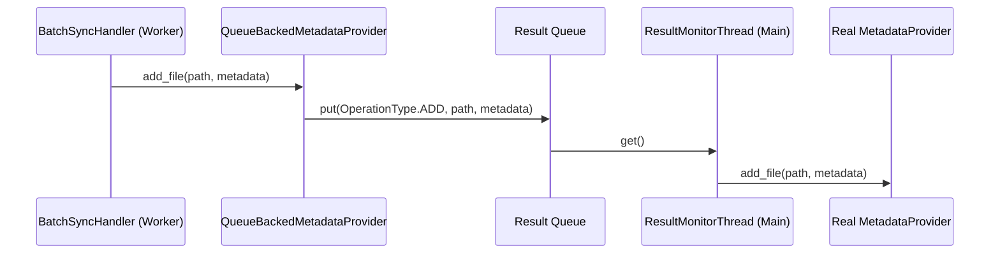

<!-- source: DeepWiki mcp.deepwiki.com · repo NVIDIA/multi-storage-client · page 4.3 Sync Engine · fetched 2026-10-26 -->

# Sync Engine

Relevant source files

The following files were used as context for generating this wiki page:

- [multi-storage-client/src/multistorageclient/sync/__init__.py](multi-storage-client/src/multistorageclient/sync/__init__.py)
- [multi-storage-client/src/multistorageclient/sync/manager.py](multi-storage-client/src/multistorageclient/sync/manager.py)
- [multi-storage-client/src/multistorageclient/sync/metadata_proxy.py](multi-storage-client/src/multistorageclient/sync/metadata_proxy.py)
- [multi-storage-client/src/multistorageclient/sync/monitors.py](multi-storage-client/src/multistorageclient/sync/monitors.py)
- [multi-storage-client/src/multistorageclient/sync/producer.py](multi-storage-client/src/multistorageclient/sync/producer.py)
- [multi-storage-client/src/multistorageclient/sync/progress_bar.py](multi-storage-client/src/multistorageclient/sync/progress_bar.py)
- [multi-storage-client/src/multistorageclient/sync/types.py](multi-storage-client/src/multistorageclient/sync/types.py)
- [multi-storage-client/src/multistorageclient/sync/worker.py](multi-storage-client/src/multistorageclient/sync/worker.py)
- [multi-storage-client/tests/test_multistorageclient/unit/sync/__init__.py](multi-storage-client/tests/test_multistorageclient/unit/sync/__init__.py)
- [multi-storage-client/tests/test_multistorageclient/unit/sync/test_metadata_proxy.py](multi-storage-client/tests/test_multistorageclient/unit/sync/test_metadata_proxy.py)
- [multi-storage-client/tests/test_multistorageclient/unit/sync/test_monitors.py](multi-storage-client/tests/test_multistorageclient/unit/sync/test_monitors.py)
- [multi-storage-client/tests/test_multistorageclient/unit/sync/test_producer.py](multi-storage-client/tests/test_multistorageclient/unit/sync/test_producer.py)
- [multi-storage-client/tests/test_multistorageclient/unit/sync/test_progress_bar.py](multi-storage-client/tests/test_multistorageclient/unit/sync/test_progress_bar.py)
- [multi-storage-client/tests/test_multistorageclient/unit/sync/test_worker.py](multi-storage-client/tests/test_multistorageclient/unit/sync/test_worker.py)
- [multi-storage-client/tests/test_multistorageclient/unit/test_sync.py](multi-storage-client/tests/test_multistorageclient/unit/test_sync.py)

The Sync Engine is a high-performance, multi-threaded, and multi-process synchronization framework designed to reconcile files between two storage locations. It supports diverse backend combinations (POSIX, S3, GCS, Azure, etc.) and employs a merge-sort comparison strategy to efficiently identify differences without loading entire file lists into memory.

## Architecture Overview

The sync process is orchestrated by the `SyncManager`, which coordinates a pipeline of specialized threads and processes. The engine is designed to be "fail-fast," meaning any unrecoverable error in a worker immediately signals a shutdown across all components to prevent inconsistent states.

### Core Pipeline Components

| Component | Entity | Role |
| :--- | :--- | :--- |
| **Manager** | `SyncManager` | Orchestrates lifecycle, calculates worker counts, and aggregates final results. |
| **Producer** | `ProducerThread` | Iterates source and target; performs merge-sort comparison; enqueues `OperationBatch`. |
| **Worker** | `BatchSyncHandler` | Executes the physical transfer (upload, download, copy, or delete). |
| **Result Monitor** | `ResultMonitorThread` | Tracks completed units, updates byte counts, and updates the `MetadataProvider`. |
| **Error Monitor** | `ErrorMonitorThread` | Collects exceptions from workers and triggers the global `shutdown_event`. |

### Sync Engine Data Flow

This diagram illustrates how data and control signals flow between the different code entities during a sync operation.

**Sources:** [src/multistorageclient/sync/manager.py:49-56](), [src/multistorageclient/sync/producer.py:52-70](), [src/multistorageclient/sync/worker.py:34-34](), [src/multistorageclient/sync/monitors.py:32-38]().

---

## Producer and Comparison Logic

The `ProducerThread` is responsible for determining the delta between the source and target.

### Merge-Sort Comparison
Instead of fetching all metadata into memory, the producer utilizes sorted iterators from both the source and target storage clients. It performs a merge-style comparison by relative path:
1. If a path exists only in source: **ADD**.
2. If a path exists only in target: **DELETE** (if `delete_unmatched_files` is enabled).
3. If path exists in both: Compare `content_length` and `last_modified` (at second resolution). If they differ, **ADD** (overwrite).

### SizeBucket Optimization
To optimize worker throughput, the producer groups operations into `OperationBatch` objects based on `SizeBucket`. This ensures that workers are not blocked by a single massive file while small files wait in the queue.

| Bucket | Range | Logic |
| :--- | :--- | :--- |
| `SMALL` | 0 - 1MB | Batched heavily to reduce overhead. |
| `MEDIUM` | 1MB - 64MB | Standard batching. |
| `LARGE` | 64MB - 1GB | Smaller batches for load balancing. |
| `VERY_LARGE` | > 1GB | Usually processed individually. |

**Sources:** [src/multistorageclient/sync/producer.py:43-50](), [src/multistorageclient/sync/producer.py:114-123](), [src/multistorageclient/sync/producer.py:134-165](), [tests/test_multistorageclient/unit/sync/test_producer.py:85-121]().

---

## Worker Implementations

The `BatchSyncHandler` is an abstract base class implemented for specific source-target pairs. The `create_sync_handler` factory selects the appropriate implementation based on the storage provider types.

### Implementation Mapping

| Implementation | Source | Target | Key Functionality |
| :--- | :--- | :--- | :--- |
| `PosixToPosixHandler` | POSIX | POSIX | Uses `shutil.copy2` to preserve timestamps/permissions. |
| `PosixToRemoteHandler` | POSIX | Remote | Uses `target_client.upload_file`. |
| `RemoteToPosixHandler` | Remote | POSIX | Uses `source_client.download_file`. |
| `RemoteToRemoteHandler` | Remote | Remote | Uses `target_client.copy` (server-side copy if supported). |

### Metadata Propagation
Workers use `QueueBackedMetadataProvider` to ensure that metadata updates (like `add_file`) performed in a worker process are proxied back to the `ResultMonitorThread` in the main process. This prevents consistency issues in multi-process mode where memory is not shared.

**Sources:** [src/multistorageclient/sync/worker.py:175-186](), [src/multistorageclient/sync/metadata_proxy.py:23-43](), [src/multistorageclient/sync/metadata_proxy.py:51-65]().

---

## Operational Features

### Dryrun Mode
When `dryrun=True` is passed to `sync_objects`, the engine performs the full comparison logic but skips the actual transfer calls. Instead, it generates JSONL files containing the planned operations (ADD/DELETE).

### Fail-Fast Error Propagation
The `ErrorMonitorThread` listens on a dedicated `error_queue`. Upon receiving the first `ErrorInfo` object:
1. It logs the traceback and exception.
2. It sets the `shutdown_event`.
3. The `ProducerThread` and all `BatchSyncHandler` workers check this event and terminate gracefully.
4. The `SyncManager` raises a `SyncError` containing all collected errors.

### Progress Monitoring
The `ProgressBar` class wraps `tqdm` with specific enhancements:
* **Capping**: Percentages are capped at 99.9% until the `ResultMonitorThread` confirms all operations are finished.
* **Throttling**: Updates are throttled to 1Hz to prevent UI flicker and reduce overhead in high-throughput syncs.

**Sources:** [src/multistorageclient/sync/manager.py:134-137](), [src/multistorageclient/sync/monitors.py:99-106](), [src/multistorageclient/sync/monitors.py:121-137](), [src/multistorageclient/sync/progress_bar.py:9-28](), [src/multistorageclient/sync/progress_bar.py:43-52]().

---

