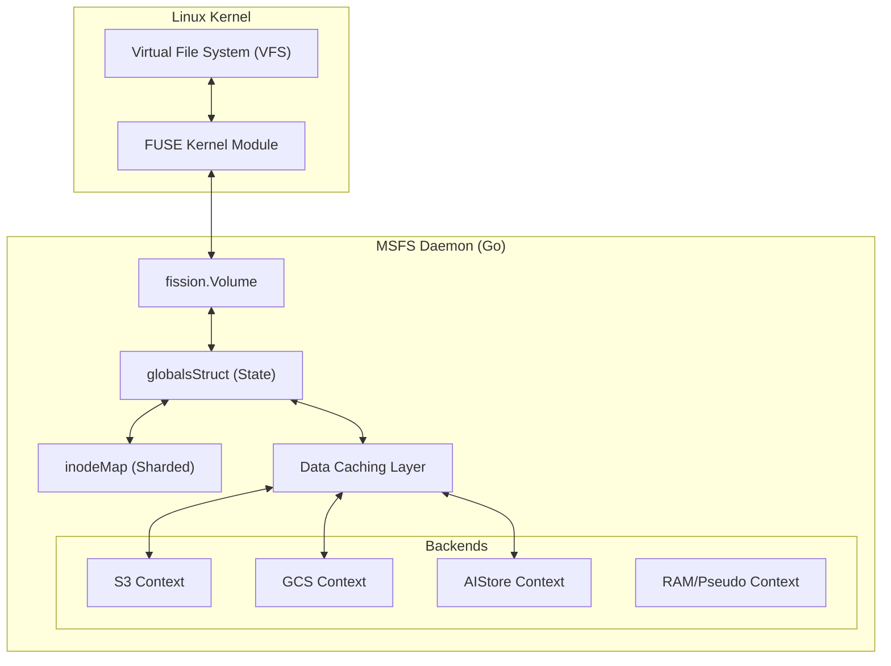

<!-- source: DeepWiki mcp.deepwiki.com · repo NVIDIA/multi-storage-client · page 5 Multi-Storage File System (MSFS) · fetched 2026-10-26 -->

# Multi-Storage File System (MSFS)

<details>
<summary>Relevant source files</summary>

The following files were used as context for generating this wiki page:

- [multi-storage-file-system/Dockerfile](multi-storage-file-system/Dockerfile)
- [multi-storage-file-system/Makefile](multi-storage-file-system/Makefile)
- [multi-storage-file-system/README.md](multi-storage-file-system/README.md)
- [multi-storage-file-system/cache.go](multi-storage-file-system/cache.go)
- [multi-storage-file-system/config.go](multi-storage-file-system/config.go)
- [multi-storage-file-system/config_test.go](multi-storage-file-system/config_test.go)
- [multi-storage-file-system/dev_setup.sh](multi-storage-file-system/dev_setup.sh)
- [multi-storage-file-system/docker-compose.yaml](multi-storage-file-system/docker-compose.yaml)
- [multi-storage-file-system/fission.go](multi-storage-file-system/fission.go)
- [multi-storage-file-system/fission_test.go](multi-storage-file-system/fission_test.go)
- [multi-storage-file-system/fs.go](multi-storage-file-system/fs.go)
- [multi-storage-file-system/globals.go](multi-storage-file-system/globals.go)
- [multi-storage-file-system/go.mod](multi-storage-file-system/go.mod)
- [multi-storage-file-system/go.sum](multi-storage-file-system/go.sum)

</details>


The Multi-Storage File System (MSFS) is a high-performance FUSE-based daemon written in Go that provides a POSIX-compliant interface to various cloud and object storage backends [multi-storage-file-system/README.md:1-13](). It allows applications that rely on standard file system operations (like `open`, `read`, and `readdir`) to interact with object storage without modification [multi-storage-file-system/README.md:3-9]().

### System Overview

MSFS acts as a bridge between the Linux Virtual File System (VFS) and remote storage providers. It leverages the `fission` library to handle FUSE kernel communication [multi-storage-file-system/fission.go:12-14](). The daemon maintains a sophisticated in-memory inode representation and a multi-tier caching system to mitigate the latency inherent in object storage.


**Sources:** [multi-storage-file-system/fission.go:68-83](), [multi-storage-file-system/globals.go:343-380](), [multi-storage-file-system/fs.go:50-53]()

### Architecture and FUSE Implementation
The core of MSFS is the `globalsStruct`, which manages the filesystem state, including the `inodeMap` and `backendMap` [multi-storage-file-system/globals.go:343-380](). MSFS implements standard FUSE callbacks such as `DoLookup`, `DoRead`, and `DoReadDir` to translate POSIX requests into backend-specific operations [multi-storage-file-system/fission.go:158-171]().

Key architectural features include:
*   **Inode Lifecycle:** Inodes are managed via a sharded map and an eviction queue to bound memory usage [multi-storage-file-system/fs.go:50-51]().
*   **Concurrency:** The system supports parallel directory operations and asynchronous reads [multi-storage-file-system/fission.go:19-27]().
*   **Fission Integration:** Uses `github.com/NVIDIA/fission/v4` for high-performance FUSE worker management [multi-storage-file-system/fission.go:68-81]().

For details, see [MSFS Architecture and FUSE Implementation](#5.1).

### Configuration and Backends
MSFS supports two configuration schemas: `v0` for compatibility with the Python Multi-Storage Client and `v1` for native MSFS features [multi-storage-file-system/README.md:47-51](). It supports a variety of backends, including AWS S3, Google Cloud Storage (GCS), AIStore, and specialized testing backends like `RAM` and `PSEUDO` [multi-storage-file-system/globals.go:24-110]().

*   **Hot Reload:** Supports configuration updates via `SIGHUP` [multi-storage-file-system/globals.go:351]().
*   **AIStore Manifests:** An AIStore backend can route metadata operations to a "manifest generation" backend (e.g., direct S3) while serving data through AIS for caching performance [multi-storage-file-system/globals.go:34-40]().

For details, see [MSFS Configuration and Backends](#5.2).

### Caching Layer
MSFS employs a multi-tier data caching strategy to optimize throughput and reduce backend costs. The cache is divided into "cache lines" of configurable size [multi-storage-file-system/cache.go:30]().

| Cache Storage Mode | Implementation | Description |
| :--- | :--- | :--- |
| `ram` | Anonymous `mmap` | High performance, memory-only cache [multi-storage-file-system/cache.go:70-75](). |
| `mapped-file` | Shared `mmap` file | Persists across process restarts in a single file [multi-storage-file-system/cache.go:48-53](). |
| `per-inode-file` | Sparse files | Individual files per inode, allowing kernel page cache integration [multi-storage-file-system/cache.go:33-42](). |

For details, see [MSFS Caching Layer](#5.3).

### Build, Packaging, and CSI
The MSFS project includes a comprehensive build system and deployment tools. It is distributed as `.deb` and `.rpm` packages for both `amd64` and `arm64` architectures [multi-storage-file-system/Makefile:128-140]().

*   **CSI Driver:** A Kubernetes Container Storage Interface (CSI) driver allows MSFS to be used as a persistent volume provider in K8s clusters.
*   **Observability:** Integrated with Prometheus and OpenTelemetry for monitoring filesystem metrics and backend performance [multi-storage-file-system/go.mod:19-24]().
*   **Development:** A `docker-compose` environment provides local instances of MinIO, fake-GCS, and AIStore for end-to-end testing [multi-storage-file-system/Dockerfile:1-4]().

For details, see [MSFS Build, Packaging, and CSI Driver](#5.4).

### Code Entity Mapping

```mermaid
classDiagram
    class globalsStruct {
        +fissionVolume fission.Volume
        +inodeMap shardedInodeMap
        +backendMap map[uint64]*backendStruct
        +dataCacheLinesTracker []dataCacheLineTrackerStruct
        +DoLookup()
        +DoRead()
        +DoOpen()
    }
    class inodeStruct {
        +inodeNumber uint64
        +inodeType uint32
        +objectPath string
        +sizeInBackend uint64
    }
    class backendStruct {
        +dirName string
        +backendType string
        +context interface{}
        +setupContext()
    }
    class dataCacheLineTrackerStruct {
        +state uint32
        +inodeNumber uint64
        +lineNumber uint64
    }

    globalsStruct "1" *-- "many" inodeStruct : manages
    globalsStruct "1" *-- "many" backendStruct : routes to
    globalsStruct "1" *-- "many" dataCacheLineTrackerStruct : tracks
```
**Sources:** [multi-storage-file-system/globals.go:343-380](), [multi-storage-file-system/globals.go:1210-1250](), [multi-storage-file-system/globals.go:160-230](), [multi-storage-file-system/globals.go:1330-1350]()

---

