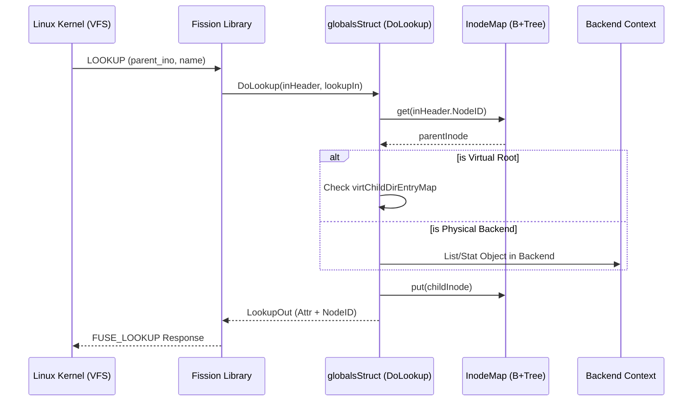

<!-- source: DeepWiki mcp.deepwiki.com · repo NVIDIA/multi-storage-client · page 5.1 MSFS Architecture and FUSE Implementation · fetched 2026-10-26 -->

# MSFS Architecture and FUSE Implementation

Relevant source files

The following files were used as context for generating this wiki page:

- [multi-storage-file-system/README.md](multi-storage-file-system/README.md)
- [multi-storage-file-system/bptree.go](multi-storage-file-system/bptree.go)
- [multi-storage-file-system/cache.go](multi-storage-file-system/cache.go)
- [multi-storage-file-system/config.go](multi-storage-file-system/config.go)
- [multi-storage-file-system/config_test.go](multi-storage-file-system/config_test.go)
- [multi-storage-file-system/fission.go](multi-storage-file-system/fission.go)
- [multi-storage-file-system/fission_test.go](multi-storage-file-system/fission_test.go)
- [multi-storage-file-system/fs.go](multi-storage-file-system/fs.go)
- [multi-storage-file-system/globals.go](multi-storage-file-system/globals.go)
- [multi-storage-file-system/globals_lock.go](multi-storage-file-system/globals_lock.go)

The Multi-Storage File System (MSFS) is a FUSE-based daemon implemented in Go that provides a POSIX-compliant interface to disparate cloud storage backends [multi-storage-file-system/README.md:1-14](). It leverages the `fission` library to handle the low-level FUSE protocol communication and manages metadata and data caching to reconcile object storage semantics with POSIX requirements [multi-storage-file-system/fission.go:12-14](), [multi-storage-file-system/README.md:11-14]().

## Core Architecture and Global State

The central state of the MSFS daemon is managed by the `globalsStruct`, which holds configuration, backend maps, inode management structures, and metrics [multi-storage-file-system/globals.go:34323-34323]().

### The `globalsStruct` Central State
The `globals` variable is a singleton instance of `globalsStruct` that acts as the primary coordinator for the filesystem [multi-storage-file-system/globals.go:34323-34323](). Key members include:
*   **`backendMap`**: Maps a unique `uint64` nonce to a `backendStruct`, representing active storage providers [multi-storage-file-system/globals.go:34323-34323]().
*   **`inodeMap`**: A sharded B+Tree mapping inode numbers to `inodeStruct` objects [multi-storage-file-system/fs.go:50-50]().
*   **`fhMap`**: Tracks open file handles (`fhStruct`) [multi-storage-file-system/fs.go:104-104]().
*   **`fissionVolume`**: The handle to the FUSE mount managed by the `fission` library [multi-storage-file-system/fission.go:83-83]().

### System Initialization Flow
The initialization process sets up the memory limits, B+Tree storage, and the root inode before performing the FUSE mount.

**Initialization Sequence:**
1.  **`initFS()`**: Creates temporary cache directories, initializes the `inodeMap` and `inodeEvictionQueue`, and creates the `FUSERootDir` inode [multi-storage-file-system/fs.go:15-110]().
2.  **`processToMountList()`**: Iterates through configured backends, sets up their specific contexts (S3, GCS, etc.), and mounts them as virtual subdirectories under the root [multi-storage-file-system/fs.go:160-200]().
3.  **`performFissionMount()`**: Configures the `fission.VolumeConfig` and invokes `DoMount()` to start the FUSE event loop [multi-storage-file-system/fission.go:62-88]().

**Sources:** [multi-storage-file-system/globals.go:34323-34323](), [multi-storage-file-system/fs.go:15-110](), [multi-storage-file-system/fs.go:160-200](), [multi-storage-file-system/fission.go:62-88]()

## FUSE Implementation via Fission

MSFS implements the `fission.Callbacks` interface. When the Linux kernel sends a FUSE request, the `fission` library invokes the corresponding method on the `globals` object [multi-storage-file-system/fission.go:68-78]().

### Key FUSE Callbacks

| Callback | Code Entity | Description |
| :--- | :--- | :--- |
| **DoLookup** | `(*globalsStruct).DoLookup` | Resolves a name in a directory to an inode. Handles virtual root, backend roots, and physical objects [multi-storage-file-system/fission.go:158-203](). |
| **DoOpen** | `(*globalsStruct).DoOpen` | Validates file existence and creates an `fhStruct` (File Handle) for subsequent I/O [multi-storage-file-system/fission.go:880-900](). |
| **DoRead** | `(*globalsStruct).DoRead` | Serves data from the `dataCache` or fetches from the backend if a cache miss occurs [multi-storage-file-system/fission.go:1072-1163](). |
| **DoReadDir** | `(*globalsStruct).DoReadDir` | Lists directory contents, utilizing paging for large object storage buckets [multi-storage-file-system/fission.go:1821-1944](). |

### Logical Flow of a Lookup

**Sources:** [multi-storage-file-system/fission.go:158-223](), [multi-storage-file-system/fs.go:50-53](), [multi-storage-file-system/fission.go:68-78]()

## Inode Lifecycle and Eviction

Inodes in MSFS represent files or directories. Because object storage can contain millions of objects, MSFS uses an eviction strategy to bound memory usage.

### Inode Structure
The `inodeStruct` tracks metadata such as `inodeNumber`, `inodeType` (File, Dir, or Root), `objectPath`, and cache status [multi-storage-file-system/fs.go:61-82]().

### Persistence and Sharding
Inodes are stored in a sharded B+Tree (`inodeMap`) backed by a PebbleDB page store (`bptreePageStore`) to ensure that even large metadata sets do not exhaust RAM [multi-storage-file-system/fs.go:50-50](), [multi-storage-file-system/bptree.go:34-40]().

### Eviction Mechanism
1.  **`inodeEvictionQueue`**: A `xTimeInodeNumberSetStruct` tracks inodes based on their last access time (`xTime`) [multi-storage-file-system/fs.go:51-51]().
2.  **`inodeEvictor`**: A background goroutine that monitors the queue and removes inodes that have exceeded the `evictable_inode_ttl` [multi-storage-file-system/fs.go:101-102](), [multi-storage-file-system/README.md:62-62]().
3.  **Active Inodes**: Inodes with open file handles (`fhSet`) or active cache lines are protected from eviction [multi-storage-file-system/fs.go:76-80]().

**Sources:** [multi-storage-file-system/fs.go:50-82](), [multi-storage-file-system/bptree.go:34-40](), [multi-storage-file-system/README.md:62-62]()

## Read Operations and Optimistic Concurrency

MSFS implements an optimistic concurrency model for reads to minimize locking overhead during data transfers.

### Data Flow for `DoRead`
1.  **Cache Check**: The system checks if the requested byte range is resident in the `dataCacheLinesTracker` [multi-storage-file-system/cache.go:88-111]().
2.  **Optimistic Read**: If the line is `CacheLineClean`, the system attempts to read data while tracking the `contentGeneration` [multi-storage-file-system/cache.go:105-105]().
3.  **Backend Fetch**: On a miss, a backend request is initiated. The line state moves to `CacheLineInbound` while the fetch is in progress [multi-storage-file-system/cache.go:113-118]().
4.  **Verification**: After the read, the `contentGeneration` is checked again. If it changed (due to eviction or overwrite), the read is retried [multi-storage-file-system/cache.go:105-105]().

### Direct I/O and Page Cache
MSFS supports different `cache_storage` modes that affect how the Linux kernel interacts with the filesystem:
*   **`ram` / `mapped-file`**: Uses `FOpenResponseDirectIO`. The kernel does not cache data, making MSFS the sole authority [multi-storage-file-system/fission.go:48-53]().
*   **`per-inode-file`**: DirectIO is disabled, allowing the kernel page cache to absorb repeated warm reads, similar to `s3fs` behavior [multi-storage-file-system/fission.go:54-59]().

**Sources:** [multi-storage-file-system/cache.go:88-118](), [multi-storage-file-system/fission.go:48-59](), [multi-storage-file-system/fission.go:1072-1163]()

## Directory Listing and Paging

Listing directories in object storage is often expensive and limited by provider page sizes (e.g., 1000 objects for S3).

### Paging Implementation
The `DoReadDir` and `DoReadDirPlus` callbacks manage state across multiple FUSE requests using the `Offset` field in the FUSE header [multi-storage-file-system/fission.go:1821-1944]().
*   **Initial Request**: MSFS initiates a listing against the backend provider.
*   **Continuation**: If the provider returns a truncation token, MSFS stores the next expected object name as the FUSE offset.
*   **Resumption**: Subsequent `DoReadDir` calls use the offset to resume listing from the correct point in the backend [multi-storage-file-system/fission.go:1944-1944]().

### Virtual vs. Physical Entries
*   **Virtual Entries**: Includes `.`, `..`, and backend root directories (e.g., `/mnt/s3_backend/`). These are managed via `virtChildDirEntryMap` [multi-storage-file-system/fs.go:53-53](), [multi-storage-file-system/fs.go:90-99]().
*   **Physical Entries**: Actual objects in the cloud bucket, managed via `physChildDirEntryMap` [multi-storage-file-system/fs.go:52-52]().

**Sources:** [multi-storage-file-system/fission.go:1821-1944](), [multi-storage-file-system/fs.go:52-53](), [multi-storage-file-system/fs.go:90-99]()

## Concurrency Control: The Globals Lock

MSFS uses a coarse-grained global mutex to protect the consistency of the `globalsStruct`. To prevent deadlocks and identify performance bottlenecks, the codebase uses an instrumented locking pattern.

### Lock Instrumentation
Instead of `sync.Mutex` directly, the code uses `globalsLock(site)` and `globalsUnlock()` [multi-storage-file-system/globals_lock.go:3-4]().
*   **`globalsLockSiteCount`**: Tracks distinct call sites (currently 67) [multi-storage-file-system/globals_lock.go:21-21]().
*   **`globalsLockMaxHoldBySite`**: A map that records the hold count, total duration, and maximum hold time for every specific line of code that acquires the lock [multi-storage-file-system/globals_lock.go:52-100]().
*   **Prometheus Integration**: Metrics like `globalsLockAcquisitionDepth` track how many goroutines are waiting for the lock at any time [multi-storage-file-system/globals_lock.go:40-40]().

**Sources:** [multi-storage-file-system/globals_lock.go:1-100](), [multi-storage-file-system/fission.go:194-194]()

---

