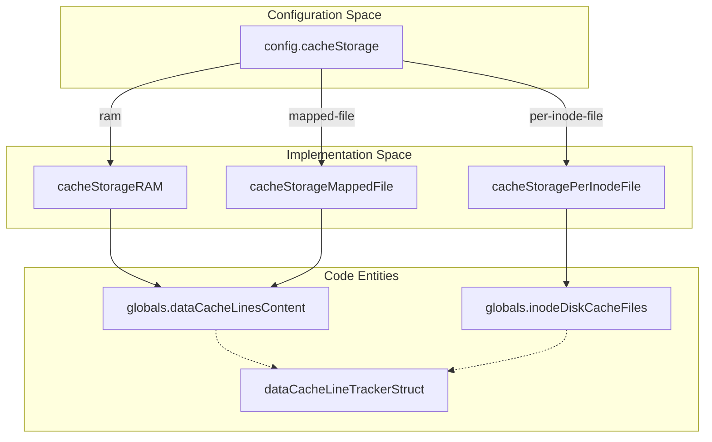
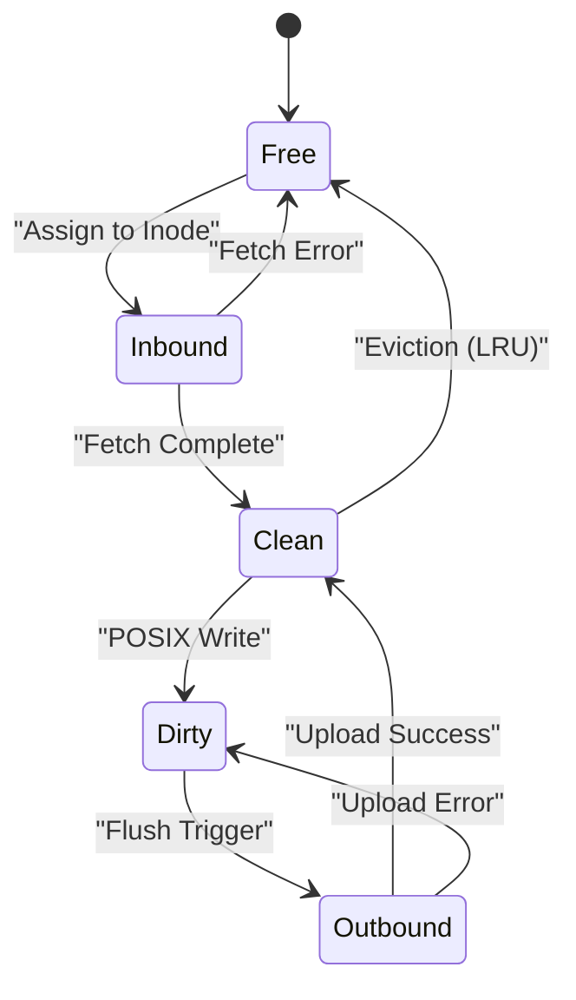

<!-- source: DeepWiki mcp.deepwiki.com · repo NVIDIA/multi-storage-client · page 5.3 MSFS Caching Layer · fetched 2026-10-26 -->

# MSFS Caching Layer

Relevant source files

The following files were used as context for generating this wiki page:

- [multi-storage-file-system/README.md](multi-storage-file-system/README.md)
- [multi-storage-file-system/cache.go](multi-storage-file-system/cache.go)
- [multi-storage-file-system/cache_disk.go](multi-storage-file-system/cache_disk.go)
- [multi-storage-file-system/cache_disk_linux.go](multi-storage-file-system/cache_disk_linux.go)
- [multi-storage-file-system/cache_disk_other.go](multi-storage-file-system/cache_disk_other.go)
- [multi-storage-file-system/cache_disk_test.go](multi-storage-file-system/cache_disk_test.go)
- [multi-storage-file-system/config.go](multi-storage-file-system/config.go)
- [multi-storage-file-system/config_test.go](multi-storage-file-system/config_test.go)
- [multi-storage-file-system/fission.go](multi-storage-file-system/fission.go)
- [multi-storage-file-system/fission_test.go](multi-storage-file-system/fission_test.go)
- [multi-storage-file-system/fs.go](multi-storage-file-system/fs.go)
- [multi-storage-file-system/globals.go](multi-storage-file-system/globals.go)

The Multi-Storage File System (MSFS) implements a sophisticated multi-tier caching strategy designed to provide POSIX-compliant access to object storage backends while maintaining high performance. This layer manages data at the granularity of "cache lines" and supports various physical storage backends for the cache itself, ranging from pure RAM to per-inode sparse files.

## Cache Storage Modes

MSFS supports three distinct storage modes for cache data, configured via the `cache_storage` setting [multi-storage-file-system/config.go:229-245]().

| Mode | Identifier | Implementation | Key Characteristics |
| :--- | :--- | :--- | :--- |
| **RAM** | `ram` | Anonymous `mmap` [multi-storage-file-system/cache.go:77-81]() | Volatile; bypasses Go heap to avoid GC overhead; pages committed on first touch [multi-storage-file-system/cache.go:71-75](). |
| **Mapped File** | `mapped-file` | Shared memory-mapped file [multi-storage-file-system/cache.go:48-64]() | Single large file `MSFS_data_cache` [multi-storage-file-system/cache.go:12]() used as a shared arena for all inodes. |
| **Per-Inode File** | `per-inode-file` | Individual sparse files [multi-storage-file-system/cache_disk.go:13-20]() | One file per inode in `<cacheDir>/cachelines/inode_<N>.bin`. Supports kernel readahead and `fallocate` hole punching [multi-storage-file-system/cache_disk.go:18-20](). |

### Mode Comparison and Code Entities
The following diagram bridges the configuration choices to the internal implementation structures.

"Cache Storage Architecture"

Sources: [multi-storage-file-system/cache.go:15-21](), [multi-storage-file-system/cache_disk.go:33-36](), [multi-storage-file-system/globals.go:34323-34323]() (globalsStruct definition).

## Cache Line Lifecycle

Data is managed in fixed-size segments called cache lines. Each line is tracked by a `dataCacheLineTrackerStruct` [multi-storage-file-system/cache.go:88]() and moves through several states managed by LRU (Least Recently Used) queues [multi-storage-file-system/cache.go:90-139]().

### Lifecycle States

1.  **Free**: The line is available for assignment to an inode [multi-storage-file-system/cache.go:94]().
2.  **Inbound**: Data is currently being fetched from the storage backend into this line [multi-storage-file-system/cache.go:117]().
3.  **Clean**: The line contains valid data that matches the backend source [multi-storage-file-system/cache.go:124]().
4.  **Dirty**: The line contains data written by the user that has not yet been flushed to the backend [multi-storage-file-system/cache.go:138]().
5.  **Outbound**: The line is currently being uploaded to the backend [multi-storage-file-system/cache.go:131]().

### Lifecycle State Machine
"Cache Line State Transitions"

Sources: [multi-storage-file-system/cache.go:177-200]() (LRU push/pop), [multi-storage-file-system/fission.go:158-223]() (Lifecycle logic in FUSE ops).

## Per-Inode File Backend and Space Reclamation

The `per-inode-file` backend provides a unique optimization for Linux systems. Each file is treated as a sparse representation of the object's total size [multi-storage-file-system/cache_disk.go:13-16]().

### Space Reclamation via PUNCH_HOLE
When a cache line is evicted from the `per-inode-file` cache, MSFS does not necessarily delete the file. Instead, it uses the `fallocate` system call with the `FALLOC_FL_PUNCH_HOLE` flag [multi-storage-file-system/cache_disk_linux.go:14-17]().

*   **Function**: `punchHoleDisk()` [multi-storage-file-system/cache_disk.go:116-143]().
*   **Behavior**: It releases the disk blocks associated with the evicted line's offset while preserving the file's logical size and the offsets of other resident lines [multi-storage-file-system/cache_disk.go:18-20]().
*   **Cleanup**: The backing file is only closed and removed when `residentLines` reaches zero [multi-storage-file-system/cache_disk.go:130-138]().

## Concurrency and Performance

### Optimistic Concurrency
Warm reads (reads from data already in cache) are optimized to avoid lock contention. MSFS uses an optimistic re-check pattern in `DoRead`:
1.  The `contentGeneration` is checked using atomic operations [multi-storage-file-system/cache.go:105]().
2.  Data is served via `pread` (in disk mode) or `memcpy` (in arena mode) outside the global lock [multi-storage-file-system/cache_disk.go:22-25]().
3.  The generation is re-verified to ensure the line wasn't evicted during the read.

### Multi-part Upload Concurrency
For writes to remote backends (e.g., S3, GCS), MSFS utilizes multi-part uploads. 
*   **Flush Triggers**: Dirty lines are flushed when they reach a certain threshold or when a file is closed (`DoRelease`) [multi-storage-file-system/fission.go:19-27]().
*   **Concurrency**: Multiple `Outbound` lines can be uploaded in parallel, managed by the backend-specific context [multi-storage-file-system/globals.go:26-44]().

## Key Functions and Data Structures

| Entity | Location | Purpose |
| :--- | :--- | :--- |
| `dataCacheUp` | [multi-storage-file-system/cache.go:23]() | Initializes the cache arena or disk structures at startup. |
| `dataCacheLineTrackerStruct` | [multi-storage-file-system/cache.go:98]() | Metadata for a single cache line (offset, state, generation). |
| `inodeDiskCacheFileStruct` | [multi-storage-file-system/cache_disk.go:33]() | Tracks the `os.File` handle and residency count for disk-based caching. |
| `storeContentDisk` | [multi-storage-file-system/cache_disk.go:75]() | Writes fetched backend data to the per-inode backing file. |
| `punchHoleSyscall` | [multi-storage-file-system/cache_disk_linux.go:14]() | Linux-specific implementation of hole punching. |

Sources: [multi-storage-file-system/cache.go:1-200](), [multi-storage-file-system/cache_disk.go:1-144](), [multi-storage-file-system/cache_disk_linux.go:1-18](), [multi-storage-file-system/config.go:229-260]().

---

