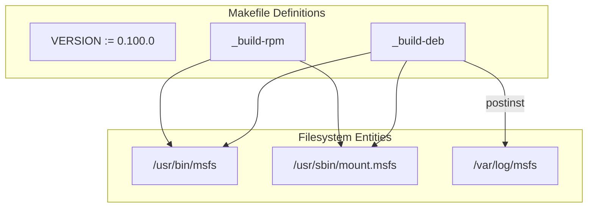
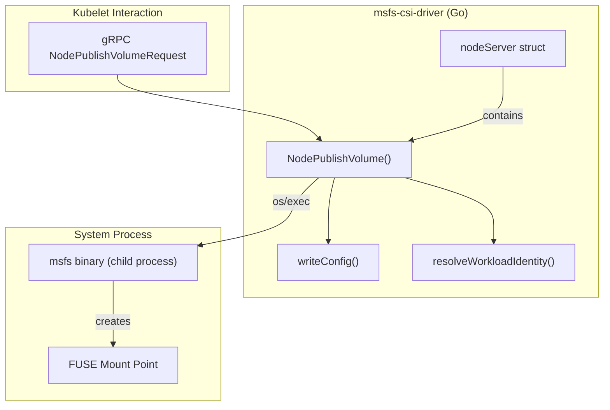

<!-- source: DeepWiki mcp.deepwiki.com · repo NVIDIA/multi-storage-client · page 5.4 MSFS Build, Packaging, and CSI Driver · fetched 2026-10-26 -->

# MSFS Build, Packaging, and CSI Driver

Relevant source files

The following files were used as context for generating this wiki page:

- [multi-storage-file-system/Dockerfile](multi-storage-file-system/Dockerfile)
- [multi-storage-file-system/Makefile](multi-storage-file-system/Makefile)
- [multi-storage-file-system/csi/README.md](multi-storage-file-system/csi/README.md)
- [multi-storage-file-system/csi/charts/msfs-csi/README.md](multi-storage-file-system/csi/charts/msfs-csi/README.md)
- [multi-storage-file-system/csi/charts/msfs-csi/templates/csidriver.yaml](multi-storage-file-system/csi/charts/msfs-csi/templates/csidriver.yaml)
- [multi-storage-file-system/csi/charts/msfs-csi/values.yaml](multi-storage-file-system/csi/charts/msfs-csi/values.yaml)
- [multi-storage-file-system/csi/deploy/README.md](multi-storage-file-system/csi/deploy/README.md)
- [multi-storage-file-system/csi/deploy/csi-driver.yaml](multi-storage-file-system/csi/deploy/csi-driver.yaml)
- [multi-storage-file-system/csi/deploy/example-pv-pvc-per-workload-irsa.yaml](multi-storage-file-system/csi/deploy/example-pv-pvc-per-workload-irsa.yaml)
- [multi-storage-file-system/csi/pkg/driver/node.go](multi-storage-file-system/csi/pkg/driver/node.go)
- [multi-storage-file-system/csi/pkg/driver/node_test.go](multi-storage-file-system/csi/pkg/driver/node_test.go)
- [multi-storage-file-system/dev_setup.sh](multi-storage-file-system/dev_setup.sh)
- [multi-storage-file-system/docker-compose.yaml](multi-storage-file-system/docker-compose.yaml)
- [multi-storage-file-system/go.mod](multi-storage-file-system/go.mod)
- [multi-storage-file-system/go.sum](multi-storage-file-system/go.sum)
- [multi-storage-file-system/grafana-provisioning/dashboards/dashboard-provider.yaml](multi-storage-file-system/grafana-provisioning/dashboards/dashboard-provider.yaml)
- [multi-storage-file-system/grafana-provisioning/dashboards/msfs-dashboard.json](multi-storage-file-system/grafana-provisioning/dashboards/msfs-dashboard.json)
- [multi-storage-file-system/grafana.ini](multi-storage-file-system/grafana.ini)
- [multi-storage-file-system/telemetry/auth/azure_access_token_provider.go](multi-storage-file-system/telemetry/auth/azure_access_token_provider.go)
- [multi-storage-file-system/telemetry/metrics/exporters/otlp_msal.go](multi-storage-file-system/telemetry/metrics/exporters/otlp_msal.go)
- [multi-storage-file-system/telemetry/metrics/readers/diperiodic_reader.go](multi-storage-file-system/telemetry/metrics/readers/diperiodic_reader.go)
- [multi-storage-file-system/telemetry/metrics_diperiodic.go](multi-storage-file-system/telemetry/metrics_diperiodic.go)
- [multi-storage-file-system/telemetry/setup.go](multi-storage-file-system/telemetry/setup.go)

This page documents the build system, distribution packaging, and Kubernetes integration for the Multi-Storage File System (MSFS). It covers the Go-based build process, the multi-backend development environment, the CSI driver architecture for Kubernetes, and the observability stack.

## Build System and Packaging

MSFS is implemented in Go and utilizes a `Makefile` for managing the build lifecycle, including linting, testing, and cross-platform compilation. The build system supports generating native binaries for `amd64` and `arm64` architectures.

### Makefile Targets
The `Makefile` defines the following primary targets:
*   `build`: Compiles the `msfs` binary using current architecture [multi-storage-file-system/Makefile:30-31]().
*   `msfs-linux-amd64` / `msfs-linux-arm64`: Cross-compiles for specific architectures [multi-storage-file-system/Makefile:58-62]().
*   `deb-packages` / `rpm-packages`: Orchestrates the creation of Debian and RPM packages [multi-storage-file-system/Makefile:129-139]().
*   `assets`: Bundles binaries, packages, and installation scripts into `.tar.gz` and `.zip` archives [multi-storage-file-system/Makefile:103-120]().

### Distribution Packages
MSFS is distributed via standard Linux package managers. The build process creates:
*   **Debian (.deb)**: Includes the `msfs` binary in `/usr/bin/` and a `mount.msfs` helper in `/usr/sbin/` [multi-storage-file-system/Makefile:145-153](). It defines a dependency on `fuse3` [multi-storage-file-system/Makefile:161]().
*   **RPM (.rpm)**: Provides equivalent structure for RedHat-based distributions.
*   **Installation Script**: A generated `msfs_install.sh` handles architecture detection and installs the appropriate package [multi-storage-file-system/Makefile:111-117]().

### Build-to-Entity Mapping
The following diagram bridges the build definitions to the resulting filesystem entities.

**Build Artifact Mapping**

Sources: [multi-storage-file-system/Makefile:5-8](), [multi-storage-file-system/Makefile:142-174]()

## Development Environment

A comprehensive development environment is provided via `docker-compose.yaml`, enabling local testing against various storage backends and observability tools.

### Integrated Services
*   **Storage Backends**:
    *   `minio`: S3-compatible storage [multi-storage-file-system/docker-compose.yaml:75-86]().
    *   `fake-gcs`: Simulated Google Cloud Storage [multi-storage-file-system/docker-compose.yaml:53-61]().
    *   `ais`: AIStore cluster for high-performance object storage [multi-storage-file-system/docker-compose.yaml:39-52]().
    *   `versity`: Versitygw for POSIX-to-S3 gateway testing [multi-storage-file-system/docker-compose.yaml:87-98]().
*   **Observability**:
    *   `prometheus`: Scrapes MSFS metrics [multi-storage-file-system/docker-compose.yaml:5-11]().
    *   `grafana`: Visualizes metrics with pre-provisioned dashboards [multi-storage-file-system/docker-compose.yaml:14-23]().
    *   `otel-collector`: Receives OpenTelemetry metrics via OTLP [multi-storage-file-system/docker-compose.yaml:28-36]().

### Environment Initialization
The `dev_setup.sh` script automates the population of these backends with test data. It includes functions to wait for service readiness (e.g., `waitForAIStore`, `waitForMinIO`) and commands to create buckets and upload local files [multi-storage-file-system/dev_setup.sh:24-127]().

Sources: [multi-storage-file-system/docker-compose.yaml:1-171](), [multi-storage-file-system/dev_setup.sh:1-128]()

## Kubernetes CSI Driver

The MSFS CSI Driver (`msfs-csi`) allows Kubernetes pods to mount S3/MSC backends as local FUSE filesystems. Unlike sidecar implementations, the CSI driver uses `kubelet` to manage the FUSE mount directly, avoiding the need for privileged application pods [multi-storage-file-system/csi/README.md:5-11]().

### Architecture and Components
The driver runs as a `DaemonSet` on every worker node [multi-storage-file-system/csi/README.md:67-72]().

*   **`msfs-csi-node` Pod**: Contains the `msfs-csi-driver` and a `node-driver-registrar` sidecar [multi-storage-file-system/csi/README.md:70]().
*   **`NodePublishVolume`**: Triggered by `kubelet`, this function in `node.go` writes a temporary `msfs.yaml` configuration and executes the `msfs` binary as a child process [multi-storage-file-system/csi/pkg/driver/node.go:108-186]().
*   **`NodeUnpublishVolume`**: Terminates the `msfs` process and cleans up the mount and configuration [multi-storage-file-system/csi/README.md:82]().

### Authentication Modes
The driver supports several `credentialMode` types via `volumeAttributes.authType` [multi-storage-file-system/csi/pkg/driver/node.go:44-51]():
*   `static`: Uses AWS keys from a Kubernetes Secret [multi-storage-file-system/csi/pkg/driver/node.go:48-51]().
*   `irsa` (IAM Roles for Service Accounts): Uses the driver's IAM role via projected tokens [multi-storage-file-system/csi/pkg/driver/node.go:49]().
*   `per-workload IRSA`: (Opt-in) Uses the application pod's own ServiceAccount token and a specified `roleArn` [multi-storage-file-system/csi/pkg/driver/node.go:188-196]().
*   `none` / `anonymous`: Connects without credentials (e.g., for public buckets) [multi-storage-file-system/csi/pkg/driver/node.go:50]().

### CSI Code Entity Mapping
The following diagram maps CSI gRPC operations to the Go implementation and the resulting system processes.

**CSI Operation Flow**

Sources: [multi-storage-file-system/csi/pkg/driver/node.go:91-98](), [multi-storage-file-system/csi/pkg/driver/node.go:108-156](), [multi-storage-file-system/csi/pkg/driver/node.go:174-192]()

## Observability

MSFS includes built-in support for Prometheus and OpenTelemetry (OTel) to provide insights into filesystem performance and health.

### Metrics Stack
*   **Prometheus**: MSFS exposes a metrics endpoint that is scraped by the Prometheus service [multi-storage-file-system/docker-compose.yaml:5-11]().
*   **OpenTelemetry**: MSFS can export metrics via OTLP HTTP. The `otel-collector` service acts as an intermediary, receiving metrics on port `4318` [multi-storage-file-system/docker-compose.yaml:28-35]().
*   **Grafana**: A pre-configured dashboard (`msfs-dashboard.json`) provides visualizations for throughput, latency, and cache performance.

### Implementation Details
The Go implementation uses the following libraries and patterns:
*   `github.com/prometheus/client_golang` for native Prometheus metrics [multi-storage-file-system/go.mod:19]().
*   `go.opentelemetry.io/otel` for instrumenting the filesystem with the OTel SDK [multi-storage-file-system/go.mod:20-24]().
*   A "diperiodic" reader and exporter pattern for handling asynchronous metric offloading.

Sources: [multi-storage-file-system/go.mod:19-24](), [multi-storage-file-system/docker-compose.yaml:5-37]()

---

