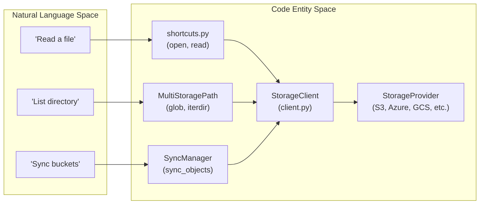

<!-- source: DeepWiki mcp.deepwiki.com · repo NVIDIA/multi-storage-client · page 6 User Guide · fetched 2026-10-26 -->

# User Guide

<details>
<summary>Relevant source files</summary>

The following files were used as context for generating this wiki page:

- [multi-storage-client-docs/justfile](multi-storage-client-docs/justfile)
- [multi-storage-client-docs/src/index.rst](multi-storage-client-docs/src/index.rst)
- [multi-storage-client-docs/src/references/checksum_support.rst](multi-storage-client-docs/src/references/checksum_support.rst)
- [multi-storage-client-docs/src/user_guide/cli.rst](multi-storage-client-docs/src/user_guide/cli.rst)
- [multi-storage-client-docs/src/user_guide/installation.rst](multi-storage-client-docs/src/user_guide/installation.rst)
- [multi-storage-client-docs/src/user_guide/libraries.rst](multi-storage-client-docs/src/user_guide/libraries.rst)
- [multi-storage-client-docs/src/user_guide/manifests.rst](multi-storage-client-docs/src/user_guide/manifests.rst)
- [multi-storage-client-docs/src/user_guide/mcp_server.rst](multi-storage-client-docs/src/user_guide/mcp_server.rst)
- [multi-storage-client-docs/src/user_guide/presigned_urls.rst](multi-storage-client-docs/src/user_guide/presigned_urls.rst)
- [multi-storage-client-docs/src/user_guide/quickstart.rst](multi-storage-client-docs/src/user_guide/quickstart.rst)
- [multi-storage-client-docs/src/user_guide/telemetry.rst](multi-storage-client-docs/src/user_guide/telemetry.rst)
- [multi-storage-client/src/multistorageclient/commands/cli/actions/sync.py](multi-storage-client/src/multistorageclient/commands/cli/actions/sync.py)
- [multi-storage-client/tests/test_multistorageclient/unit/sync/test_manager.py](multi-storage-client/tests/test_multistorageclient/unit/sync/test_manager.py)
- [multi-storage-client/tests/test_multistorageclient/unit/test_cli.py](multi-storage-client/tests/test_multistorageclient/unit/test_cli.py)
- [multi-storage-client/tests/test_multistorageclient/unit/test_presigned_url.py](multi-storage-client/tests/test_multistorageclient/unit/test_presigned_url.py)

</details>


Practical usage information for the Multi-Storage Client (MSC). This guide covers installation, configuration, and common usage patterns for developers and data scientists.

## Overview

The Multi-Storage Client (MSC) provides a unified high-performance Python interface for interacting with diverse storage backends like AWS S3, Azure Blob Storage, Google Cloud Storage (GCS), NVIDIA AIStore, and POSIX filesystems [multi-storage-client-docs/src/index.rst:5-8](). By abstracting provider-specific SDKs, MSC allows users to write storage-agnostic code that can be easily ported between cloud and on-premise environments.

For detailed information on specific topics, refer to the following child pages:
- **[Getting Started](#6.1)**: Installation and first operations.
- **[Configuration Examples](#6.2)**: Detailed profile setups for various backends.
- **[Advanced Usage](#6.3)**: Performance tuning, manifest-based datasets, and Rust acceleration.

## Getting Started

### Installation
MSC is available on PyPI. The base package supports POSIX filesystems. Accessing cloud backends requires specific "extras" to include the necessary SDK dependencies [multi-storage-client-docs/src/user_guide/installation.rst:5-9]().

```bash
# Base installation (POSIX only)
pip install multi-storage-client

# Recommended installation with observability and S3 support
pip install "multi-storage-client[observability-otel,boto3]"
```

### Basic Configuration
MSC looks for configuration in YAML or JSON format at several locations, including `~/.msc_config.yaml` or the path defined by the `MSC_CONFIG` environment variable [multi-storage-client-docs/src/user_guide/quickstart.rst:40-49]().

```yaml
profiles:
  my-s3-bucket:
    storage_provider:
      type: s3
      options:
        base_path: my-data-bucket
        region_name: us-east-1
```
*Sources: [multi-storage-client-docs/src/user_guide/installation.rst:14-41](), [multi-storage-client-docs/src/user_guide/quickstart.rst:55-69]()*

## Core Interfaces

MSC provides three primary ways to interact with storage: **Shortcut Functions**, the **StorageClient API**, and the **Path-like Interface**.

### System Interaction Diagram
The following diagram maps high-level user actions to the internal code entities that handle them.


*Sources: [multi-storage-client-docs/src/user_guide/quickstart.rst:173-210](), [multi-storage-client/tests/test_multistorageclient/unit/sync/test_manager.py:25-28]()*

### Shortcut Functions
The `multistorageclient` module provides convenient top-level functions that automatically manage client lifecycles using `msc://` URLs [multi-storage-client-docs/src/user_guide/quickstart.rst:179-183]().

```python
import multistorageclient as msc

# msc://{profile}/{relative_path}
with msc.open("msc://my-s3-bucket/data/file.txt", "r") as f:
    print(f.read())
```

### Path-like Interface
The `MultiStoragePath` (aliased as `msc.Path`) provides an interface familiar to users of `pathlib` [multi-storage-client-docs/src/user_guide/libraries.rst:187-190]().

```python
path = msc.Path("msc://my-s3-bucket/logs")
for log in path.glob("*.log"):
    if log.exists():
        print(log.name, log.stat().st_size)
```
*Sources: [multi-storage-client-docs/src/user_guide/quickstart.rst:188-204](), [multi-storage-client-docs/src/user_guide/libraries.rst:191-222]()*

## Advanced Capabilities

### Sync Engine
The `SyncManager` allows for high-performance synchronization between different storage providers, supporting multi-threaded execution and dry-run modes [multi-storage-client/tests/test_multistorageclient/unit/sync/test_manager.py:26-28]().

```python
from multistorageclient.sync import SyncManager

manager = SyncManager(source_client=src, source_path="data/", 
                      target_client=dst, target_path="backup/")
manager.sync_objects(delete_unmatched_files=True)
```

### Telemetry and Observability
MSC integrates with OpenTelemetry to provide metrics on latency, throughput, and error rates. This can be configured globally in the MSC configuration file [multi-storage-client-docs/src/user_guide/telemetry.rst:5-10]().

### Manifest-Based Datasets
For large-scale datasets, MSC can use **Manifests** (JSONL or Parquet) to accelerate listing and metadata retrieval, avoiding expensive `list_objects` calls to cloud providers [multi-storage-client-docs/src/user_guide/manifests.rst:5-8]().

### CLI and MCP Server
- **CLI**: The `msc` command provides subcommands like `ls`, `rm`, and `sync` [multi-storage-client-docs/src/user_guide/cli.rst:25-33]().
- **MCP Server**: Allows AI assistants (like Cursor or Claude) to interact with your storage backends using natural language [multi-storage-client-docs/src/user_guide/mcp_server.rst:5-11]().

### Presigned URLs
MSC supports generating time-limited presigned URLs for S3 and Azure, allowing temporary access without sharing credentials [multi-storage-client-docs/src/user_guide/presigned_urls.rst:5-8]().

```python
url = msc.generate_presigned_url("msc://my-s3-profile/model.bin", expires_in=3600)
```

## Configuration Schema Overview

| Feature | Config Key | Description |
| :--- | :--- | :--- |
| **Profiles** | `profiles` | Map of profile names to provider settings [multi-storage-client-docs/src/user_guide/quickstart.rst:59-60](). |
| **Caching** | `cache_config` | Defines eviction policy (LRU, FIFO) and storage (memory, disk) [multi-storage-client-docs/src/index.rst:23](). |
| **Telemetry** | `opentelemetry` | Configures OTLP exporters and metric attributes [multi-storage-client-docs/src/user_guide/telemetry.rst:17-18](). |
| **Checksums** | `checksum_algorithm` | Enables end-to-end integrity (e.g., CRC32, SHA256) [multi-storage-client-docs/src/references/checksum_support.rst:78-80](). |

*Sources: [multi-storage-client-docs/src/user_guide/quickstart.rst:55-95](), [multi-storage-client-docs/src/user_guide/telemetry.rst:11-46](), [multi-storage-client-docs/src/references/checksum_support.rst:22-70]()*

For more details, see [Configuration Examples](#6.2) and [Advanced Usage](#6.3).

---

