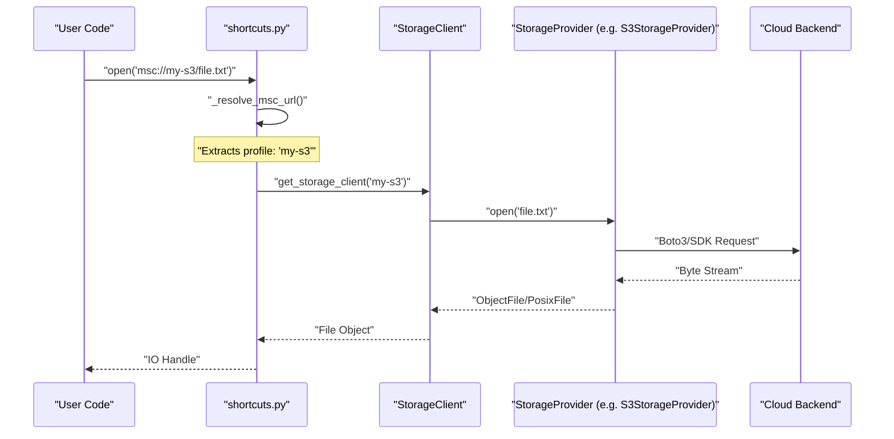

<!-- source: DeepWiki mcp.deepwiki.com · repo NVIDIA/multi-storage-client · page 6.1 Getting Started · fetched 2026-10-26 -->

# Getting Started

<details>
<summary>Relevant source files</summary>

The following files were used as context for generating this wiki page:

- [multi-storage-client-docs/src/user_guide/libraries.rst](multi-storage-client-docs/src/user_guide/libraries.rst)
- [multi-storage-client-docs/src/user_guide/manifests.rst](multi-storage-client-docs/src/user_guide/manifests.rst)
- [multi-storage-client-docs/src/user_guide/presigned_urls.rst](multi-storage-client-docs/src/user_guide/presigned_urls.rst)
- [multi-storage-client-docs/src/user_guide/quickstart.rst](multi-storage-client-docs/src/user_guide/quickstart.rst)
- [multi-storage-client-docs/src/user_guide/telemetry.rst](multi-storage-client-docs/src/user_guide/telemetry.rst)
- [multi-storage-client/src/multistorageclient/shortcuts.py](multi-storage-client/src/multistorageclient/shortcuts.py)
- [multi-storage-client/tests/test_multistorageclient/unit/test_presigned_url.py](multi-storage-client/tests/test_multistorageclient/unit/test_presigned_url.py)
- [multi-storage-client/tests/test_multistorageclient/unit/test_shortcuts.py](multi-storage-client/tests/test_multistorageclient/unit/test_shortcuts.py)

</details>


This document provides a practical guide for new users to quickly start using the `multi-storage-client` library. It covers installation, basic configuration setup, essential operations via shortcuts and the `StorageClient` API, and basic usage patterns.

## Installation

The library can be installed via `pip`. It uses an extras-based architecture to keep the core footprint small while allowing users to opt-in to specific provider dependencies.

```bash
# Core installation
pip install multi-storage-client

# Installation with common extras
pip install multi-storage-client[s3,azure,gcs,observability-otel]
```

Key extras include:
* `s3`: AWS S3 support (via `boto3`).
* `azure`: Azure Blob Storage support.
* `gcs`: Google Cloud Storage support.
* `observability-otel`: OpenTelemetry SDK for metrics and tracing [multi-storage-client-docs/src/user_guide/telemetry.rst:7-8]().
* `parquet`: Support for Parquet-formatted manifests [multi-storage-client-docs/src/user_guide/manifests.rst:113-115]().

## Configuration Setup

The library requires a configuration to map profiles to storage backends. By default, it searches for configuration files in multiple locations, including `MSC_CONFIG` environment variable, `${HOME}/.msc_config.yaml`, and `/etc/msc_config.yaml` [multi-storage-client-docs/src/user_guide/quickstart.rst:40-48]().

### 1. Basic YAML Configuration
Create a file at `~/.msc_config.yaml`:

```yaml
profiles:
  my-s3-bucket:
    storage_provider:
      type: s3
      options:
        base_path: my-bucket-name
        region_name: us-east-1
  
  local-data:
    storage_provider:
      type: posix
      options:
        base_path: /mnt/data
```
Sources: [multi-storage-client-docs/src/user_guide/quickstart.rst:59-69]()

### 2. Rclone Compatibility
MSC can automatically load existing `rclone` configurations. It searches standard locations like `~/.config/rclone/rclone.conf` [multi-storage-client-docs/src/user_guide/quickstart.rst:151-157]().

### 3. Zero-Config POSIX Access
You can use MSC without any configuration to access absolute POSIX paths. It uses a reserved profile named `__filesystem__` internally [multi-storage-client-docs/src/user_guide/quickstart.rst:9-17](), [multi-storageclient/src/multistorageclient/shortcuts.py:185-191]().

## Basic Operations

There are two primary ways to interact with storage: **Shortcut Functions** (convenient, global) and the **StorageClient API** (explicit, instance-based).

### Shortcut Functions
Shortcut functions in the `multistorageclient` module automatically manage a cache of `StorageClient` instances [multi-storageclient/src/multistorageclient/shortcuts.py:32-33]().

```python
import multistorageclient as msc

# Read a file from an S3 profile
content = msc.read_bytes("msc://my-s3-bucket/path/to/object.bin")

# Write to a local profile
msc.write_bytes("msc://local-data/output.txt", b"Hello MSC")

# Glob listing
for path in msc.glob("msc://my-s3-bucket/logs/*.log"):
    print(path)
```
Sources: [multi-storage-client-docs/src/user_guide/quickstart.rst:188-204](), [multi-storageclient/src/multistorageclient/shortcuts.py:179-183]()

### StorageClient API
For programmatic control or when using dictionary-based configs, use the `StorageClient` class directly.

```python
from multistorageclient import StorageClient, StorageClientConfig

# Create client from a specific profile in the default config file
client = StorageClient(StorageClientConfig.from_file(profile="my-s3-bucket"))

# Perform operations
with client.open("data.csv", "r") as f:
    data = f.read()
```
Sources: [multi-storage-client-docs/src/user_guide/quickstart.rst:213-222]()

## Data Flow and Path Resolution

The library resolves URLs into specific `StorageProvider` implementations.

### Path Resolution Logic
1. **MSC Protocol**: `msc://<profile>/<path>` maps directly to a configured profile [multi-storageclient/src/multistorageclient/shortcuts.py:127-141]().
2. **Path Mapping**: If a standard path (e.g., `/mnt/s3/...`) is used, MSC checks `PathMapping` in the config to see if it should be handled by a specific profile [multi-storageclient/src/multistorageclient/shortcuts.py:178-183]().
3. **Implicit/POSIX**: Absolute paths starting with `/` or `file://` fall back to the `__filesystem__` provider [multi-storageclient/src/multistorageclient/shortcuts.py:185-191]().

### Operation Flow Diagram
This diagram shows how a shortcut call like `msc.open()` travels through the system.


Sources: [multi-storageclient/src/multistorageclient/shortcuts.py:127-141](), [multi-storageclient/src/multistorageclient/shortcuts.py:236-250](), [multi-storage-client-docs/src/user_guide/quickstart.rst:182-204]()

## Component Architecture

The following diagram maps the logical storage abstractions to their code entities.

```mermaid
classDiagram
    class "multistorageclient" {
        <<module>>
        open()
        glob()
        read_bytes()
    }
    class "StorageClient" {
        <<interface>>
        +open(path)
        +list(path)
        +upload_file(local, remote)
    }
    class "StorageProvider" {
        <<abstract>>
        +get_object()
        +put_object()
    }
    class "S3StorageProvider" {
        +boto3_client
    }
    class "PosixFileStorageProvider" {
        +os_operations
    }
    class "StorageClientConfig" {
        +from_file()
        +from_dict()
    }

    "multistorageclient" ..> "StorageClient" : "uses cached instances"
    "StorageClient" o-- "StorageProvider" : "delegates to"
    "StorageProvider" <|-- "S3StorageProvider"
    "StorageProvider" <|-- "PosixFileStorageProvider"
    "StorageClient" ..> "StorageClientConfig" : "initialized by"
```
Sources: [multi-storageclient/src/multistorageclient/shortcuts.py:24-28](), [multi-storage-client-docs/src/user_guide/quickstart.rst:175-179](), [multi-storage-client-docs/src/user_guide/quickstart.rst:112-130]()

## Advanced Features Quick-Look

### Presigned URLs
Generate temporary access URLs for S3 or Azure backends:
```python
url = msc.generate_presigned_url("msc://my-s3-profile/data.bin", expires_in=3600)
```
Sources: [multi-storage-client-docs/src/user_guide/presigned_urls.rst:12-18]()

### Manifest-Based Listing
For massive buckets, use a manifest to avoid slow O(N) cloud listing:
```yaml
profiles:
  fast-list:
    storage_provider: {type: s3, options: {base_path: my-bucket}}
    metadata_provider:
      type: manifest
      options: {manifest_path: .msc_manifests}
```
Sources: [multi-storage-client-docs/src/user_guide/manifests.rst:127-138]()

### Pathlib Interface
Use `msc.Path` for a `pathlib`-compatible experience:
```python
path = msc.Path("msc://my-s3-bucket/data")
if path.exists():
    for file in path.glob("*.jpg"):
        print(file.name)
```
Sources: [multi-storage-client-docs/src/user_guide/libraries.rst:187-217]()

---

