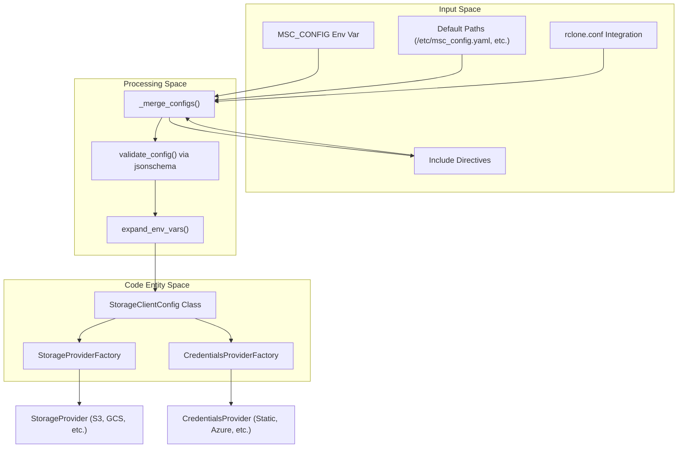
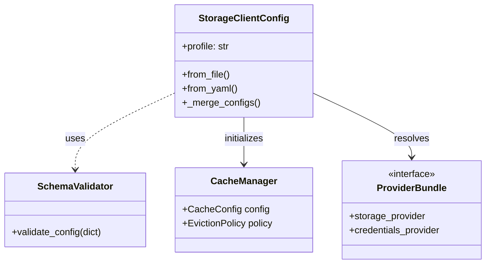

<!-- source: DeepWiki mcp.deepwiki.com · repo NVIDIA/multi-storage-client · page 6.2 Configuration Examples · fetched 2026-10-26 -->

# Configuration Examples

<details>
<summary>Relevant source files</summary>

The following files were used as context for generating this wiki page:

- [multi-storage-client-docs/src/references/configuration.rst](multi-storage-client-docs/src/references/configuration.rst)
- [multi-storage-client-docs/src/user_guide/cache.rst](multi-storage-client-docs/src/user_guide/cache.rst)
- [multi-storage-client/.msc/config.yaml](multi-storage-client/.msc/config.yaml)
- [multi-storage-client/src/multistorageclient/caching/README.md](multi-storage-client/src/multistorageclient/caching/README.md)
- [multi-storage-client/src/multistorageclient/config.py](multi-storage-client/src/multistorageclient/config.py)
- [multi-storage-client/src/multistorageclient/schema.py](multi-storage-client/src/multistorageclient/schema.py)
- [multi-storage-client/tests/test_multistorageclient/unit/mcp/test_mcp_integration.py](multi-storage-client/tests/test_multistorageclient/unit/mcp/test_mcp_integration.py)
- [multi-storage-client/tests/test_multistorageclient/unit/test_config.py](multi-storage-client/tests/test_multistorageclient/unit/test_config.py)
- [multi-storage-client/tests/test_multistorageclient/unit/test_replica_manager.py](multi-storage-client/tests/test_multistorageclient/unit/test_replica_manager.py)
- [multi-storage-client/tests/test_multistorageclient/unit/test_schema.py](multi-storage-client/tests/test_multistorageclient/unit/test_schema.py)

</details>


This page provides technical details and practical examples for configuring the Multi-Storage Client (MSC). It illustrates how to define storage profiles, credential providers, metadata providers, and advanced features like caching, path mapping, and OpenTelemetry integration.

## Configuration Data Flow

The configuration system follows a structured path from raw YAML/JSON input to validated provider objects.



Sources: [src/multistorageclient/config.py:32-53](), [src/multistorageclient/config.py:459-485](), [src/multistorageclient/schema.py:19-33]()

## Core Configuration Scenarios

### 1. S3 and S3-Compatible Backends
The S3 provider supports standard AWS S3 as well as compatible backends like AIStore (`ais_s3`), Google S3 (`gcs_s3`), and SwiftStack (`s8k`).

```yaml
profiles:
  aws-s3:
    storage_provider:
      type: s3
      options:
        base_path: my-bucket/prefix
        region_name: us-east-1
    credentials_provider:
      type: S3Credentials
      options:
        access_key: ${AWS_ACCESS_KEY}
        secret_key: ${AWS_SECRET_KEY}
  
  s8k-backend:
    storage_provider:
      type: s8k
      options:
        base_path: my-bucket
        endpoint_url: https://pdx.s8k.io
        rust_client: {} # Enables Rust-accelerated transfers
```
Sources: [multi-storage-client/.msc/config.yaml:72-83](), [multi-storage-client/.msc/config.yaml:132-143](), [src/multistorageclient/config.py:84-95]()

### 2. Azure and GCS Native Backends
MSC provides native drivers for Azure Blob Storage and Google Cloud Storage, supporting specific auth mechanisms like Workload Identity.

```yaml
profiles:
  azure-prod:
    credentials_provider:
      type: DefaultAzureCredentials
      options:
        workload_identity_tenant_id: ${AZURE_TENANT_ID}
    storage_provider:
      type: azure
      options:
        base_path: msc-container
        endpoint_url: https://account.blob.core.windows.net
  
  gcs-native:
    storage_provider:
      type: gcs
      options:
        base_path: my-gcs-bucket
        project_id: data-platform-dev
```
Sources: [multi-storage-client/.msc/config.yaml:7-19](), [multi-storage-client/.msc/config.yaml:20-28]()

### 3. POSIX Profiles
The `__filesystem__` profile is a reserved name for local disk access.

```yaml
profiles:
  local-data:
    storage_provider:
      type: file
      options:
        base_path: /mnt/data
```
Sources: [src/multistorageclient/config.py:81-83](), [tests/test_multistorageclient/unit/test_config.py:82-99]()

## Composite and Replica Configs

### Multi-Backend Composite Configs
A composite profile allows mapping logical paths to multiple physical backends via a `metadata_provider`.

```yaml
profiles:
  composite-view:
    storage_provider_profiles: ["aws-s3", "gcs-native"]
    metadata_provider:
      type: manifest
      options:
        manifest_path: /path/to/manifests
```
Sources: [src/multistorageclient/schema.py:149-166](), [tests/test_multistorageclient/unit/test_schema.py:76-89]()

### Replica Management
Replicas allow MSC to opportunistically read from faster or closer storage locations.

```yaml
profiles:
  origin-with-replica:
    storage_provider:
      type: s3
      options:
        base_path: main-bucket
    replicas:
      - replica_profile: local-cache-bucket
        read_priority: 1
```
Sources: [multi-storage-client/.msc/config.yaml:84-98](), [tests/test_multistorageclient/unit/test_replica_manager.py:34-49]()

## Advanced System Configuration

### Caching Setup
The `cache` section defines global behavior for local object caching, including partial file caching via `cache_line_size`.

```yaml
cache:
  size: 500G
  location: /scratch/msc_cache
  check_source_version: true
  cache_line_size: 64M
  eviction_policy:
    policy: lru
    refresh_interval: 300
```
Sources: [multi-storage-client-docs/src/user_guide/cache.rst:31-39](), [src/multistorageclient/schema.py:54-98]()

### OpenTelemetry and Path Mapping
MSC can export metrics to OTLP collectors and map standard URLs to MSC profiles.

```yaml
opentelemetry:
  metrics:
    exporter:
      type: otlp
      options:
        endpoint: http://localhost:4318/v1/metrics
    attributes:
      - type: static
        options:
          attributes:
            cluster: prod-us-east

path_mapping:
  "s3://my-raw-bucket/": "msc://aws-s3/"
```
Sources: [multi-storage-client-docs/src/references/configuration.rst:107-124](), [src/multistorageclient/schema.py:174-178]()

## Implementation Mapping



Sources: [src/multistorageclient/config.py:29-52](), [src/multistorageclient/schema.py:101-171]()

## Configuration Rules & Merging
1. **Include Order**: Files are processed in the order listed in the `include` block. Later entries extend earlier ones [multi-storage-client-docs/src/references/configuration.rst:70-73]().
2. **Profile Conflicts**: Identical profile definitions are allowed; different definitions for the same name raise a `ValueError` [src/multistorageclient/config.py:177-179]().
3. **Environment Expansion**: All string values are processed by `expand_env_vars` using `${VAR}` syntax [src/multistorageclient/utils.py:52]().
4. **Reserved Names**: The profile `__filesystem__` is reserved for native POSIX access and cannot be redefined as a cloud provider [tests/test_multistorageclient/unit/test_config.py:101-119]().

Sources: [src/multistorageclient/config.py:109-181](), [multi-storage-client-docs/src/references/configuration.rst:127-134]()

---

