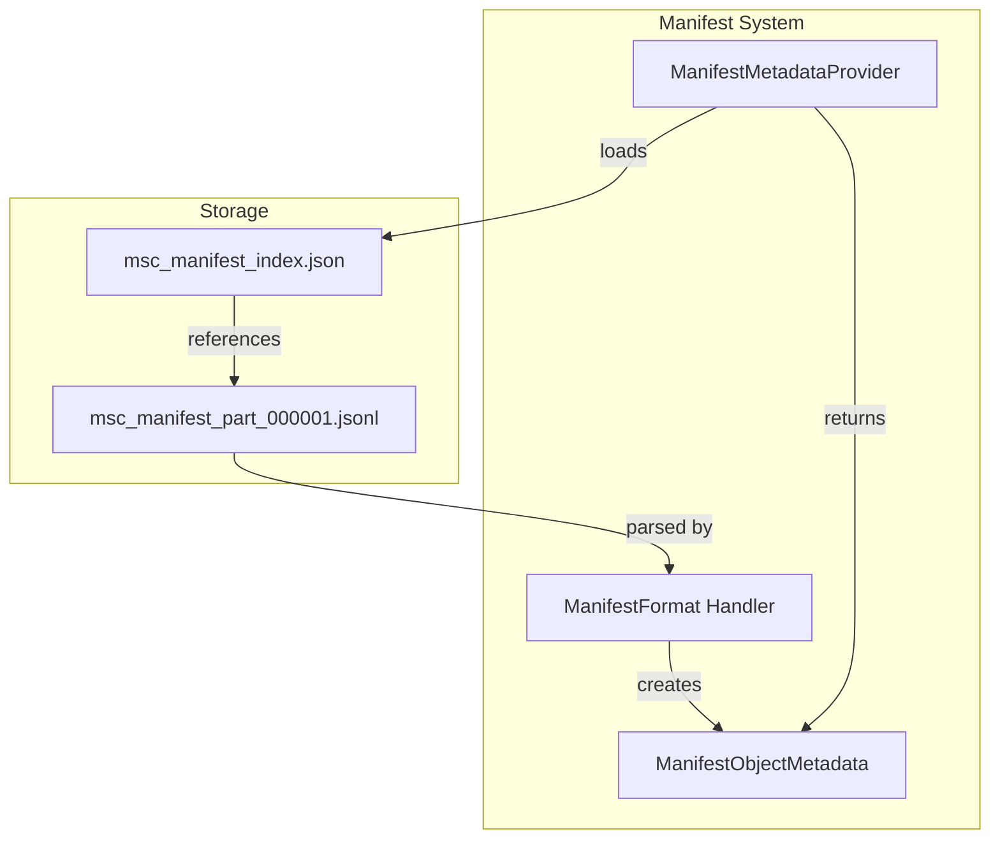
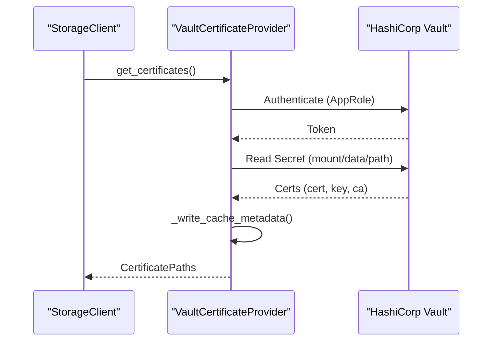

<!-- source: DeepWiki mcp.deepwiki.com · repo NVIDIA/multi-storage-client · page 6.3 Advanced Usage · fetched 2026-10-26 -->

# Advanced Usage

<details>
<summary>Relevant source files</summary>

The following files were used as context for generating this wiki page:

- [multi-storage-client-docs/src/user_guide/libraries.rst](multi-storage-client-docs/src/user_guide/libraries.rst)
- [multi-storage-client-docs/src/user_guide/manifests.rst](multi-storage-client-docs/src/user_guide/manifests.rst)
- [multi-storage-client-docs/src/user_guide/presigned_urls.rst](multi-storage-client-docs/src/user_guide/presigned_urls.rst)
- [multi-storage-client-docs/src/user_guide/quickstart.rst](multi-storage-client-docs/src/user_guide/quickstart.rst)
- [multi-storage-client-docs/src/user_guide/telemetry.rst](multi-storage-client-docs/src/user_guide/telemetry.rst)
- [multi-storage-client-scripts/src/multistorageclient_scripts/utils/argparse_extensions/__init__.py](multi-storage-client-scripts/src/multistorageclient_scripts/utils/argparse_extensions/__init__.py)
- [multi-storage-client-scripts/src/multistorageclient_scripts/utils/wait/__init__.py](multi-storage-client-scripts/src/multistorageclient_scripts/utils/wait/__init__.py)
- [multi-storage-client/src/multistorageclient/__init__.py](multi-storage-client/src/multistorageclient/__init__.py)
- [multi-storage-client/src/multistorageclient/explorer/api/server.py](multi-storage-client/src/multistorageclient/explorer/api/server.py)
- [multi-storage-client/src/multistorageclient/instrumentation/auth.py](multi-storage-client/src/multistorageclient/instrumentation/auth.py)
- [multi-storage-client/src/multistorageclient/mcp/server.py](multi-storage-client/src/multistorageclient/mcp/server.py)
- [multi-storage-client/src/multistorageclient/providers/manifest_metadata.py](multi-storage-client/src/multistorageclient/providers/manifest_metadata.py)
- [multi-storage-client/src/multistorageclient/signers/cloudfront.py](multi-storage-client/src/multistorageclient/signers/cloudfront.py)
- [multi-storage-client/tests/test_multistorageclient/unit/explorer/test_api_endpoints.py](multi-storage-client/tests/test_multistorageclient/unit/explorer/test_api_endpoints.py)
- [multi-storage-client/tests/test_multistorageclient/unit/providers/test_manifest_metadata.py](multi-storage-client/tests/test_multistorageclient/unit/providers/test_manifest_metadata.py)
- [multi-storage-client/tests/test_multistorageclient/unit/providers/test_metadata_rewrite.py](multi-storage-client/tests/test_multistorageclient/unit/providers/test_metadata_rewrite.py)
- [multi-storage-client/tests/test_multistorageclient/unit/test_presigned_url.py](multi-storage-client/tests/test_multistorageclient/unit/test_presigned_url.py)
- [multi-storage-client/tests/test_multistorageclient/unit/utils/mocks.py](multi-storage-client/tests/test_multistorageclient/unit/utils/mocks.py)

</details>


This page documents advanced features and usage patterns of the Multi-Storage Client (MSC) beyond basic operations. It covers the pathlib-like interface, presigned URLs, CloudFront integration, manifest-based datasets, replica management, and integration with popular data science frameworks like Hydra and fsspec.

## Path-like Interface

The Multi-Storage Client provides a pathlib-like interface through the `MultiStoragePath` class, which allows for intuitive file system operations across different storage backends.

```mermaid
classDiagram
    class "MultiStoragePath" {
        +_internal_path: PurePosixPath
        +_storage_client: StorageClient
        +_path: str
        +__init__(path)
        +__str__()
        +name
        +suffix
        +parent
        +exists()
        +is_file()
        +is_dir()
        +open()
        +read_bytes()
        +read_text()
        +write_bytes()
        +write_text()
        +glob()
        +iterdir()
        +unlink()
        +rename()
    }

    class "PurePosixPath" {
        +parts
        +suffix
        +name
        +parent
        +parents
    }

    class "StorageClient" {
        +read()
        +write()
        +delete()
        +info()
        +list()
        +glob()
    }

    "MultiStoragePath" --> "PurePosixPath" : "uses for path operations"
    "MultiStoragePath" --> "StorageClient" : "delegates storage operations"
```

Sources: [multi-storage-client/src/multistorageclient/pathlib.py:22-437](), [multi-storage-client/src/multistorageclient/__init__.py:22-22]()

### Key Operations

The `MultiStoragePath` class supports many operations similar to the standard `pathlib.Path`:

| Operation | Description | Local Support | Remote Support |
|-----------|-------------|---------------|---------------|
| `path.exists()` | Check if path exists | ✓ | ✓ |
| `path.is_file()` | Check if path is a file | ✓ | ✓ |
| `path.is_dir()` | Check if path is a directory | ✓ | ✓ |
| `path.open()` | Open file for reading/writing | ✓ | ✓ |
| `path.read_bytes()` | Read file content as bytes | ✓ | ✓ |
| `path.write_bytes()` | Write bytes to file | ✓ | ✓ |
| `path.glob()` | Find paths matching a pattern | ✓ | ✓ |
| `path.unlink()` | Delete file | ✓ | ✓ |

Sources: [multi-storage-client/src/multistorageclient/pathlib.py:230-410]()

## Presigned URLs and CloudFront Signing

Presigned URLs grant temporary access to private objects without requiring the requester to hold credentials. MSC supports native S3 signing, Azure SAS tokens, and CloudFront RSA-based signing.

### URL Signer Architecture

```mermaid
classDiagram
    class "URLSigner" {
        <<interface>>
        +generate_presigned_url(path, method)
    }
    class "CloudFrontURLSigner" {
        -_key_pair_id: str
        -_private_key_path: str
        -_domain: str
        +generate_presigned_url(path, method)
    }
    class "S3StorageProvider" {
        +generate_presigned_url(path, method)
    }
    class "AzureStorageProvider" {
        +generate_presigned_url(path, method)
    }

    URLSigner <|.. CloudFrontURLSigner
    "S3StorageProvider" ..> URLSigner : "uses"
```

Sources: [multi-storage-client/src/multistorageclient/signers/base.py:16-25](), [multi-storage-client/src/multistorageclient/signers/cloudfront.py:37-110]()

### CloudFront Signing
For CloudFront signed URLs (e.g., wildcard-signed URLs for Zarr datasets), MSC implements the canned-policy signing spec using RSA-SHA1 via the `cryptography` package [multi-storage-client/src/multistorageclient/signers/cloudfront.py:37-44]().

```python
from multistorageclient import SignerType, generate_presigned_url

url = generate_presigned_url(
    "msc://profile/results/experiment.zarr/*",
    signer_type=SignerType.CLOUDFRONT,
    signer_options={
        "key_pair_id": "K2JCJMDEHXQW5F",
        "private_key_path": "/secrets/cloudfront.pem",
        "domain": "d111111abcdef8.cloudfront.net",
        "expires_in": 7200,
    },
)
```
Sources: [multi-storage-client-docs/src/user_guide/presigned_urls.rst:78-97](), [multi-storage-client/src/multistorageclient/signers/cloudfront.py:53-73]()

## Manifest-Based Datasets

The `ManifestMetadataProvider` allows MSC to manage datasets where file metadata is decoupled from the underlying storage. This is useful for large-scale datasets, metadata-only listing, and physical path remapping.

### Data Flow for Manifests



Sources: [multi-storage-client/src/multistorageclient/providers/manifest_metadata.py:111-150](), [multi-storage-client/src/multistorageclient/providers/manifest_formats.py:16-45]()

### Manifest Structure
Manifests consist of an index file (`msc_manifest_index.json`) and multiple parts (JSONL or Parquet). The provider tracks `_pending_adds` and `_pending_removes` until `commit_metadata()` is called [multi-storage-client/src/multistorageclient/providers/manifest_metadata.py:113-144]().

Sources: [multi-storage-client/src/multistorageclient/providers/manifest_metadata.py:42-46](), [multi-storage-client/tests/test_multistorageclient/unit/providers/test_manifest_metadata.py:97-103]()

## Replica Management

MSC supports multi-replica configurations where a logical object can exist in multiple physical locations. The `sync_replicas` shortcut ensures all replicas are up-to-date with the primary backend.

```python
import multistorageclient as msc

# Syncs all configured replicas for the given profile
msc.sync_replicas("msc://data-profile/")
```
Sources: [multi-storage-client/src/multistorageclient/shortcuts.py:211-224](), [multi-storage-client/src/multistorageclient/__init__.py:40-40]()

## Hydra Plugin Integration

The MSC Hydra plugin enables loading Hydra configurations directly from object storage using `msc://` URLs. The plugin is automatically registered when `multistorageclient` and `hydra-core` are installed.

```python
import hydra
from omegaconf import DictConfig

@hydra.main(version_base=None, config_path="msc://profile/configs", config_name="training")
def my_app(cfg: DictConfig) -> None:
    print(f"Config loaded from storage: {cfg}")
```
Sources: [multi-storage-client-docs/src/user_guide/libraries.rst:35-58](), [multi-storage-client/src/multistorageclient/__init__.py:96-99]()

## Partial File Caching Tuning

The caching system allows for partial file caching via cache lines. This can be tuned via `CacheConfig` or environment variables to optimize for specific workloads.

### Cache Tuning Parameters
- `collect_interval_millis`: Frequency of metric collection [multi-storage-client-docs/src/user_guide/telemetry.rst:35-36]().
- `disable_read_cache`: Can be passed to `open()` to bypass the cache for specific large files [multi-storage-client-docs/src/user_guide/quickstart.rst:240-242]().

Sources: [multi-storage-client/src/multistorageclient/cache.py:19-19](), [multi-storage-client-docs/src/user_guide/telemetry.rst:17-46]()

## Rclone Compatibility Layer

MSC can ingest `rclone.conf` files to automatically generate profiles. It searches standard locations like `~/.config/rclone/rclone.conf` or the `rclone` executable directory.

| Feature | MSC Native | Rclone INI |
|---------|------------|------------|
| Storage Access | ✓ | ✓ |
| Caching | ✓ | ✗ |
| Observability | ✓ | ✗ |
| Manifests | ✓ | ✗ |

Sources: [multi-storage-client-docs/src/user_guide/quickstart.rst:132-165]()

## Observability and Auth Providers

For secure telemetry, MSC supports `VaultCertificateProvider` to fetch mTLS certificates from HashiCorp Vault using AppRole authentication.



Sources: [multi-storage-client/src/multistorageclient/instrumentation/auth.py:85-134](), [multi-storage-client/src/multistorageclient/instrumentation/auth.py:172-180]()

---

