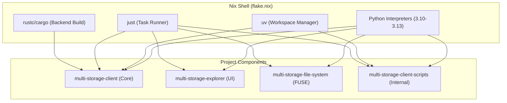
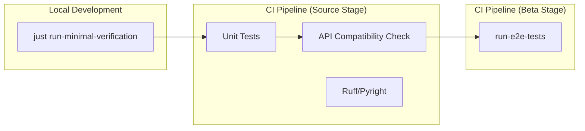

<!-- source: DeepWiki mcp.deepwiki.com · repo NVIDIA/multi-storage-client · page 7 Development · fetched 2026-10-26 -->

# Development

Relevant source files

The following files were used as context for generating this wiki page:

- [.github/actionlint.yaml](.github/actionlint.yaml)
- [.github/workflows/.beta.yml](.github/workflows/.beta.yml)
- [.github/workflows/.github_pages.yml](.github/workflows/.github_pages.yml)
- [.github/workflows/.production.yml](.github/workflows/.production.yml)
- [.github/workflows/.source.yml](.github/workflows/.source.yml)
- [.github/workflows/default_branch.yml](.github/workflows/default_branch.yml)
- [.github/workflows/pull_request.yml](.github/workflows/pull_request.yml)
- [.gitlab/pipelines/.beta.yml](.gitlab/pipelines/.beta.yml)
- [.gitlab/pipelines/.source.yml](.gitlab/pipelines/.source.yml)
- [flake.lock](flake.lock)
- [flake.nix](flake.nix)
- [justfile](justfile)
- [multi-storage-client-scripts/README.md](multi-storage-client-scripts/README.md)

This page provides information for developers who want to contribute to or modify the multi-storage-client codebase. It covers the high-level development environment, the unified task management system, and the automated verification infrastructure.

For detailed information about specific development topics, see the following child pages:

- [Development Environment](#7.1) — Detailed instructions for setting up Nix, `uv` workspaces, and AI agent tooling.
- [CI/CD Pipeline](#7.2) — In-depth documentation on GitHub Actions and GitLab CI automated test chains.
- [Release Process](#7.3) — Details on semantic versioning, API compatibility checks, and publishing to PyPI.

## Development Environment Overview

The project uses a Nix-based environment to ensure consistency across different platforms and Python versions. The environment is defined in `flake.nix` and managed via `uv` for Python dependencies.

Sources: [flake.nix:38-123](), [justfile:14-39]()

The environment supports a matrix of Python versions from 3.10 to 3.13 [flake.nix:42-46](), [.github/workflows/.source.yml:75-79]().

## Task Management with Just

The project uses `just` as a unified entry point for all development tasks, from building the React-based explorer to running end-to-end tests.

| Task | Command | Description |
|------|---------|-------------|
| **Full Build** | `just build` | Builds Nix, Explorer, Client, Docs, Scripts, and FUSE components [justfile:39-39]() |
| **Client Build** | `just multi-storage-client` | Builds the Python client and Rust backend [justfile:23-24]() |
| **Explorer Build** | `just multi-storage-explorer` | Builds the React/Ant Design web interface [justfile:19-20]() |
| **Agent Setup** | `just setup-agent-tools` | Configures MCP and rules for AI agents (Cursor, Claude, Windsurf) [justfile:46-157]() |

Sources: [justfile:11-40](), [justfile:46-85]()

## AI Agent Integration

A unique aspect of the development workflow is the native support for AI coding agents. The project maintains a set of canonical rules and skills in the `.agents/` directory, which are synced to specific tool configurations (like `.cursorrules` or `.clauderules`) via the `setup-agent-tools` recipe [justfile:41-46](). This includes:
- **Model Context Protocol (MCP)**: A server that allows AI agents to perform storage operations directly [justfile:100-108]().
- **Agent Learnings**: A shared `agent-learnings.md` file to prevent agents from repeating mistakes [justfile:58-62]().

## Verification Infrastructure

The project employs a multi-stage verification process that spans unit tests, minimal verification, and full end-to-end (E2E) suites.

Sources: [.github/workflows/.source.yml:111-116](), [.github/workflows/.beta.yml:17-46]()

### CI/CD Pipeline Summary
The pipeline is structured into three distinct environments:
1. **Source**: Handles linting, unit tests, and building wheels across the Python version matrix [.github/workflows/.source.yml:69-81]().
2. **Beta**: Executes heavy E2E tests that require specialized hardware or cloud credentials [.github/workflows/.beta.yml:17-21]().
3. **Production**: Manages the release of artifacts to PyPI and documentation to GitHub Pages [.github/workflows/.production.yml:17-21]().

For details on the pipeline logic, see [CI/CD Pipeline](#7.2).

## Release Management

Releases are automated via the `msc-scripts` internal tool, which enforces a two-phase publish pattern [multi-storage-client-scripts/README.md:1-3]().
- **Phase Check**: Verifies API compatibility against the previous version [.github/workflows/.source.yml:113-116]().
- **Phase Publish**: Finalizes the release on GitHub and PyPI [.github/workflows/.production.yml:41-43]().

For details on versioning and the release checklist, see [Release Process](#7.3).

Sources: [.github/workflows/.source.yml:113-116](), [.github/workflows/.production.yml:41-43](), [multi-storage-client-scripts/README.md:1-43]()

---

