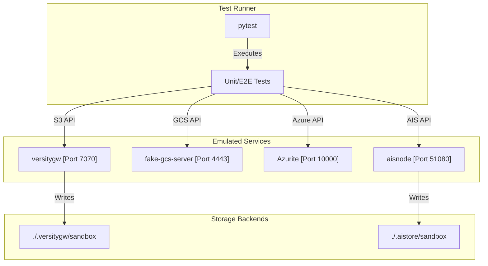
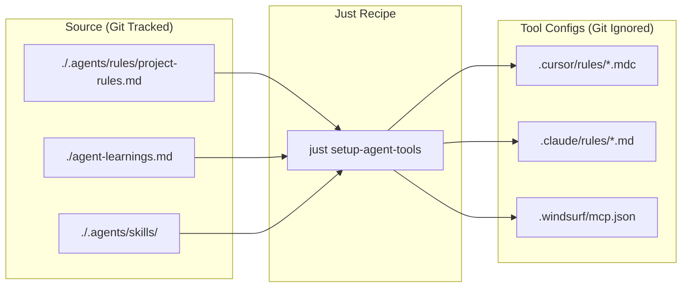

<!-- source: DeepWiki mcp.deepwiki.com · repo NVIDIA/multi-storage-client · page 7.1 Development Environment · fetched 2026-10-26 -->

# Development Environment

<details>
<summary>Relevant source files</summary>

The following files were used as context for generating this wiki page:

- [.cachekeep](.cachekeep)
- [.gitignore](.gitignore)
- [.gitlab/pipelines/.beta.yml](.gitlab/pipelines/.beta.yml)
- [.gitlab/pipelines/.source.yml](.gitlab/pipelines/.source.yml)
- [flake.lock](flake.lock)
- [flake.nix](flake.nix)
- [justfile](justfile)
- [multi-storage-client/.rayignore](multi-storage-client/.rayignore)
- [multi-storage-client/justfile](multi-storage-client/justfile)
- [multi-storage-client/tests/test_multistorageclient/unit/contrib/test_ray.py](multi-storage-client/tests/test_multistorageclient/unit/contrib/test_ray.py)
- [nix/overlays/development/multi-storage-client/devShells/default.nix](nix/overlays/development/multi-storage-client/devShells/default.nix)
- [nix/overlays/development/multi-storage-client/packages/aistore/package.nix](nix/overlays/development/multi-storage-client/packages/aistore/package.nix)

</details>


This document explains how to set up, configure, and use the development environment for the `multi-storage-client` repository. It covers dependency management via `uv`, the Nix-based reproducible environment, testing frameworks, and AI agent integration.

## Prerequisites

The project supports a matrix of Python versions from 3.10 to 3.13 [justfile:119-123](). While standard Python installations work, the recommended development stack includes:

1.  **Nix**: Provides a reproducible environment with all system dependencies (Go, Rust, Storage Emulators) [flake.nix:7-28]().
2.  **uv**: High-performance Python package and project manager used for workspace management [multi-storage-client/justfile:25-29]().
3.  **just**: Command runner for executing development recipes [justfile:1-5]().
4.  **Rustup**: Required for building the Rust-accelerated backend (`multistorageclient_rust`) [multi-storage-client/justfile:21-23]().

Sources: [flake.nix:7-28](), [justfile:7-9](), [multi-storage-client/justfile:10-15]().

## Environment Setup

The repository is a monorepo containing the Python client, a FUSE filesystem (MSFS), and a web explorer.

### Nix Development Shell
The `flake.nix` defines a development shell that includes all necessary binaries, including storage systems like `aistore`, `azurite`, and `fake-gcs-server` [nix/overlays/development/multi-storage-client/devShells/default.nix:106-114]().

```bash
# Enter the development environment
nix develop
```

This shell automatically configures `LD_LIBRARY_PATH` for dynamic linking and sets up SDK paths for cross-compilation [nix/overlays/development/multi-storage-client/devShells/default.nix:139-152]().

### Python Workspace Management
The project uses `uv` to manage the virtual environment and install extras. The `prepare-toolchain` recipe handles Rust target addition and Python dependency synchronization [multi-storage-client/justfile:21-29]().

```bash
# Set up the Python environment and build Rust extensions
just multi-storage-client/prepare-toolchain
```

Sources: [flake.nix:119-123](), [nix/overlays/development/multi-storage-client/devShells/default.nix:49-130](), [multi-storage-client/justfile:21-29]().

## Development Workflow

The following table summarizes key `just` recipes for daily development:

| Recipe | Description |
|:---|:---|
| `just analyze` | Runs `ruff format`, `ruff check`, and `pyright` type checking [multi-storage-client/justfile:41-49](). |
| `just run-unit-tests` | Starts storage emulators, runs Rust `cargo test`, and Python `pytest` [multi-storage-client/justfile:147-153](). |
| `just run-e2e-tests` | Executes end-to-end tests against live or emulated backends [multi-storage-client/justfile:161-163](). |
| `just start-explorer` | Launches the MSC Explorer web UI backend [multi-storage-client/justfile:37-38](). |
| `just setup-agent-tools` | Configures AI agent rules (Cursor, Claude, Windsurf) and MCP server [justfile:46-108](). |

Sources: [multi-storage-client/justfile:41-163](), [justfile:46-108]().

### Code Quality Tools
The project enforces strict quality standards using:
*   **Ruff**: For linting and formatting [multi-storage-client/justfile:45-47]().
*   **Pyright**: For static type analysis [multi-storage-client/justfile:49]().
*   **Actionlint**: For validating GitHub Actions workflows [nix/overlays/development/multi-storage-client/devShells/default.nix:58]().

## Testing Infrastructure

The environment provides a full suite of storage and telemetry emulators to simulate cloud environments locally.

### Storage System Emulators
Storage systems are managed via `start-storage-systems` and `stop-storage-systems` recipes.

| System | Role | Ports |
|:---|:---|:---|
| **AIStore** | High-performance AI storage | 51080 (Proxy), 51081 (Target) [multi-storage-client/justfile:68](). |
| **Azurite** | Azure Blob Storage emulator | 10000-10002 [multi-storage-client/justfile:69](). |
| **fake-gcs-server** | Google Cloud Storage emulator | 4443 [multi-storage-client/justfile:70](). |
| **versitygw** | S3-to-POSIX gateway | 7070 [multi-storage-client/justfile:71](). |

**Data Flow: Test Execution**
Title: Local Test Environment Data Flow

Sources: [multi-storage-client/justfile:61-104]().

### Telemetry Stack
For testing observability features, the environment can spin up a local LGTM stack (Loki, Grafana, Tempo, Mimir).
*   **Grafana**: Port 3000 [multi-storage-client/justfile:126]().
*   **Mimir**: Port 8080 (Prometheus compatible) [multi-storage-client/justfile:127]().
*   **Tempo**: Port 8081 (Otel Traces) [multi-storage-client/justfile:128]().

Sources: [multi-storage-client/justfile:114-144]().

## AI Agent Integration

The project includes specific tooling for AI-assisted development (Cursor, Claude Code, Windsurf). The `setup-agent-tools` recipe synchronizes project rules and configures the Model Context Protocol (MCP) server.

### MCP Configuration
The MSC MCP server allows AI agents to interact directly with storage backends via the `msc` CLI [justfile:69-85](). The configuration is generated by `.agents/configure-mcp.py` [justfile:100-108]().

### Agent Rules and Learnings
*   **`.agents/rules/`**: Canonical source for project-specific rules [justfile:50]().
*   **`agent-learnings.md`**: A living document where agents record and read project-specific gotchas [justfile:58-62]().
*   **Tool-specific output**: The recipe generates `.cursor/rules/`, `.claude/rules/`, and `.windsurf/mcp.json` [justfile:130-198]().

**Entity Mapping: Agent Tooling**
Title: AI Agent Tooling and Rule Propagation

Sources: [justfile:46-198](), [.gitignore:53-60]().

## CI/CD Pipeline Integration

The development environment is mirrored in GitLab CI. Pipelines run across the Python version matrix (3.10-3.13) using Nix-based images [ .gitlab/pipelines/.source.yml:118-123]().

*   **Static Analysis**: Artifacts are exported in GitLab-compatible JSON for code quality integration [multi-storage-client/justfile:47]().
*   **Coverage**: Cobertura XML reports are generated for unit tests [ .gitlab/pipelines/.source.yml:139-141]().
*   **E2E Tests**: Run in a "Beta" environment with specialized JWT tokens for service access [ .gitlab/pipelines/.beta.yml:55-64]().

Sources: [.gitlab/pipelines/.source.yml:118-143](), [.gitlab/pipelines/.beta.yml:55-81]().

---

