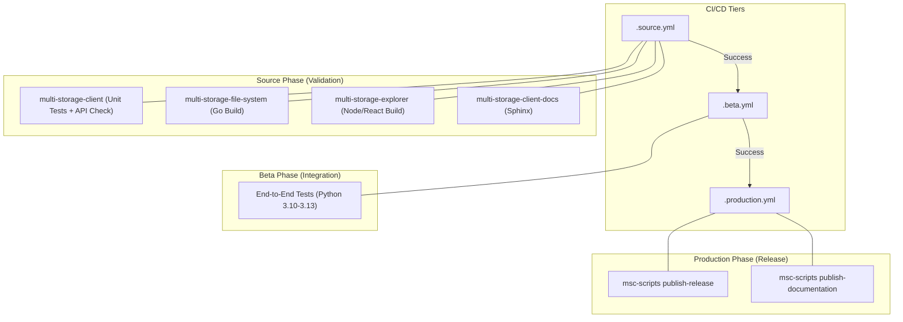
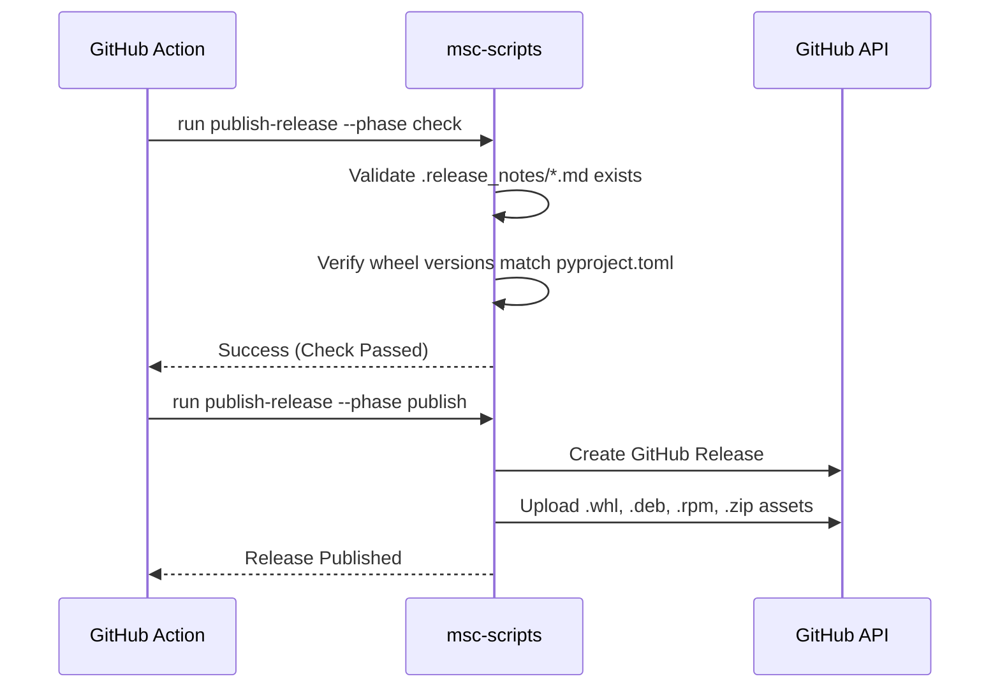

<!-- source: DeepWiki mcp.deepwiki.com · repo NVIDIA/multi-storage-client · page 7.2 CI/CD Pipeline · fetched 2026-10-26 -->

# CI/CD Pipeline

Relevant source files

The following files were used as context for generating this wiki page:

- [.github/actionlint.yaml](.github/actionlint.yaml)
- [.github/workflows/.beta.yml](.github/workflows/.beta.yml)
- [.github/workflows/.github_pages.yml](.github/workflows/.github_pages.yml)
- [.github/workflows/.production.yml](.github/workflows/.production.yml)
- [.github/workflows/.pypi.yml](.github/workflows/.pypi.yml)
- [.github/workflows/.source.yml](.github/workflows/.source.yml)
- [.github/workflows/default_branch.yml](.github/workflows/default_branch.yml)
- [.github/workflows/pull_request.yml](.github/workflows/pull_request.yml)
- [.github/workflows/release.yml](.github/workflows/release.yml)
- [.gitlab-ci.yml](.gitlab-ci.yml)
- [.gitlab/pipelines/.pypi.yml](.gitlab/pipelines/.pypi.yml)
- [.gitlab/pipelines/default_branch.yml](.gitlab/pipelines/default_branch.yml)
- [.gitlab/pipelines/merge_request.yml](.gitlab/pipelines/merge_request.yml)
- [.gitlab/pipelines/tag.yml](.gitlab/pipelines/tag.yml)
- [multi-storage-client-docs/src/user_guide/multi_storage_file_system.rst](multi-storage-client-docs/src/user_guide/multi_storage_file_system.rst)
- [multi-storage-client-scripts/README.md](multi-storage-client-scripts/README.md)
- [multi-storage-client-scripts/justfile](multi-storage-client-scripts/justfile)
- [multi-storage-client-scripts/pyproject.toml](multi-storage-client-scripts/pyproject.toml)
- [multi-storage-client-scripts/src/multistorageclient_scripts/cli/__main__.py](multi-storage-client-scripts/src/multistorageclient_scripts/cli/__main__.py)
- [multi-storage-client-scripts/src/multistorageclient_scripts/cli/check_python_api_compat/__init__.py](multi-storage-client-scripts/src/multistorageclient_scripts/cli/check_python_api_compat/__init__.py)
- [multi-storage-client-scripts/src/multistorageclient_scripts/cli/publish_documentation/__init__.py](multi-storage-client-scripts/src/multistorageclient_scripts/cli/publish_documentation/__init__.py)
- [multi-storage-client-scripts/src/multistorageclient_scripts/cli/publish_release/__init__.py](multi-storage-client-scripts/src/multistorageclient_scripts/cli/publish_release/__init__.py)
- [multi-storage-client-scripts/src/multistorageclient_scripts/cli/publish_wheels/__init__.py](multi-storage-client-scripts/src/multistorageclient_scripts/cli/publish_wheels/__init__.py)
- [multi-storage-client-scripts/src/multistorageclient_scripts/utils/httpx/auth/__init__.py](multi-storage-client-scripts/src/multistorageclient_scripts/utils/httpx/auth/__init__.py)
- [multi-storage-client-scripts/tests/test_multistorageclient_scripts/cli/test_check_python_api_compat.py](multi-storage-client-scripts/tests/test_multistorageclient_scripts/cli/test_check_python_api_compat.py)
- [multi-storage-file-system/Dockerfile.csi](multi-storage-file-system/Dockerfile.csi)
- [multi-storage-file-system/justfile](multi-storage-file-system/justfile)
- [multi-storage-file-system/main.go](multi-storage-file-system/main.go)

## Purpose and Scope

This document describes the Continuous Integration and Continuous Deployment (CI/CD) pipeline for the `multi-storage-client` repository. The pipeline automates the lifecycle of the monorepo, including the Python client, FUSE filesystem (MSFS), web explorer, and documentation. It utilizes GitHub Actions as the primary orchestration engine, supported by a secondary GitLab CI configuration for internal environments.

## Pipeline Architecture

The CI/CD system follows a tiered promotion model (Source -> Beta -> Production). It relies heavily on **Nix** to provide a reproducible environment across all runners, ensuring that dependencies and toolchains are identical in local development and CI [ .github/workflows/.source.yml:13-15 ]().

### Workflow Chain

Sources: [ .github/workflows/default_branch.yml:13-32 ](), [ .github/workflows/.source.yml:7-184 ]()

## Component Workflows

### 1. Source Validation (`.source.yml`)
This workflow executes on every pull request and push to the default branch. It performs parallel builds of all monorepo components.

*   **multi-storage-client**: Runs a matrix across Python 3.10, 3.11, 3.12, and 3.13 [ .github/workflows/.source.yml:73-79 ]().
    *   Executes `just build` and `just run-minimal-verification` [ .github/workflows/.source.yml:110-111 ]().
    *   Invokes `msc-scripts check-api-compat` to ensure no breaking changes against the baseline version [ .github/workflows/.source.yml:113-116 ]().
*   **multi-storage-file-system**: Builds the Go-based FUSE daemon and packages it into `.deb`, `.rpm`, `.tar`, and `.zip` formats [ .github/workflows/.source.yml:184-202 ]().
*   **multi-storage-explorer**: Bundles the React frontend into static assets for the Python wheel [ .github/workflows/.source.yml:43-68 ]().

### 2. Beta Integration (`.beta.yml`)
The Beta tier runs end-to-end (E2E) tests. These tests interact with live or emulated storage backends (e.g., MinIO, Azurite) to verify the client's behavior in real-world scenarios [ .github/workflows/.beta.yml:17-47 ]().

### 3. Production Release (`.production.yml`)
Triggered only on the default branch after Beta tests pass. It uses the `msc-scripts` internal tool to perform a two-phase release (check then publish) [ .github/workflows/.production.yml:17-43 ]().

## Internal Tooling: `msc-scripts`

The `multi-storage-client-scripts` package is a dedicated Python toolset for CI/CD automation [ multi-storage-client-scripts/pyproject.toml:7-28 ]().

### Key Commands and Logic

| Command | Implementation | Purpose |
| :--- | :--- | :--- |
| `check-api-compat` | `check_python_api_compat/__init__.py` | Compares the current codebase against a git tag to detect breaking changes in public signatures. |
| `publish-release` | `publish_release/__init__.py` | Handles GitHub Release creation, asset upload (wheels, MSFS packages), and release note extraction [ multi-storage-client-scripts/src/multistorageclient_scripts/cli/publish_release/__init__.py:78-116 ](). |
| `publish-documentation` | `publish_documentation/__init__.py` | Deploys Sphinx-generated HTML to GitHub Pages using OIDC tokens [ multi-storage-client-scripts/src/multistorageclient_scripts/cli/publish_documentation/__init__.py:153-184 ](). |

### Release Phase Logic
The `publish-release` and `publish-documentation` commands implement a `Phase` enum (`check` vs `publish`) [ multi-storage-client-scripts/src/multistorageclient_scripts/cli/publish_release/__init__.py:38-46 ](). This allows the CI to validate all assets exist before committing to a remote write operation.

Sources: [ multi-storage-client-scripts/src/multistorageclient_scripts/cli/publish_release/__init__.py:78-184 ]()

## Artifact Types

The pipeline produces several distinct artifact types, which are cached and passed between workflow jobs:

1.  **Python Wheels**: Built via `uv build` in the `multi-storage-client` job [ .github/workflows/.source.yml:96 ]().
2.  **MSFS Packages**: OS-specific installers (`.deb`, `.rpm`) for the FUSE filesystem [ .github/workflows/.source.yml:199-200 ]().
3.  **Documentation Archive**: A ZIP containing the Sphinx website, later deployed to GitHub Pages [ multi-storage-client-scripts/src/multistorageclient_scripts/cli/publish_release/__init__.py:98-108 ]().
4.  **Coverage Reports**: JUnit and Cobertura XMLs for test tracking [ .github/workflows/.source.yml:95 ]().

## Code Quality and Linting

*   **actionlint**: A dedicated runner configuration ensures GitHub Action YAML files are syntactically correct and follow best practices [ .github/actionlint.yaml ]().
*   **ruff & pyright**: Executed via `just build` in the Source phase to enforce formatting and type safety [ .github/workflows/.source.yml:110 ]().

## GitLab CI Equivalence

For environments where GitHub Actions are not available, the repository maintains `.gitlab-ci.yml`. This uses a dispatch pattern to include specific pipeline definitions based on the source (merge request, push, or tag) [ .gitlab-ci.yml:17-52 ](). It mirrors the logic found in the GitHub workflows but is optimized for GitLab runners.

Sources: [ .gitlab-ci.yml:1-64 ](), [ .gitlab/pipelines/default_branch.yml:1-32 ]()

---

