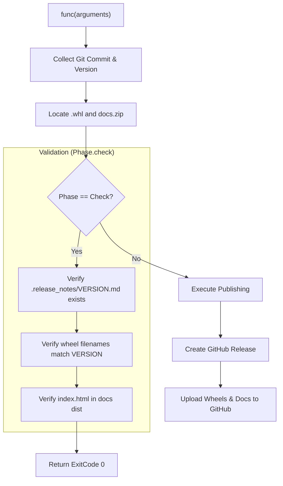
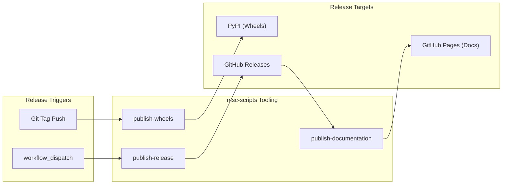

<!-- source: DeepWiki mcp.deepwiki.com · repo NVIDIA/multi-storage-client · page 7.3 Release Process · fetched 2026-10-26 -->

# Release Process

Relevant source files

The following files were used as context for generating this wiki page:

- [.github/workflows/.pypi.yml](.github/workflows/.pypi.yml)
- [.github/workflows/release.yml](.github/workflows/release.yml)
- [.gitlab/pipelines/.pypi.yml](.gitlab/pipelines/.pypi.yml)
- [.release_notes/.unreleased.md](.release_notes/.unreleased.md)
- [multi-storage-client-docs/src/user_guide/multi_storage_file_system.rst](multi-storage-client-docs/src/user_guide/multi_storage_file_system.rst)
- [multi-storage-client-scripts/src/multistorageclient_scripts/cli/publish_documentation/__init__.py](multi-storage-client-scripts/src/multistorageclient_scripts/cli/publish_documentation/__init__.py)
- [multi-storage-client-scripts/src/multistorageclient_scripts/cli/publish_release/__init__.py](multi-storage-client-scripts/src/multistorageclient_scripts/cli/publish_release/__init__.py)
- [multi-storage-client-scripts/src/multistorageclient_scripts/cli/publish_wheels/__init__.py](multi-storage-client-scripts/src/multistorageclient_scripts/cli/publish_wheels/__init__.py)
- [multi-storage-client-scripts/src/multistorageclient_scripts/utils/httpx/auth/__init__.py](multi-storage-client-scripts/src/multistorageclient_scripts/utils/httpx/auth/__init__.py)
- [multi-storage-client/pyproject.toml](multi-storage-client/pyproject.toml)
- [multi-storage-file-system/Dockerfile.csi](multi-storage-file-system/Dockerfile.csi)
- [multi-storage-file-system/justfile](multi-storage-file-system/justfile)
- [multi-storage-file-system/main.go](multi-storage-file-system/main.go)
- [pyproject.toml](pyproject.toml)
- [uv.lock](uv.lock)

This document outlines the workflow and procedures for releasing new versions of the Multi-Storage Client (MSC). It covers semantic versioning, change tracking, the two-phase publish pattern, and the automated deployment of wheels and documentation.

## Versioning and Change Tracking

The project follows semantic versioning conventions. Versions are defined in the project's metadata, such as `multi-storage-client/pyproject.toml` [multi-storage-client/pyproject.toml:9-9]().

### Release Notes Management
Before a release, changes are tracked in the `.release_notes/` directory. 
- **Unreleased Changes**: Contributors add items to `.release_notes/.unreleased.md` [ .release_notes/.unreleased.md:1-8](). This file is divided into `Breaking Changes`, `New Features`, and `Bug Fixes`.
- **Release Specific Notes**: During the release process, the content of the unreleased notes is moved to a version-specific file (e.g., `1.0.0.md`). The release script specifically looks for a file matching the current version string in this directory [multi-storage-client-scripts/src/multistorageclient_scripts/cli/publish_release/__init__.py:91-91]().

Sources: [.release_notes/.unreleased.md:1-8](), [multi-storage-client/pyproject.toml:9-9](), [multi-storage-client-scripts/src/multistorageclient_scripts/cli/publish_release/__init__.py:91-91]()

## The Two-Phase Publish Pattern

To ensure reliability and prevent partial failures during public releases, the release scripts utilize a "Check then Publish" pattern via the `Phase` enum [multi-storage-client-scripts/src/multistorageclient_scripts/cli/publish_release/__init__.py:38-46]().

1.  **Check Phase**: Validates all inputs, ensures release notes exist and are not empty, verifies that built wheels match the expected version, and checks for documentation artifacts [multi-storage-client-scripts/src/multistorageclient_scripts/cli/publish_release/__init__.py:123-183]().
2.  **Publish Phase**: Executes the actual network operations to upload artifacts to GitHub, PyPI, or GitHub Pages [multi-storage-client-scripts/src/multistorageclient_scripts/cli/publish_release/__init__.py:187-190]().

### Release Logic Flow
The following diagram illustrates the `publish-release` logic implemented in `multistorageclient_scripts`:

**Release Validation and Execution Flow**

Sources: [multi-storage-client-scripts/src/multistorageclient_scripts/cli/publish_release/__init__.py:78-190]()

## Artifact Publishing

### PyPI and Python Wheels
The Python client is packaged as a wheel using `maturin` [multi-storage-client/pyproject.toml:1-5](). The release process for wheels is orchestrated by `publish-wheels` which is triggered in CI pipelines [ .github/workflows/.pypi.yml:41-41]().
- **Build System**: Uses `maturin` to handle both Python code and Rust extensions [multi-storage-client/pyproject.toml:173-179]().
- **Static Assets**: Pre-built static assets for the MSC Explorer are explicitly included in the wheel [multi-storage-client/pyproject.toml:180-183]().

### MSFS System Packages
The Multi-Storage File System (MSFS) is released as system-level packages (DEB, RPM, and Tarballs).
- **Tooling**: Managed via `justfile` recipes in the `multi-storage-file-system` directory [multi-storage-file-system/justfile:41-83]().
- **Architecture**: Supports both `amd64` and `arm64` [multi-storage-file-system/justfile:35-35]().

### Documentation Deployment
Documentation is hosted on GitHub Pages. The deployment is handled by the `publish-documentation` script [multi-storage-client-scripts/src/multistorageclient_scripts/cli/publish_documentation/__init__.py:88-88]().
- **OIDC Authentication**: Uses GitHub Actions OIDC tokens to authenticate with the GitHub Pages deployment API [multi-storage-client-scripts/src/multistorageclient_scripts/cli/publish_documentation/__init__.py:171-183]().
- **Deployment**: Only triggers for the latest, non-draft, non-prerelease tags [multi-storage-client-scripts/src/multistorageclient_scripts/cli/publish_documentation/__init__.py:159-167]().

Sources: [multi-storage-client/pyproject.toml:1-5, 173-183](), [multi-storage-file-system/justfile:41-83](), [multi-storage-client-scripts/src/multistorageclient_scripts/cli/publish_documentation/__init__.py:88-183]()

## CI/CD Pipeline Integration

The release process is integrated into both GitHub Actions and GitLab CI.

**CI Release Pipeline Architecture**

### GitHub Actions
The `release.yml` workflow coordinates the sub-workflows for PyPI and GitHub Pages [ .github/workflows/release.yml:19-46](). It uses `permissions` to allow writing `id-token` for secure OIDC publishing [ .github/workflows/release.yml:21-24]().

### GitLab CI
The GitLab pipeline uses a `nix` environment to run the `msc-scripts` commands [ .gitlab/pipelines/.pypi.yml:64-67](). It leverages the `publish-wheels` command with tokens stored in environment variables [ .gitlab/pipelines/.pypi.yml:66-66]().

Sources: [.github/workflows/release.yml:19-46](), [.gitlab/pipelines/.pypi.yml:64-67](), [.github/workflows/.pypi.yml:41-41]()

## API Compatibility Checking
As part of the release pipeline (referenced in `msc-scripts`), the `check-api-compat` tool (internal to the scripts package) ensures that new releases do not introduce unintended breaking changes to the public API, supporting the project's commitment to semantic versioning.

Sources: [multi-storage-client-scripts/src/multistorageclient_scripts/cli/publish_release/__init__.py:63-64]()

---

