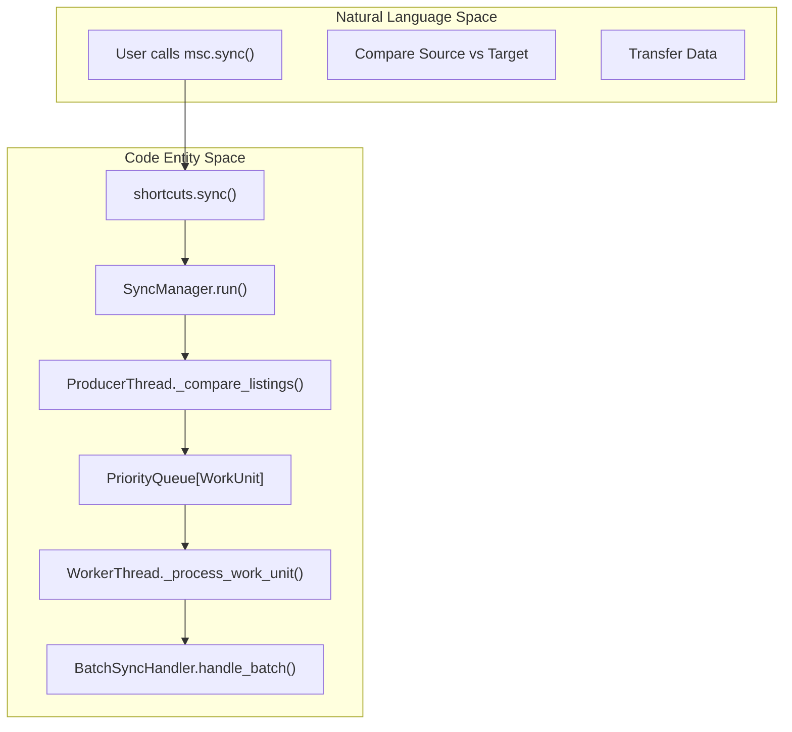
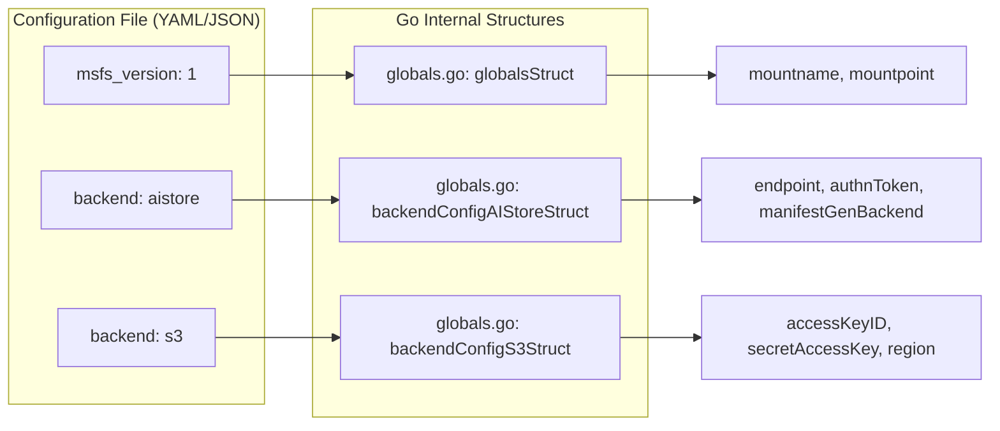

<!-- source: DeepWiki mcp.deepwiki.com · repo NVIDIA/multi-storage-client · page 8 Glossary · fetched 2026-10-26 -->

# Glossary

Relevant source files

The following files were used as context for generating this wiki page:

- [.release_notes/.unreleased.md](.release_notes/.unreleased.md)
- [multi-storage-client-docs/src/references/configuration.rst](multi-storage-client-docs/src/references/configuration.rst)
- [multi-storage-client-docs/src/user_guide/cache.rst](multi-storage-client-docs/src/user_guide/cache.rst)
- [multi-storage-client/pyproject.toml](multi-storage-client/pyproject.toml)
- [multi-storage-client/src/multistorageclient/config.py](multi-storage-client/src/multistorageclient/config.py)
- [multi-storage-client/src/multistorageclient/providers/base.py](multi-storage-client/src/multistorageclient/providers/base.py)
- [multi-storage-client/src/multistorageclient/schema.py](multi-storage-client/src/multistorageclient/schema.py)
- [multi-storage-client/src/multistorageclient/sync/manager.py](multi-storage-client/src/multistorageclient/sync/manager.py)
- [multi-storage-client/src/multistorageclient/sync/producer.py](multi-storage-client/src/multistorageclient/sync/producer.py)
- [multi-storage-client/src/multistorageclient/sync/types.py](multi-storage-client/src/multistorageclient/sync/types.py)
- [multi-storage-client/src/multistorageclient/sync/worker.py](multi-storage-client/src/multistorageclient/sync/worker.py)
- [multi-storage-client/src/multistorageclient/types.py](multi-storage-client/src/multistorageclient/types.py)
- [multi-storage-client/tests/test_multistorageclient/unit/providers/test_base_storage_provider.py](multi-storage-client/tests/test_multistorageclient/unit/providers/test_base_storage_provider.py)
- [multi-storage-client/tests/test_multistorageclient/unit/sync/test_producer.py](multi-storage-client/tests/test_multistorageclient/unit/sync/test_producer.py)
- [multi-storage-client/tests/test_multistorageclient/unit/sync/test_worker.py](multi-storage-client/tests/test_multistorageclient/unit/sync/test_worker.py)
- [multi-storage-client/tests/test_multistorageclient/unit/test_config.py](multi-storage-client/tests/test_multistorageclient/unit/test_config.py)
- [multi-storage-client/tests/test_multistorageclient/unit/test_schema.py](multi-storage-client/tests/test_multistorageclient/unit/test_schema.py)
- [multi-storage-client/tests/test_multistorageclient/unit/test_sync.py](multi-storage-client/tests/test_multistorageclient/unit/test_sync.py)
- [multi-storage-file-system/README.md](multi-storage-file-system/README.md)
- [multi-storage-file-system/config.go](multi-storage-file-system/config.go)
- [multi-storage-file-system/globals.go](multi-storage-file-system/globals.go)
- [pyproject.toml](pyproject.toml)
- [uv.lock](uv.lock)

This glossary defines technical terms, domain-specific jargon, and architectural concepts used within the `multi-storage-client` (MSC) and `multi-storage-file-system` (MSFS) codebases. It is intended to help onboarding engineers navigate the "Natural Language Space" and map it to specific "Code Entity Space" implementations.

## Core Client Concepts

### MSC (Multi-Storage Client)
The unified Python high-performance client for interacting with multiple object and file stores. It provides a consistent API across different providers (S3, GCS, Azure, AIS, POSIX).
*   **Code Pointer:** `multistorageclient.client.StorageClient` in [multi-storage-client/src/multistorageclient/client.py]() (referenced in [multi-storage-client/pyproject.toml:8-10]()).

### Provider
The abstraction layer for storage, metadata, and credentials. 
*   **StorageProvider:** Defines methods for data I/O (read, write, list, delete). [multi-storage-client/src/multistorageclient/types.py:44]()
*   **MetadataProvider:** Provides metadata for objects, often used for manifest-based datasets. [multi-storage-client/src/multistorageclient/providers/manifest_metadata.py]()
*   **CredentialsProvider:** Handles authentication and token lifecycle. [multi-storage-client/src/multistorageclient/types.py:81-118]()

### Profile
A named configuration block in the MSC config file that bundles specific storage, metadata, and credential settings.
*   **Implementation:** `StorageClientConfig` parses these from YAML/JSON. [multi-storage-client/src/multistorageclient/config.py]()
*   **Schema:** Defined in [multi-storage-client/src/multistorageclient/schema.py]().

### MSC URL
A URI scheme formatted as `msc://<profile_name>/<path>`.
*   **Code Pointer:** `MSC_PROTOCOL` in [multi-storage-client/src/multistorageclient/types.py:28-29]().
*   **Resolution:** Handled by `resolve_storage_client` in `multistorageclient.shortcuts`.

### Symlink Handling
Strategies for managing symbolic links, primarily in POSIX providers.
*   **FOLLOW:** Transparently recurse into directory links.
*   **SKIP:** Exclude links.
*   **PRESERVE:** Yield links as leaf entries with `symlink_target` metadata.
*   **Code Pointer:** `SymlinkHandling` enum in [multi-storage-client/src/multistorageclient/types.py:43-65]().

---

## Sync Engine Terminology

The Sync Engine is responsible for high-performance data movement between different storage locations.

| Term | Definition | Code Entity |
| :--- | :--- | :--- |
| **SyncManager** | The orchestrator that manages the lifecycle of a sync operation, including producer and worker threads. | `multistorageclient.sync.manager.SyncManager` |
| **ProducerThread** | Performs a merge-sort comparison of source and target listings to identify required work (add/delete). | `multistorageclient.sync.producer.ProducerThread` |
| **WorkUnit** | A single task (e.g., "copy file A to B" or "delete file C") sent to a worker. | `multistorageclient.sync.types.WorkUnit` |
| **BatchSyncHandler** | Provider-specific optimization for batch transfers (e.g., POSIX-to-POSIX vs. S3-to-S3). | `multistorageclient.sync.worker.BatchSyncHandler` |

### Sync Engine Data Flow

This diagram bridges the conceptual "Sync Operation" to the specific classes and functions that execute it.

**Sync Execution Logic**

**Sources:** [multi-storage-client/src/multistorageclient/sync/manager.py](), [multi-storage-client/src/multistorageclient/sync/producer.py](), [multi-storage-client/src/multistorageclient/sync/worker.py]()

---

## MSFS (Multi-Storage File System) Terms

### MSFS
The FUSE-based daemon (written in Go) that mounts MSC profiles as local POSIX filesystems.
*   **Code Pointer:** [multi-storage-file-system/main.go]().

### Inode
A data structure in MSFS representing a file or directory.
*   **Evictable Inode:** An auto-generated inode that is minimally maintained in memory. [multi-storage-file-system/README.md:62]().

### Cache Storage Modes
MSFS supports different tiers for data caching:
*   **RAM:** Shared memory arena.
*   **Mapped-File:** Single large file used as a block cache.
*   **Per-Inode-File:** Each remote object is cached in a corresponding local file.
*   **Code Pointer:** `resolveCacheStorage` in [multi-storage-file-system/config.go:229-263]().

### MSFS Global State
The `globalsStruct` contains the runtime configuration and state for the FUSE mount.
*   **Code Pointer:** [multi-storage-file-system/globals.go]().

### MSFS Configuration Mapping

This diagram maps MSFS configuration settings to the internal Go structs.

**MSFS Config to Struct Mapping**

**Sources:** [multi-storage-file-system/globals.go:26-44](), [multi-storage-file-system/globals.go:94-108](), [multi-storage-file-system/config.go]()

---

## Infrastructure and Performance

### Multipart Threshold
The file size at which the client switches from a single PUT/GET to a multipart upload/download.
*   **Default:** 64 MiB. [multi-storage-client/src/multistorageclient/providers/base.py:167]().

### OpenTelemetry (OTel)
The system used for exporting metrics (latency, throughput, error rates).
*   **Implementation:** `Telemetry` class in `multistorageclient.telemetry`. [multi-storage-client/src/multistorageclient/providers/base.py:35]().
*   **Attributes:** Prefixed with `multistorageclient.`. [multi-storage-client/src/multistorageclient/providers/base.py:180-184]().

### Rust Backend (`multistorageclient_rust`)
A high-performance extension providing async I/O acceleration for S3 and GCS, bridged to Python via PyO3.
*   **Code Pointer:** [multi-storage-client/src/multistorageclient/rust_utils.py]() (referenced in [multi-storage-client/pyproject.toml:177]()).

### Manifest
A JSON/YAML file containing a list of objects and their metadata (size, ETag, etc.). Used to avoid expensive `LIST` operations on cloud providers.
*   **Provider:** `ManifestMetadataProvider`. [multi-storage-client/src/multistorageclient/providers/manifest_metadata.py]().
*   **MSFS Backend:** `manifestGenBackend` in [multi-storage-file-system/globals.go:40-43]().

---

## Domain Abbreviations

| Abbreviation | Full Term | Context |
| :--- | :--- | :--- |
| **AIS** | AIStore | A high-performance storage system optimized for AI workloads. [multi-storage-file-system/globals.go:26]() |
| **FUSE** | Filesystem in Userspace | The technology used by MSFS to provide POSIX access. [multi-storage-file-system/README.md:11]() |
| **GCS** | Google Cloud Storage | Google's object storage service. [multi-storage-file-system/globals.go:47]() |
| **MCP** | Model Context Protocol | Server implementation for exposing storage to AI agents. [multi-storage-client/pyproject.toml:68]() |
| **OCI** | Oracle Cloud Infrastructure | Oracle's cloud storage provider. [multi-storage-client/pyproject.toml:97]() |
| **S8K** | Storage 8K | NVIDIA internal S3-compatible storage. [multi-storage-client/tests/test_multistorageclient/unit/test_config.py:44]() |

**Sources:** [multi-storage-client/src/multistorageclient/types.py](), [multi-storage-file-system/globals.go](), [multi-storage-client/pyproject.toml]()