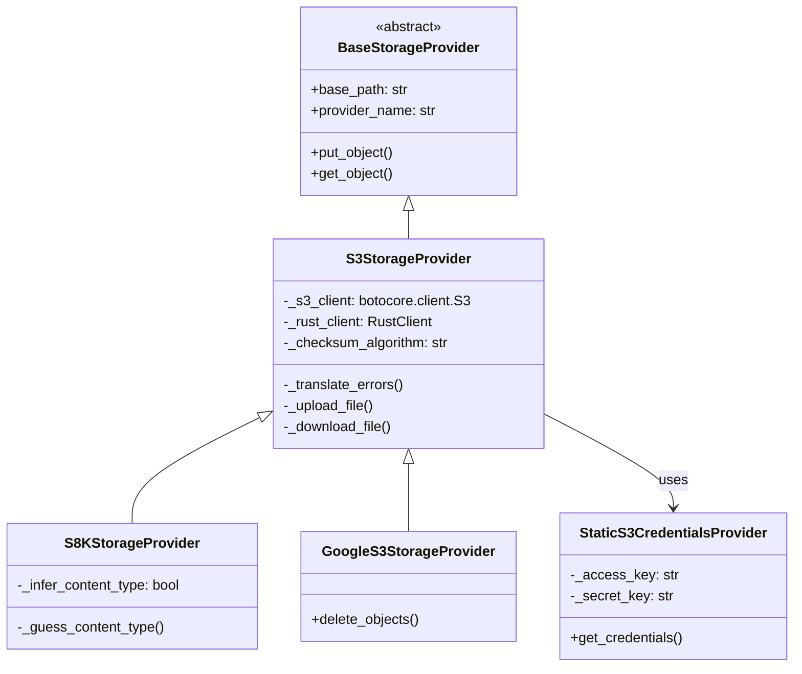
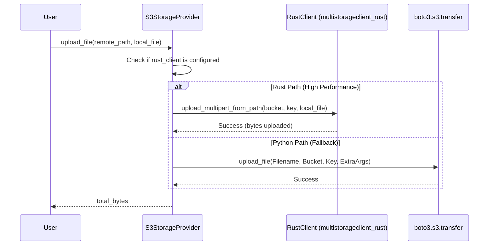

<!-- source: DeepWiki mcp.deepwiki.com · repo NVIDIA/multi-storage-client · extra page AWS S3 Provider · fetched 2026-10-26 -->

# AWS S3 Provider

Relevant source files

The following files were used as context for generating this wiki page:

- [multi-storage-client/src/multistorageclient/constants.py](multi-storage-client/src/multistorageclient/constants.py)
- [multi-storage-client/src/multistorageclient/providers/gcs.py](multi-storage-client/src/multistorageclient/providers/gcs.py)
- [multi-storage-client/src/multistorageclient/providers/gcs_s3.py](multi-storage-client/src/multistorageclient/providers/gcs_s3.py)
- [multi-storage-client/src/multistorageclient/providers/s3.py](multi-storage-client/src/multistorageclient/providers/s3.py)
- [multi-storage-client/src/multistorageclient/providers/s8k.py](multi-storage-client/src/multistorageclient/providers/s8k.py)
- [multi-storage-client/tests/test_multistorageclient/unit/providers/test_s3_checksum_algorithm.py](multi-storage-client/tests/test_multistorageclient/unit/providers/test_s3_checksum_algorithm.py)
- [multi-storage-client/tests/test_multistorageclient/unit/providers/test_s3_error_translation.py](multi-storage-client/tests/test_multistorageclient/unit/providers/test_s3_error_translation.py)

## Purpose and Scope

The AWS S3 Provider implements the storage provider interface for Amazon S3 and S3-compatible object stores (e.g., MinIO, SwiftStack, GCS via S3 interface). It enables the `multi-storage-client` to interact with S3 buckets through a consistent interface, supporting operations like reading, writing, copying, and deleting objects, as well as retrieving metadata and listing objects. The provider includes a high-performance Rust-accelerated path for large transfers and specific support for S3-compatible backends like `s8k` and `gcs_s3`.

Sources: [src/multistorageclient/providers/s3.py:143-146](), [src/multistorageclient/providers/s8k.py:24-28](), [src/multistorageclient/providers/gcs_s3.py:21-24]()

## Class Structure

The S3 provider ecosystem consists of the primary `S3StorageProvider` and specialized subclasses for S3-compatible storage.

Sources: 
- [src/multistorageclient/providers/s3.py:74-83]()
- [src/multistorageclient/providers/s3.py:143-158]()
- [src/multistorageclient/providers/s8k.py:24-37]()
- [src/multistorageclient/providers/gcs_s3.py:21-38]()

## Implementation Details

### Rust-Accelerated Transfer Path
For high-performance requirements, the `S3StorageProvider` can utilize a `RustClient` (from `multistorageclient_rust`) to handle multipart uploads and downloads. This path is triggered when `rust_client` options are provided in the configuration and no complex `ExtraArgs` (like custom ACLs) are present that require the Python `boto3` layer.

Key functions for Rust integration:
- `run_async_rust_client_method`: Bridges Python sync calls to the async Rust backend [src/multistorageclient/rust_utils.py:44-54]().
- `_upload_file`: Routes to `rust_client.upload_multipart_from_path` if conditions are met [src/multistorageclient/providers/s3.py:596-610]().

### Checksum Support
The provider supports S3's additional checksum algorithms (CRC32, CRC32C, SHA1, SHA256, CRC64NVME).
- **Validation**: `_validate_checksum_algorithm` ensures the algorithm is supported by AWS [src/multistorageclient/providers/s3.py:255-267]().
- **Rust Limitation**: The Rust backend currently only supports `SHA256` for checksummed uploads [src/multistorageclient/providers/s3.py:207-209]().

### Presigned URLs
The `S3URLSigner` generates temporary URLs for GET/PUT operations using the underlying S3 client's `generate_presigned_url` method [src/multistorageclient/providers/s3.py:132-140]().

Sources: 
- [src/multistorageclient/providers/s3.py:71-71]()
- [src/multistorageclient/providers/s3.py:116-140]()
- [src/multistorageclient/providers/s3.py:596-610]()

## Data Flow: Large File Upload

The following diagram illustrates how the provider decides between the standard Python path and the Rust-accelerated path.

Sources: 
- [src/multistorageclient/providers/s3.py:570-627]()
- [src/multistorageclient/rust_utils.py:44-54]()

## S3-Compatible Variants

### SwiftStack (s8k)
The `S8KStorageProvider` adds specialized behavior for SwiftStack backends:
- **Content-Type Inference**: Automatically guesses MIME types based on file extensions (e.g., `.wav` to `audio/x-wav`) if `infer_content_type` is enabled [src/multistorageclient/providers/s8k.py:69-84]().
- **Retry Mode**: Forces `legacy` retry mode to handle HTTP 429 errors specific to SwiftStack [src/multistorageclient/providers/s8k.py:62-62]().

### GCS S3 Interface (gcs_s3)
The `GoogleS3StorageProvider` adapts the S3 provider for Google Cloud Storage's XML API:
- **Checksum Restriction**: Explicitly disables `checksum_algorithm` as GCS S3 does not support these specific S3 headers [src/multistorageclient/providers/gcs_s3.py:28-29]().
- **Bulk Deletion**: Overrides `_delete_objects` to perform individual deletes because GCS S3 does not support the S3 Bulk Delete API [src/multistorageclient/providers/gcs_s3.py:39-48]().

Sources:
- [src/multistorageclient/providers/s8k.py:57-67]()
- [src/multistorageclient/providers/gcs_s3.py:26-38]()

## Error Translation

The `_translate_errors` method maps `botocore` and `RustClient` exceptions to internal `multistorageclient` types.

| Source Exception | Condition | Translated Exception |
| :--- | :--- | :--- |
| `ClientError` | HTTP 404 (NoSuchKey) | `FileNotFoundError` |
| `ClientError` | HTTP 412 (PreconditionFailed) | `PreconditionFailedError` |
| `ClientError` | HTTP 429 / 503 | `RetryableError` |
| `RustRetryableError` | Connection Reset / Timeout | `RetryableError` |
| `IncompleteReadError` | Partial data transfer | `RetryableError` |

Sources: [src/multistorageclient/providers/s3.py:283-356](), [tests/test_multistorageclient/unit/providers/test_s3_error_translation.py:78-173]()

## Configuration Options

| Parameter | Type | Default | Description |
| :--- | :--- | :--- | :--- |
| `multipart_threshold` | `int` | 64 MiB | Threshold for switching to multipart logic [src/multistorageclient/providers/s3.py:60]() |
| `multipart_chunksize` | `int` | 32 MiB | Size of parts in multipart operations [src/multistorageclient/providers/s3.py:61]() |
| `checksum_algorithm` | `str` | `None` | One of CRC32, CRC32C, SHA1, SHA256, CRC64NVME [src/multistorageclient/providers/s3.py:71]() |
| `rust_client` | `dict` | `None` | Configuration for the Rust-accelerated backend [src/multistorageclient/providers/s3.py:196]() |
| `infer_content_type` | `bool` | `False` | (s8k only) Infer MIME type from extension [src/multistorageclient/providers/s8k.py:59]() |

Sources:
- [src/multistorageclient/providers/s3.py:57-65]()
- [src/multistorageclient/providers/s3.py:152-187]()
- [src/multistorageclient/constants.py:20-22]()

---

