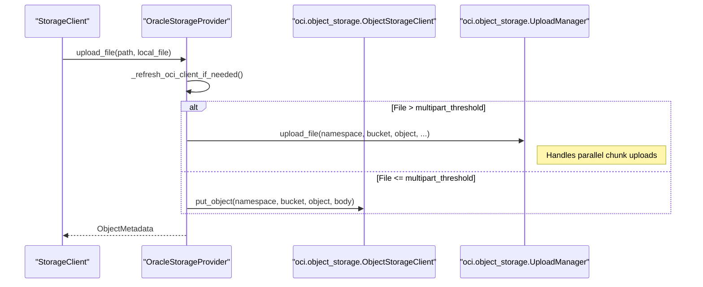

<!-- source: DeepWiki mcp.deepwiki.com · repo NVIDIA/multi-storage-client · extra page Azure and Oracle Providers · fetched 2026-10-26 -->

# Azure and Oracle Providers

<details>
<summary>Relevant source files</summary>

The following files were used as context for generating this wiki page:

- [multi-storage-client/src/multistorageclient/providers/azure.py](multi-storage-client/src/multistorageclient/providers/azure.py)
- [multi-storage-client/tests/test_multistorageclient/e2e/common.py](multi-storage-client/tests/test_multistorageclient/e2e/common.py)
- [multi-storage-client/tests/test_multistorageclient/e2e/test_azure.py](multi-storage-client/tests/test_multistorageclient/e2e/test_azure.py)
- [multi-storage-client/tests/test_multistorageclient/e2e/test_gcs.py](multi-storage-client/tests/test_multistorageclient/e2e/test_gcs.py)
- [multi-storage-client/tests/test_multistorageclient/e2e/test_oci.py](multi-storage-client/tests/test_multistorageclient/e2e/test_oci.py)
- [multi-storage-client/tests/test_multistorageclient/e2e/test_s3.py](multi-storage-client/tests/test_multistorageclient/e2e/test_s3.py)
- [multi-storage-client/tests/test_multistorageclient/e2e/test_swift.py](multi-storage-client/tests/test_multistorageclient/e2e/test_swift.py)
- [multi-storage-client/tests/test_multistorageclient/unit/providers/test_storage_providers.py](multi-storage-client/tests/test_multistorageclient/unit/providers/test_storage_providers.py)

</details>


## Introduction

This page documents the Azure Blob Storage and Oracle Cloud Infrastructure (OCI) Object Storage providers. These implementations allow the `StorageClient` to interact with Azure and OCI backends using the unified `StorageProvider` interface. Both providers support standard object operations, specialized authentication patterns (such as SAS for Azure), and integrated telemetry.

Sources: [src/multistorageclient/providers/azure.py:16-49](), [src/multistorageclient/providers/oci.py:16-50]()

## Provider Architecture

The following diagram maps the relationship between the base abstraction and the specific implementations for Azure and OCI, including their credential handling strategies.

```mermaid
classDiagram
    class "BaseStorageProvider" as BaseStorageProvider {
        [src/multistorageclient/providers/base.py]
        +put_object(path, body, ...)
        +get_object(path, range, ...)
        +list_objects(path, ...)
        +get_object_metadata(path)
    }

    class "AzureBlobStorageProvider" as AzureBlobStorageProvider {
        [src/multistorageclient/providers/azure.py]
        -_blob_service_client: BlobServiceClient
        -_account_url: str
        -_generate_presigned_url()
        -_refresh_blob_service_client_if_needed()
    }

    class "OracleStorageProvider" as OracleStorageProvider {
        [src/multistorageclient/providers/oci.py]
        -_oci_client: ObjectStorageClient
        -_upload_manager: UploadManager
        -_namespace: str
        -_refresh_oci_client_if_needed()
    }

    class "StaticAzureCredentialsProvider" as StaticAzureCredentialsProvider {
        [src/multistorageclient/providers/azure.py]
        -_connection: str
        +get_credentials()
    }

    BaseStorageProvider <|-- AzureBlobStorageProvider
    BaseStorageProvider <|-- OracleStorageProvider
    AzureBlobStorageProvider ..> StaticAzureCredentialsProvider : uses
```

Sources: [src/multistorageclient/providers/azure.py:49-55](), [src/multistorageclient/providers/azure.py:160-187](), [src/multistorageclient/providers/oci.py:52-86]()

## Azure Blob Storage Provider

The `AzureBlobStorageProvider` [src/multistorageclient/providers/azure.py:218-223]() utilizes the `azure-storage-blob` SDK. It maps logical paths to Azure containers and blobs.

### Authentication Patterns
Azure support includes three primary authentication methods:
1.  **Connection String**: Handled via `StaticAzureCredentialsProvider` [src/multistorageclient/providers/azure.py:160-187]().
2.  **Default Azure Credential**: Managed via `DefaultAzureCredentialsProvider` [src/multistorageclient/providers/azure.py:188-216](), which supports Managed Identity and Workload Identity.
3.  **SAS (Shared Access Signature)**: The `AzureURLSigner` [src/multistorageclient/providers/azure.py:102-158]() generates time-limited URLs. It supports both Account Keys and User Delegation Keys [src/multistorageclient/providers/azure.py:110-112]().

### Implementation Details
- **Multipart Uploads**: Azure uses a threshold of 64 MiB (`MULTIPART_THRESHOLD`) and chunk sizes of 32 MiB (`MULTIPART_CHUNKSIZE`) [src/multistorageclient/providers/azure.py:59-60]().
- **Content-MD5**: Azure REST API limits `Content-MD5` validation to ranges $\le$ 4 MiB [src/multistorageclient/providers/azure.py:64-66]().
- **Presigned URLs**: `generate_presigned_url` requires the `x-ms-blob-type: BlockBlob` header for `PUT` operations [tests/test_multistorageclient/e2e/test_azure.py:89-91]().

Sources: [src/multistorageclient/providers/azure.py:59-66](), [src/multistorageclient/providers/azure.py:102-158](), [tests/test_multistorageclient/e2e/test_azure.py:86-118]()

## Oracle Storage Provider

The `OracleStorageProvider` [src/multistorageclient/providers/oci.py:52-57]() implements support for OCI Object Storage using the `oci` Python SDK.

### Key Components and Data Flow



### OCI Specifics
- **Namespace**: Every OCI provider instance is bound to a specific OCI `namespace` [src/multistorageclient/providers/oci.py:65-68]().
- **Multipart Logic**: It uses a default `multipart_threshold` of 512 MiB and `multipart_chunksize` of 256 MiB [src/multistorageclient/providers/oci.py:44-48]().
- **Conditional Writes**: OCI supports `if-match` and `if-none-match: "*"` (to prevent overwrites), translating failures into `PreconditionFailedError` [tests/test_multistorageclient/e2e/test_oci.py:43-51]().

Sources: [src/multistorageclient/providers/oci.py:44-48](), [src/multistorageclient/providers/oci.py:65-86](), [tests/test_multistorageclient/e2e/test_oci.py:37-52]()

## Error Handling and Behavioral Differences

Both providers translate vendor-specific exceptions into the library's internal exception types defined in `multistorageclient.types`.

| Feature | Azure Behavior | Oracle (OCI) Behavior |
| :--- | :--- | :--- |
| **Over-write Protection** | Does not support `if-none-match="*"`; raises `RuntimeError` [tests/test_multistorageclient/e2e/test_azure.py:48-55](). | Supports `if-none-match="*"`; raises `PreconditionFailedError` [tests/test_multistorageclient/e2e/test_oci.py:43-51](). |
| **ETag Mismatch** | Raises `PreconditionFailedError` (412) [tests/test_multistorageclient/e2e/test_azure.py:46-47](). | Raises `PreconditionFailedError` (412) [tests/test_multistorageclient/e2e/test_oci.py:43-51](). |
| **Metadata Prefix** | Uses `msc_` prefix for custom attributes [tests/test_multistorageclient/e2e/test_azure.py:65-69](). | Uses `msc_` prefix for custom attributes [tests/test_multistorageclient/e2e/test_oci.py:55-59](). |
| **Presigned URL** | Requires `x-ms-blob-type` header for `PUT` [tests/test_multistorageclient/e2e/test_azure.py:105-111](). | Standard HTTP `PUT` [tests/test_multistorageclient/e2e/test_oci.py:23-35](). |

Sources: [tests/test_multistorageclient/e2e/test_azure.py:41-56](), [tests/test_multistorageclient/e2e/test_oci.py:37-52](), [src/multistorageclient/providers/azure.py:287-300](), [src/multistorageclient/providers/oci.py:252-265]()

---

