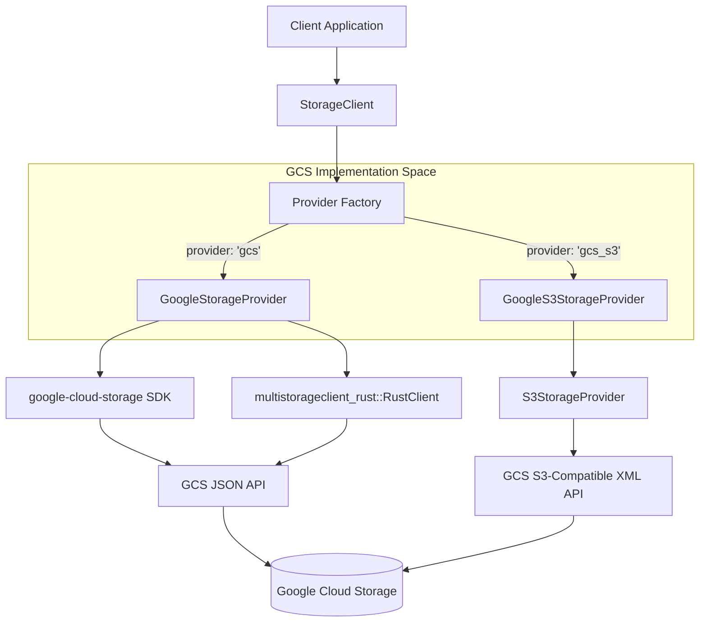
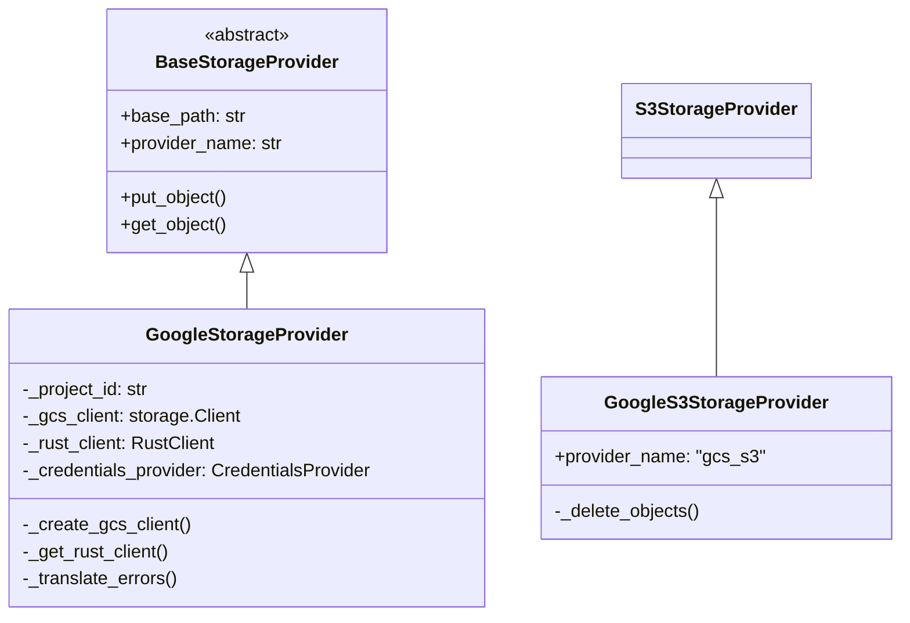

<!-- source: DeepWiki mcp.deepwiki.com · repo NVIDIA/multi-storage-client · extra page Google Cloud Storage Provider · fetched 2026-10-26 -->

# Google Cloud Storage Provider

Relevant source files

The following files were used as context for generating this wiki page:

- [multi-storage-client/src/multistorageclient/constants.py](multi-storage-client/src/multistorageclient/constants.py)
- [multi-storage-client/src/multistorageclient/providers/gcs.py](multi-storage-client/src/multistorageclient/providers/gcs.py)
- [multi-storage-client/src/multistorageclient/providers/gcs_s3.py](multi-storage-client/src/multistorageclient/providers/gcs_s3.py)
- [multi-storage-client/src/multistorageclient/providers/s3.py](multi-storage-client/src/multistorageclient/providers/s3.py)
- [multi-storage-client/tests/test_multistorageclient/unit/providers/test_s3_error_translation.py](multi-storage-client/tests/test_multistorageclient/unit/providers/test_s3_error_translation.py)

This page documents the Google Cloud Storage (GCS) provider implementation in `multi-storage-client`, which enables interaction with Google Cloud Storage buckets and objects via native GCS APIs or the S3-compatible interface.

## Overview

The GCS implementation provides two distinct paths for interacting with Google Cloud Storage:
1.  **Native GCS Provider (`GoogleStorageProvider`)**: Uses the official `google-cloud-storage` Python SDK and a high-performance Rust-based backend for data transfers.
2.  **S3-Compatible GCS Provider (`GoogleS3StorageProvider`)**: Leverages the GCS S3-interoperability layer, allowing GCS to be treated as an S3 backend with specific GCS-specific adjustments.

Sources: [src/multistorageclient/providers/gcs.py:151-154](), [src/multistorageclient/providers/gcs_s3.py:21-24]()

## Architecture

### Provider Selection and Data Flow

The `multi-storage-client` selects between the native GCS implementation and the S3-compatible wrapper based on the `provider` string in the configuration (`gcs` vs `gcs_s3`).

Sources: [src/multistorageclient/providers/gcs.py:60-61](), [src/multistorageclient/providers/gcs_s3.py:18-19](), [src/multistorageclient/providers/gcs.py:188-193]()

### Native GCS Provider Internal Structure

The `GoogleStorageProvider` inherits from `BaseStorageProvider` and integrates with both the Google Python SDK for metadata/management and a Rust client for high-throughput data movement.

Sources: [src/multistorageclient/providers/gcs.py:151-156](), [src/multistorageclient/providers/gcs_s3.py:21-24]()

## Authentication

GCS supports several authentication mechanisms via the `CredentialsProvider` interface.

### Service Account Authentication
The `GoogleServiceAccountCredentialsProvider` allows using a JSON key file or a dictionary containing service account info.
*   **Source**: [src/multistorageclient/providers/gcs.py:112-149]()
*   **Key Function**: `get_credentials()` returns a `Credentials` object with the JSON info stored in `custom_fields`. [src/multistorageclient/providers/gcs.py:138-145]()

### Identity Pool Authentication
The `GoogleIdentityPoolCredentialsProvider` facilitates workload identity federation by providing an audience and a token supplier.
*   **Source**: [src/multistorageclient/providers/gcs.py:84-110]()

### Client Initialization
The `_create_gcs_client` method handles the conversion of MSC `Credentials` into Google-specific credential objects (`service_account.Credentials` or `OAuth2Credentials`).
*   **Call Site**: `GoogleStorageProvider.__init__` calls `_create_gcs_client`. [src/multistorageclient/providers/gcs.py:188-188]()
*   **Implementation**: [src/multistorageclient/providers/gcs.py:768-809]()

## Native GCS Provider (`gcs`)

### Configuration Parameters

| Parameter | Default | Description |
| :--- | :--- | :--- |
| `project_id` | `GOOGLE_CLOUD_PROJECT_ID` | GCP Project ID. [src/multistorageclient/providers/gcs.py:158]() |
| `multipart_threshold` | 64 MiB | Threshold for switching to multipart/chunked transfers. [src/multistorageclient/providers/gcs.py:64]() |
| `multipart_chunksize` | 32 MiB | Size of chunks for transfers. [src/multistorageclient/providers/gcs.py:65]() |
| `max_concurrency` | 8 | Concurrency limit for Python-based transfers. [src/multistorageclient/providers/gcs.py:67]() |

### Rust-Accelerated Transfers
If a `RustClient` is provided or initialized, `GoogleStorageProvider` offloads `upload_file` and `download_file` to the Rust backend for performance.
*   **Upload**: `_upload_file` uses `run_async_rust_client_method` with `upload_multipart_from_path`. [src/multistorageclient/providers/gcs.py:530-538]()
*   **Download**: `_download_file` uses `download_to_path`. [src/multistorageclient/providers/gcs.py:642-648]()

### Error Translation
The `_translate_errors` decorator maps Google API exceptions to MSC standard exceptions:
*   `google.api_core.exceptions.NotFound` -> `FileNotFoundError`. [src/multistorageclient/providers/gcs.py:146-148]()
*   `google.api_core.exceptions.PreconditionFailed` -> `PreconditionFailedError`. [src/multistorageclient/providers/gcs.py:150-152]()
*   `google.cloud.storage.exceptions.InvalidResponse` (304) -> `NotModifiedError`. [src/multistorageclient/providers/gcs.py:154-156]()

Sources: [src/multistorageclient/providers/gcs.py:143-171]()

## S3-Compatible GCS Provider (`gcs_s3`)

The `GoogleS3StorageProvider` is a specialized version of the `S3StorageProvider`. It is used when users want to interact with GCS via the XML API but need to account for specific GCS limitations.

### Key Differences from Standard S3
1.  **No Bulk Deletion**: GCS S3-compatible interface does not support the standard S3 `DeleteObjects` (bulk) operation. The implementation overrides `_delete_objects` to perform individual deletions. [src/multistorageclient/providers/gcs_s3.py:39-48]()
2.  **Checksum Constraints**: Checksum algorithms are explicitly disabled for `gcs_s3` as they are not supported in the same manner as AWS S3. [src/multistorageclient/providers/gcs_s3.py:28-29]()
3.  **Mandatory Checksum Behavior**: `request_checksum_calculation` and `response_checksum_validation` are forced to `"when_required"`. [src/multistorageclient/providers/gcs_s3.py:31-32]()

Sources: [src/multistorageclient/providers/gcs_s3.py:21-37]()

## Implementation Details

### Path Splitting
Both providers use `split_path` to decompose MSC paths into bucket names and object keys.
*   **Example**: `gs://my-bucket/my-key` -> `bucket="my-bucket"`, `key="my-key"`. [src/multistorageclient/providers/gcs.py:206-207]()

### Metadata Mapping
The `_get_object_metadata` method maps GCS `Blob` properties to the MSC `ObjectMetadata` structure.
*   `blob.updated` -> `last_modified`. [src/multistorageclient/providers/gcs.py:382]()
*   `blob.etag` -> `etag`. [src/multistorageclient/providers/gcs.py:383]()
*   `blob.size` -> `size`. [src/multistorageclient/providers/gcs.py:384]()

Sources: [src/multistorageclient/providers/gcs.py:366-391]()

### Directory Simulation
GCS is a flat namespace. The provider simulates directories by checking for a trailing slash or using the `prefix` and `delimiter` parameters in `list_blobs`.
*   **Directory Check**: `_is_dir` verifies if a prefix exists by performing a limited list operation. [src/multistorageclient/providers/gcs.py:288-305]()

Sources: [src/multistorageclient/providers/gcs.py:307-364]()

---

