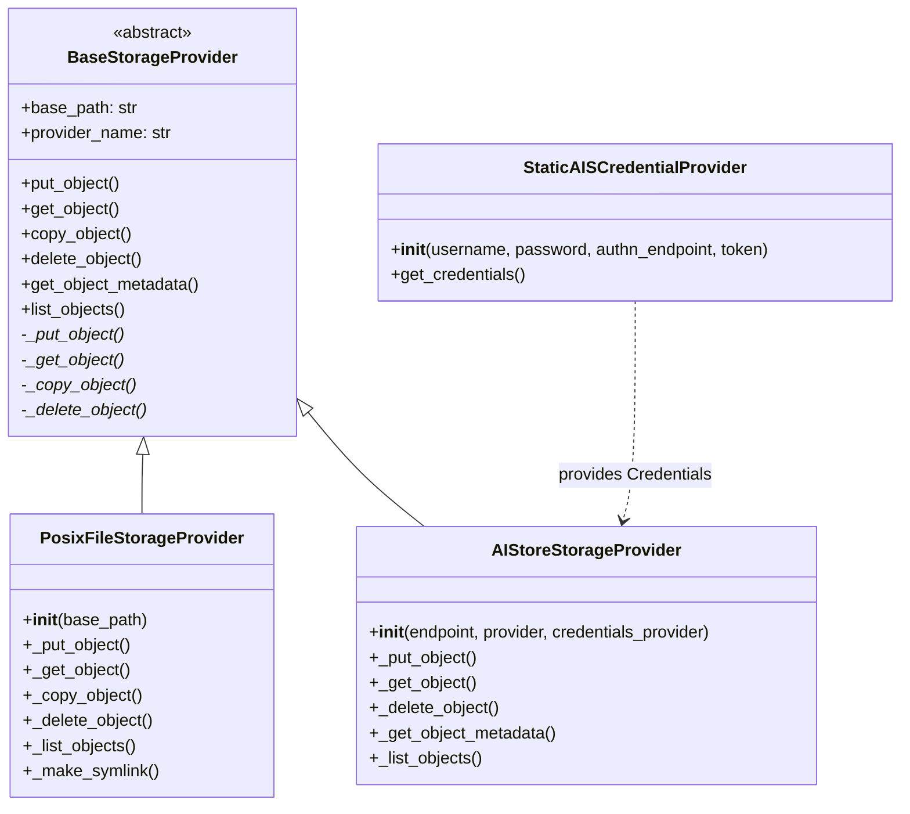
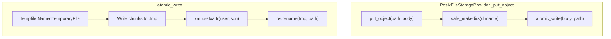
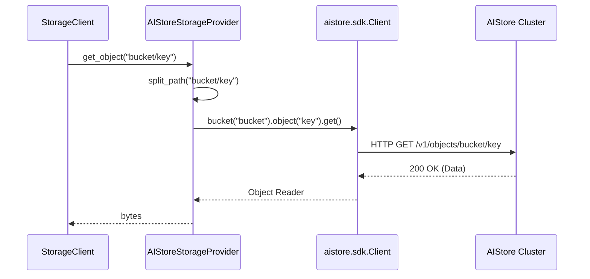

<!-- source: DeepWiki mcp.deepwiki.com · repo NVIDIA/multi-storage-client · extra page POSIX and AIStore Providers · fetched 2026-10-26 -->

# POSIX and AIStore Providers

<details>
<summary>Relevant source files</summary>

The following files were used as context for generating this wiki page:

- [multi-storage-client/src/multistorageclient/cache.py](multi-storage-client/src/multistorageclient/cache.py)
- [multi-storage-client/src/multistorageclient/providers/ais.py](multi-storage-client/src/multistorageclient/providers/ais.py)
- [multi-storage-client/src/multistorageclient/providers/huggingface.py](multi-storage-client/src/multistorageclient/providers/huggingface.py)
- [multi-storage-client/src/multistorageclient/providers/oci.py](multi-storage-client/src/multistorageclient/providers/oci.py)
- [multi-storage-client/src/multistorageclient/providers/posix_file.py](multi-storage-client/src/multistorageclient/providers/posix_file.py)
- [multi-storage-client/tests/test_multistorageclient/e2e/test_huggingface.py](multi-storage-client/tests/test_multistorageclient/e2e/test_huggingface.py)
- [multi-storage-client/tests/test_multistorageclient/unit/providers/test_parallel_listing.py](multi-storage-client/tests/test_multistorageclient/unit/providers/test_parallel_listing.py)
- [multi-storage-client/tests/test_multistorageclient/unit/providers/test_posix_file.py](multi-storage-client/tests/test_multistorageclient/unit/providers/test_posix_file.py)
- [multi-storage-client/tests/test_multistorageclient/unit/providers/test_symlinks.py](multi-storage-client/tests/test_multistorageclient/unit/providers/test_symlinks.py)
- [multi-storage-client/tests/test_multistorageclient/unit/test_cache.py](multi-storage-client/tests/test_multistorageclient/unit/test_cache.py)
- [multi-storage-client/tests/test_multistorageclient/unit/test_partial_file_caching.py](multi-storage-client/tests/test_multistorageclient/unit/test_partial_file_caching.py)

</details>


This document describes the POSIX file system provider and AIStore provider implementations in the multi-storage-client. These providers allow the storage client to interact with local file systems (POSIX) and NVIDIA's AIStore distributed object storage system, respectively.

## Provider Architecture Overview

The POSIX and AIStore providers implement the `BaseStorageProvider` interface, allowing them to be used interchangeably within the `StorageClient` facade.

### Class Relationship Diagram



Sources: [src/multistorageclient/providers/posix_file.py:92-122](), [src/multistorageclient/providers/ais.py:98-158](), [src/multistorageclient/providers/ais.py:49-92]()

## POSIX File Storage Provider

The `PosixFileStorageProvider` enables interaction with local POSIX-compliant file systems. It maps object storage concepts (buckets/keys) to local directory structures.

### Key Features
- **Atomic Writes**: Uses temporary files and `os.rename` to ensure files are fully written or not at all [src/multistorageclient/providers/posix_file.py:59-89]().
- **Symlink Support**: Implements `_make_symlink` to create relative symlinks on the local filesystem [src/multistorageclient/providers/posix_file.py:191-201]().
- **Metadata**: Stores object metadata in extended attributes (`user.json` xattr) [src/multistorageclient/providers/posix_file.py:85-87]().
- **Parallel Listing**: Supports optimized parallel recursive listing via a heap-based BFS walk [src/multistorageclient/providers/posix_file.py:231-274]().

### Data Flow: Atomic Write



Sources: [src/multistorageclient/providers/posix_file.py:146-159](), [src/multistorageclient/providers/posix_file.py:59-89]()

### Parallel Listing Implementation
The POSIX provider overrides `_list_objects` to handle both flat and recursive listing. For recursive listing, it uses a generator-based approach that yields `ObjectMetadata` for every file found under the base path, sorted by key [src/multistorageclient/providers/posix_file.py:231-274]().

## AIStore Storage Provider

The `AIStoreStorageProvider` integrates with NVIDIA's AIStore. It handles bucket/object lifecycle and supports AIStore-specific features like custom properties.

### Authentication and Credentials
AIStore authentication is managed via `StaticAISCredentialProvider`, which can perform a login against an AIStore `AuthN` endpoint to retrieve a token [src/multistorageclient/providers/ais.py:89-92]().

### AIStore Operation Flow



Sources: [src/multistorageclient/providers/ais.py:224-240](), [src/multistorageclient/providers/ais.py:160-189]()

### AIStore Specific Features
- **Manifest Generation**: While handled largely in the FUSE layer (MSFS), the AIStore provider supports listing objects with custom properties which are used to build manifests [src/multistorageclient/providers/ais.py:277-310]().
- **Error Translation**: The provider translates `AISError` (like 404) into standard Python `FileNotFoundError` for consistency [src/multistorageclient/providers/ais.py:180-185]().

## Symlink Handling Across Providers

MSC provides a unified symlink interface. For POSIX, these are native symlinks. For object stores (like AIStore or S3), symlinks are represented as zero-byte objects with a specific metadata attribute `msc-symlink-target` [tests/test_multistorageclient/unit/providers/test_symlinks.py:44-48]().

| Feature | POSIX Provider Implementation | AIStore Provider Implementation |
| :--- | :--- | :--- |
| **Creation** | `os.symlink` (relative) [src/multistorageclient/providers/posix_file.py:194-196]() | Object with `msc-symlink-target` attr [src/multistorageclient/providers/ais.py:258-275]() |
| **Detection** | `os.path.islink` [src/multistorageclient/providers/posix_file.py:209-211]() | Check for `msc-symlink-target` in props [src/multistorageclient/providers/ais.py:277-310]() |
| **Resolution** | Native OS resolution | Metadata-based target extraction |

## Configuration Examples

### POSIX Provider
```yaml
profiles:
  local_data:
    storage_provider:
      type: file
      options:
        base_path: /mnt/data/storage
```

### AIStore Provider
```yaml
profiles:
  ais_data:
    storage_provider:
      type: ais
      options:
        endpoint: "http://ais-gateway:8080"
        base_path: "my-ais-bucket"
    credentials_provider:
      type: ais
      options:
        token: "your-auth-token"
```

Sources: [src/multistorageclient/providers/posix_file.py:97-108](), [src/multistorageclient/providers/ais.py:103-131]()

## Summary of Implementation Differences

| Feature | POSIX Provider | AIStore Provider |
| :--- | :--- | :--- |
| **Copy Object** | `os.rename` or file-to-file copy [src/multistorageclient/providers/posix_file.py:173-182]() | Not supported (AttributeError) [src/multistorageclient/providers/ais.py:242-256]() |
| **Atomic Writes** | Temporary file + Rename [src/multistorageclient/providers/posix_file.py:59-89]() | Native AIStore PUT atomicity |
| **Listing** | `os.walk` (Parallel BFS) [src/multistorageclient/providers/posix_file.py:231-274]() | `bucket.list_objects` (Paged) [src/multistorageclient/providers/ais.py:277-310]() |
| **Metadata** | Extended Attributes (xattr) [src/multistorageclient/providers/posix_file.py:85-87]() | AIStore Custom Properties [src/multistorageclient/providers/ais.py:214-222]() |

Sources: [src/multistorageclient/providers/posix_file.py:1-286](), [src/multistorageclient/providers/ais.py:1-315]()

---

