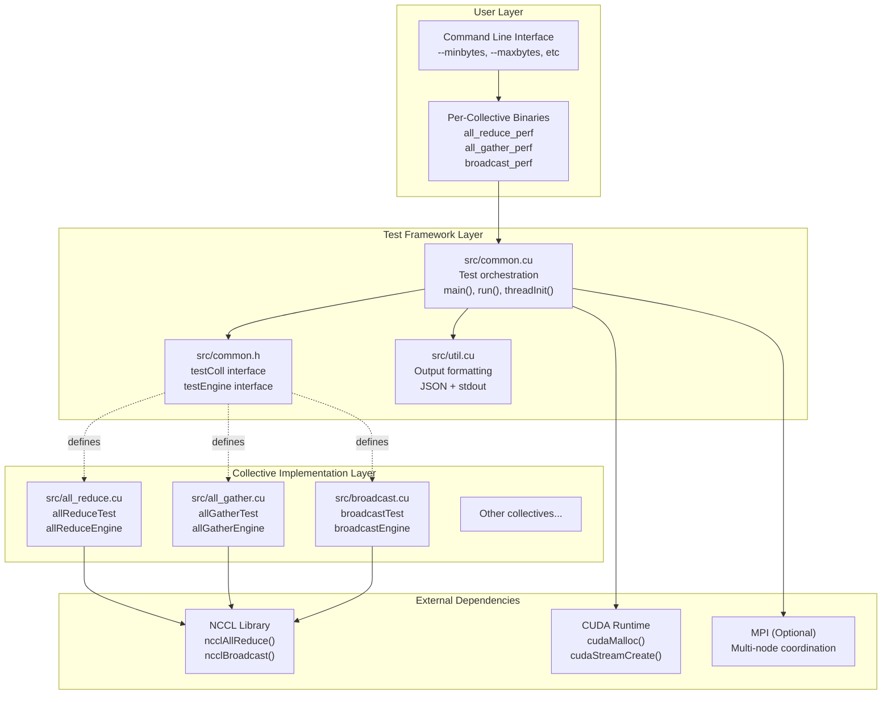
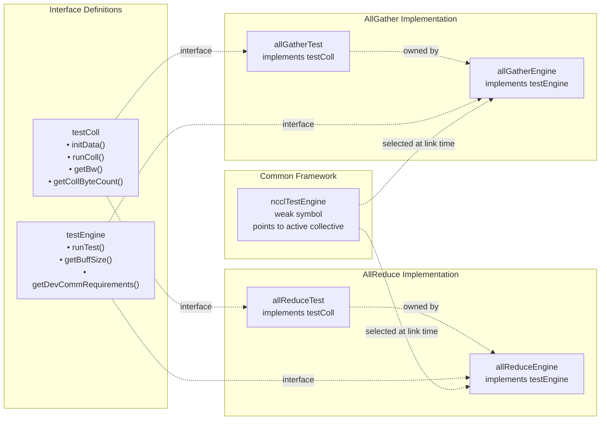
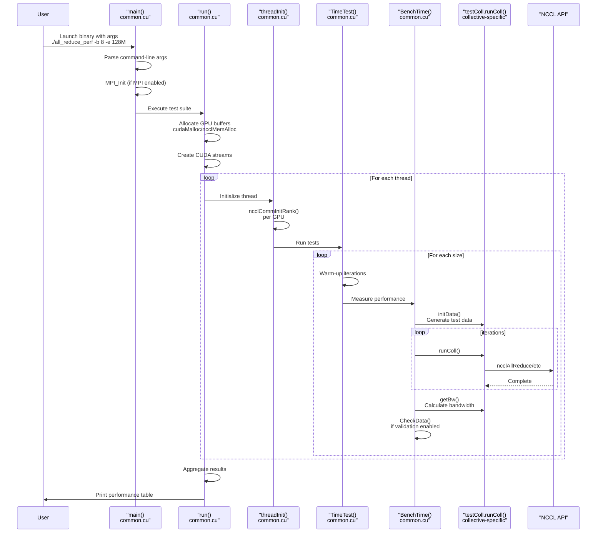
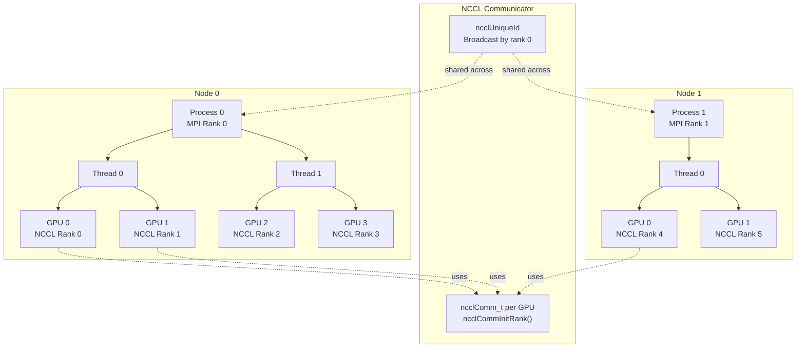

<!-- source: DeepWiki mcp.deepwiki.com · repo NVIDIA/nccl-tests · page 1 Overview · fetched 2026-10-26 -->

# Overview

<details>
<summary>Relevant source files</summary>

The following files were used as context for generating this wiki page:

- [README.md](README.md)
- [doc/PERFORMANCE.md](doc/PERFORMANCE.md)
- [src/common.cu](src/common.cu)

</details>


NCCL Tests is a performance benchmarking and correctness validation suite for the NVIDIA Collective Communications Library (NCCL). It provides standalone test binaries for measuring bandwidth, latency, and data correctness of NCCL collective communication operations across multiple GPUs, processes, and nodes.

For build instructions and dependencies, see [Installation and Build](#1.1). For command-line usage, see [Command Line Arguments](#1.2). For detailed architectural patterns, see [System Architecture](#1.3).

## Purpose and Scope

NCCL Tests serves three primary functions:

1. **Performance Measurement**: Quantifies bandwidth (algorithmic and bus bandwidth) and latency for collective operations across varying message sizes
2. **Correctness Validation**: Verifies that collective operations produce mathematically correct results using deterministic data generation
3. **Scalability Testing**: Supports testing from single-GPU scenarios to multi-node clusters with thousands of GPUs using MPI

The test suite is designed for system administrators, NCCL developers, and performance engineers who need to validate NCCL functionality and measure communication performance on GPU clusters.

Sources: [README.md:1-5](), [doc/PERFORMANCE.md:1-4]()

## Core Components

The NCCL Tests architecture consists of four primary layers:



**Figure 1: High-Level System Architecture**

Sources: [src/common.cu:1-30](), [src/common.h](), [README.md:1-20]()

### Framework Core

The framework core in `src/common.cu` provides the main test execution engine. Key functions include:

| Function | Purpose | Lines |
|----------|---------|-------|
| `main()` | Entry point, argument parsing, MPI initialization | [src/common.cu:818-1103]() |
| `run()` | Main test orchestration, buffer allocation, thread management | [src/common.cu:1125-1438]() |
| `threadInit()` | Per-thread NCCL communicator initialization | [src/common.cu:722-791]() |
| `threadRunTests()` | Executes tests for all data types and sizes | [src/common.cu:713-720]() |
| `BenchTime()` | Measures performance for a single configuration | [src/common.cu:523-669]() |
| `TimeTest()` | Orchestrates warm-up and benchmark iterations | [src/common.cu:685-711]() |

Sources: [src/common.cu:818-1438]()

### Plugin Architecture

Each collective operation implements two interfaces defined in `src/common.h`:



**Figure 2: Collective Operation Plugin System**

The framework invokes `ncclTestEngine.runTest()` without knowing which specific collective is being tested. Each binary contains exactly one collective implementation, selected at link time through weak symbol binding.

Sources: [src/common.h](), [src/common.cu:718]()

## Generated Binaries

The build system generates individual binaries for each collective operation:

| Binary | Collective Operation | Primary Source |
|--------|---------------------|----------------|
| `all_reduce_perf` | AllReduce | [src/all_reduce.cu]() |
| `all_gather_perf` | AllGather | [src/all_gather.cu]() |
| `alltoall_perf` | AllToAll | [src/alltoall.cu]() |
| `broadcast_perf` | Broadcast | [src/broadcast.cu]() |
| `reduce_perf` | Reduce | [src/reduce.cu]() |
| `reduce_scatter_perf` | ReduceScatter | [src/reduce_scatter.cu]() |
| `gather_perf` | Gather | [src/gather.cu]() |
| `scatter_perf` | Scatter | [src/scatter.cu]() |
| `sendrecv_perf` | SendRecv (point-to-point) | [src/sendrecv.cu]() |
| `hypercube_perf` | Hypercube pattern | [src/hypercube.cu]() |

Each binary shares common framework code ([src/common.cu](), [src/util.cu](), [src/timer.cc]()) but contains only one collective-specific implementation to minimize binary size.

Sources: [src/Makefile](), [README.md:27-28]()

## Test Execution Flow



**Figure 3: Test Execution Pipeline**

The execution follows a hierarchical pattern:
1. **Process level**: MPI coordinates multiple processes across nodes
2. **Thread level**: Each process spawns multiple test threads
3. **GPU level**: Each thread manages multiple GPUs
4. **Iteration level**: Multiple benchmark iterations per configuration

Each GPU receives a unique **rank** calculated as: `rank = (proc × nThreads + thread) × nGpus + gpu_index`

Sources: [src/common.cu:818-1438](), [src/common.cu:722-791](), [src/common.cu:713-720]()

## Performance Metrics

NCCL Tests reports two bandwidth metrics for each test configuration:

### Algorithm Bandwidth

The raw bandwidth calculated as `size / time`. This directly measures how fast the operation completes but varies with the number of ranks.

```
algbw = S / t
```

Where `S` is message size in bytes and `t` is elapsed time in seconds.

### Bus Bandwidth

A normalized bandwidth that reflects hardware utilization, independent of rank count. Different collectives apply different correction factors:

| Collective | Bus Bandwidth Formula | Factor |
|------------|----------------------|--------|
| AllReduce | `algbw × 2(n-1)/n` | 2(n-1)/n |
| ReduceScatter | `algbw × (n-1)/n` | (n-1)/n |
| AllGather | `algbw × (n-1)/n` | (n-1)/n |
| Broadcast | `algbw × 1` | 1 |
| Reduce | `algbw × 1` | 1 |
| AllToAll | `algbw × (n-1)/n` | (n-1)/n |

Where `n` is the total number of ranks (GPUs participating in the collective).

The bus bandwidth can be compared directly against hardware specifications (NVLink bandwidth, PCIe bandwidth, network bandwidth) to assess utilization efficiency.

Sources: [doc/PERFORMANCE.md:14-143](), [src/common.cu:600-601]()

## Data Validation

When enabled with `-c N`, NCCL Tests performs `N` validation iterations using the `verifiable` subsystem:

1. **Data Generation**: `InitData()` generates deterministic input data based on rank, seed, and offset - [src/common.cu:231-234]()
2. **Expected Results**: `InitDataReduce()` pre-computes expected results based on the reduction operation - [src/common.cu:226-229]()
3. **Verification**: `CheckData()` compares actual GPU results against expected values - [src/common.cu:322-367]()

The verification system uses CUDA kernels from the `verifiable` subsystem to perform element-wise comparisons on the GPU, reporting the count of incorrect elements.

Sources: [src/common.cu:220-367](), [verifiable/verifiable.h]()

## Multi-GPU and Multi-Node Support

NCCL Tests supports three levels of parallelism:



**Figure 4: Multi-Process, Multi-Thread, Multi-GPU Hierarchy**

**Command-line parameters**:
- `-t N` or `--nthreads N`: Threads per process (default: 1) - [src/common.cu:80]()
- `-g N` or `--ngpus N`: GPUs per thread (default: 1) - [src/common.cu:81]()
- MPI process count controlled by `mpirun -np N`

**Total ranks** = `(MPI processes) × (threads per process) × (GPUs per thread)`

Example: `mpirun -np 4 ./all_reduce_perf -t 2 -g 2` creates 16 total NCCL ranks (4 processes × 2 threads × 2 GPUs).

Sources: [src/common.cu:80-81](), [src/common.cu:1125-1200](), [README.md:31-46]()

## Output Formats

NCCL Tests provides dual output formats:

### Console Output (stdout)

Human-readable table format showing per-configuration results:
```
       size         count      type   redop    root     time   algbw   busbw #wrong     time   algbw   busbw #wrong
        (B)    (elements)                               (us)  (GB/s)  (GB/s)            (us)  (GB/s)  (GB/s)
           8             2     float     sum      -1    25.83    0.00    0.00      0    25.35    0.00    0.00      0
          16             4     float     sum      -1    25.76    0.00    0.00      0    25.29    0.00    0.00      0
```

The table includes columns for message size, element count, data type, reduction operation, timing, both bandwidth metrics, and error count. The rightmost columns show results for in-place operations.

### JSON Output

Machine-readable format enabled with `-J output.json` containing structured data for automated analysis - [src/common.cu:161-182]().

Sources: [src/util.cu](), [src/common.cu:161-182]()

## Key Configuration Parameters

Common parameters for controlling test behavior:

| Parameter | Purpose | Default |
|-----------|---------|---------|
| `-b, --minbytes` | Minimum message size | 32 MB |
| `-e, --maxbytes` | Maximum message size | 32 MB |
| `-f, --stepfactor` | Multiplicative step between sizes | 1 (disabled) |
| `-i, --stepbytes` | Additive step between sizes | 1 MB |
| `-n, --iters` | Benchmark iterations | 20 |
| `-w, --warmup_iters` | Warm-up iterations (not timed) | 1 |
| `-c, --check` | Validation iterations | 1 |
| `-o, --op` | Reduction operation (sum/prod/min/max/avg) | sum |
| `-d, --datatype` | Data type (float/int/half/etc) | float |
| `-G, --cudagraph` | CUDA graph launches | 0 (disabled) |
| `-R, --local_register` | Buffer registration (0/1/2) | 0 (disabled) |

For the complete list of arguments, see [Command Line Arguments](#1.2).

Sources: [src/common.cu:79-113](), [README.md:54-85]()

## Advanced Features

### CUDA Graph Support

When enabled with `-G N`, NCCL Tests captures benchmark iterations as a CUDA graph and replays it `N` times, reducing CPU overhead - [src/common.cu:536-598]().

### Buffer Registration

The `-R` flag enables memory registration for RDMA optimization:
- `-R 1`: Local registration (`ncclCommRegister`)
- `-R 2`: Symmetric registration (`ncclCommWindowRegister`)

This is required for device implementations (`-D`) - [src/common.cu:754-768]().

### GPU Partitioning

The `NCCL_TESTS_SPLIT` environment variable enables running multiple independent collective operations in parallel by partitioning ranks into groups. Operations supported: `AND`, `OR`, `MOD`, `DIV` - [README.md:88-104]().

Sources: [src/common.cu:1142-1166](), [README.md:86-104]()

## Related Documentation

- **[Installation and Build](#1.1)**: Build instructions, dependencies, MPI integration
- **[Command Line Arguments](#1.2)**: Complete parameter reference
- **[System Architecture](#1.3)**: Detailed architectural patterns and design decisions
- **[Core Testing Framework](#2)**: In-depth framework implementation details
- **[Collective Operations](#3)**: Individual collective implementations

---

