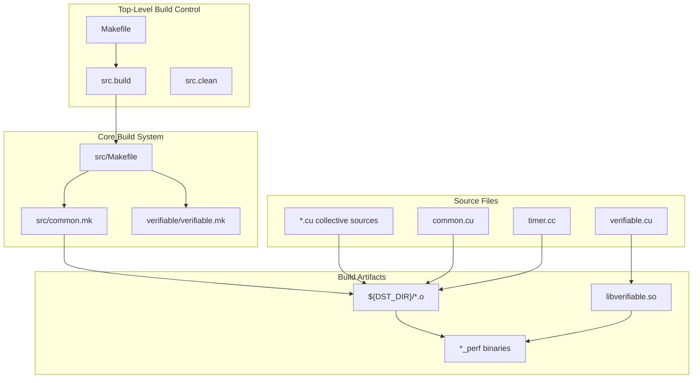
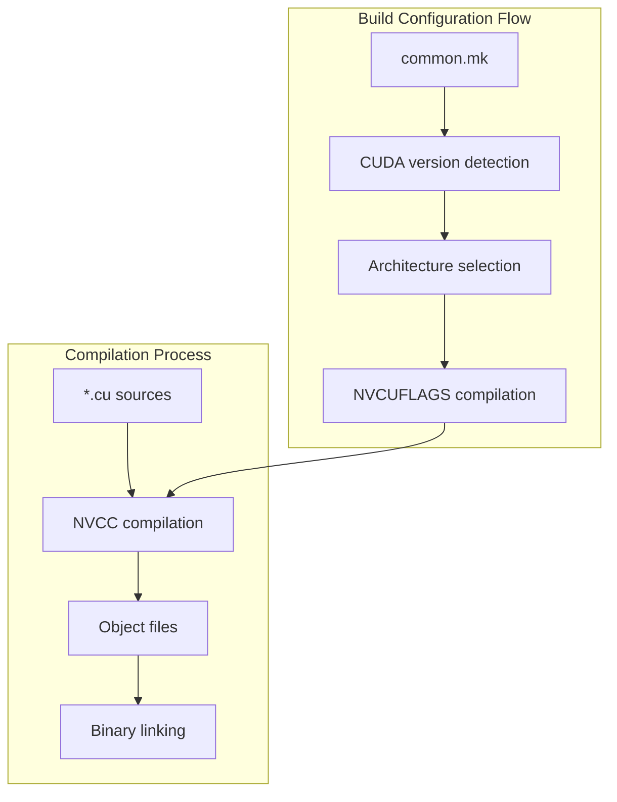
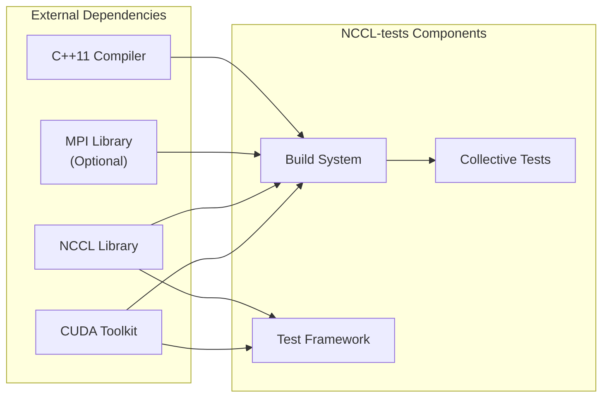

<!-- source: DeepWiki mcp.deepwiki.com · repo NVIDIA/nccl-tests · page 1.1 Installation and Build · fetched 2026-10-26 -->

# Installation and Build

<details>
<summary>Relevant source files</summary>

The following files were used as context for generating this wiki page:

- [LICENSE.txt](LICENSE.txt)
- [Makefile](Makefile)
- [README.md](README.md)
- [doc/PERFORMANCE.md](doc/PERFORMANCE.md)
- [src/Makefile](src/Makefile)
- [src/common.mk](src/common.mk)
- [src/multimem_ops.h](src/multimem_ops.h)
- [src/nccl1_compat.h](src/nccl1_compat.h)

</details>


This document provides detailed instructions for building the NCCL Tests framework from source. NCCL Tests is a comprehensive benchmarking and testing suite designed to measure the performance and verify the correctness of NVIDIA Collective Communications Library (NCCL) operations.

## Prerequisites

Before installing NCCL-tests, ensure you have the following components:

- CUDA Toolkit (version 9.0 or higher recommended)
- NCCL library installed
- GCC/G++ compiler with C++11 support
- GNU Make

For multi-node testing, you'll also need:
- MPI library (OpenMPI, MPICH, etc.)

Sources: [README.md:4-19]()

## Basic Build

The simplest build method requires just a single command:

```bash
make
```

or for parallel compilation:

```bash
make -j
```

This builds all NCCL Tests binaries in the `build` directory. The build process creates performance test executables like `all_reduce_perf`, `broadcast_perf`, and other collective operation tests.

Sources: [README.md:7](), [Makefile:12-20]()

## Build System Architecture



Sources: [Makefile:12-23](), [src/Makefile:6-47](), [src/Makefile:35-38]()

## Advanced Installation Options

### Custom CUDA and NCCL Paths

If CUDA or NCCL are installed in non-standard locations, specify their paths:

```bash
make CUDA_HOME=/path/to/cuda NCCL_HOME=/path/to/nccl
```

The build system uses `CUDA_HOME` to locate CUDA headers and libraries through `common.mk`, and `NCCL_HOME` to add include directories (`-I$(NCCL_HOME)/include/`) and library paths (`-L$(NCCL_HOME)/lib`).

Sources: [README.md:9-13](), [src/Makefile:18-21]()

### MPI Support

To enable multi-node testing capabilities, compile with MPI support:

```bash
make MPI=1 MPI_HOME=/path/to/mpi
```

When `MPI=1` is set, the build system:
- Adds `-DMPI_SUPPORT` compiler flag
- Includes MPI headers with `-I$(MPI_HOME)/include`
- Links against MPI libraries with `-L$(MPI_HOME)/lib -L$(MPI_HOME)/lib64 -lmpi`

For IBM MPI systems, use `MPI_IBM=1` instead, which links against `-lmpi_ibm`.

Sources: [README.md:15-19](), [src/Makefile:23-30]()

### Build Configuration Options

The build system supports several configuration options:

| Option | Default | Description |
|--------|---------|-------------|
| `BUILDDIR=path` | `../build` | Specify custom build output directory |
| `NAME_SUFFIX=suffix` | empty | Add suffix to binary names (e.g., `_mpi`) |
| `DSO=1` | 0 | Use shared library for verifiable component |
| `MPI=1` | 0 | Enable MPI support for multi-node testing |
| `MPI_IBM=1` | 0 | Enable IBM MPI support |

Examples:
```bash
# Build with MPI support and custom suffix
make MPI=1 NAME_SUFFIX=_mpi MPI_HOME=/path/to/mpi

# Build with shared verifiable library
make DSO=1

# Build to custom directory
make BUILDDIR=/custom/build/path
```

Sources: [src/Makefile:9-13](), [src/Makefile:17](), [src/Makefile:21-27]()

## CUDA Architecture Targeting



The build system automatically detects your CUDA version through `common.mk` and selects appropriate GPU architecture targets. This ensures compatibility across different NVIDIA GPU generations and CUDA toolkit versions.

Sources: [src/Makefile:6]()

## Dependency Relationships



Sources: [src/Makefile:7-15](), [src/Makefile:75-89]()

## Build Artifacts

When the build completes successfully, you'll find the following test executables in the build directory:

### Performance Test Binaries

The build system generates the following performance test executables based on `BIN_FILES_LIST`:

- `all_reduce_perf` - Tests AllReduce operations
- `all_gather_perf` - Tests AllGather operations  
- `broadcast_perf` - Tests Broadcast operations
- `reduce_scatter_perf` - Tests ReduceScatter operations
- `reduce_perf` - Tests Reduce operations
- `alltoall_perf` - Tests AllToAll operations
- `scatter_perf` - Tests Scatter operations
- `gather_perf` - Tests Gather operations
- `sendrecv_perf` - Tests SendRecv operations
- `hypercube_perf` - Tests Hypercube pattern operations

### Binary Naming

When using `NAME_SUFFIX`, binaries are generated with the specified suffix. For example:
```bash
make MPI=1 NAME_SUFFIX=_mpi
```
produces binaries like `all_reduce_perf_mpi`, `broadcast_perf_mpi`, etc.

### Verification Library

The build system also generates:
- `libverifiable.so` (when `DSO=1`) - Shared library for result verification
- Verifiable object files integrated into binaries (when `DSO=0`)

Sources: [src/Makefile:37-38](), [src/Makefile:66-76](), [src/Makefile:45-47]()

## Verification

After building NCCL-tests, you can verify your installation by running a simple test:

```bash
./build/all_reduce_perf -b 8 -e 128M -f 2 -g 1
```

This command tests the AllReduce operation on a single GPU, with buffer sizes ranging from 8 bytes to 128 MB, doubling the size on each iteration.

For information about command line arguments and usage of the test binaries, see [Command Line Arguments](#1.2).

Sources: [README.md:27-30]()

---

