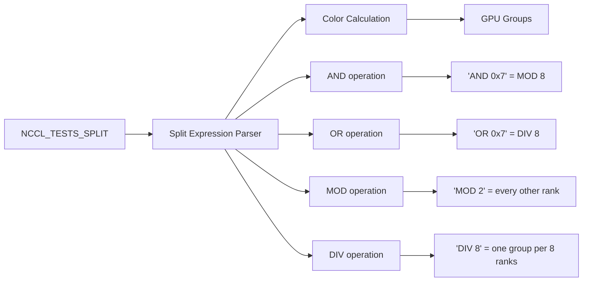
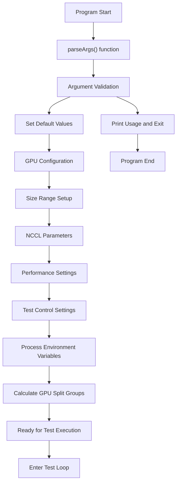

<!-- source: DeepWiki mcp.deepwiki.com · repo NVIDIA/nccl-tests · page 1.2 Command Line Arguments · fetched 2026-10-26 -->

# Command Line Arguments

<details>
<summary>Relevant source files</summary>

The following files were used as context for generating this wiki page:

- [README.md](README.md)
- [doc/PERFORMANCE.md](doc/PERFORMANCE.md)
- [src/common.cu](src/common.cu)

</details>


This page provides a comprehensive reference for all command-line arguments supported by NCCL Tests performance binaries. These arguments control test execution parameters, data sizes, NCCL operation settings, and performance measurement options.

For information about building the test binaries, see [Installation and Build](#1.1). For details about the test execution framework that processes these arguments, see [Test Execution Flow](#2.2).

## Overview

All NCCL Tests performance binaries (`all_reduce_perf`, `broadcast_perf`, etc.) support a common set of command-line arguments organized into five main categories:

- **GPU Configuration**: Number of threads and GPUs per test
- **Data Size Control**: Size ranges and increment patterns for testing
- **NCCL Operation Parameters**: Operation type, data type, and root rank settings
- **Performance Measurement**: Iteration counts, timing options, and aggregation settings
- **Test Execution Control**: Initialization modes, correctness checking, and advanced features

## Argument Categories and Parsing Flow

```mermaid
graph TD
    CLI["Command Line Arguments"] --> Parser["parseArgs() in common.cu"]
    
    Parser --> GPU["GPU Configuration"]
    Parser --> Sizes["Data Size Control"]
    Parser --> NCCL["NCCL Operations"]
    Parser --> Perf["Performance Measurement"]
    Parser --> Test["Test Execution"]
    
    GPU --> nthreads["-t, --nthreads"]
    GPU --> ngpus["-g, --ngpus"]
    
    Sizes --> minbytes["-b, --minbytes"]
    Sizes --> maxbytes["-e, --maxbytes"]
    Sizes --> stepbytes["-i, --stepbytes"]
    Sizes --> stepfactor["-f, --stepfactor"]
    
    NCCL --> op["-o, --op"]
    NCCL --> datatype["-d, --datatype"]
    NCCL --> root["-r, --root"]
    
    Perf --> iters["-n, --iters"]
    Perf --> warmup["-w, --warmup_iters"]
    Perf --> agg["-m, --agg_iters"]
    Perf --> cycles["-N, --run_cycles"]
    Perf --> average["-a, --average"]
    
    Test --> parallel_init["-p, --parallel_init"]
    Test --> check["-c, --check"]
    Test --> blocking["-z, --blocking"]
    Test --> cudagraph["-G, --cudagraph"]
    Test --> cputime["-C, --report_cputime"]
    Test --> register["-R, --local_register"]
    Test --> timeout["-T, --timeout"]
```



Sources: [README.md:52-83]()

## GPU Configuration Arguments

These arguments control the distribution of GPUs across processes and threads for multi-GPU testing.

| Argument | Default | Description |
|----------|---------|-------------|
| `-t, --nthreads <num>` | 1 | Number of threads per process |
| `-g, --ngpus <num>` | 1 | Number of GPUs per thread |

The total number of NCCL ranks equals: `(MPI processes) × (threads per process) × (GPUs per thread)`

**Example**: On a single node with 8 GPUs:
```bash
./build/all_reduce_perf -g 8  # Single thread, 8 GPUs
```

Sources: [README.md:56-58]()

## Data Size Control Arguments

These arguments define the range of data sizes to test and how to increment between sizes.

| Argument | Default | Description |
|----------|---------|-------------|
| `-b, --minbytes <size>` | 32M | Minimum size to start with |
| `-e, --maxbytes <size>` | 32M | Maximum size to end at |
| `-i, --stepbytes <size>` | 1M | Fixed increment between sizes |
| `-f, --stepfactor <factor>` | disabled | Multiplication factor between sizes |

**Size Format**: Supports suffixes like `K` (1024), `M` (1024²), `G` (1024³)

**Increment Modes**: Only one of `stepbytes` or `stepfactor` should be used:
- **Fixed increment**: `-i 1M` adds 1MB between each test size
- **Multiplicative**: `-f 2` doubles the size for each test

**Example**: Scan from 8 bytes to 128MB, doubling each time:
```bash
./build/all_reduce_perf -b 8 -e 128M -f 2
```

Sources: [README.md:59-64]()

## NCCL Operation Arguments

These arguments configure the specific NCCL operation parameters.

| Argument | Default | Values | Description |
|----------|---------|--------|-------------|
| `-o, --op <operation>` | sum | `sum/prod/min/max/avg/all` | Reduction operation for AllReduce, Reduce, ReduceScatter |
| `-d, --datatype <type>` | float | `nccltype/all` | NCCL data type |
| `-r, --root <rank>` | 0 | `rank/all` | Root rank for Broadcast, Reduce operations |

**Operation Types**: Only applies to reduction collectives (AllReduce, Reduce, ReduceScatter)
**Data Types**: Standard NCCL types like `float`, `int`, `half`, etc.
**Root Selection**: For operations with a root rank, can test specific rank or all ranks

Sources: [README.md:65-68]()

## Performance Measurement Arguments

These arguments control timing, iteration counts, and performance reporting.

| Argument | Default | Description |
|----------|---------|-------------|
| `-n, --iters <count>` | 20 | Number of timed iterations |
| `-w, --warmup_iters <count>` | 1 | Number of warmup iterations (not timed) |
| `-m, --agg_iters <count>` | 1 | Operations to aggregate per iteration |
| `-N, --run_cycles <count>` | 1 | Run and print each cycle (0=infinite) |
| `-a, --average <mode>` | 1 | Performance averaging mode (MPI only) |

**Averaging Modes** (for MPI builds):
- `0`: Report rank 0 performance only
- `1`: Report average across all ranks
- `2`: Report minimum across all ranks  
- `3`: Report maximum across all ranks

Sources: [README.md:69-74]()

## Test Execution Control Arguments

These arguments control advanced test execution features and debugging options.

| Argument | Default | Description |
|----------|---------|-------------|
| `-p, --parallel_init <0/1>` | 0 | Use threads for parallel NCCL initialization |
| `-c, --check <count>` | 1 | Perform correctness checking iterations |
| `-z, --blocking <0/1>` | 0 | Make NCCL collectives blocking (CPU sync) |
| `-G, --cudagraph <count>` | 0 | Capture as CUDA graph and replay count times |
| `-C, --report_cputime <0/1>` | 0 | Report CPU time instead of GPU latency |
| `-R, --local_register <mode>` | 0 | Buffer registration: 0=none, 1=local, 2=symmetric |
| `-T, --timeout <seconds>` | disabled | Timeout for each test |

**Key Features**:
- **Parallel Init**: Reduces NCCL initialization time with many GPUs
- **Correctness Checking**: Validates results using the verifiable library (see [Data Verification System](#6))
- **CUDA Graphs**: Captures communication pattern for repeated execution
- **Buffer Registration**: Optimizes memory access for send/receive operations

Sources: [README.md:75-82]()

## Environment Variables

NCCL Tests also support environment variables that affect test execution behavior.

### GPU Partitioning with NCCL_TESTS_SPLIT

The `NCCL_TESTS_SPLIT` environment variable partitions GPUs into smaller groups running the same operation in parallel.



**Syntax**: `<operation><value>` where operation is `AND`, `OR`, `MOD`, `DIV` (or symbols `&`, `|`, `%`, `/`)

**Value Formats**: Decimal, hexadecimal (`0x`), or binary (`0b`)

**Examples**:
- `NCCL_TESTS_SPLIT="MOD 8"`: 8 parallel operations, 1 GPU each
- `NCCL_TESTS_SPLIT="DIV 8"`: 1 operation per 8 GPUs
- `NCCL_TESTS_SPLIT="AND 0x1"`: 2 operations, alternating ranks

**Alternative Syntax**: `NCCL_TESTS_SPLIT_MASK="<value>"` equals `NCCL_TESTS_SPLIT="&<value>"`

Sources: [README.md:84-102]()

## Argument Processing Flow



Sources: [README.md:52-83]()

## Common Usage Patterns

### Single Node Multi-GPU Testing
```bash
# Test 8 GPUs on single node, scanning sizes with factor 2
./build/all_reduce_perf -g 8 -b 8 -e 128M -f 2
```

### Multi-Node MPI Testing
```bash
# 64 MPI processes, 8 nodes, 1 GPU per process
mpirun -np 64 -N 8 ./build/all_reduce_perf -b 8 -e 8G -f 2 -g 1
```

### Correctness Checking
```bash
# Run with correctness verification on each iteration
./build/all_reduce_perf -g 4 -c 5 -b 1M -e 1M
```

### Performance Profiling
```bash
# Detailed timing with more iterations and warmup
./build/all_reduce_perf -g 8 -n 100 -w 10 -m 5 -b 32M -e 32M
```

Sources: [README.md:35-46]()

---

