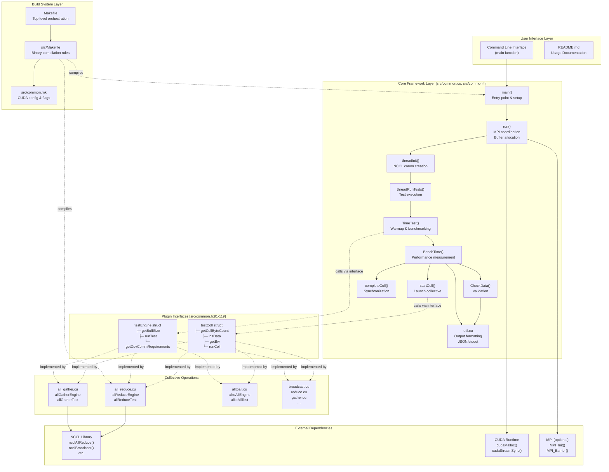
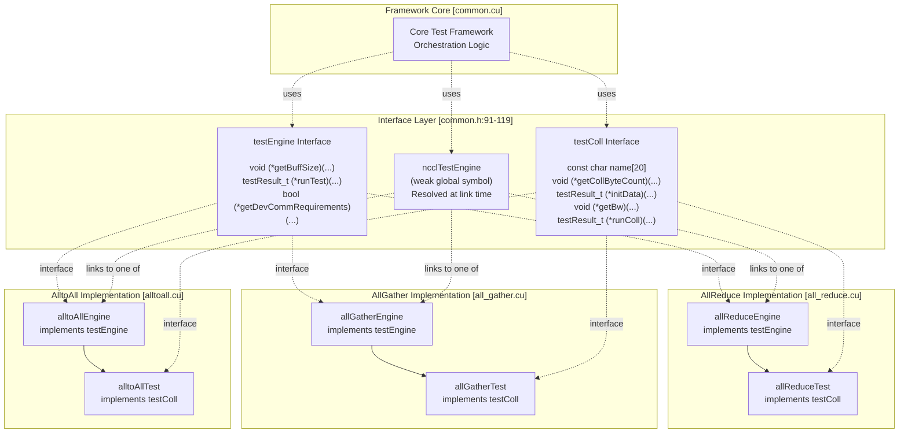
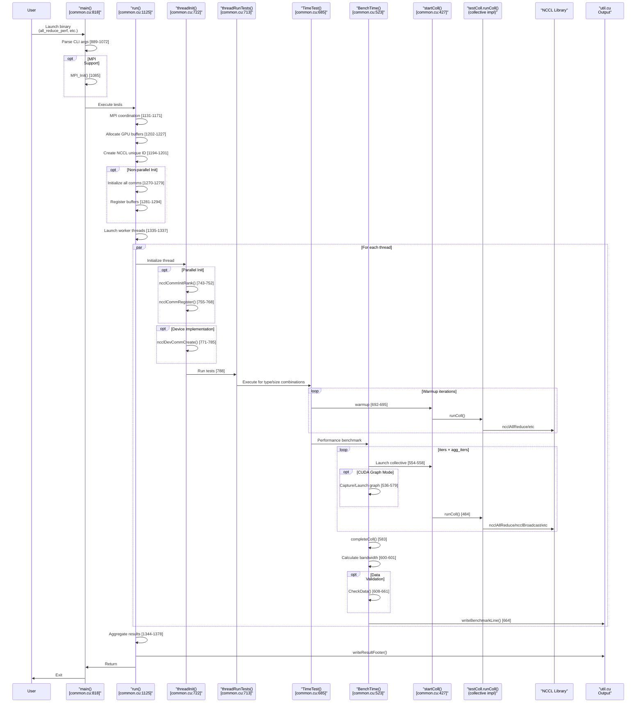
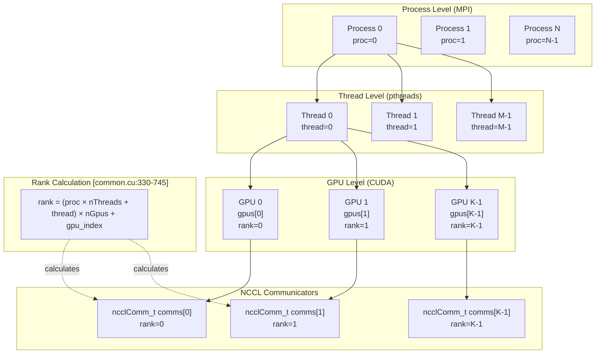
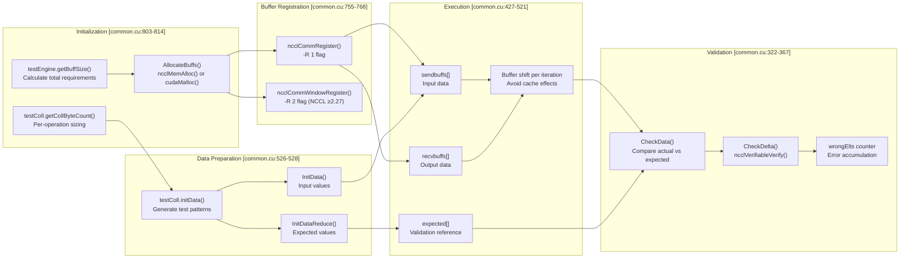
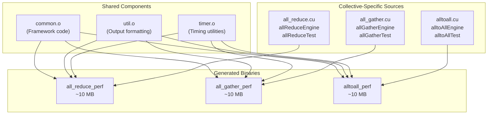

<!-- source: DeepWiki mcp.deepwiki.com · repo NVIDIA/nccl-tests · page 1.3 System Architecture · fetched 2026-10-26 -->

# System Architecture

<details>
<summary>Relevant source files</summary>

The following files were used as context for generating this wiki page:

- [README.md](README.md)
- [doc/PERFORMANCE.md](doc/PERFORMANCE.md)
- [src/common.cu](src/common.cu)
- [src/common.h](src/common.h)

</details>


## Purpose and Scope

This page provides a high-level architectural overview of the NCCL Tests system, documenting how the major components interact to enable benchmarking and validation of NCCL collective operations. It maps the conceptual architecture to specific code entities (files, classes, interfaces) to bridge understanding between system design and implementation.

For detailed information about specific subsystems, see:
- Build infrastructure: [Build System](#5)
- Test execution details: [Core Testing Framework](#2)
- Individual collectives: [Collective Operations](#3)
- CUDA optimizations: [Advanced CUDA Features](#4)

Sources: [Diagram 1: Overall System Architecture]()

---

## Architectural Overview

The NCCL Tests system is organized into four major layers that work together to execute performance benchmarks and correctness validation:

| Layer | Primary Components | Responsibility |
|-------|-------------------|----------------|
| **User Interface** | README.md, CLI parsing | Command-line argument processing, documentation |
| **Build System** | Makefile, src/Makefile, src/common.mk | Per-collective binary generation, dependency management |
| **Core Framework** | src/common.cu, src/common.h, src/util.cu | Test orchestration, timing, validation, output |
| **Collective Operations** | *_perf.cu files (all_reduce.cu, etc.) | NCCL collective implementations and test logic |

The architecture uses a **plugin pattern** where each collective operation (AllReduce, AllGather, etc.) implements standard interfaces defined by the core framework. This allows the framework to orchestrate tests uniformly across all collective types while generating separate binaries for each operation.

Sources: [src/common.cu:1-1103](), [src/common.h:1-358](), [README.md:1-109]()

---

## System Component Diagram



**Key architectural features:**

1. **Core Framework** ([src/common.cu:1-1103]()) contains the main execution pipeline (`main()` → `run()` → `threadInit()` → `threadRunTests()`)
2. **Plugin Interfaces** ([src/common.h:91-119]()) define contracts that collectives must implement: `testColl` for operation-specific logic and `testEngine` for buffer management
3. **Weak Symbol Resolution** - A global `ncclTestEngine` symbol ([src/common.h:119]()) is weakly linked to point to the active collective's engine at link time
4. **Separation of Concerns** - Framework handles orchestration, timing, validation; collectives handle NCCL API calls and data layout

Sources: [src/common.cu:818-1103](), [src/common.h:91-119]()

---

## Plugin Interface Architecture

The test framework uses a dual-interface plugin pattern to achieve uniformity across different collective operations:



### Interface Responsibilities

**`testColl` struct** ([src/common.h:91-102]()):
- `getCollByteCount()` - Calculate send/recv buffer sizes and in-place offsets
- `initData()` - Initialize test data patterns
- `getBw()` - Compute algorithm and bus bandwidth from timing results
- `runColl()` - Execute the NCCL collective operation (ncclAllReduce, ncclBroadcast, etc.)

**`testEngine` struct** ([src/common.h:110-117]()):
- `getBuffSize()` - Determine total buffer allocation requirements
- `runTest()` - Execute full test suite across data types and sizes
- `getDevCommRequirements()` - Specify device communicator needs (NCCL ≥2.28.0)

**Weak Symbol Mechanism** ([src/common.h:119]()):
The global `ncclTestEngine` symbol is declared as weak, allowing each binary to contain only one collective's implementation. At link time, the linker resolves this symbol to the specific engine (e.g., `allReduceEngine`) included in that binary, enabling code reuse of the entire framework.

Sources: [src/common.h:91-119]()

---

## Test Execution Pipeline

The following diagram shows the complete execution flow from program launch to result output:



**Execution phases:**

1. **Initialization** ([src/common.cu:818-1086]()) - Parse arguments, initialize MPI if enabled
2. **Resource Setup** ([src/common.cu:1125-1227]()) - Allocate GPU buffers, create NCCL communicators
3. **Thread Launch** ([src/common.cu:1335-1337]()) - Spawn worker threads for parallel execution
4. **Warmup** ([src/common.cu:689-696]()) - Execute operations without timing to establish P2P connections
5. **Benchmarking** ([src/common.cu:551-587]()) - Timed execution over multiple iterations
6. **Validation** ([src/common.cu:608-661]()) - Optional correctness checking via `CheckData()`
7. **Reporting** (util.cu) - Output performance metrics in JSON and/or table format

Sources: [src/common.cu:818-1103](), [src/common.cu:427-521](), [src/common.cu:523-669](), [src/common.cu:685-711]()

---

## Multi-Level Parallelism Architecture

The system supports three levels of parallelism to scale testing across large GPU clusters:



### Parallelism Configuration

**Process-level** (Optional, requires MPI):
- Configured via `mpirun -np <count>`
- Enables multi-node execution
- MPI communicator created in `run()` ([src/common.cu:1131-1171]())
- Rank 0 broadcasts `ncclUniqueId` ([src/common.cu:1194-1201]())

**Thread-level**:
- Configured via `-t, --nthreads <num>` argument ([src/common.cu:895]())
- Each thread manages a subset of GPUs
- Thread data stored in `threadArgs` struct ([src/common.h:121-162]())
- Launched via `pthread_create()` ([src/common.cu:1335-1337]())

**GPU-level**:
- Configured via `-g, --ngpus <num>` argument ([src/common.cu:898]())
- Each GPU has its own NCCL communicator
- GPU selection: `gpu_index = (localRank × nThreads × nGpus) + thread × nGpus + i` ([src/common.cu:1214]())

**Rank Calculation Formula** ([src/common.cu:330-745]()):
```c
int rank = ((args->proc * args->nThreads + args->thread) * args->nGpus + i);
```

This formula ensures each GPU receives a unique global rank across all processes, threads, and local GPUs.

### GPU Partitioning (NCCL_TESTS_SPLIT)

The system supports partitioning ranks into independent groups for topology-specific testing:

**Environment Variable** ([src/common.cu:1142-1166]()):
- `NCCL_TESTS_SPLIT="<operation><value>"` where operation is AND/OR/MOD/DIV
- `NCCL_TESTS_SPLIT_MASK="<value>"` equivalent to `AND <value>`

**Examples:**
- `NCCL_TESTS_SPLIT="MOD 8"` - Create 8 groups, each using every 8th rank
- `NCCL_TESTS_SPLIT="DIV 8"` - Create one group per node (8 GPUs/node)
- `NCCL_TESTS_SPLIT="AND 0x1"` - Create 2 groups using alternating ranks

**Implementation:**
- Color calculation: `color = proc <operator> value` ([src/common.cu:1144-1165]())
- MPI communicator split: `MPI_Comm_split(MPI_COMM_WORLD, color, proc, &mpi_comm)` ([src/common.cu:1169]())

Sources: [src/common.cu:1125-1227](), [src/common.h:121-162](), [src/common.cu:1142-1166](), [README.md:87-104]()

---

## Data Flow and Memory Management



### Buffer Management

**Allocation** ([src/common.cu:803-814]()):
- Uses `ncclMemAlloc()` (NCCL ≥2.19) or falls back to `cudaMalloc()`
- Three buffers per GPU: `sendbuff`, `recvbuff`, `expected` (if validation enabled)
- Size calculation: `(maxMem - reserveMem - 1GB) / (datacheck ? 3 : 2)` ([src/common.cu:1187]())

**Registration** ([src/common.cu:755-768](), [src/common.cu:1281-1294]()):
- Local registration (`-R 1`): `ncclCommRegister()` for RDMA optimization
- Symmetric registration (`-R 2`): `ncclCommWindowRegister()` for device-side operations (NCCL ≥2.27)

**Per-Iteration Offset** ([src/common.cu:430-433]()):
- Shifts buffer offset each iteration: `shift = totalnbytes × (iter % steps)`
- Prevents cache effects and tests ptrExchange robustness

**Data Patterns** ([src/common.cu:226-234]()):
- `InitData()` generates rank-specific input patterns via `ncclVerifiablePrepareInput()`
- `InitDataReduce()` computes expected reduction results via `ncclVerifiablePrepareExpected()`

### Validation System

**Correctness Checking** ([src/common.cu:322-367]()):
1. Execute collective operation
2. Compare `recvbuff` against `expected` buffer
3. Use `CheckDelta()` → `ncclVerifiableVerify()` for element-wise comparison
4. Accumulate `wrongElts` counter across all GPUs
5. Aggregate errors across all ranks via `Allreduce()` ([src/common.cu:656-659]())

**Validation Frequency**:
- Controlled by `-c, --check <count>` argument
- Default: 1 validation iteration after each benchmark
- Set to 0 to disable validation entirely

Sources: [src/common.cu:803-814](), [src/common.cu:322-367](), [src/common.cu:226-234](), [src/common.cu:427-433]()

---

## Binary Generation Strategy

The build system generates **one binary per collective operation** rather than a single monolithic binary:



**Rationale:**
- **Reduced binary size**: ~10 MB per binary vs. ~100 MB for monolithic
- **Faster linking**: Parallel compilation of multiple binaries
- **Weak symbol resolution**: `ncclTestEngine` points to exactly one collective's engine per binary

**Build Targets** (see [Build System](#5)):
- `all_reduce_perf`
- `all_gather_perf`
- `alltoall_perf`
- `broadcast_perf`
- `reduce_perf`
- `reduce_scatter_perf`
- `gather_perf`
- `scatter_perf`
- `sendrecv_perf`
- `hypercube_perf`

Sources: [Diagram 4: Build System and Binary Generation](), [src/Makefile]()

---

## Thread Synchronization Mechanisms

The framework provides synchronization primitives for coordinating multiple threads and processes:

### Barrier Function

**`Barrier(struct threadArgs* args)`** ([src/common.cu:236-261]()):
- Implements process-local pthread barrier
- Last thread (highest thread ID) performs MPI_Barrier if MPI enabled
- Uses epoch-based double buffering to allow repeated barrier crossings
- Static variables persist across calls: `lock[2]`, `cond[2]`, `counter[2]`

```c
// Simplified logic:
pthread_mutex_lock(&lock[epoch]);
if (++counter[epoch] == nThreads) {
    pthread_cond_broadcast(&cond[epoch]);
    if (last_thread) MPI_Barrier(MPI_COMM_WORLD);
    counter[epoch] = 0;
}
pthread_mutex_unlock(&lock[epoch]);
epoch ^= 1;  // Toggle between 0 and 1
```

### Allreduce Function

**`Allreduce<T>(struct threadArgs* args, T* value, int average)`** ([src/common.cu:266-320]()):
- Thread-local reduction with optional MPI cross-process reduction
- Supports multiple reduction modes: RANK0 (0), AVG (1), MIN (2), MAX (3), SUM (4)
- Used for aggregating timing measurements and error counts
- Same epoch-based double buffering as `Barrier()`

**Usage example** ([src/common.cu:588]()):
```c
Allreduce(args, &deltaSec, average);  // Aggregate timing across all ranks
```

Sources: [src/common.cu:236-320]()

---

## Key Data Structures

### `struct threadArgs`

**Definition** ([src/common.h:121-162]()):
Encapsulates all per-thread state for test execution.

| Field | Type | Purpose |
|-------|------|---------|
| `nbytes` | size_t | Current test size in bytes |
| `minbytes`, `maxbytes` | size_t | Size range for testing |
| `stepbytes`, `stepfactor` | size_t | Size iteration strategy |
| `totalProcs`, `nProcs`, `proc` | int | Process-level parallelism |
| `nThreads`, `thread` | int | Thread-level parallelism |
| `nGpus`, `gpus[]` | int, int* | GPU configuration |
| `sendbuffs`, `recvbuffs`, `expected` | void** | GPU memory buffers |
| `comms[]` | ncclComm_t* | NCCL communicators (one per GPU) |
| `streams[]` | cudaStream_t* | CUDA streams (one per GPU) |
| `collTest` | struct testColl* | Pointer to collective implementation |
| `devComms[]` | ncclDevComm* | Device communicators (NCCL ≥2.28) |
| `sendRegHandles[]`, `recvRegHandles[]` | void** | Memory registration handles (NCCL ≥2.19) |

**Allocation pattern** ([src/common.cu:1318-1332]()):
```c
struct testThread threads[nThreads];
for (int t = 0; t < nThreads; t++) {
    threads[t].func = parallel_init ? threadInit : threadRunTests;
    threads[t].args.thread = t;
    threads[t].args.nGpus = nGpus;
    threads[t].args.gpus = gpus + t*nGpus;
    threads[t].args.comms = comms + t*nGpus;
    // ... more initialization
}
```

### `struct testThread`

**Definition** ([src/common.h:165-170]()):
Wrapper for pthread execution of test threads.

| Field | Type | Purpose |
|-------|------|---------|
| `thread` | pthread_t | POSIX thread handle |
| `func` | threadFunc_t | Entry function (`threadInit` or `threadRunTests`) |
| `args` | struct threadArgs | Per-thread arguments |
| `ret` | testResult_t | Thread return status |

Sources: [src/common.h:121-170](), [src/common.cu:1318-1342]()

---

## Summary

The NCCL Tests architecture achieves flexibility and scalability through:

1. **Plugin-based design** - Uniform interfaces (`testColl`, `testEngine`) allow framework code reuse across all collective operations
2. **Multi-level parallelism** - Process/thread/GPU hierarchy scales from single GPU to thousands of GPUs across multiple nodes
3. **Modular build system** - Per-collective binaries reduce size and enable parallel compilation
4. **Separation of concerns** - Framework handles orchestration, collectives handle NCCL operations
5. **Weak symbol mechanism** - Link-time resolution enables selective inclusion of collective implementations

The core execution path flows through these functions:
- `main()` → `run()` → `threadInit()` → `threadRunTests()` → `TimeTest()` → `BenchTime()` → `startColl()` → `testColl.runColl()`

For detailed documentation of each subsystem, see the child pages under [Core Testing Framework](#2), [Collective Operations](#3), [Advanced CUDA Features](#4), and [Build System](#5).

Sources: [src/common.cu:1-1103](), [src/common.h:1-358](), [README.md:1-109]()

---

