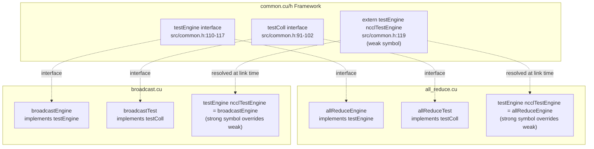
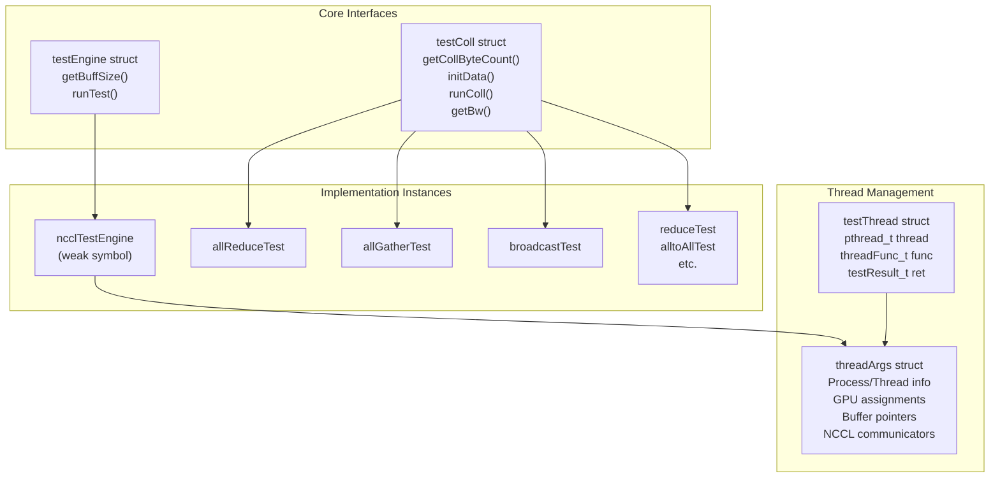
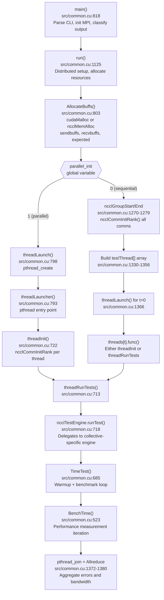
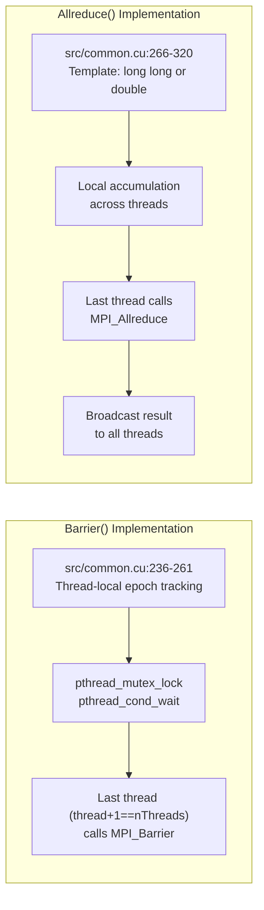
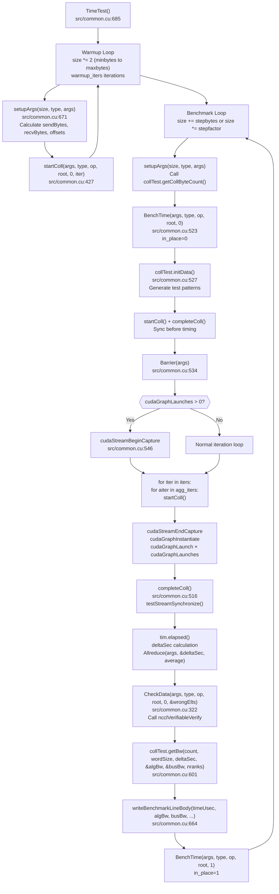
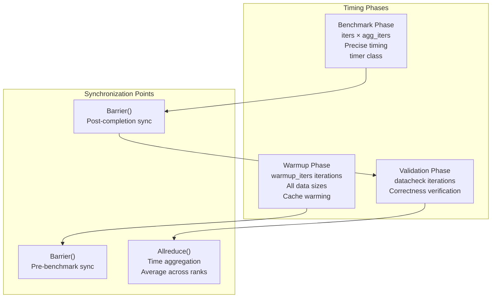
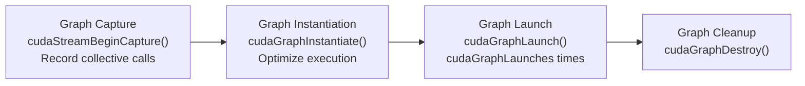

<!-- source: DeepWiki mcp.deepwiki.com · repo NVIDIA/nccl-tests · page 2 Core Testing Framework · fetched 2026-10-26 -->

# Core Testing Framework

<details>
<summary>Relevant source files</summary>

The following files were used as context for generating this wiki page:

- [src/common.cu](src/common.cu)
- [src/common.h](src/common.h)

</details>


The Core Testing Framework is the central test orchestration system implemented primarily in [src/common.cu]() and [src/common.h](). It provides infrastructure for executing NCCL collective operation tests across distributed processes, multiple threads per process, and multiple GPUs per thread. The framework implements a plugin architecture where collective operations register themselves via the `testEngine` and `testColl` interfaces, enabling uniform testing across all collective types.

The framework's main responsibilities include:
- Multi-level parallelism management (MPI processes, pthreads, CUDA streams)
- NCCL communicator lifecycle (initialization, registration, destruction)
- Test execution orchestration (warmup, benchmark, validation)
- Performance measurement (timing, bandwidth calculation, result aggregation)
- Distributed synchronization (barriers, allreduce for result collection)

For details on specific collective implementations, see [Collective Operations](#3). For build infrastructure, see [Build System](#5).
</old_str>

<old_str>
### Thread Arguments Structure

The `threadArgs` structure ([src/common.h:121-162]()) serves as the central data container passed to all test functions:

**Field Categories in `threadArgs`**

| Category | Fields | Purpose |
|----------|--------|---------|
| **Size Configuration** | `nbytes`, `minbytes`, `maxbytes`, `stepbytes`, `stepfactor`, `sendBytes`, `expectedBytes` | Control test data sizes and iteration stepping |
| **Process Topology** | `totalProcs`, `nProcs`, `proc`, `nThreads`, `thread`, `nGpus`, `localRank` | Define distributed execution hierarchy |
| **GPU Resources** | `gpus[]`, `streams[]`, `sendbuffs[]`, `recvbuffs[]`, `expected[]` | Per-GPU CUDA resources |
| **NCCL Resources** | `ncclId`, `comms[]`, `devComms[]` (≥2.28), `sendRegHandles[]`, `recvRegHandles[]` (≥2.19) | NCCL communicators and registered memory handles |
| **Collective Interface** | `collTest` (pointer to `testColl`) | Reference to active collective implementation |
| **Result Collection** | `errors[]`, `bw[]`, `bw_count[]`, `reportErrors` | Aggregate error counts and bandwidth measurements |

**Rank Calculation Formula**

The global NCCL rank for each GPU is computed as:
```
rank = (proc × nThreads + thread) × nGpus + gpu_index
```

This formula enables hierarchical parallelism where MPI processes contain threads, and threads manage multiple GPUs.

**Sources:** [src/common.h:121-162](), [src/common.cu:330](), [src/common.cu:440](), [src/common.cu:745]()
</old_str>
<new_str>
### Core Interfaces

The framework defines two primary interfaces in [src/common.h:91-117]() that enable modular collective operation testing:

**Interface: `testEngine` Structure**

| Method | Purpose |
|--------|---------|
| `getBuffSize(size_t *sendcount, size_t *recvcount, size_t count, int nranks)` | Calculate required buffer sizes for send/recv operations |
| `runTest(threadArgs* args, int root, ncclDataType_t type, const char* typeName, ncclRedOp_t op, const char* opName)` | Execute test for given data type and operation |
| `getDevCommRequirements(int deviceImpl, ncclDevCommRequirements* reqs)` | Specify device communicator requirements (NCCL ≥2.28) |

**Interface: `testColl` Structure**

| Method | Purpose |
|--------|---------|
| `getCollByteCount(size_t *sendcount, size_t *recvcount, size_t *paramcount, ...)` | Compute element counts for send/recv buffers per collective |
| `initData(threadArgs* args, ncclDataType_t type, ncclRedOp_t op, int root, int rep, int in_place)` | Initialize test data with deterministic patterns |
| `runColl(void* sendbuff, size_t sendoffset, void* recvbuff, size_t recvoffset, ...)` | Execute the collective operation |
| `getBw(size_t count, int typesize, double sec, double* algBw, double* busBw, int nranks)` | Calculate algorithmic and bus bandwidth |

**Plugin Architecture via Weak Symbol**



The weak symbol mechanism allows the framework to reference `ncclTestEngine` without knowing which collective is linked. Each collective binary (e.g., `all_reduce_perf`, `broadcast_perf`) provides a strong symbol that overrides the weak declaration, selecting the appropriate implementation at link time.

**Sources:** [src/common.h:91-119](), [src/common.cu:119]()

## Architecture

The framework is built around a plugin-style architecture that separates the generic testing infrastructure from specific collective operation implementations.

### Core Interfaces

The framework defines two primary interfaces that enable modular collective operation testing:



The `testEngine` interface ([src/common.h:108-112]()) provides buffer sizing and test execution, while `testColl` ([src/common.h:89-100]()) defines the collective-specific operations including data initialization, execution, and bandwidth calculation.

**Sources:** [src/common.h:89-112](), [src/common.cu:114]()

### Error Handling System

The framework implements a comprehensive error handling system with specialized result types and propagation macros:

| Error Type | Value | Purpose |
|------------|-------|---------|
| `testSuccess` | 0 | Successful execution |
| `testInternalError` | 1 | Framework internal failure |
| `testCudaError` | 2 | CUDA API failure |
| `testNcclError` | 3 | NCCL API failure |
| `testTimeout` | 4 | Operation timeout |
| `testNotImplemented` | 5 | Feature not available |

The `TESTCHECK`, `CUDACHECK`, and `NCCLCHECK` macros ([src/common.h:26-64]()) provide automatic error propagation with hostname and location information for debugging distributed test failures.

**Sources:** [src/common.h:66-87]()

## Test Execution Flow

The framework orchestrates test execution through a multi-stage pipeline implemented across several key functions.

### Main Execution Pipeline

**Function Call Hierarchy**



**Key Function Responsibilities**

| Function | Location | Primary Responsibility |
|----------|----------|----------------------|
| `main()` | [src/common.cu:818-1103]() | Parse command-line arguments using `getopt_long`, initialize MPI (if enabled), classify output file type |
| `run()` | [src/common.cu:1125-1438]() | Allocate GPU buffers, initialize NCCL communicators, launch threads, collect results |
| `AllocateBuffs()` | [src/common.cu:803-814]() | Allocate GPU memory via `cudaMalloc` (NCCL <2.19) or `ncclMemAlloc` (NCCL ≥2.19) |
| `threadLauncher()` | [src/common.cu:793-797]() | Pthread entry point that invokes `thread->func(&thread->args)` |
| `threadInit()` | [src/common.cu:722-791]() | Per-thread NCCL communicator initialization via `ncclCommInitRank`, then calls `threadRunTests()` |
| `threadRunTests()` | [src/common.cu:713-720]() | Set CUDA device and invoke `ncclTestEngine.runTest()` |

**Sources:** [src/common.cu:818-1103](), [src/common.cu:1125-1438](), [src/common.cu:713-814]()

### Thread Management and Synchronization

**Sequential vs Parallel Initialization**

The framework supports two NCCL initialization modes controlled by the `parallel_init` global variable ([src/common.cu:94]()):

| Mode | Description | Communicator Creation | Use Case |
|------|-------------|----------------------|----------|
| **Sequential** (`parallel_init=0`) | Main thread creates all communicators before launching worker threads | [src/common.cu:1270-1279]() via `ncclGroupStart/ncclCommInitRank/ncclGroupEnd` | Default mode, simpler debugging |
| **Parallel** (`parallel_init=1`) | Each worker thread creates its own communicators | [src/common.cu:743-753]() within `threadInit()` | Faster initialization for many GPUs |

**Thread Synchronization Primitives**



**Barrier() Function** ([src/common.cu:236-261]())
- Uses double-buffered epochs to avoid race conditions
- Last thread in each process performs `MPI_Barrier` (if MPI enabled)
- Ensures all threads and processes reach synchronization point

**Allreduce<T>() Function** ([src/common.cu:266-320]())
- Template supporting `long long` and `double` types
- Supports multiple reduction operations: rank0 broadcast, average, min, max, sum
- Used for aggregating timing results (`deltaSec`) and error counts (`wrongElts`)

**Sources:** [src/common.cu:236-320](), [src/common.cu:588](), [src/common.cu:658]()

### Collective Operation Orchestration

**Benchmark Iteration Flow**



**Key Functions in Orchestration**

| Function | Location | Purpose |
|----------|----------|---------|
| `setupArgs()` | [src/common.cu:671-683]() | Calls `collTest->getCollByteCount()` to compute send/recv buffer sizes and in-place offsets |
| `startColl()` | [src/common.cu:427-514]() | Issues collective operation via `collTest->runColl()`, handles NCCL group operations, supports device kernels |
| `completeColl()` | [src/common.cu:516-521]() | Calls `testStreamSynchronize()` to wait for CUDA streams with timeout and async error checking |
| `testStreamSynchronize()` | [src/common.cu:369-425]() | Polls `cudaStreamQuery()` and `ncclCommGetAsyncError()` with timeout support |

**In-Place Offset Calculation**

For in-place collectives, send and receive buffers overlap with rank-specific offsets:
```c
void* data = in_place ? ((void*)((uintptr_t)recvbuff + recvInplaceOffset * rank)) : recvbuff;
```
([src/common.cu:332]())

**Sources:** [src/common.cu:427-521](), [src/common.cu:523-669](), [src/common.cu:671-683](), [src/common.cu:685-711]()

### Collective Operation Orchestration

Test execution follows a structured pattern for each collective operation:

```mermaid
graph LR
    setup["setupArgs()<br/>Calculate buffer sizes<br/>Based on collective type"] --> warm["Warmup Phase<br/>Multiple iterations<br/>All sizes (factor of 2)"]
    
    warm --> bench["Benchmark Phase<br/>BenchTime() loop<br/>Precise measurements"]
    
    bench --> start["startColl()<br/>Launch collective<br/>NCCL Group operations"]
    start --> complete["completeColl()<br/>testStreamSynchronize()<br/>Wait for completion"]
    
    complete --> validate["Data Validation<br/>CheckData()<br/>Compare with expected"]
    validate --> bandwidth["Bandwidth Calculation<br/>collTest.getBw()<br/>Algorithmic + Bus BW"]
```



The `startColl()` function ([src/common.cu:359-446]()) handles NCCL group operations and supports both standard NCCL calls and device implementation kernels. `completeColl()` ([src/common.cu:448-453]()) manages stream synchronization with timeout support.

**Sources:** [src/common.cu:359-453](), [src/common.cu:615-657]()

## Performance Measurement

The framework implements sophisticated timing and bandwidth measurement capabilities designed for accurate distributed performance analysis.

### Timing Methodology



The `BenchTime()` function ([src/common.cu:455-613]()) orchestrates performance measurement using the `timer` class for high-precision timing. Multiple aggregated iterations (`agg_iters`) are grouped within NCCL group operations to reduce launch overhead.

### Bandwidth Calculations

Each collective operation implements two bandwidth metrics through the `getBw()` method:

- **Algorithmic Bandwidth**: Data processed per unit time from the algorithm's perspective
- **Bus Bandwidth**: Actual data movement across interconnects, accounting for collective communication patterns

The framework supports different averaging modes controlled by the `average` parameter ([src/common.cu:104-105]()):
- `0`: Broadcast from rank 0
- `1`: Average across all ranks  
- `2`: Minimum across all ranks
- `3`: Maximum across all ranks

**Sources:** [src/common.cu:455-613](), [src/common.cu:198-252]()

### CUDA Graph Support

For NCCL versions ≥2.9 with CUDA ≥11.3, the framework supports CUDA graph capture and replay for reduced launch overhead:



Graph mode is controlled by the `cudaGraphLaunches` parameter and provides more accurate performance measurement by eliminating CPU launch overhead variations.

**Sources:** [src/common.cu:468-530](), [src/common.cu:544-583]()

---

